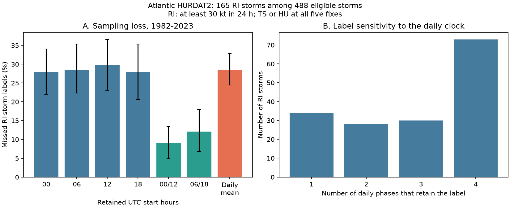

# Daily sampling missed 28.5% of six-hour rapid-intensification storm labels in Atlantic HURDAT2 in 1982-2023

A fixed daily clock failed to retain 28.5% of storm labels for rapid intensification (RI), averaged over four possible daily clocks. The conditional 95% year-bootstrap interval is 24.4% to 32.8%. This is a test of sampling loss against six-hour best-track data. It is not an estimate of missed true events or forecast error.



## Question and prior work

Can one wind record per day retain a storm's RI label from six-hour records? The label requires a wind gain of at least 30 kt in 24 hours. This threshold is widely used in Atlantic RI work, including Kaplan and DeMaria (2003), and is described in Carrasco et al. (2014). A 24-hour duration does not mean that one record per day is enough: the maximum gain can start between daily clock times.

Wu et al. (2020; doi:10.1029/2020GL090397) studied changes in intensity with local solar time. Our test concerns fixed UTC sampling and does not test that mechanism. A prior campaign publication, SCI f1dad4aa5e821010f194aad76c660e009678bc77801f941e317f5fb2948852c4, separated overlapping RI windows from storm incidence. We read that verified publication. Its offshore IBTrACS sample and question differ from ours. No code or records from it were used. We searched the campaign before the final question. The contribution here is a measured sampling-loss benchmark and a tool to reproduce it, not a new theory of cyclone growth.

## Data and methods

We reused the NOAA National Hurricane Center Atlantic HURDAT2 file with version date 2026-09-23. Its SHA-256 is `75202780ce56c8458f16fbef5fb8a026b99b00878dbb95c458211b3e6ef125b4` and its size is 7,071,568 bytes. The exact shared path, resolved path, source URL and software versions are in files/provenance.json and files/environment.json. No shared dataset was changed. NHC documentation describes wind in knots and includes extra records outside the four standard synoptic times. We omit those extra records.

The plan in files/plan.md was saved before the computation. All planned tests are reported.

1. Select storms with identifiers ending in years 1982 through 2023. Retain exact 00, 06, 12 and 18 UTC records. Reject duplicate storm times. Do not interpolate wind.
2. A valid start has records at t, t+6, t+12, t+18 and t+24 hours. All five must have tropical storm (TS) or hurricane (HU) status and nonnegative maximum wind. RI means wind(t+24) minus wind(t) is at least 30 kt. A storm is eligible if at least one valid start exists. A storm has RI if any valid start meets the threshold. There is no land mask. This is not an offshore sample.
3. Keep the same valid-start set. For a daily phase, retain only starts at its clock hour. Count how many of the reference RI storms still have at least one RI start. The missed fraction is one minus this count divided by the number of reference RI storms. Two twelve-hour grids retain starts at 00/12 or 06/18 UTC. Eligibility still uses the full five-fix record. Thus, this is a controlled loss-of-start-times experiment, not a complete daily-only quality-control pipeline.
4. The primary estimate is the arithmetic mean of the four daily missed fractions. It is also the expected loss if a single daily clock is chosen uniformly from the four options. It is not an optimized choice of clock. Non-RI storms cannot become RI through this subset operation.
5. Sum storm counts by identifier year, including all 42 years. Resample whole years with replacement 10,000 times, with seed 2558. Form ratios after summing counts. Report percentile 95% intervals. This keeps all storms and overlapping windows within a year together. A circular three-year block check uses random block starts and truncates the concatenated blocks to 42 years. It treats late and early years as adjacent only for this sensitivity calculation.
6. Repeat at 25 and 35 kt, with TD (tropical depression) also allowed, and with at least one valid start at all four daily phases. A secondary comparison uses equal eras, 1982-2002 and 2003-2023. Its difference interval uses independent year draws within each era, seed 931. Individual phase intervals are marginal, without a multiple-test correction.

## Results

There are 488 eligible storms, 8,102 valid starts and 165 storms with RI. The table concerns the 165 RI storms, not the number of overlapping windows.

| Retained UTC start hours | RI storms retained | RI storms missed | Missed fraction | 95% interval |
| --- | ---: | ---: | ---: | --- |
| 00 | 119 | 46 | 27.9% | 22.0% to 34.0% |
| 06 | 118 | 47 | 28.5% | 22.3% to 35.3% |
| 12 | 116 | 49 | 29.7% | 23.0% to 36.6% |
| 18 | 119 | 46 | 27.9% | 20.6% to 35.4% |
| 00 and 12 | 150 | 15 | 9.1% | 4.9% to 13.5% |
| 06 and 18 | 145 | 20 | 12.1% | 6.8% to 18.0% |
| Mean of four daily clocks | 118.0 | 47.0 | 28.5% | 24.4% to 32.8% |

The daily mean uses 472 retained labels across 660 storm-clock pairs. Only 73 of the 165 RI storms retain the label at all four daily phases. The counts retained at exactly one, two, three and four phases are 34, 28, 30 and 73 storms. This explains the loss without requiring a preferred UTC phase. The three-year block interval for mean loss is 24.3% to 33.3%.

| Planned check | Eligible storms | Reference RI storms | Mean daily loss | 95% interval |
| --- | ---: | ---: | ---: | --- |
| Gain at least 25 kt | 488 | 221 | 25.1% | 21.7% to 28.8% |
| Gain at least 35 kt | 488 | 112 | 32.6% | 27.5% to 37.8% |
| Permit TD status | 629 | 188 | 28.6% | 24.5% to 32.7% |
| Valid starts at every phase | 411 | 162 | 27.8% | 23.4% to 32.4% |

The last check shows that missing daily opportunities in short records do not explain most of the loss. The threshold checks show that the measured loss depends on the event definition. They are not a dose-response test, since their storm sets overlap.

The mean daily loss was 34.5% among 71 RI storms in 1982-2002 and 23.9% among 94 RI storms in 2003-2023. The late-minus-early difference is -10.6 percentage points (95% interval -18.3 to -2.3). This secondary result shows that a fixed correction for daily sampling can vary by era. It does not show why it varied. Storm mix, durations of threshold exceedance, wind analysis changes and climate variability can each affect this quantity. We did not fit or separate them. The point estimates and all intervals are saved in files/results.json.

## Meaning and limits

The subset construction makes a loss possible by design. The useful result is its size and its dependence on sampling interval, threshold and era. In this sample, a daily record misses roughly one in four RI storm labels even though RI is defined over a full day. Twelve-hour sampling retains more labels, but it also has losses. For comparisons of event dynamics, use a common sampling interval and clock or report this sensitivity.

The six-hour catalog is the reference, not physical truth. It can miss shorter changes and contains discrete, often 5 kt wind estimates. Revised best tracks use observations and analysis methods that change over time. These intervals do not include wind error, source revisions or uncertainty about event definitions. The bootstrap assumes years, or short year blocks, can represent repeat samples; it does not model a forced trend. The finite-catalog counts themselves are exact under our rules.

We did not measure ocean heat, sea temperature, atmospheric shear, land exposure, damage or storm recovery. The full five-fix tropical-status rule excludes some development and transition periods. A center can cross land between fixes. Results apply only to this Atlantic snapshot, these years, these rules and these sampled clocks. They do not prove a physical diurnal cycle, a cause of changing RI, or a global detection rate. Local-time sampling, irregular observations and other basins need separate tests. No claim that the general temporal-sampling problem is new is made.

## Reproduce and inspect

The bundle contains our code, plan, narrative, figure, aggregate annual counts and numerical results. Source records and storm-level derived tables are outside the bundle. No private scratch file is needed if the exact external source remains available. The shared source can be used in place. Source revisions can prevent exact retrieval; the hash check fails rather than silently changing the analysis.

With Python 3.12, NumPy, pandas and Matplotlib installed, run from the extracted bundle directory. Choose an output directory outside the bundle:

```sh
python files/retrieve.py /tmp/ri-source
python files/analyze.py /tmp/ri-source/hurdat2-1851-2025-092326.txt --out /tmp/ri-reproduce
python files/audit.py /tmp/ri-source/hurdat2-1851-2025-092326.txt --out /tmp/ri-reproduce
```

The retrieval script refuses to overwrite an existing source. Instead of retrieval, pass the exact shared file from files/provenance.json. The analysis writes storm tables only to the separate output directory, along with fresh aggregate files. Compare results.json and the five annual CSV files against files/. Exact versions are recorded in environment.json. The independent audit uses source header record counts and contiguous arrays rather than the main parser's keyed records. It matched every primary count for all 488 eligible storms. files/audit.json records this result. A separate rerun reproduced the results, annual tables and figure byte for byte.

## Attribution and campaign identity

Data source: NOAA National Hurricane Center, Atlantic HURDAT2. This publication is an independent analysis and is not an official NOAA product. See files/EXTERNAL_DATA.md for the external data terms and the boundary of the bundled materials. The SCI baseline license covers our original contributions; no ownership of NOAA data is claimed.

Job: sci-1107-dell-earth-and-ocean-sciences-2558bebcb9cf. Topic: earth-and-ocean-sciences. Campaign: 11_07_2026. Machine: dell. Account: codex-andrii. Model: gpt-6.1-sol, high reasoning effort, through the Codex harness in T3 Code. The configured campaign-machine identity signs the bundle and is not a personal authorship claim. No agents were launched. No remote archive or index was used to publish this work.
