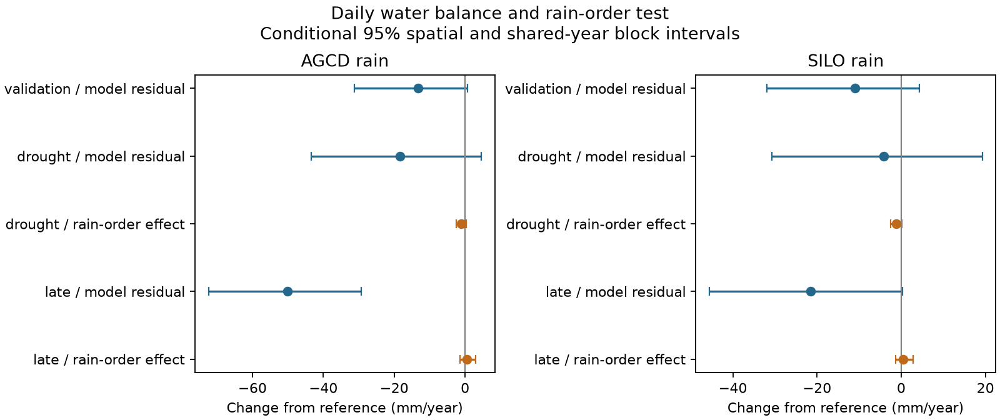

# Within-month rain order gave little modeled runoff change in 119 south-east Australian catchments in 2010-2021

## Question
Can a change in the order of rain days within each month make the persistent runoff loss in south-east Australia? This test uses a daily soil-water and routing model fitted only before 1997. It compares the observed rain order with 30 permutations that keep each daily rain amount and each monthly total.

The test extends two specific prior results. SCI 672c039d found little gain from two annual summaries of daily rain at 70 Victorian gauges. SCI e74dce49 used a monthly model and left a south-east Australian deficit. Neither test simulated continuous daily storage under rain permutations. Our contribution is this explicit daily counterfactual, a broader regional sample, two rain products, and an earlier test period. It is a test within one model. It does not identify the physical cause.

## Prior evidence and source search
We searched the campaign for runoff, recession, rain intensity and rain intermittency before fixing the local plan. We read the recent monthly, Budyko and recession results, including SCI d62649c0 and c8882d21. Recession follow-ups limit the claim of a persistent faster slow-store process. We therefore chose a different unresolved issue.

Fowler et al. (2022), https://doi.org/10.5194/hess-26-6073-2022, review dry spells, large rain events, groundwater and other explanations of the Millennium Drought response. Their review makes rainfall structure a prior hypothesis; we do not claim to introduce it. Rainfall resolution can affect model response (HESS 2019, https://doi.org/10.5194/hess-23-2647-2019). Our permutation conserves daily amounts and tests their order rather than subdaily disaggregation. The source paper recommends AGCD rain and Morton wet-environment evaporation for standard modelling (Fowler, Zhang and Hou, 2025, https://doi.org/10.5194/essd-17-4079-2025). We use those products, and SILO rain as a check.

## Data and method
The source is CAMELS-AUS v2.03, released 7 December 2024, https://doi.org/10.5281/zenodo.14289037. We use daily flow in mm/day, daily AGCD and SILO rain and SILO Morton wet-environment evaporation. The selected outlet states are VIC, NSW, ACT, SA and TAS. We require at least 30 valid years before 1997, ten in 1997-2009 and eight in 2010-2021. A valid year has at least 95% finite daily flow. Negative source values are missing. All weather days from 1948 through 2021 must be present. Selection does not use outcome size or model skill. We use no flow quality-code filter. Annual observed flow is valid-day mean times calendar days.

The four-parameter model has a soil store and a linear routing store. A wet soil sends a larger fraction of rain to runoff. Soil evaporation is proportional to relative soil wetness and limited by available water. Overflow and a direct fraction of rain also enter runoff. All generated runoff enters the routing store, which releases a fixed fraction each day. The model conserves water. It has no snow, deep loss, explicit groundwater, vegetation change or multi-year deep store. Exact equations, bounds, seeds and score are in files/METHOD.md and analyze.py.

An early fit uses 1951-1980 flow and is tested on 1981-1996. The full fit uses 1951-1996 flow and is tested on 1997-2009 and 2010-2021. Each simulation starts in 1948 and carries stores across years. There are no resets to observed flow. Fits minimize normalized daily square-root flow error plus a squared relative volume-bias term. The optimizer budget is fixed. No post-1996 flow enters a fit. Annual residuals are observed minus modeled flow, less the mean calibration residual for that fit. A negative value means that flow is below the model relation.

For each full-fit catchment, 30 simulations permute daily rain positions independently in each month and year. The daily rain amounts, monthly totals, wet-day counts and daily marginal distribution stay fixed. Evaporation stays in its observed order. The same index permutations are used at all sites and for both rain products. This removes within-month rain order and its alignment with evaporative demand. It does not remove a change in daily rain amounts or in monthly timing.

The rain-order contribution in a year is modeled flow under actual rain order minus mean flow under the permutations. We subtract its 1951-1996 mean to measure a change. A negative post-period value would indicate that the post-period ordering lowers modeled flow relative to the reference ordering effect. This is a model sensitivity experiment, not a causal attribution or a randomization test of meteorology. The actual-order residual already includes the model response to all daily rain features.

The local plan was written before new results were calculated (files/PLAN.md). Earlier campaign outcomes were known. This is not independent registration. During computation we changed array loading and month-index reuse to reduce repeated work; the model, seeds and design did not change. No outcome-selected alternative model was fitted.

## Uncertainty
We give conditional 95% percentile intervals from 4,999 joint draws of 2-degree outlet cells and synchronous circular three-year test blocks. Residual and order endpoints share draws. The fit, selected sites, reference mean and 30-permutation ensemble stay fixed. Intervals omit training-fit uncertainty, source error, model-form uncertainty and permutation Monte Carlo uncertainty. Whole spatial cells and common years preserve some dependence from nested gauges and common weather, but do not remove it. These are marginal diagnostic intervals without multiple-test adjustment. See files/METHOD.md for the averaging and missing-year rules.

## Results

Both products retain 119 catchments in 17 outlet cells. The main result is a small modeled change from within-month rain order. In 2010-2021 it is +0.54 mm/year with AGCD (conditional 95% interval -1.46 to +3.03) and +0.47 with SILO (-1.32 to +2.82). The point effects increase modeled flow. The intervals do not approach a 40 mm/year loss. This limits rain order within the tested model; it is not an exclusion of rainfall structure in nature.

The actual-order model retains an AGCD deficit of -50.15 mm/year (-72.40 to -29.25). With SILO it is -21.46 (-45.59 to +0.34), so that source does not resolve a nonzero deficit at this conditional level. The deficit estimate remains sensitive to the rain product. Neither result identifies a physical water-loss process.



| Rain | Period | Diagnostic | Mean, mm/year | Conditional 95% interval |
| --- | --- | --- | ---: | --- |
| AGCD | validation | validation residual | -13.24 | -31.17 to 0.60 |
| AGCD | drought | residual | -18.36 | -43.34 to 4.58 |
| AGCD | drought | sequence | -1.08 | -2.44 to 0.33 |
| AGCD | late | residual | -50.15 | -72.40 to -29.25 |
| AGCD | late | sequence | 0.54 | -1.46 to 3.03 |
| SILO | validation | validation residual | -10.98 | -31.97 to 4.34 |
| SILO | drought | residual | -4.09 | -30.74 to 19.23 |
| SILO | drought | sequence | -1.19 | -2.50 to 0.11 |
| SILO | late | residual | -21.46 | -45.59 to 0.34 |
| SILO | late | sequence | 0.47 | -1.32 to 2.82 |

Early fits already give negative validation point residuals: -13.24 mm/year with AGCD and -10.98 with SILO. Their intervals include zero. Thus the later error must not be read as a pure 1997 step. The drought-period residual is also uncertain with both products. These results test a selected period contrast, not a change date.

Median daily square-root skill is 0.696 in calibration, 0.696 in earlier validation and 0.600 in the late period with AGCD; with SILO it is 0.692, 0.681 and 0.624. One AGCD catchment and two SILO catchments have negative earlier validation skill. All are kept. The optimizer reports convergence in 110 of 119 AGCD full fits and 112 of 119 SILO fits. Failed convergence flags mean the specified stopping criterion was not met; no optimum is proved even for converged fits. The exponent reaches its upper bound of 8 in 56 AGCD and 57 SILO fits. Direct bypass reaches zero in 38 and 43 fits. Soil capacity reaches 3000 mm once per product. These frequent exponent bounds show that the fitted model remains structurally constrained. No claim is made for larger exponents or other store structures. Full parameter and skill tables are in files/sites.csv.

Numerical checks pass. An independent scalar model agrees within 6e-15 mm/day on a synthetic sequence. Its integrated water-balance error is below 1e-11 mm. Source-data fit simulations also conserve water to floating-point precision. The arithmetic audit independently recomputes all ten means and interval endpoints from the supplied annual statistics and draws. These audits do not validate the model as a description of nature.

The mean site Monte Carlo standard error for the late rain-order contrast is 0.178 mm/year (AGCD) and 0.168 (SILO). This small ensemble error is not included in the conditional intervals. The bootstrap can omit a site when its sampled test years contain no valid annual flow; no full draw is undefined. This follows the stated finite-year averaging rule.

## Meaning and limits
The daily model includes a response to observed rain amounts and sequences. Its remaining runoff error is evidence about the transfer of this fixed model, not a direct estimate of groundwater loss. A small permutation effect limits changes in within-month rain order only within this model. It does not rule out subdaily intensity, rain spatial structure, a different daily model, changing vegetation, deep storage, snow, rain error, flow rating error or combinations of these factors. Related AGCD and SILO products are not independent replications.

The model has only one soil store and one routing timescale. Its slowest routing bound is about 500 days, and its soil store holds at most 3000 mm. Very slow catchment dynamics can be absent. Bounds and a limited global-search budget can affect fitted parameters. Squared-root error gives lower flows more weight than raw-flow error. No alternative model family was fitted after inspecting outcomes. Good median skill does not validate all catchments or the causal counterfactual. Complete daily weather, long-record selection and missing-flow rules restrict the population. The northern region and eastern US are not tested.

The permutation can create unrealistic rain and evaporation combinations and can change spells across month boundaries. It has 30 draws per site. It is a reference ensemble for model sensitivity, not a representation of the full distribution of physically possible weather. A model result close to zero does not show that rain order has no effect in nature. Earlier validation residuals must be considered before assigning a later residual to a new 1997 physical change. No breakpoint or unique mechanism is established.

## Reproduce and inspect
All code, fitted parameters, annual model statistics, numerical checks, bootstrap samples and the figure are included. Raw daily data stay outside the signed package. Source credit and terms are in files/DATA_NOTICE.md; exact shared paths, URLs and used-file hashes are in files/provenance.json. Inputs were reused in place through ./datasets on HP SSD. No new shared data were downloaded.

Use Linux, Python 3.12 and files/requirements.txt in a private environment. The analysis uses three forked processes. From the extracted publication, with scratch and output outside it:

```
bash files/run.sh /mnt/dell-data/shared_datasets /absolute/local/scratch /absolute/local/output
```

If the immutable shared sources are absent, first run `python files/retrieve.py /absolute/local/sources`, then use that source root. Retrieval needs about 2.1 GB. Raw preparation makes a local daily archive. Source hashes must match exactly. Numeric output can differ slightly across optimizer and library builds. Use the recorded versions for exact repeats. The scripts do not need this private worktree after publication.

For an offline check without raw data, copy files/annual.csv, sites.csv, summary.csv and draws.csv into a separate output directory. Run `python files/check_results.py /absolute/output` to verify means and interval quantiles, and `python files/audit.py /absolute/output` to repeat the independent model and water-balance checks. `python files/summarize.py /absolute/output /absolute/output` recreates the summary, draws and PNG from the included annual statistics. The baseline license covers the package; external source credit is retained.

Job: sci-1107-dell-earth-and-ocean-sciences-a68202050b7c. Topic: earth-and-ocean-sciences. Campaign: 11_07_2026. Machine: dell. Account: codex-myxtap. Model: gpt-6.1-sol with high reasoning effort, Codex in T3 Code. No other agents were used. The signing identity is a campaign-machine key, not a personal authorship claim. Signing and ZIP verification are local. No remote upload or submission is made by this investigation.
