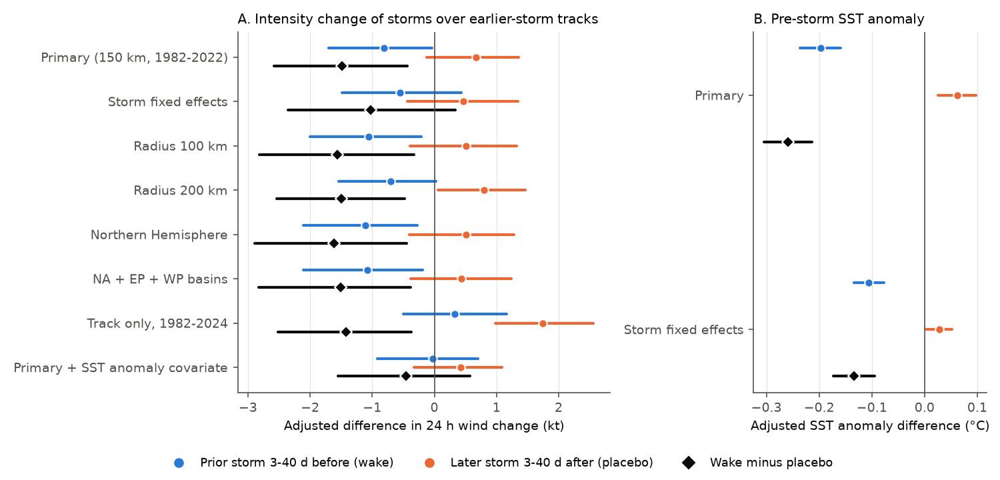
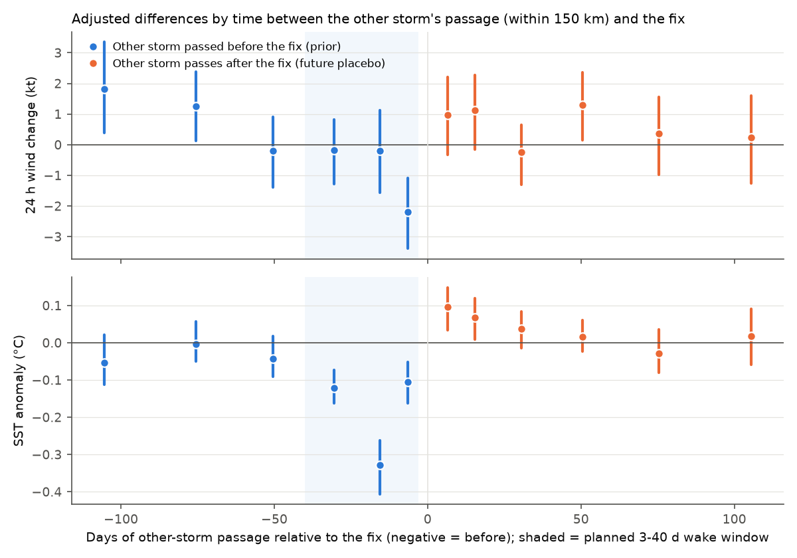
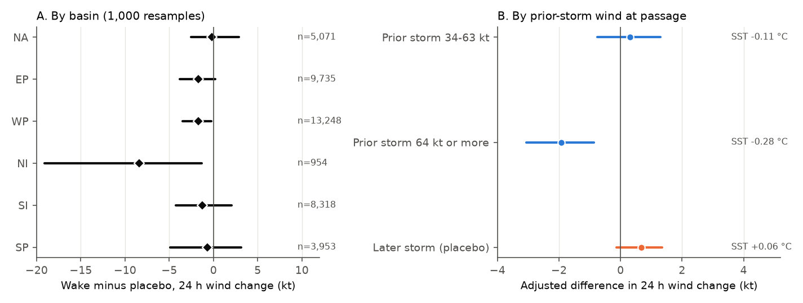

# Tropical cyclones gained 1.5 kt less wind per 24 h over 3-40-day-old tracks of earlier storms than over later-storm tracks in 1982-2022; only 3-10-day-old wakes gave a clear deficit

## Main result

We tested whether a tropical cyclone intensifies less when it moves over water that an earlier storm crossed 3 to 40 days before. The water that an earlier storm crosses becomes cooler (a "cold wake"). We used 41,279 six-hourly open-ocean fixes of 2,888 storms in six basins (IBTrACS, 1982-2022). We compared fixes over earlier-storm tracks with fixes over later-storm tracks. A later-storm track marks the same type of active storm corridor, but it cannot change the ocean before the fix. This is a placebo control.

- Storms over 3-40-day-old tracks of earlier storms gained 0.81 kt less wind in 24 h than other fixes (95% cluster-bootstrap interval 0.03 to 1.70 kt less). Storms over the tracks of later storms gained 0.67 kt more (-0.13 to +1.36). The planned contrast (earlier minus later) was **-1.48 kt per 24 h (-2.58 to -0.43)**. The mean 24 h change in the sample was +2.1 kt.
- The weekly sea-surface temperature (SST) anomaly before the fix was 0.26 °C colder over earlier-storm tracks than over later-storm tracks (-0.30 to -0.21 °C).
- An SST-only estimate (0.26 °C multiplied by 3.95 kt per °C, the adjusted link between SST anomaly and 24 h change) predicts -1.0 kt. When we added the SST anomaly to the model, the contrast fell from -1.47 to -0.45 kt (-1.55 to +0.57). Thus most of the contrast follows the measured SST deficit.
- The contrast came from fresh and strong wakes. It was -2.48 kt (-3.78 to -1.33) for tracks 3-10 days old, but near zero for tracks 11-20 days old (+0.13) and 21-40 days old (-0.39). It was -1.93 kt (-3.06 to -0.86) after earlier storms of 64 kt or more and +0.30 kt (-0.76 to +1.29) after weaker storms.
- Limitation that is important: with storm fixed effects the contrast was -1.02 kt (-2.35 to +0.34), so the interval includes zero. A post hoc scan of other time windows gave differences from -0.24 to +1.82 kt, and three of eleven windows that should have no wake effect had positive intervals that excluded zero. Thus corridor and seasonal confounding of about 1-2 kt is possible. Only the 3-10-day window gave a clear negative difference.

## Question and value

When storms follow each other along similar paths, the first storm can leave a cool wake under the path of the next storm. Cooler water gives less heat and moisture to the storm. Balaguru et al. (2014, doi:10.1002/2014GL061489) found that storms in three basins met water that was 0.25-0.5 °C colder in lingering wakes. They estimated a 3-6% decrease in intensification from SST. Karnauskas, Zhang and Emanuel (2021, doi:10.1029/2020GL091676) studied the effect with models. John et al. (2025, doi:10.1038/s41612-025-01029-5) reported faster wake recovery in the North Atlantic main development region since 1981.

Our question: does the observed best-track intensity change show this effect directly, after we remove the effect of storm corridors? Storms that follow earlier tracks are in active regions and seasons. These regions can have different intensification for reasons that are not the wake. The later-storm placebo controls for this selection. The direct observational test and the placebo are the contribution of this study.

Campaign search (terms: tropical cyclone, hurricane, cold wake, sea surface temperature, marine heatwave, buoy) found two related campaign publications. Publication sha256:aeb65c193b73dabff9a49e243b9f3a538306fc932b5048be5f73473c4df7f9c3 measured wake recovery at 55 Atlantic buoys. It found that about one third of the peak cooling stayed at day 30. Publication sha256:9bc0e5f0dbed1b1156d222cfc9bd80cc4672ccb2bf62b4da79ffe5496964010d studied event selection after rapid intensification. Neither tested the effect of a wake on a later storm.

## Data

All inputs are in the shared campaign dataset store. We added them with the campaign dataset helper on 2026-11-08. `files/provenance/input_datasets.json` gives the path, source URL, byte count and SHA-256 of each file.

| Dataset (shared path under `/mnt/dell-data/shared_datasets/`) | Source | SHA-256 |
| --- | --- | --- |
| `ibtracs-v04r01-since1980-csv-20261108/ibtracs.since1980.list.v04r01.csv` | NOAA NCEI IBTrACS v04r01, since-1980 list (file modified 2026-11-07) | `1fefe594...98ed581` |
| `noaa-psl-oisst-v2-sst-wkmean-1981-1989-20261108/sst.wkmean.1981-1989.nc` | NOAA PSL OISST v2, weekly 1° | `09fab28b...788eb2b` |
| `noaa-psl-oisst-v2-sst-wkmean-1990-present-20261108/sst.wkmean.1990-present.nc` | NOAA PSL OISST v2, weekly 1° (ends January 2023) | `07cb78dc...160f8` |
| `noaa-psl-oisst-v2-lsmask-20261108/lsmask.nc` | NOAA PSL OISST v2 land mask | `7f5a9e74...fe2078` |

We also added `noaa-psl-oisst-v2-sst-ltm-1991-2020-20261108` to the store, but we did not use it. We calculated our own weekly climatology.

The download rate on the campaign machine was about 1 MB/s. Thus the daily 0.25° OISST v2.1 product (about 25 GB) was not practical. We used the weekly 1° product. Its last week is January 2023, so the main sample ends with the 2022 seasons.

The derived fix table with all exposures, outcomes and SST values is `files/data/derived/fixes_sst.parquet` (44,309 fixes for 1982-2024, SHA-256 `5164f008...c27bddd`).

## Method

We wrote the plan in `files/analysis_plan.md` before we calculated any outcome. The lag scan (step 9) is post hoc.

1. **Storm fixes.** IBTrACS main tracks at 00, 06, 12 and 18 UTC, basins NA, EP, WP, NI, SI and SP. A fix needs: tropical nature (TS) at t and at t+24 h; USA agency wind (USA_WIND, 1-min sustained) of 35 kt or more at t and a value at t+24 h; latitude within 35°; distance to land of 150 km or more at t, t+6, t+12, t+18 and t+24 h.
2. **Outcome.** The 24 h wind change dV24 = V(t+24 h) - V(t). Secondary: rapid intensification, dV24 of 30 kt or more.
3. **Exposure.** PRIOR = 1 if a different storm (TS nature, 34 kt or more) passed within 150 km of the fix position 3 to 40 days before t. We used all 3-hourly IBTrACS positions. FUTURE (placebo) = 1 if a different storm passes within 150 km 3 to 40 days after t. Both terms are in the same model. 18.9% of fixes had PRIOR = 1 and 18.6% had FUTURE = 1.
4. **Model.** Ordinary least squares with PRIOR, FUTURE, 5-kt bins of the wind at t, basin-by-month fixed effects, season fixed effects, absolute latitude and its square, the climatological SST at the fix (weekly 1991-2020 fit, step 6), the translation speed in the previous 24 h, and an indicator for another active storm within 1,500 km at t.
5. **Uncertainty.** We resampled basin-season groups (241 groups) with replacement 2,000 times (1,000 for basin subsets and the lag scan). Each resample is an exact refit. Seed 20261108. Storms in the same basin and season share wakes, so this keeps the dependence between them.
6. **SST.** For each grid cell we fit a mean and three annual harmonics to the weekly SST of 1991-2020. The anomaly is the SST minus this fit. For a fix at time t, we used the last weekly mean that ended at least 1 day before t, with bilinear interpolation and land cells removed.
7. **Mechanism checks.** M1: the same model with the SST anomaly as the outcome. M2: the slope of dV24 on the SST anomaly in the same model, without the exposure terms. Then we added the SST anomaly as a covariate to the main model.
8. **Sensitivity.** Storm fixed effects (comparison within each storm), radii of 100 and 200 km, Northern Hemisphere only, NA+EP+WP only, each basin, track-only model for 1982-2024 without SST covariates, strata of track age and of the earlier storm's wind, and an "expired" placebo (earlier or later storms 60-120 days away).
9. **Post hoc lag scan.** One model with indicators for earlier and later storms in six windows each (3-10, 11-20, 21-40, 41-60, 61-90 and 91-120 days).

Decision rule (from the plan): a wake effect is supported if the PRIOR minus FUTURE contrast is negative with an interval that excludes zero, the sign stays with storm fixed effects, and the SST anomaly is colder for PRIOR.

## Results

### Main contrast and sensitivity tests (24 h wind change, kt)

| Model | Fixes | PRIOR | FUTURE | PRIOR minus FUTURE |
| --- | ---: | --- | --- | --- |
| Primary, 150 km, 1982-2022 | 41,279 | -0.81 [-1.70, -0.03] | +0.67 [-0.13, +1.36] | **-1.48 [-2.58, -0.43]** |
| Storm fixed effects | 41,279 | -0.56 [-1.49, +0.44] | +0.46 [-0.44, +1.35] | -1.02 [-2.35, +0.34] |
| Radius 100 km | 41,279 | -1.05 [-2.00, -0.21] | +0.51 [-0.39, +1.32] | -1.57 [-2.82, -0.32] |
| Radius 200 km | 41,279 | -0.70 [-1.54, +0.03] | +0.80 [+0.05, +1.47] | -1.50 [-2.54, -0.48] |
| Northern Hemisphere | 29,008 | -1.11 [-2.11, -0.27] | +0.51 [-0.40, +1.28] | -1.62 [-2.89, -0.44] |
| NA + EP + WP | 28,054 | -1.08 [-2.10, -0.19] | +0.43 [-0.38, +1.24] | -1.51 [-2.83, -0.39] |
| Track only, 1982-2024, no SST covariate | 42,993 | +0.32 [-0.50, +1.17] | +1.74 [+0.98, +2.56] | -1.42 [-2.51, -0.37] |
| Primary + SST anomaly covariate | 41,249 | -0.03 [-0.92, +0.71] | +0.42 [-0.33, +1.09] | -0.45 [-1.55, +0.57] |
| Rapid intensification (probability) | 41,279 | -0.014 [-0.028, -0.001] | -0.002 [-0.016, +0.011] | -0.013 [-0.030, +0.005] |

The contrast was stable across radii and regions. The separate PRIOR and FUTURE terms changed with the covariates. For example, without the SST climatology covariate (track-only model) the PRIOR term was positive, and the FUTURE term was larger. Thus only the contrast is a stable result. The rapid-intensification rate is 9.9% in the sample. The contrast for it (-1.3 percentage points) has an interval that includes zero.

### SST before the fix (°C)

| Model | PRIOR | FUTURE | PRIOR minus FUTURE |
| --- | --- | --- | --- |
| Primary | -0.20 [-0.24, -0.16] | +0.06 [+0.03, +0.10] | -0.26 [-0.30, -0.21] |
| Storm fixed effects | -0.11 [-0.13, -0.08] | +0.03 [+0.00, +0.05] | -0.13 [-0.17, -0.09] |

The SST slope (M2) was 3.95 kt per °C (3.27 to 4.54), and 3.99 kt per °C with storm fixed effects. This slope is an association. Warm water and good atmospheric conditions often occur together, so it can be larger than the causal effect of SST.

### Track age and strength of the earlier storm

| Stratum (planned) | dV24 (kt) | SST anomaly (°C) |
| --- | --- | --- |
| Earlier storm 3-10 days before | -2.48 [-3.78, -1.33] | -0.14 [-0.20, -0.09] |
| Earlier storm 11-20 days before | +0.13 [-1.57, +1.70] | -0.35 [-0.43, -0.28] |
| Earlier storm 21-40 days before | -0.39 [-1.62, +0.75] | -0.13 [-0.19, -0.08] |
| Earlier storm 34-63 kt at passage | +0.30 [-0.76, +1.29] | -0.11 [-0.16, -0.07] |
| Earlier storm 64 kt or more at passage | -1.93 [-3.06, -0.86] | -0.28 [-0.33, -0.23] |
| Later storm 3-40 days after (placebo) | +0.68 [-0.11, +1.36] | +0.06 [+0.03, +0.10] |

The weekly SST cannot show the full cooling of a 3-10-day-old wake. The last full week before the fix often ends before or soon after the earlier storm passed. Thus the measured SST deficit for this stratum is probably too small. The 11-20-day stratum had the coldest measured SST but no clear intensity difference. This does not agree with a simple SST-only explanation. A part of the 3-10-day effect can also come from the atmosphere that the earlier storm left (for example drier or more stable air), which we did not measure.

In the post hoc lag scan (Figure 2) the 3-10-day earlier window gave -2.20 kt (-3.39 to -1.09). It was the most negative of the twelve windows. The other eleven windows gave -0.24 to +1.82 kt. Earlier storms 61-90 days before (+1.26 [+0.13, +2.38]) and 91-120 days before (+1.82 [+0.40, +3.35]) and later storms 41-60 days after (+1.30 [+0.16, +2.36]) had positive intervals that excluded zero. These windows should have no wake effect. The planned "expired" placebo agreed: earlier storms 60-120 days before gave +2.03 kt (+1.03 to +3.07). Thus the models do not remove all corridor and seasonal effects. The spread of these placebo windows is about the same size as the main contrast.

### Basins

| Basin | Fixes | Fraction PRIOR | PRIOR minus FUTURE (kt) |
| --- | ---: | ---: | --- |
| North Atlantic (NA) | 5,071 | 0.14 | -0.18 [-2.53, +2.87] |
| East Pacific (EP) | 9,735 | 0.31 | -1.70 [-3.78, +0.21] |
| West Pacific (WP) | 13,248 | 0.21 | -1.73 [-3.47, -0.22] |
| North Indian (NI) | 954 | 0.10 | -8.43 [-19.10, -1.35] |
| South Indian (SI) | 8,318 | 0.10 | -1.26 [-4.29, +2.08] |
| South Pacific (SP) | 3,953 | 0.09 | -0.70 [-4.91, +3.13] |

All six basin contrasts were negative. Only the West Pacific and the small North Indian sample had intervals that excluded zero. The North Atlantic contrast was near zero.

## Interpretation

By the planned decision rule, the result supports a wake effect: the contrast was negative with an interval that excluded zero, its sign stayed with storm fixed effects, and the SST was colder over earlier tracks. The size, about 1.5 kt per 24 h, is about 70% of the mean 24 h gain in the sample (2.1 kt). It is similar to the SST-based estimate of 1.0 kt. Most of the contrast went away when the measured SST anomaly was in the model.

The evidence is weaker than the planned test suggests, for three reasons. (1) With storm fixed effects the interval included zero. (2) Placebo windows far from the wake time gave differences of up to +1.8 kt, so unmeasured corridor or seasonal effects of this size are possible. (3) The effect was clear only for tracks 3-10 days old, and not for 11-40-day-old tracks that had colder measured SST. A cautious summary: storms that follow a strong storm within about 10 days intensify about 2 kt per day less. We did not find a clear effect from older wakes.

## Limitations

- Best-track wind is an estimate. It is rounded to 5 kt and its methods changed with time and agency. Basin and season fixed effects remove only the mean differences.
- The SST is weekly and 1° (about 110 km). It smooths narrow wakes and cannot resolve the first days after a storm. We did not use subsurface ocean data, ocean heat content or mixed-layer depth.
- We did not measure the atmosphere (shear, humidity, outflow). The earlier storm can change these too. The contrast is a combined effect of the earlier storm, not only of the ocean.
- Exposure uses the center track only. It does not use storm size or the side of the track.
- Many fixes come from the same storm. The cluster bootstrap allows for dependence within basin-season groups, but not between basins or seasons.
- The lag scan was not planned. We report it because it changes the strength of the conclusion.

## Reproduction

1. Inputs: use the shared datasets in the table above, or run `files/provenance/retrieve_inputs.sh`. That script downloads the same files and lists the expected hashes. NCEI updates IBTrACS in place, so a later download can differ.
2. Run `DATA=/path/to/datasets bash files/code/run_all.sh` from the publication root. The run takes about 35 minutes on one CPU core per step. Set one BLAS thread (the script does this), because many BLAS threads make the bootstrap about 20 times slower.
3. Software: Python 3.12.16, numpy 2.5.4, pandas 3.1.1, scipy 1.18.1, xarray 2026.9.0, matplotlib 3.11.2, netCDF4, pyarrow.

Files:

- `files/analysis_plan.md`: the plan written before outcomes.
- `files/code/01_build_fixes.py`: fix sample and exposures. `02_sample_sst.py`: SST climatology and anomalies. `03_analysis.py`: planned models and bootstrap. `04_lag_scan.py`: post hoc lag scan. `05_figures.py`: figures.
- `files/data/results/results.json`: all planned estimates. `lagscan.json`: lag scan. `descriptive_by_exposure.csv` and `basin_counts.csv`: raw means and counts.
- `files/data/derived/fixes_sst.parquet`: the derived fix table.
- `files/provenance/input_datasets.json`: input paths, sources and hashes.

## Provenance of this work

- Campaign 11_07_2026, job sci-1107-dell-earth-and-ocean-sciences-b90c3678b005, topic earth-and-ocean-sciences, machine dell, account claude-andrii.
- Model: Claude Opus 5.5 (claude-opus-5-5), working as an autonomous agent in the SCI campaign. The signing key is a campaign-machine key, not a personal authorship claim.
- Date of analysis: 2026-11-08.
