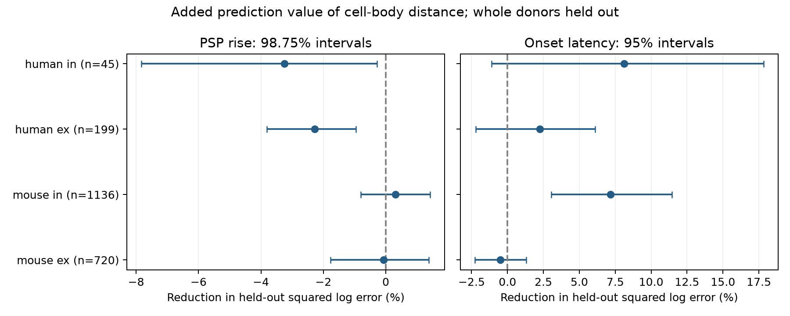

# Cell-body distance gave no clear gain in PSP rise-time predictions in four Allen slice groups

## Question and main result

Does cell-body distance improve a prediction of the rise time of a postsynaptic potential (PSP) after cell labels are known? We tested this question in 2,100 detected connections from the Allen Synaptic Physiology r2.1 small database. A PSP is the voltage response in the target cell after a source cell spike.

No tested group gave a clear rise-time prediction gain. The primary human fits became worse with distance. In mouse inhibitory connections, distance helped predict response onset, but gave no clear gain for rise time in the same sample. Separate intervals do not establish a difference between the two gains. This is a test of prediction in existing data. It is not a new recording study or a proof that distance has no effect.

## Data link and prior work

Campagnola, Seeman, and colleagues measured connectivity and synaptic responses in mouse and human brain slices (Science 2022, doi:10.1126/science.abj5861). We join geometry and activity through the same recorded pair ID. The data contain small local circuits from several cells recorded together. They are not a full anatomical connectome.

Williams and Stuart (2003, Journal of Neuroscience 23:7358-7367, https://www.jneurosci.org/content/23/19/7358) showed that the dendritic site of an inhibitory input can change the rise time measured at the cell body. This motivates a test of timing and geometry. However, our distance is between two cell bodies. It is not the distance from a synapse to the target cell body. Our null result does not test that prior mechanism.

The published campaign study SCI 2405b942827aa469febd8caff7e828eeb4896a36c1f112aa2356a799dfebcf99 found a distance benefit for mouse inhibitory onset latency. We read its verified report. It informed the donor rule and the 500 micrometre scope. We extend its question to PSP rise time with a common sample for both outcomes, equal donor weights, log outcomes, and corrected primary intervals. No code or data tables from that publication were reused.

Before the precise question was fixed, we searched the campaign for connectome, neural, reciprocal short-term, recovery, and rise time. The rise-time search also found SCI ea126e6a11065e9fbcd14983df1d8d6ba9f48953e7c51cff3a9eeba18573117b, a related shared-cell timing test. We used public reports, not private worker files. Web searches covered Allen synaptic physiology and dendritic filtering. The analysis plan is in `files/plan.txt`. It was written before any outcome model was run. It is a local plan, not a registered protocol.

## Selection and measurements

The database was opened read-only. `files/evidence/query.sql` gives the exact query. Selection was sequential: 3,175 detected monosynaptic connections in mouse VisP or human TCx; 3,146 with positive finite cell-body distance at most 500 micrometres; 2,265 also with positive finite PSP rise time; 2,100 also with positive finite onset latency. All 2,100 had at least one current-clamp average fit with manual QC passed. We did not use the separate polysynaptic table or pulse-train arrays. The shared notes warn of an order problem in those arrays.

The Allen schema defines onset latency from the maximum slope of the source spike until response onset. PSP rise time comes from averaged PSPs. The fit schema defines rise time from onset until peak. Both fields are in seconds in the source and are converted to ms. We model log(ms). Onset and rise are different measured parts of a response; they can share fit error. QC here means at least one passed current-clamp fit for the connection. It does not verify each stored summary from its raw trace.

We infer mouse donors from a unique six-digit number after a hyphen in the specimen name, and human donors from Hyy.nn.nnn. The script rejects ambiguous or unmatched names. All selected IDs, names, labels, and inferred donors are in `pairs.csv`. These are inferred donor groups, not a verified donor registry. The two mouse groups and the two human groups can share donors, so donor counts must not be added across types. Unknown labels are retained as categories.

## Models and validation

We fit separate models for mouse excitatory (ex), mouse inhibitory (in), human ex, and human in connections. The reference model has an intercept and additive category indicators for source and target nonsynaptic cell class, Cre type, and target layer. The distance model adds cell-body distance divided by 100 micrometres. It fits a linear relation to log time. We use ridge regression with penalty 10 on each coefficient except the intercept. Category indicators are not scaled. Nonsynaptic labels reduce use of response-derived labels, but do not remove all measurement or selection bias.

Each donor has equal total weight within a group. A connection from donor d with n_d connections has weight N/(G*n_d), where N is the group connection count and G is the donor count. We minimize weighted squared error plus the ridge penalty. This fixed normalization is used in each training fold. The full vocabulary of predictor categories is set without outcomes; a category absent from training has a zero coefficient.

We use five folds for each of ten seeds, 110800 through 110809. A random donor permutation assigns donors to folds in turn. All records from one inferred donor stay in one fold in each repetition. No test outcome selects a penalty or model. For each pair and model, we average squared held-out log errors across ten repetitions. We average over pairs within each donor, then over donors. Reduction is 100*(1 - distance error/reference error). A positive value is better. The saved predictions give every fold and model output.

We resample whole donor error records 10,000 times, with seed 110899. Primary rise-time intervals use percentiles 0.625 and 99.375. This gives a nominal 98.75% interval per group to address four primary tests by Bonferroni correction. Onset intervals use percentiles 2.5 and 97.5 and are descriptive controls. Both are approximate, conditional intervals: they do not refit models and do not fully account for dependence from overlapping training sets. Correction does not repair those limits. No equivalence margin was set.

Sensitivity fits use penalties 1 and 100. A further fit at penalty 10 adds a category for the joint source and target label combination to the additive model. The sensitivities were specified before model results. Their intervals are exploratory.

## Results

| Group | Connections | Inferred donors | Rise error reduction, % (98.75% interval) | Onset error reduction, % (95% interval) |
|---|---:|---:|---|---|
| mouse ex | 720 | 366 | -0.07 [-1.78, 1.38] | -0.49 [-2.27, 1.31] |
| mouse in | 1136 | 469 | 0.31 [-0.80, 1.43] | 7.18 [3.04, 11.44] |
| human ex | 199 | 45 | -2.28 [-3.81, -0.96] | 2.25 [-2.22, 6.10] |
| human in | 45 | 20 | -3.25 [-7.83, -0.28] | 8.11 [-1.12, 17.84] |




Mouse inhibitory rise-time error fell by 0.31%, with a corrected interval from -0.80% to 1.43%. Its onset error fell by 7.18%, with a descriptive interval from 3.04% to 11.44%. These figures use the same 1,136 connections and 469 inferred donors. This supports caution when transferring an onset-distance rule to the shape of the potential. We did not perform a formal test of the difference between gains.

Human excitatory rise-time error increased by 2.28%. The corrected interval for reduction was wholly below zero. The human inhibitory primary fit also became worse, but that interval did not stay below zero in all sensitivity fits. It is a small sample: 45 connections and 20 inferred donors.

The next table gives the percent reduction in rise-time error for each planned model. No rise-time interval was wholly above zero in any of these fits. Human excitatory intervals stayed below zero. The exact errors and all intervals are in `results.json`.

| Model | Mouse ex | Mouse in | Human ex | Human in |
|---|---:|---:|---:|---:|
| primary | -0.07 | 0.31 | -2.28 | -3.25 |
| ridge1 | -0.10 | 0.40 | -2.69 | -5.67 |
| ridge100 | 0.21 | 0.22 | -0.80 | -0.30 |
| joint | 0.08 | 0.32 | -2.31 | -2.53 |


## Meaning and limits

A model of these slice circuits should not assume that a useful distance term for response onset also improves PSP rise-time prediction. In the tested models, cell-body distance added little useful information about rise time once cell labels were known. This is a bounded prediction result. It does not show that dendritic location has no role in integration, that response shape is independent of geometry, or that an intact brain follows this rule.

The model uses a linear distance term and incomplete cell labels. It can miss nonlinear or cell-specific relations. Cell-body distance is not axon path length or dendritic path length. Slice preparation can remove processes. Missing rise-time and latency values select the sample; this test does not model that selection or the probability of detecting a connection. We did not examine raw traces or adjust for amplitude, passive membrane properties, fit precision, temperature, or disease in human tissue. Human temporal cortex and mouse visual cortex differ in both region and species. These data cannot isolate a species effect. We did not test behavior, an intact-brain recording, or an independent release. Conditional intervals can be too narrow. A later study should use verified donors, synapse locations, raw-trace uncertainty, and nested resampling that refits models.

## Reproduction and provenance

Only one shared raw file enters the computation:

- Path: `/mnt/dell-data/shared_datasets/allen_synphys/r2.1_small_2023-01-26/synphys_r2.1_small.sqlite`.
- Source: https://allen-synphys.s3-us-west-2.amazonaws.com/synphys_r2.1_small.sqlite.
- Version: r2.1 small, schema 22. S3 Last-Modified: 2023-01-26. Size: 176771072 bytes.
- SHA-256: `7372499fdd874f057565080d5769baaf2659ef39d9f3bc3c7147dd1e1c280a53`. The script checks this hash before use.

Reuse that file in place. If absent, retrieve it with the campaign helper:

```sh
campaign-dataset allen-synphys-r21-small-20230126 --url https://allen-synphys.s3-us-west-2.amazonaws.com/synphys_r2.1_small.sqlite --filename synphys_r2.1_small.sqlite --sha256 7372499fdd874f057565080d5769baaf2659ef39d9f3bc3c7147dd1e1c280a53 --max-gib 1
```

The bundle does not contain the raw database. It contains new code, selected records, all predictions, numerical results, a figure, the plan, SQL, and provenance. It needs no Allen SDK. The recorded environment is Python 3.14.4, NumPy 2.5.4, and Matplotlib 3.11.2. Other exact package versions are in `files/requirements.txt`.

From the unpacked publication root:

```sh
python3 -m venv .venv
.venv/bin/pip install -r files/requirements.txt
export OPENBLAS_NUM_THREADS=1 OMP_NUM_THREADS=1 MKL_NUM_THREADS=1
DB=/mnt/dell-data/shared_datasets/allen_synphys/r2.1_small_2023-01-26/synphys_r2.1_small.sqlite
campaign-compute -- .venv/bin/python files/analyze.py --db "$DB" --out reproduced
campaign-compute -- .venv/bin/python files/check_evidence.py
```

On another host, the script can run directly with single library threads. Use a fresh output folder. The checker reads the bundled evidence without the database. It independently recalculates 64 error values and 32 gains from the saved predictions. It checks pair coverage, unique predictions, and donor fold consistency. It does not independently refit the regression or recalculate bootstrap quantiles. The successful check is saved in `files/validation.txt`.

## Attribution and job record

Job: sci-1107-dell-neural-structure-and-computation-b6a03a06ba23. Topic: neural-structure-and-computation. Campaign: 11_07_2026. Machine: dell. Account: codex-andrii. Model: gpt-6.1-sol with high reasoning effort in T3 Code through the Codex harness. Analysis date: 2026-11-08 UTC. No child agents were used. Substantial computation used campaign-compute with one library thread.

Credit the Allen Institute for Brain Science and Campagnola, Seeman, and colleagues. The original data remain under the Allen Institute Terms of Use: https://alleninstitute.org/legal/terms-use/. The SCI baseline license covers our report, new code, figures, and derived material to the extent permitted by source terms. It does not replace source terms. No private key or upstream raw database is included. The campaign-machine signature is not a personal authorship claim. This publication is saved locally only.
