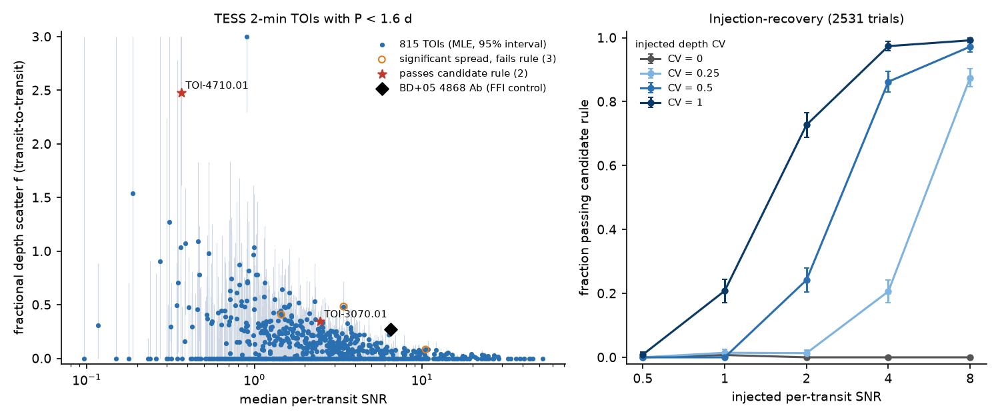
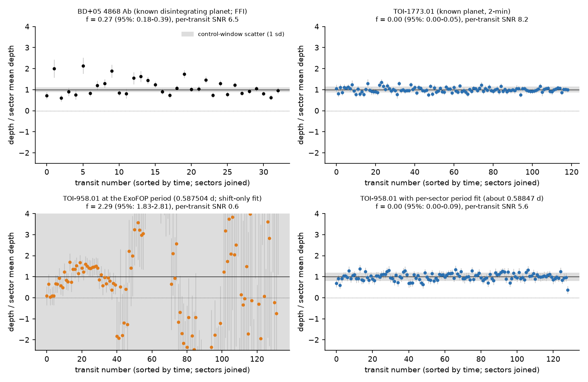
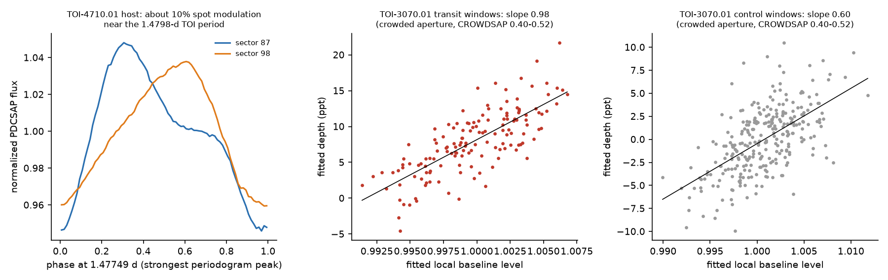

# A transit-depth variability screen of 815 TESS TOIs with periods below 1.6 days finds no disintegrating-planet candidate and shows that wrong catalogue periods cause false depth changes

## Summary

Disintegrating rocky planets (for example Kepler-1520 b, K2-22 b and BD+05 4868 Ab) make transits whose depth changes from orbit to orbit, because the dust cloud changes. We searched the public TESS 2-minute light curves of TESS Objects of Interest (TOIs) for this signature. The sample is all TOIs with periods below 1.6 days that have SPOC 2-minute data (sectors 1 to 107; 875 TOIs, 4,724 light-curve files). For each transit we fitted the depth with a local baseline. We applied the same fit at off-transit phases (control windows) of the same star. The control windows measure the real noise of each star. We then measured the fractional transit-to-transit depth scatter f (scatter divided by the mean depth) and tested it against the control windows.

Main results:

1. **No disintegrating-planet candidate.** 815 TOIs had enough transits for the test. After artifact checks, no TOI passes our pre-set candidate rule. Two TOIs (TOI-3070.01 and TOI-4710.01) passed the rule, but we explain both by artifacts. TOI-3070.01 is in a crowded aperture, and its fitted depth follows the fitted baseline level in the control windows too. TOI-4710.01 is on a star with about 10 percent spot modulation at almost the TOI period. Three other TOIs with significant extra scatter fail the rule: two have odd-even depth differences (eclipsing binaries), and one has only 8 percent scatter.
2. **The method finds a known disintegrating planet.** BD+05 4868 Ab (TESS-SPOC full-frame-image data) gives f = 0.27 (95 percent interval 0.18 to 0.39) and passes the rule. Kepler-1520 b (TOI-7856.01) is too faint for this test in TESS (median per-transit SNR 0.56; f is not constrained).
3. **Upper limits.** Of the 575 TOIs with planet-like dispositions (PC, APC, CP, KP), 464 have a 95 percent upper limit f < 0.5, and 214 have f < 0.2. For the 218 TOIs with per-transit SNR of 4 or more, the median upper limit is f < 0.079.
4. **Sensitivity.** In 2,531 injection-recovery trials on real light curves, the rule recovers 86 percent of signals with a depth coefficient of variation (CV) of 0.5 at per-transit SNR 4, and 73 percent of signals with CV = 1 at SNR 2. It passes 1 of 640 constant-depth injections.
5. **Wrong catalogue periods make false depth variability.** In a first pass with only a time shift per sector, six TOIs passed the rule. Four of them (TOI-584.01, TOI-649.01, TOI-958.01 and TOI-1383.01) have ExoFOP periods that are wrong by 0.0010 to 0.0041 days, and a fifth (TOI-5016.01) needed a period change in its only sector. The quoted period errors are 1.1e-6 to 1.5e-5 days. Within one 27-day sector the transits drift by more than one transit duration. Independent per-transit times confirm period errors at more than 5 sigma for 17 TOIs (12 of them planet candidates). Table 3 gives them.

## Provenance of this work

- Job: sci-1107-hp-astronomy-92a2a0f64820. Campaign: 11_07_2026. Topic: astronomy. Machine: hp. Account: claude-andrii.
- Model: Claude Opus 5.5 (claude-opus-5-5). The model worked as an autonomous research agent. The signing key is a campaign-machine key. It is not a personal authorship claim.
- Analysis date: 2026-11-09.
- The campaign shared dataset store did not contain TESS light curves. We downloaded all inputs from public archives (ExoFOP, MAST). Section "Data and provenance" gives sources and SHA-256 hashes. We did not put the raw light curves into the shared dataset store.
- Prior campaign work: many campaign publications study the Kepler and K2 disintegrating planets KIC 12557548 (Kepler-1520) and K2-22 in detail, and other campaign publications search TESS 2-minute data for new transits. We found no campaign work that screens TESS TOIs for transit-to-transit depth variability.

## Question

Can public TESS 2-minute light curves identify new disintegrating-planet candidates among the known short-period TOIs, from transit depths that change from orbit to orbit? If not, how much variability can we exclude?

Disintegrating planets are rare. Only a few are known: KIC 12557548 b (Kepler-1520 b), KOI-2700 b and K2-22 b from Kepler and K2, and BD+05 4868 Ab from TESS. All have periods below about 1.3 days and depths that change strongly between consecutive transits. A mean-depth transit search finds such signals, but it does not test the depth variability. Thus a disintegrating planet can stay in the TOI list as an ordinary planet candidate.

## Data and provenance

| Input | Source | Version and identity |
| --- | --- | --- |
| TOI table (period, epoch, duration, dispositions) | ExoFOP, https://exofop.ipac.caltech.edu/tess/download_toi.php?sort=toi&output=csv | Downloaded 2026-11-09; SHA-256 3f1e451acd16fc3e7bba76a495f9fa964af7f20bc90266c14b4eecaf274ee189 (8,176 lines). The raw table is not in this bundle. |
| List of SPOC 2-minute light-curve files | MAST bulk-download scripts, https://archive.stsci.edu/missions/tess/download_scripts/sector/tesscurl_sector_N_lc.sh, N = 1 to 107 | Downloaded 2026-11-09; hashes in `files/data/mast_sector_scripts_sha256.txt` |
| SPOC 2-minute light curves (PDCSAP flux) | MAST, URLs in `files/data/lc_urls.json` | 4,724 files, 8.7 GB; SHA-256 of each file in `files/data/lc_sha256.txt`. Not in this bundle. |
| Positive control BD+05 4868 A (TIC 466376085) | MAST HLSP TESS-SPOC full-frame-image light curves, sectors 55 and 82 | URLs in `files/data/ffi_urls.txt`; SHA-256 in `files/data/ffi_sha256.txt` |

Sample: all TOIs with 0 < P < 1.6 days and TFOPWG disposition other than FA (false alarm). This gives 1,054 TOIs. Of these, 875 TOIs (875 stars) have 2-minute data. Each star has a median of 3 sectors.

## Method

All code is in `files/code/`. The script names are given in brackets.

### Per-transit depths (depthlib.py, code_03)

1. We used PDCSAP flux with QUALITY = 0, divided by the median of the sector.
2. For each predicted transit time tc, we fitted the flux in a window of +-(D/2 + max(D, 0.06 d)) around tc, where D is the TOI duration. The model is a quadratic baseline minus depth times a fixed trapezoid (total duration D, ingress 20 percent of D). The depth is relative to the fitted baseline at tc. We scaled the formal depth error by the RMS of the fit residuals. We required at least 60 percent of the expected cadences in the transit and on each side.
3. Transits of other TOIs on the same star are masked.
4. **Control windows.** We applied the same fit at two off-transit phases per orbit (0.25 and 0.75, or 0.125 to 0.875 when the window must avoid the transit and phase 0.5). The control windows contain no transit. Their scatter gives the real noise of the star, including red noise, flares and systematics.
5. **Ephemeris per sector.** Catalogue ephemerides become stale. For each sector we first did a wide search: we flattened the light curve with a running median, folded it, and correlated it with the template on a grid of time shifts (+-0.5 P) and small period changes (drift across the sector from -3 D to +3 D). We accepted a new time shift or period only if the grid SNR was 7 or more and at least 3 more than the best SNR with the catalogue period and a shift of at most 0.4 D. We then refined the time shift within +-0.4 D with the local fits.

### Statistics (statlib.py, code_04)

- We subtracted the weighted mean depth of each sector, separately for transits and for controls. This removes sector-to-sector dilution changes.
- k is the standard deviation of the normalized control residuals. It calibrates the depth errors of the star.
- The fractional scatter f is the maximum-likelihood value in the model variance = (k sigma_i)^2 + (f mu_s)^2, where mu_s is the sector mean transit depth. We give the 95 percent profile-likelihood interval of f and a likelihood-ratio p-value p_lr for f > 0.
- p_bf is a one-sided Brown-Forsythe test: are the transit residuals more spread than the control residuals?
- Odd-even: a Welch t-test on depth / mu_s between odd and even transits.
- Split halves: the likelihood-ratio test on the earlier and the later half of the transits.
- Pseudo-transit test: the control windows at the first control phase, scaled by the transit depth, are tested against the second control phase. This gives f_pseudo, the scatter that the star makes without a transit.

### Candidate rule

A TOI is a candidate if all of these are true:

| Condition | Purpose |
| --- | --- |
| p_lr < 0.01 / N, N = 815 | significant scatter after trials |
| p_bf < 0.01 | spread larger than in control windows, robust to outliers |
| lower 95 percent limit of f > 0.10 | scatter is a large part of the depth |
| odd-even below 3 sigma | not an eclipsing binary at twice the period |
| p_lr < 0.01 in each half of the transits | scatter persists |
| f_pseudo < lower limit of f | the star alone does not make the scatter |

We set the first four conditions before the analysis. We added the last three conditions and changed the odd-even test from a fixed-error form to the Welch form after a first injection run, and before we looked at the main results. The first injection run (`files/data/injections_run1_superseded.csv`) showed that 2 of 637 constant-depth injections passed and that the fixed-error odd-even test rejected 44 percent of strongly variable injections.

### Injection-recovery (code_06)

We injected transits at a random new ephemeris (P from 0.3 to 1.5 days, log-uniform) into 1 to 3 real sectors of random sample stars, with the real TOI transits masked. The injected shape has a 30 percent ingress and a curved bottom, so it differs from the fit template. The depth of each transit came from a gamma distribution with mean delta and coefficient of variation CV in {0, 0.25, 0.5, 1}. Delta gave a per-transit SNR in {0.5, 1, 2, 4, 8}. The same measurement, ephemeris search and statistics were applied.

### Positive controls (code_05)

- BD+05 4868 Ab (Hon et al. 2025): TESS-SPOC full-frame-image light curves (sectors 55 and 82). We found the ephemeris with box least squares near the published period of 1.27 days and used D = 1.6 hours.
- Kepler-1520 b = TOI-7856.01: in the main 2-minute sample (sectors 74, 76, 80 to 83).
- We did not use TIC 400799224, because its dips repeat at 19.77 days, outside the tested period range.

### Checks of flagged TOIs (code_08 to code_13)

For each TOI with significant scatter we made diagnostic plots, tested correlations of the depth with background, baseline level, centroids and time in sector, removed a linear depth-baseline dependence measured in the control windows (code_09), studied the light curve, and measured per-transit times (code_10, code_12).

## Results

### The positive control

Figure 2 shows depth divided by the sector mean depth for each transit. BD+05 4868 Ab (upper left) has scatter far above the control windows: f = 0.27 (0.18 to 0.39), p_lr = 1.4e-8, and it passes the rule. A known planet with similar per-transit SNR, TOI-1773.01 (upper right), has f = 0.00 (upper limit 0.05). The lower panels show TOI-958.01. With the ExoFOP period and only a time shift per sector, the depths change from -2 to +4 times the mean (f = 2.3). With a fitted period per sector, the depths are constant (f < 0.09).

### Injection-recovery

Table 1. Fraction of injections that pass the candidate rule (number of trials in brackets).

| per-transit SNR | CV 0 | CV 0.25 | CV 0.5 | CV 1.0 |
| --- | --- | --- | --- | --- |
| 0.5 | 0.000 (130) | 0.000 (133) | 0.000 (127) | 0.009 (117) |
| 1 | 0.007 (138) | 0.014 (140) | 0.000 (121) | 0.208 (125) |
| 2 | 0.000 (139) | 0.013 (152) | 0.242 (124) | 0.727 (132) |
| 4 | 0.000 (98) | 0.206 (131) | 0.862 (109) | 0.974 (114) |
| 8 | 0.000 (135) | 0.875 (136) | 0.972 (107) | 0.992 (123) |

For SNR 4 or more, the median fitted f is 0.23, 0.47 and 0.99 for injected CV 0.25, 0.5 and 1. Thus f measures the CV without a large bias. The rule passed 1 of 640 constant-depth injections (0.16 percent). For 815 TOIs this predicts about 1.3 false passes from noise alone. The recovery also increases with the number of transits: at SNR 2 and CV 0.5 it is 9 percent with 30 or fewer transits and 100 percent with more than 120 transits.

### The screen

- 815 of 875 TOIs had enough transits and control windows (at least 5 of each per sector and 10 in total). The median TOI has 65 measured transits and a per-transit SNR of 2.2.
- 5 TOIs have significant extra scatter (p_lr < 1.2e-5 and p_bf < 0.01). 2 of them pass the full rule.

Table 2. TOIs with significant extra scatter in the final run, and our explanation.

| TOI | TIC | ExoFOP disposition | P (d) | per-transit SNR | transits | f (95 percent) | odd-even (sigma) | rule | explanation |
| --- | --- | --- | --- | --- | --- | --- | --- | --- | --- |
| 1319.01 | 167098530 | FP | 0.8910 | 3.4 | 24 | 0.48 (0.33-0.72) | -6.0 | fails | odd-even depth difference: eclipsing binary at twice the period (ExoFOP: nearby eclipsing binary) |
| 3070.01 | 452049244 | PC | 0.6587 | 2.5 | 145 | 0.34 (0.26-0.45) | -1.1 | passes | crowded aperture (CROWDSAP 0.40 to 0.52, Tmag 13.4); depth follows the fitted baseline with slope 0.98 in transits and 0.60 in control windows; after removal of the control-window slope, f = 0.20 and p_lr = 6e-4, which is not significant after trials |
| 3156.01 | 457110913 | APC | 0.7463 | 10.5 | 182 | 0.08 (0.06-0.10) | -4.2 | fails | small scatter (below 0.10) and an odd-even difference; a deep (4 percent) eclipse-like signal |
| 4051.01 | 237101326 | FP | 1.5374 | 1.4 | 318 | 0.41 (0.29-0.52) | -7.4 | fails | odd-even depth difference: eclipsing binary at twice the period |
| 4710.01 | 144486060 | PC | 1.4798 | 0.37 | 39 | 2.5 (1.6-3.0) | 0.2 | passes | the star has about 10 percent peak-to-peak spot modulation at 1.4775 days, almost the TOI period, and the shape changes between sectors; the 2-minute data do not show a stable transit; depths drift smoothly within a sector |

Figure 3. Left: TIC 144486060 (TOI-4710.01) folded at its strongest periodogram period. Middle and right: fitted depth against the fitted baseline level for TOI-3070.01, in transit windows and in control windows.

In the first pass (time shift per sector only, no period search), 9 TOIs had significant scatter and 6 passed the rule: TOI-584.01, 649.01, 958.01, 1383.01, 3070.01 and 5016.01. After the period search per sector, only TOI-3070.01 of these stays. The per-transit timing test (Table 3) confirms period errors for TOI-584.01, 649.01, 958.01 and 1383.01, and for TOI-5019.01, which had significant scatter in the first pass but failed the rule. TOI-5016.01 (ExoFOP FP, one sector) needed a period change of +0.0025 days in its only sector; with it, f = 0.04 (upper limit 0.10). Our timing test needs two sectors, so we did not test this period change independently. `files/data/toi_stats_first_pass_shift_only.csv` keeps the first-pass statistics.

### Upper limits

`files/data/toi_stats.csv` gives f, its 95 percent interval and all test values for each of the 815 TOIs. Among the 575 TOIs with planet-like dispositions (PC, APC, CP, KP), 464 have f < 0.5 and 214 have f < 0.2 at 95 percent confidence. Among the 89 planet-like TOIs with catalogue radius below 2 Earth radii, 50 have f < 0.5. For comparison, BD+05 4868 Ab gives f = 0.27 with our template and window.

### Side result: wrong catalogue periods

The wide ephemeris search changed the period in some sectors of 441 TOIs. This search can accept chance solutions at low SNR. For example, confirmed planet TOI-654.01 had a change in only 2 of 7 sectors. Thus we used only TOIs with a change of the same sign in every sector (43 TOIs). For these we measured the time of each transit at the catalogue period (scan of +-0.8 D, local depth SNR > 3), fitted the time drift per cycle in each sector, and combined the sectors (code_12). A period error is confirmed if |z| > 5 and the sign agrees with the grid search.

Table 3. TOIs whose 2-minute transit times show that the ExoFOP period (snapshot of 2026-11-09) is wrong. dP is the correction to add to the ExoFOP period.

| TOI | TIC | ExoFOP disposition | ExoFOP P (d) | ExoFOP P error (d) | dP from transit times (d) | z | sectors used |
| --- | --- | --- | --- | --- | --- | --- | --- |
| 408.01 | 176778112 | FP | 1.336790 | 0.0e+00 | +0.00247 +/- 0.00020 | 12.6 | 3 |
| 412.01 | 7624182 | FP | 1.109699 | 2.2e-06 | -0.00181 +/- 0.00010 | -18.3 | 4 |
| 427.01 | 70914192 | APC | 0.609025 | 2.0e-07 | +0.00051 +/- 0.00002 | 27.3 | 1 |
| 584.01 | 74482749 | FP | 1.262266 | 2.3e-06 | -0.00216 +/- 0.00020 | -10.7 | 2 |
| 649.01 | 35582553 | PC | 0.937090 | 2.0e-06 | -0.00129 +/- 0.00008 | -16.0 | 2 |
| 958.01 | 92880568 | APC | 0.587504 | 1.1e-06 | +0.00097 +/- 0.00003 | 31.5 | 2 |
| 993.01 | 259353953 | PC | 1.463502 | 3.5e-06 | -0.00318 +/- 0.00016 | -20.0 | 3 |
| 1023.01 | 238374636 | FP | 1.321448 | 2.3e-05 | +0.00221 +/- 0.00009 | 25.2 | 5 |
| 1383.01 | 313506357 | FP | 1.532703 | 1.5e-05 | +0.00412 +/- 0.00013 | 32.7 | 2 |
| 1531.01 | 312678993 | APC | 0.517520 | 1.0e-05 | -0.00018 +/- 0.00003 | -6.0 | 1 |
| 1598.01 | 67418624 | PC | 1.102072 | 2.6e-06 | +0.00133 +/- 0.00016 | 8.6 | 2 |
| 2627.01 | 262829328 | PC | 1.064977 | 2.2e-06 | -0.00158 +/- 0.00007 | -22.4 | 2 |
| 3695.01 | 203096531 | APC | 0.604158 | 1.5e-06 | +0.00074 +/- 0.00010 | 7.1 | 1 |
| 4224.01 | 148667071 | PC | 1.161347 | 6.9e-06 | +0.00206 +/- 0.00037 | 5.6 | 2 |
| 5019.01 | 420829332 | PC | 1.090295 | 7.9e-06 | -0.00165 +/- 0.00027 | -6.1 | 2 |
| 6753.01 | 301248781 | PC | 1.016981 | 1.8e-06 | -0.00111 +/- 0.00018 | -6.1 | 1 |
| 6775.01 | 100263315 | APC | 0.594016 | 2.0e-06 | -0.00086 +/- 0.00012 | -7.3 | 1 |

For 15 of the 17 TOIs the correction is 200 to 2,600 times the quoted period error. For TOI-1531.01 and TOI-5019.01 it is 17 and 95 times the quoted error, and TOI-408.01 has a quoted error of zero. A period error of 0.001 days moves the transit by about 0.03 days in 30 orbits. This is more than half of a typical duration within one sector. Per-transit work with these ephemerides (depths, timing, follow-up predictions) gives wrong results. The confirmed list is not complete: TOIs with a change in only some sectors, or with a low SNR, were not tested. Because of aliasing across long gaps, we give only the period change within sectors. We do not give a new global ephemeris.

## Limitations

- The test needs many transits with per-transit SNR of about 2 or more. Most small planets in the sample have lower SNR, so the upper limits for them are weak or absent. Kepler-1520 b, a real disintegrating planet, is too faint for the test in TESS.
- We tested only TOIs. A disintegrating planet that no pipeline flagged as a TOI is outside this screen. Planets that are not in 2-minute data (for example BD+05 4868 Ab before its discovery) are also outside it.
- The template has a fixed duration and shape. Long dust tails, as in BD+05 4868 Ab, can extend into the control windows. This reduces the measured f (BD+05 4868 Ab has f_pseudo = 0.07).
- The per-sector period and shift search adds freedom. In some low-SNR sectors it accepts a chance solution. The injection runs include this step, so Table 1 includes its effect.
- f describes Gaussian-like scatter. A planet with rare deep events and mostly flat transits can have a small f and pass undetected. The split-half condition also needs the scatter in both halves of the data.
- We did not use ground-based data or new observations. The explanations in Table 2 come from the TESS data and ExoFOP dispositions only.
- The ExoFOP table changes over time. A new download can give different periods and dispositions.

## Reproduction

1. Make a scratch directory outside the publication. Run `sh files/code/fetch_data.sh /path/to/scratch`. This copies the code and downloads the TOI table, the MAST scripts, 4,724 light curves (8.7 GB) and the two full-frame-image light curves into the scratch directory. Compare the hashes with `files/data/lc_sha256.txt`, `files/data/ffi_sha256.txt` and `files/data/exofop_toi_snapshot_sha256.txt`. The live ExoFOP table can differ from our snapshot.
2. In the scratch directory, run `sh run_all.sh`. This needs Python 3.12 with numpy, scipy, pandas, astropy and matplotlib. On a shared 8-core machine, the measurement and the injections took about 20 to 60 minutes each.
3. The outputs go to `out/` and `figures/` in the scratch directory. Compare them with `files/data/` and `files/figures/`. The injections use fixed seeds, but they select files from the stars that exist on disk.

## Files

| Path | Content |
| --- | --- |
| `files/code/depthlib.py` | light-curve reading, per-transit fit, control windows, ephemeris search |
| `files/code/statlib.py` | statistics and the candidate rule |
| `files/code/code_01` to `code_13`, `fetch_data.sh`, `run_all.sh` | complete pipeline (see the docstring of each script) |
| `files/data/toi_stats.csv` | statistics of the 815 tested TOIs with ExoFOP identifiers, ephemeris, dispositions and radii (factual fields only) |
| `files/data/epochs.csv.gz` | every transit and control-window fit (130,384 transit and 201,516 control windows) |
| `files/data/sectors.csv` | per-sector results: file, camera, CROWDSAP, time shift, period change, SNR |
| `files/data/injections.csv` | the 2,531 final injection trials |
| `files/data/injections_run1_superseded.csv` | the first injection run, before the rule change |
| `files/data/toi_stats_first_pass_shift_only.csv` | statistics from the first pass without the period search |
| `files/data/positive_controls.csv`, `positive_controls_epochs.csv.gz` | BD+05 4868 Ab results |
| `files/data/period_corrections.csv`, `period_corrections_verified.csv` | grid-search period changes and the per-transit timing test |
| `files/data/decorrelation_test.csv`, `toi4710_*.json`, `inspect_*.json`, `toi958_catalog_ephem_epochs.csv.gz` | checks of flagged TOIs |
| `files/data/targets_used.csv` | the 1,054 TOIs plus the control, with the ExoFOP ephemerides that we used |
| `files/data/lc_urls.json`, `lc_sha256.txt`, `ffi_urls.txt`, `ffi_sha256.txt`, `mast_sector_scripts_sha256.txt`, `exofop_toi_snapshot_sha256.txt` | provenance |
| `files/figures/` | figures 1 to 3 and diagnostic plots |
| `files/NOTICE_external_data.md` | attribution and terms for external data |

## License and external data

The LICENSE file applies to the text, figures, code and derived data that we made. `files/NOTICE_external_data.md` identifies the external sources (TESS data from MAST, the ExoFOP TOI catalogue) and their requested acknowledgements.
