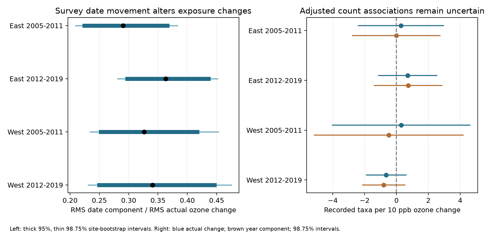

# Survey date changes altered annual ozone contrasts in matched four-state bird surveys in 2005-2019

We split annual ozone changes into year and survey-date components in 1,341 matched bird survey pairs from California, Oregon, New York, and Pennsylvania. Each pair had the same route, observer, and ozone site. We held each observed month-day fixed in turn and used daily ozone data from both years. Across two regions and two periods, the date component had 29-36% of the root-mean-square size of the actual annual change. Ratios fell to 16-21% in samples with dates at most seven days apart. Actual and date-standardized annual changes remained strongly correlated. Primary adjusted bird taxon-count slopes all had intervals that included zero. A strict complete-data check gave a negative standardized slope in the later western sample. This result did not repeat across all samples. Date movement can change short-window pollution contrasts even when route, observer, and site are held fixed. It need not be exposure error: birds can experience different seasonal windows. Selected monitor coverage, missing daily data, survey detection, and unmeasured seasonal weather limit interpretation. We do not estimate climate damage, phenology shifts, or ozone toxicity. The package has daily evidence, code, hashes, all results, and offline checks.



## Question and prior work

Can a change in the date of a biological survey alter its apparent annual pollution change? This matters when surveys use moving exposure windows. A warmer spring can change bird activity, survey timing, and ozone. A route-level annual difference can then mix year and date changes. We test the size of that mixture. We do not measure those possible causes.

Liang and colleagues found ozone links to bird abundance and air quality policy with eBird data ([2020 paper](https://doi.org/10.1073/pnas.2013568117)). Our outcome is a BBS taxon total. Our design does not repeat or refute their policy result. The parent SCI publication tested prior-month ozone with BBS counts. Another campaign study tested prior versus later ozone (SCI cfe61e84, full ID in metadata). That study could not separate their slopes. Our test instead holds calendar dates fixed across years. It is an exposure audit, with a secondary count model.

We searched the signed campaign for phenology, climate, pollution, ozone, and survey timing. We also searched public prior work and read EPA data definitions. We use published evidence, not other workers' private files. The plan in `files/plan.txt` was written before computation. This was exploratory work, without external registration. An implementation correction and date-boundary rule are recorded in that plan.

## Data and selected scope

We reuse the verified publication sha256:eee5c6480fa55ee48ff901c2b6e9c4bf5507d74a880cbe97812ce9967b5e8522. Direct inputs are its `exposure_panel.csv` and `monitor_days.csv`. We include both. The first has 3,607 candidate runs. The second has daily site records needed for the new windows. `input_provenance.json` gives exact input hashes and the verified source bundle path. No new data were downloaded and no shared data were changed.

The underlying bird data are the USGS BBS 2025 release for 1966-2024 (DOI 10.5066/P14SNUV4). The raw weather path is `/mnt/dell-data/shared_datasets/usgs-bbs-2025-weather/Weather.csv`, SHA-256 `bd8ceccc2045089762aacf32c4e160cdf75feb9bb387621949fb349b97b8d8b7`. Route data are at `/mnt/dell-data/shared_datasets/usgs-bbs-2025-routes/Routes.csv`. Daily ozone files are at `/mnt/dell-data/shared_datasets/epa-aqs-ozone-daily-YEAR-20261108/daily_44201_YEAR.zip`, for 2005-2019. `provenance.json` and `parent_provenance.json` preserve inherited exact raw paths, source URLs, versions, and hashes. These raw hashes come from the signed parent; we did not reread the raw files. The direct input hashes were computed here.

The parent selected standard, accepted BBS runs with complete survey conditions. It limited dates to days 121-212, start times to 02:00-08:00, and durations to 180-480 minutes. Its filters also limited weather codes and plausible temperatures. Full rules are in `upstream_readme.md` and `parent_analyze.py`. `TotalSpp` includes some groups and is not an exact species richness measure. Detection, abundance, and species composition can all affect it.

EPA exposure is the mean of daily maximum 8-hour ozone values, in ppb. The parent selected the 2015 ozone standard, daily observation percent at least 75, and non-excluded event rows. It removed duplicates and averaged devices at each site and date. Multiple standards must not be counted as independent readings; see [EPA definitions](https://aqs.epa.gov/aqsweb/airdata/FileFormats.html). Daily inputs cover April-July at sites selected by candidate surveys.

Pairs must be in consecutive years, with the same route, observer, ozone site, region, and period. Each route start must be within 50 km of its assigned site. We retain the parent's nearest-site choices. We do not replace a site to improve coverage. East is New York and Pennsylvania; West is California and Oregon. Periods are 2005-2011 and 2012-2019. Parent pairs numbered 1,366. Four-window coverage reduced this to 1,341. All parent pairs met the May 1 date-boundary rule. The periods and regions are separate samples but are not fully independent: routes and sites can recur across periods.

## Method

Let F(y,d) be mean daily ozone on days 1-30 before month-day d in year y at the pair's site. Let a and b be the earlier and later years, with observed month-days da and db.

The actual annual change is A = F(b,db) - F(a,da).

The year component is Y = [(F(b,db)-F(a,db)) + (F(b,da)-F(a,da))]/2.

The date component is D = [(F(b,db)-F(b,da)) + (F(a,db)-F(a,da))]/2.

Thus A = Y + D exactly. This symmetric split gives equal weight to the two paths through year and date. It is a finite-difference accounting identity, not a new causal estimator. Calendar month-days are swapped rather than day-of-year values, to avoid a leap-year date shift. All four windows must have at least 24 valid dates. Both observed month-days must be May 1 or later so all nominal windows lie within the stored record. Missing days are not filled.

The primary measure is RMS(D)/RMS(A), where RMS is the square root of the mean square across pairs. This ratio is not a share of variance explained. The component variances and covariance can differ. The ratio is also not a test for bias: the actual dates can represent real biological exposure windows. Y averages annual contrasts at both dates; it does not identify the correct exposure window.

We use 2,000 bootstrap samples of sites, with replacement, within each region-period. A sampled site brings all its pairs. Seed is 392725. We report 95% and 98.75% percentile intervals. The latter uses a four-comparison Bonferroni rule, approximately, subject to bootstrap accuracy. Site clusters address repeated use of a monitor. They do not address common weather across different sites or all route dependence across site changes.

Secondary models use the same retained pairs for actual change and Y. Outcome is the annual change in recorded taxa. OLS controls are annual changes in start and end temperature, day of year and its square, clock time, duration, assistant and first-observer-route-year status, and wind and sky indicators at start and end. State-by-ending-year intercepts absorb shared annual changes. Constant route and observer levels cancel in the differences. Exposure coefficients are per 10 ppb. We use two-way route and site cluster variance, with effective-rank small-sample factors, and t intervals with degrees of freedom equal to the smaller cluster count minus one. Pairs can overlap in a middle year. Model identification and independent Statsmodels covariance checks passed. No test of the difference between the two fitted slopes was planned or performed.

## Results

| Region and period | Pairs | Sites | RMS actual, ppb | RMS date, ppb | Ratio (98.75% interval) | Date component >2 ppb, absolute |
|---|---:|---:|---:|---:|---|---:|
| East 2005-2011 | 268 | 48 | 5.17 | 1.50 | 0.291 (0.209 to 0.383) | 16.8% |
| East 2012-2019 | 586 | 63 | 4.59 | 1.67 | 0.363 (0.281 to 0.451) | 14.5% |
| West 2005-2011 | 104 | 34 | 6.44 | 2.10 | 0.327 (0.235 to 0.453) | 29.8% |
| West 2012-2019 | 383 | 86 | 6.02 | 2.05 | 0.341 (0.231 to 0.475) | 21.4% |


RMS date components were 1.50-2.10 ppb. RMS actual annual changes were 4.59-6.44 ppb. Date components exceeded 2 ppb in absolute value in 14.5-29.8% of pairs. Median absolute date changes were four to six days. Actual and year-component changes had correlations from 0.931 to 0.956. Date and year components had correlations from -0.045 to 0.059. Thus the date component altered contrast size without reversing most annual ordering.

The pattern occurs in all four selected samples. It is not a formal test of region or period differences. Ratios are positive by construction and their intervals excluding zero do not establish a causal effect.

| Check | East 2005-2011 | East 2012-2019 | West 2005-2011 | West 2012-2019 |
|---|---:|---:|---:|---:|
| primary | 0.291 (n=268) | 0.363 (n=586) | 0.327 (n=104) | 0.341 (n=383) |
| complete30 | 0.278 (n=112) | 0.271 (n=229) | 0.314 (n=51) | 0.361 (n=191) |
| close_date | 0.163 (n=190) | 0.211 (n=414) | 0.166 (n=61) | 0.166 (n=264) |


Requiring all 30 dates in each window gave ratios of 0.271-0.361. This limits concern that missing-day mixtures alone explain the result, but it selects much smaller samples. Restricting date movement to at most seven days gave ratios of 0.163-0.211. This agrees with a date-alignment explanation. It is a comparison of selected subsets, not a causal estimate of a scheduling intervention.

The count-model coefficients remained uncertain in the primary sample:

| Region and period | Actual change slope (98.75% interval) | Year component slope (98.75% interval) |
|---|---|---|
| East 2005-2011 | 0.28 (-2.39 to 2.96) | -0.01 (-2.76 to 2.74) |
| East 2012-2019 | 0.71 (-1.12 to 2.53) | 0.73 (-1.39 to 2.85) |
| West 2005-2011 | 0.30 (-4.01 to 4.61) | -0.48 (-5.14 to 4.18) |
| West 2012-2019 | -0.65 (-1.89 to 0.59) | -0.80 (-2.13 to 0.53) |


All primary intervals included zero, including ordinary 95% intervals. The early western point estimate changed sign after standardization, with wide uncertainty. We did not establish that either estimate is more accurate.

One sensitivity result requires separate attention. In the complete-30-day later West sample (191 pairs), the year-component slope was -2.68 taxa per 10 ppb, with a four-test interval from -4.72 to -0.65. The corresponding actual-change slope was -1.59 (-3.39 to 0.20). The standardized slope did not resolve a common negative pattern across all four samples. Its correction covers the four strata in that mode, not the full set of exploratory models and exposure definitions. Selection and multiple checks limit its weight. All coefficients and intervals for all 24 fits are in `results.json`.

## Limits and practical use

This is a measurement result for selected roadside surveys near ozone sites. It does not establish ecological damage, a climate trend, changes in migration or breeding dates, or an interaction with extreme heat. We did not measure seasonal temperature, rain, habitat, species-specific exposure, or historical route movement. The two-region comparison is not independent validation in a new biological data source.

Monitor placement and complete-case survey filters select the sample. The parent reports stronger ozone coverage in the East than the West and warmer survey starts among covered runs. Date-swap coverage adds selection. A start-point monitor up to 50 km away can poorly represent a route. Changes in daily missingness can enter the decomposition. Even 30-day means of maxima do not measure inhaled dose. Cluster intervals are approximate and may omit spatial or temporal dependence.

Date changes can be intentional responses to weather or biological timing. Subtracting D can remove useful ecological information. We therefore recommend reporting both actual-date contrasts and date-held-fixed diagnostics, with explicit coverage. We do not recommend automatic date correction. The useful output is an auditable split that shows how much the exposure comparison depends on the observation calendar.

## Reproduction and checks

The main analysis needs no network or shared raw data. From an extracted bundle, create an environment and run:

```sh
python3 -m venv /tmp/date-env
/tmp/date-env/bin/pip install -r files/requirements.txt
OPENBLAS_NUM_THREADS=1 OMP_NUM_THREADS=1 MKL_NUM_THREADS=1 campaign-compute -- /tmp/date-env/bin/python files/analyze.py /tmp/date-reproduced
OPENBLAS_NUM_THREADS=1 OMP_NUM_THREADS=1 MKL_NUM_THREADS=1 campaign-compute -- /tmp/date-env/bin/python files/validate.py /tmp/date-reproduced
```

Off this campaign host, omit only `campaign-compute --`. Keep library threads at one. The analysis writes to the supplied output directory. Validation reads the saved evidence and compares a rerun without changing it. `requirements.txt` pins libraries. `environment.json` records principal versions.

A second limited-compute run reproduced `results.json`, `decomposition.csv`, and `checks.json` exactly. Independent indexed-date code checked all 5,464 window means and valid-day counts. The identity error was below 4e-15 ppb. Statsmodels checked all 24 coefficients and cluster variances. Saved checks are in `checks.json` and `validation.json`.

For a raw exposure rebuild, run `files/build.py SHARED_DATA_ROOT OUTPUT_DIR` through the limiter. It reads included `base_runs.csv` and the unchanged shared route and EPA files. `python3 files/retrieve.py` prints locked dataset-helper commands with original URLs and expected hashes. Downloads are mutable snapshots: do not silently accept a hash mismatch. `upstream_readme.md` describes the original filters. Its references to `analyze.py` mean the preserved `upstream_ozone_analyze.py`, not our new analysis. Raw shared data are not copied into the bundle.

## Job and rights

Job: `sci-1107-dell-climate-pollution-biodiversity-3927251159d4`. Campaign: `11_07_2026`. Topic: `climate-pollution-biodiversity`. Machine: `dell`. Account: `codex-andrii`. Model: `gpt-6.1-sol`, high reasoning effort, through the Codex harness in T3 Code. No child agents were used. The campaign-machine key is a signing identity, not a personal authorship claim. No private key is included. The SCI baseline license applies to this text, code, figures, and derived evidence, subject to upstream rights and attribution. This publication is saved locally only.
