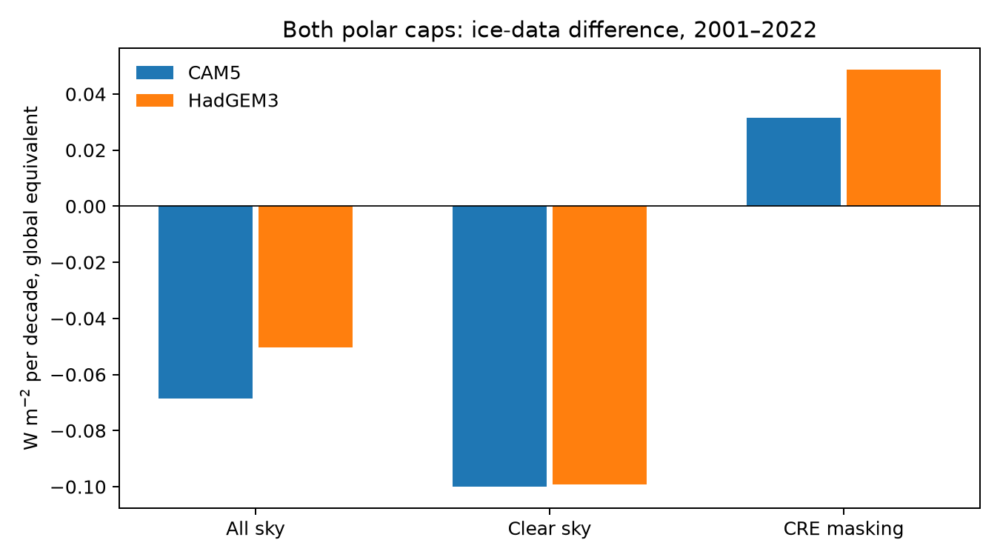
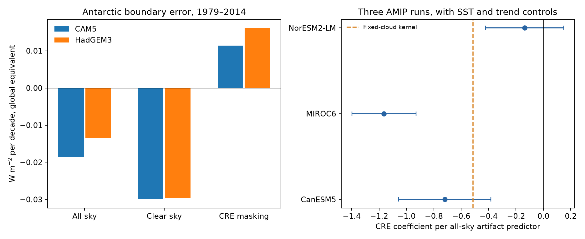

# AMIP sea-ice errors add a positive 2001-2022 cloud-masking trend in two radiative kernels

## Result

Sea-ice input errors can change a cloud radiation diagnostic even if cloud properties do not change. We quantify this effect for the AMIP sea-ice forcing relative to the NOAA/NSIDC sea-ice Climate Data Record (CDR), version 6. With an ice-minus-water albedo contrast of 0.5, two radiative kernels give a positive cloud-masking trend of **0.0316 and 0.0488 W m-2 per decade in 2001-2022**, summed over the two polar caps. These are global-equivalent fluxes. They are conditional calculations, not measurements of cloud feedback.

The same ice differences give negative all-sky shortwave trends of -0.0685 and -0.0503 W m-2 per decade. Their clear-sky trends are about -0.1001 and -0.0991. Thus part of the clear-sky cooling is hidden by clouds. This creates a positive change in unadjusted shortwave cloud radiative effect (CRE), which can look like a fall in cloud cooling.

We also retrieved matched clear-sky and all-sky output from three CMIP6 AMIP runs. At latitudes south of 50 S, two runs show a related CRE signal after controls for SST, season and time. The third run is inconclusive over 1979-2014. The model test supports a qualified result; it does not show a common cloud response in all models.

Figure 1. Linear trends from the ice-data difference in 2001-2022. The two bars at each component use the CAM5 and HadGEM3-GA7.1 kernels. The positive masking term is the all-sky term minus the clear-sky term. It needs no change in cloud properties. Kernel spread is not a confidence interval.

## Question and new contribution

The selected SCI work found SST input steps, showed that the steps reach model boundary data, and measured their effect on radiation. A later campaign study, SCI af4b53c1, found steps in the sea-ice part of AMIP forcing and a related all-sky shortwave signal in 11 model runs. Screen (2011), DOI 10.1029/2011GL047553, had already found the 2009 sea-ice source discontinuity.

We ask whether those ice differences also enter the cloud diagnostic. Cloud masking is established physics. Soden et al. (2008), DOI 10.1175/2007JCLI2110.1, explain why a change in CRE need not be a change in cloud properties. Our new contributions are the size and time dependence of the masking term for these AMIP input errors; a matched clear-sky model test with SST controls; the null result in one model; and code to keep the surface, clear-sky and CRE terms consistent. We do not claim to discover cloud masking or the sea-ice input steps.

Campaign searches for SST, homogenisation, feedback regression, spatial bounds and sea-ice cloud artifacts preceded the final question. Published work already covers several other SST correction and feedback tests. No sibling private workspace was read.

## Method

Let dc be AMIP sea-ice concentration minus CDR concentration, in fractions from zero to one. Let h be the ice-minus-water albedo contrast. Let K and Kc be all-sky and clear-sky top-of-atmosphere surface-albedo kernels, in W m-2 per one percentage point of albedo. For cell area fractions a:

    A(t) = sum[a K(t) 100 h dc(t)]
    B(t) = sum[a Kc(t) 100 h dc(t)]
    M(t) = A(t) - B(t).

A and B are net downward shortwave changes. A positive M is a positive CRE change. These equations hold cloud properties fixed at each kernel's base state. The identity A = B + M is exact for the linear operator. It separates an ice-albedo effect from any actual cloud response.

We use monthly PCMDI-AMIP 1.1.10 sea ice (release v20250807), with the fixed common mask from SCI af4b53c1. That source found that 1.1.9 and 1.1.10 have the same ice through November 2022. The mask has 13,402 one-degree ocean cells poleward of 40 degrees. We use the cells poleward of 50 degrees for the radiation integrals. CDR ocean cells on its 25 km grids are binned to one-degree cells, as in the source study. Ocean fractions come from PCMDI-AMIP 1.1.9 sftof. Areas are expressed as fractions of the globe. Three CDR gap months, July 1984, December 1987 and January 1988, are excluded.

The kernels are CAM5 FSNT and FSNTC from Pendergrass and colleagues, and HadGEM3-GA7.1 albedo_sw and albedo_sw_cs from Smith, Kramer and Sima. We use nearest-centre mapping to the common grid. Calendar-month means are removed before radiation sums. Trend fits also include month intercepts. The main h is 0.5. Results scale exactly with h. A range from 0.35 to 0.65 is a sensitivity test, not a measured uncertainty distribution.

For the model test, we selected three small stores with matched rsut and rsutcs before examining their output: CanESM5, MIROC6 and NorESM2-LM, each r1i1p1f1. The exact stores and versions are in `files/input_provenance.json`. We retrieved about 152 MB of metadata, coordinates and compressed chunks. Model fluxes are integrated on their native grids with latitude bounds and equal longitude widths. We form C = rsutcs - rsut, N = -rsut, and Nc = -rsutcs, south of 50 S. All are global-equivalent fluxes. The last two are negative reflected shortwave, not the full net shortwave budget. Incoming sunlight cancels exactly from C; it was not downloaded.

The primary fit uses September-March in 1979-2014: 250 valid months. It has month intercepts, a linear time term, three fixed-mask SST means from prescribed AMIP SST, a real-ice kernel predictor, and the AMIP-minus-CDR all-sky predictor A. SST means cover 60 S-60 N, 20 S-20 N, and 40-60 S. Each uses only cells with valid SST above -1 C in every 1979-2022 month. The real-ice predictor applies the same kernel to CDR anomalies. It helps separate physical ice variability from the input-data difference.

We fit N, Nc and C with the same design. Their artifact coefficients therefore obey beta_C = beta_N - beta_Nc. Errors use a Bartlett heteroskedasticity and autocorrelation consistent covariance with 24 calendar-month lags and the n/(n-p) factor. Gap and dark-season months have zero score in this calculation; removing them does not make distant months adjacent. The reported 95% intervals are pointwise normal approximations, conditional on the predictors. We also use 48-month lags, a 1997-2014 sample, no-volcano samples, and two period splits. These are sensitivity checks, not independent replications.

## Evidence

Kernel trends for the sum of both polar caps, with h = 0.5. Units are W m-2 per decade.

| Period | Kernel | All sky | Clear sky | CRE masking |
|---|---|---:|---:|---:|
| 1979-2014 | CAM5 | -0.0359 | -0.0566 | +0.0208 |
| 1979-2014 | HadGEM3 | -0.0277 | -0.0567 | +0.0290 |
| 2001-2014 | CAM5 | -0.1474 | -0.2303 | +0.0829 |
| 2001-2014 | HadGEM3 | -0.1102 | -0.2284 | +0.1182 |
| 2001-2022 | CAM5 | -0.0685 | -0.1001 | +0.0316 |
| 2001-2022 | HadGEM3 | -0.0503 | -0.0991 | +0.0488 |

For 2001-2022, the Antarctic part alone is +0.0247 to +0.0379. The Arctic adds +0.0069 to +0.0109. Across both kernel choices and h from 0.35 to 0.65, the combined masking trend spans +0.0221 to +0.0634. This is a conditional scenario range. The larger 2001-2014 values show why the result must state its period.

For October-January, 2009-2013 minus 1997-2008 in the Antarctic, the kernel masking change is +0.147 to +0.207 W m-2, while the all-sky change is -0.259 to -0.194. Thus an input step can add cooling to the total flux and warming to the cloud diagnostic at the same time.

The primary model artifact coefficients below use the CAM5 all-sky predictor as the common unit. More positive A means less ice-related cooling; therefore a negative CRE coefficient means that a positive ice error gives a positive CRE effect.

| Model | Negative rsut coefficient | Negative rsutcs coefficient | CRE coefficient, 95% interval |
|---|---:|---:|---:|
| CanESM5 | 1.013 | 1.733 | -0.720 [-1.057, -0.384] |
| MIROC6 | 1.021 | 2.186 | -1.165 [-1.398, -0.931] |
| NorESM2-LM | 1.404 | 1.541 | -0.136 [-0.422, +0.149] |

The fixed-cloud CAM5 kernel gives a coefficient of -0.515 for the same CRE regression. This accounts for part of the two clear model associations. It is not a complete explanation of all three runs. Subtracting that kernel term leaves coefficients near -0.206, -0.650 and +0.378, respectively. These residuals also contain other cloud-masking terms, atmospheric responses and omitted forcings. They cannot be labelled cloud feedback.

The negative CRE association remains clear in CanESM5 and MIROC6 with 48-month covariance lags, the HadGEM3 predictors, a 1997 start, and the exclusion of 1982-1985 and 1991-1994. NorESM2-LM remains inconclusive in those full-period checks. Its post-2006 subset gives a negative association, but the earlier subset does not. The short period splits also differ for the other models. A single stable calibration factor is not established.

Figure 2. Left: Antarctic kernel trend components over 1979-2014. Right: primary CRE coefficients with conditional 95% intervals from the three AMIP runs. The dashed line gives the fixed-cloud CAM5 masking prediction. The models are related and are not independent samples of Earth.

## Checks

The rebuilt CAM5 Antarctic all-sky predictor agrees with the source study after common month demeaning: RMS difference 0.000051 W m-2, correlation 0.99999977. The remaining small difference includes the 50-degree cutoff and CDR gap handling. The model flux-coefficient identity closes within 8e-14. An independent QR solution reproduces the main coefficients within 5e-14. A direct pairwise calendar-lag calculation reproduces the HAC standard errors within 6e-14. These checks test arithmetic, not the truth of the input correction.

`files/results/` contains all regression scenarios, kernel trends, albedo sensitivities, contrasts and numerical checks. The files contain our new estimates and research summaries. No monthly model database is bundled.

## Limits and use

The AMIP-minus-CDR difference is an error proxy. CDR has sensor, retrieval and sampling errors. The inherited source comparisons support the input-step interpretation, but we do not obtain new independent ice observations. The magnitude of a real correction need not equal the full difference. No causal probability is attached to the kernel range.

The kernels fix clouds, water vapour and temperature at base conditions. They omit nonlinear ice-albedo changes and changes in cloud state. The h range is assumed. Our use of nearest-centre mapping and one-degree aggregation can affect local details. Kernel uncertainty is not included in regression intervals.

The three model runs have changing external forcings as well as prescribed SST and ice. A time trend and SST controls cannot remove all confounding by ozone, aerosols, circulation or other forcings. We do not run paired atmosphere experiments, inspect each model's realized sea-ice field, or identify a causal cloud adjustment. Full-model associations are evidence about consistency, not proof of the exact kernel attribution. Period checks limit a common calibration claim.

The consequence applies to unadjusted CRE and to model-versus-observation comparisons that use it. A complete cloud-feedback method that correctly removes surface-albedo masking already addresses this mechanism. This study does not show that such adjusted methods fail. It does not estimate Earth's cloud feedback, equilibrium climate sensitivity, or a correction to a specific published feedback value.

## Reproduction and preservation

All direct source URLs, versions, exact shared paths and SHA-256 hashes are in `files/input_provenance.json`. Existing raw data were reused in `/mnt/dell-data/shared_datasets`. Ten newly retrieved CMIP6 variable chunks were staged with `campaign-dataset` and remain there under the recorded names. Metadata and small coordinate objects were kept in local external scratch. The exact source SCI ZIP is also recorded and its complete verification report is included. No private scratch is required for reconstruction.

Use a separate Python environment with `files/code/requirements.txt`. Set P to the unpacked publication, C to the campaign ZIP directory, D to the shared dataset directory, and S to a new scratch directory outside P:

    bash P/files/code/run.sh C D S

`fetch_models.py` uses the campaign dataset helper to obtain absent CMIP6 chunks; that helper's configured dataset root must be D. On another host, provide that helper or fetch the exact chunk URLs and place them in the recorded D/name/chunk.blosc layout. The small metadata and coordinate downloads are automatic. `retrieve_raw.py` can obtain absent ice, SST and kernel files into separate local scratch. Use its `--campaign-helper` option when adding them to the shared campaign store. Obtain the exact cited SCI ZIP before running. Do not use a newer live source if its hash differs.

`verify_inputs.py` checks 49 distinct raw source objects against this publication's record. `prepare_ice.py` also verifies the source SCI bundle and source entry hashes. `analyze.py` regenerates all tables, numerical audits and PNGs. It takes seconds once the inputs are present. Raw reprocessing and retrieval took minutes on this host with at most two transfer workers and one numerical thread. The full source reconstruction needs about 0.8 GB of source bytes plus working memory and scratch. No server is started. External monthly databases stay in S, outside the signed publication, under their source terms. To inspect without downloads, read the bundled result tables and figures. They do not replace raw-data reproduction.

## Provenance and references

Campaign 11_07_2026; job sci-1107-hp-earth-and-ocean-sciences-d46baaffbc91; topic earth-and-ocean-sciences; machine hp; account codex-olen. Model: gpt-6.1-sol, high reasoning effort, in T3 Code through the Codex harness. Date: 2026-11-11. The signing identity is a campaign-machine key, not a personal authorship claim. No agents were launched. Only a local signed publication is requested. External source terms and full attribution are in `files/NOTICE_external_data.md`.

- SCI af4b53c150104c63e3cab9b0c2753140a3de8f99a7278431143530a556377690: sea-ice forcing audit, mask and source records.
- SCI 642d8851529d55fbc041c99de38ed94bdd6fbfbca206d6a0ddf304b242da48cc and 78d7f2e0e904a30d9d8856aef2e045507dd6f1c6621614f0637521274e3b8db2: SST input errors and model-radiation consequences that motivate this extension.
- Screen (2011). Sudden increase in Antarctic sea ice: Fact or artifact? DOI 10.1029/2011GL047553.
- Soden et al. (2008). Quantifying Climate Feedbacks Using Radiative Kernels. DOI 10.1175/2007JCLI2110.1.
- Pendergrass and colleagues. CAM5 Radiative Kernels. DOI 10.5065/D6F47MT6.
- Smith, Kramer and Sima (2020). The HadGEM3-GA7.1 radiative kernel. DOI 10.5194/essd-12-2157-2020.
- Meier, Fetterer, Windnagel, Stewart and Stafford (2026). NOAA/NSIDC Climate Data Record of Passive Microwave Sea Ice Concentration, version 6. DOI 10.7265/b18j-z797. Subset: monthly polar grids, January 1979-December 2022, with the documented three gaps excluded. Accessed 11 November 2026.
