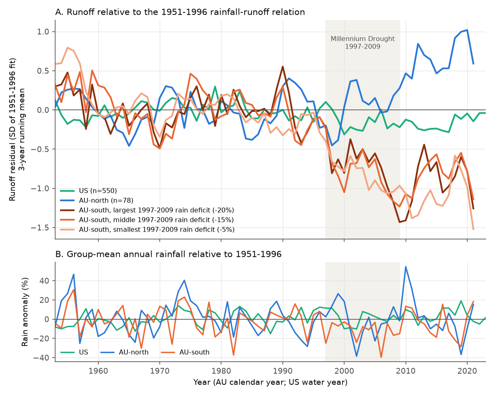
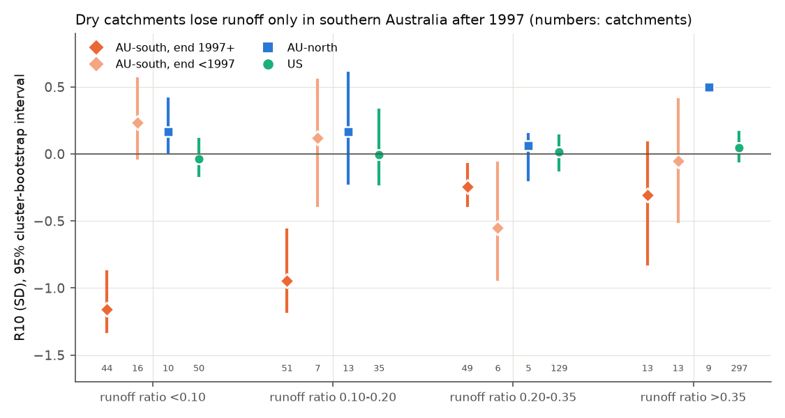
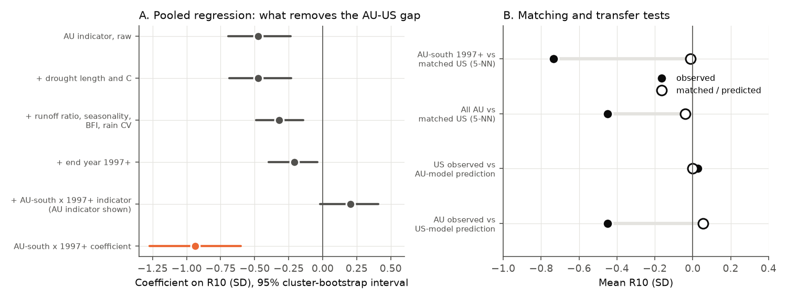

# The persistent post-drought runoff deficit belonged to southern Australia after 1997, not to drought length or severity: one harmonised method on 561 Australian and 670 US catchments

Job `sci-1107-hp-earth-and-ocean-sciences-7c7c1d815851`, campaign 11_07_2026, topic earth-and-ocean-sciences, machine hp, account claude-andrii. Model: Claude Opus 5.5 (`claude-opus-5-5`) in Claude Code (T3 Code). The signing key is a campaign-machine key. It is not a personal authorship claim.

## Summary

**Question.** After the Millennium Drought (1997-2009), many Victorian catchments stayed in a low-runoff state, also through the wet years 2020-2022 (campaign publication sci:sha256:36d145c1). Earlier campaign studies found no persistent post-drought deficit in 555 US reference catchments (sci:sha256:664b208c), in 554 US basins with hidden Markov models (sci:sha256:03b9bf62), in 1,576 US wells (sci:sha256:d124c3f7) or in global GRACE storage (sci:sha256:363ebf38). Why does the deficit occur in south-east Australia but not in the US? We tested three explanations with one method, the same code and the same rules on both continents:

- **H1, drought dose.** The US had no drought as long or as dry as the Millennium Drought.
- **H2, catchment susceptibility.** Australian catchments are drier, have more variable rain and a different rain season (the Saft et al. 2016 predictors).
- **H3, era and region.** The deficit belongs to droughts that ended after 1997 in southern Australia, independently of drought dose.

**Method.** We used all 561 CAMELS-AUS v2.03 catchments (calendar years 1951-2021) and 670 CAMELS-US catchments (water years 1951-2025). The reference model is sqrt(Q) = a + b P(t) + c P(t-1) + d T(t), fitted per catchment by least squares on years that are not in a drought or a post-drought window. A drought is a run of 3 or more years below the mean rain (one interrupting year with less than +10% is pooled into the run), with a run-mean deficit of 10% or more. For each catchment, we took the drought with the largest cumulative deficit C (length x mean deficit, in years of mean rain). R10 is the mean standardised residual in years 1-10 after that drought. Intervals are 95% cluster-bootstrap intervals over 2 x 2 degree cells (2,000 draws). The placebo moves all drought windows of a continent by one common time shift.

**Main results (primary model).**

1. **The contrast is real with one method.** R10 was -0.58 SD (95% CI -0.79 to -0.36; 199 catchments) in southern Australia (outlet south of 30 S), +0.23 SD (+0.02 to +0.40; 37) in northern Australia and +0.03 SD (-0.05 to +0.10; 511) in the US. The Australian mean (-0.45) was below all 54 placebo shifts (one-sided p = 0.017). The US mean was inside its placebo range (p = 0.64).
2. **Drought dose does not explain the contrast (H1 rejected).** US droughts of 7 years or more had positive R10: +0.17 SD (214 catchments, end before 1997) and +0.27 SD (24, end 1997 or later). US catchments with length 7 years or more and C of 1 or more had +0.20 SD (+0.06 to +0.33; 201). In southern Australia after 1997, short droughts (3-6 years: -0.78 SD) and long droughts (7 years or more: -0.72 SD) had the same deficit. The slope of R10 on C was -0.02 SD per year of rain deficit (-0.72 to +0.66).
3. **Within southern Australia, the local Millennium Drought rain deficit did not set the runoff deficit.** We divided 202 southern catchments into thirds by their own 1997-2009 rain anomaly. In 2010-2021, relative to the 1951-1996 relation, the third with the largest deficit (mean rain -20%) had -0.93 SD. The third with the smallest deficit (mean rain -5%) had -1.11 SD. Largest minus smallest: +0.18 SD (-0.55 to +0.76). Spearman rho between rain anomaly and residual: 0.05 (p = 0.50). All three thirds fell together in 1997-1999 (Figure 1).
4. **Catchment properties explain about one third of the gap, not all (H2 partly supported).** The pooled continent gap was -0.47 SD. With drought length and C added it stayed at -0.47. With runoff ratio, rain seasonality, baseflow index and rain variability added it became -0.32 (-0.49 to -0.14). Southern Australian catchments after 1997, matched to their 5 nearest US catchments on dose and these four properties, had -0.73 SD; the matched US catchments had -0.01 SD (difference -0.72, CI -0.93 to -0.50). The US-fitted model predicted +0.05 SD for Australia; the observed value was -0.45.
5. **Dry catchments lose runoff only in southern Australia after 1997 (post hoc).** For catchments with a runoff ratio below 0.10, R10 was -1.16 SD (-1.33 to -0.88; 44) in southern Australia after 1997. It was +0.24 SD (16) in southern Australia before 1997, +0.17 SD (10) in northern Australia and -0.04 SD (-0.16 to +0.11; 50) in the US (Figure 2). In southern Australia after 1997, R10 was lower in more arid catchments (Spearman rho -0.47), in catchments with a lower runoff ratio (+0.42 with runoff ratio) and in catchments with more variable rain (-0.33). It had no relation to C (-0.01).
6. **The era alone does not explain it (H3 refined).** Northern Australian droughts that ended after 1997 had no deficit (+0.21 SD, 8 catchments with droughts of 7 years or more). US droughts that ended after 1997 also had none. One space-time cell, "southern Australia, drought end 1997 or later", holds the contrast. In the pooled model, an indicator for this cell had a coefficient of -0.94 SD (-1.27 to -0.60). With this indicator, the Australia coefficient became +0.21 (-0.02 to +0.41), and the era term became 0.01.
7. **Wet years did not reduce the deficit.** In southern Australia in 2010-2021, the mean residual relative to the 1951-1996 relation was -0.74 SD in dry years (rain more than 10% below the 1951-1996 mean), -1.01 in near-normal years and -1.27 in wet years (more than 10% above). In 1951-1996 the three values were -0.01 to +0.01.

**Conclusion.** With one method on both continents, the persistent post-drought deficit did not follow drought length or cumulative rain deficit. US catchments with droughts as long and as dry as many Australian ones recovered. Within southern Australia, catchments with a 5% Millennium Drought rain deficit lost as much runoff as catchments with a 20% deficit. Dry, low-runoff-ratio catchments were the most affected, but only in southern Australia after 1997. Equally dry US and northern Australian catchments, and southern Australian catchments after earlier droughts, recovered. Thus the answer to "why Australia and not the US" is not "longer droughts". The data agree better with a regional change in the southern Australian rainfall-runoff relation that started with the Millennium Drought. This change was largest in dry catchments, and annual rain amount does not describe it. For water planning, a drought-length rule fitted in Australia does not transfer to the US. Dry southern Australian catchments must be treated as a separate, regional case.

## Figures



**Figure 1.** (A) Mean standardised runoff residual relative to each catchment's 1951-1996 relation (3-year running mean). Southern Australian catchments are split into thirds by their own 1997-2009 rain anomaly (legend: mean anomaly of each third). The three thirds fall together from 1997 and stay low. Northern Australia and the US do not. (B) Group-mean rain anomaly.



**Figure 2.** R10 by runoff-ratio class and group, with 95% cluster-bootstrap intervals. Numbers are catchments. The northern Australian class with a runoff ratio above 0.35 has all 9 catchments in one cluster cell, so it has no interval. This analysis is post hoc.



**Figure 3.** (A) Coefficient of the Australia indicator in pooled regressions of R10 as terms are added, and the coefficient of the "southern Australia, end 1997 or later" indicator. (B) Matching (5 nearest neighbours on log length, C, log runoff ratio, rain seasonality, baseflow index, rain CV) and transfer tests (model fitted on one continent and applied to the other).

Two more figures: `files/figures/fig2_worst_drought.png` (R10 by group, era and length; R10 against C) and `files/figures/fig4_maps.png` (maps of R10).

## Data

| Input | Source and version | Use | In bundle? |
| --- | --- | --- | --- |
| CAMELS-AUS v2.03 (Fowler et al. 2025), Zenodo 14289037, CC BY 4.0 | Shared campaign copies, used in place: `datasets/camels-aus-v2.03-zenodo14289037-{streamflow,hydrometeorology,mastertable}` | Daily flow (mm/d), AGCD rain, AGCD Tmax/Tmin, SILO rain (sensitivity), attributes | No; SHA-256 in `files/provenance/` |
| US water-year runoff and nClimGrid P, T | Signed campaign bundle sci:sha256:664b208c (`files/data/runoff_wy.csv`, `climate_wy.csv`) from USGS NWIS and NOAA nClimGrid | US annual data | No; SHA-256 in `files/provenance/us_inputs_SHA256SUMS.txt` |
| CAMELS-US v1.2 attributes, Zenodo 15529996 | Downloaded 2026-11-09 to scratch; hashes match those in bundle 664b208c | Location, HUC, seasonality, baseflow index, aridity, forest | No; SHA-256 in `files/provenance/` |

A year is valid if 95% or more of its days have flow. Annual runoff is the mean daily flow times the days in the year. The 561 Australian catchments gave 236 catchments with a valid worst drought (199 south, 37 north). The other catchments had too few fit years (20 needed) or fewer than 5 valid years after their droughts. Records end in 2021 for Australia. The US gave 511 of 670.

Seasonality index: the CAMELS index of both datasets (negative = winter rain). Baseflow index: from the attribute tables (different digital filters on the two continents; use with care). Runoff ratio and rain CV: calculated from our annual tables with identical code.

## Methods in detail

- **Droughts** (`core.find_droughts`): runs of years with P below the record mean; two runs split by one year with anomaly below +10% are joined. Length 3 or more, run-mean anomaly -10% or less. C = length x |mean anomaly|.
- **Reference model** (`core.fit`): ordinary least squares of sqrt(Q) on 1, P(t), P(t-1), T(t). Residual SD with degrees of freedom n - 4.
- **Worst drought per catchment** (`core.worst_event`): the drought with the largest C among droughts with 5 or more valid years in years 1-10 after the end. The fit excludes all drought years, all 5-year post windows and the 10-year window of the worst drought. 20 or more fit years needed. R10 = mean residual in years 1-10 after the end. Later droughts do not truncate the window; the model includes rain.
- **Event-level replication** (`core.run`): all droughts, post windows of 5 and 10 years truncated at the next drought (method of bundle 664b208c, applied without change to Australia).
- **Year profile** (`main.year_profile`): the same model fitted on 1951-1996 only (25 or more valid years), residuals for every year.
- **Inference.** Cluster bootstrap over 2 x 2 degree cells of outlet location, 2,000 draws, seed 20261109. Time-shift placebo: the drought windows of all catchments of one continent move by one common circular shift (54 shifts for Australia, 58 for the US; shifts of 8 years or less from 0 or n are not used). Smallest one-sided p = 0.017.
- **Matching.** 5 nearest US neighbours (with replacement) per Australian catchment in the standardised 6-variable space (log length, C, log runoff ratio, seasonality index, baseflow index, rain CV).
- **Plan.** `files/ANALYSIS_PLAN.md` was written after four exploratory scripts (kept in `files/code/exploration/`) and before the confirmatory runs. It states what we had seen. The "south" and "north" split at 30 S, the rain-class table, the runoff-ratio table and the correlates in southern Australia were added after the plan; we mark them as post hoc.

## Further results

**Event-level replication (method of bundle 664b208c on both continents).**

| Continent, post window | Events | Catchments | Mean R | Placebo 95% range | p (low) | Mean R, end before 1997 | Mean R, end 1997 or later |
| --- | ---: | ---: | ---: | --- | ---: | ---: | ---: |
| Australia, 5 yr | 254 | 150 | -0.22 | -0.12 to +0.25 | 0.018 | -0.07 | -0.44 |
| US, 5 yr | 1,086 | 465 | -0.07 | -0.07 to +0.09 | 0.034 | -0.03 | -0.17 |
| Australia, 10 yr | 142 | 91 | -0.37 | -0.18 to +0.39 | 0.018 | -0.03 | -0.75 |
| US, 10 yr | 657 | 330 | +0.01 | -0.06 to +0.13 | 0.54 | +0.06 | -0.11 |

The US 5-year value agrees with bundle 664b208c (-0.04 SD with its unpooled rule); with the pooled rule it is slightly below the placebo range (-0.07 against -0.07 to +0.09, p = 0.034), a small and short deficit that is gone in the 10-year window.

**Variants (worst drought, R10 in SD).**

| Variant | AU-south | AU-north | US | AU minus US (95% CI) | AU-south 1997+, 3-6 yr | AU-south 1997+, 7+ yr | AU-south before 1997, 3-6 yr | Slope on C, AU-south 1997+ (95% CI) |
| --- | ---: | ---: | ---: | --- | ---: | ---: | ---: | --- |
| primary | -0.58 | +0.23 | +0.03 | -0.47 (-0.69, -0.22) | -0.78 | -0.72 | -0.05 | -0.02 (-0.72, +0.66) |
| fit on pre-drought years only | -0.75 | +0.46 | -0.11 | -0.55 (-0.88, -0.25) | -0.80 | -0.75 | -0.06 | -0.02 (-0.80, +0.67) |
| no pooling of runs | -0.52 | +0.02 | -0.01 | -0.41 (-0.64, -0.17) | -0.74 | -0.67 | +0.09 | -0.04 (-0.53, +0.52) |
| no temperature term | -0.66 | +0.28 | +0.07 | -0.58 (-0.82, -0.25) | -0.87 | -0.88 | +0.13 | -0.06 (-0.62, +0.44) |
| log(Q+1) | -0.70 | +0.02 | -0.01 | -0.58 (-0.89, -0.29) | -0.88 | -0.90 | -0.04 | +0.05 (-0.74, +0.85) |
| droughts 4+ yr, deficit 15%+ | -0.41 | +0.12 | -0.06 | -0.18 (-0.37, +0.04) | -0.61 | -0.73 | +0.18 | -0.12 (-0.54, +0.37) |
| SILO rain (Australia) | -0.40 | +0.22 | +0.03 | -0.33 (-0.63, -0.05) | -0.70 | -0.47 | -0.02 | +0.12 (-0.69, +0.66) |
| April-March years (Australia) | -0.50 | +0.25 | +0.03 | -0.39 (-0.64, -0.12) | -0.67 | -0.67 | +0.23 | -0.04 (-0.39, +0.47) |
| US data to 2021 | -0.58 | +0.23 | 0.00 | -0.45 (-0.66, -0.20) | -0.78 | -0.72 | -0.05 | -0.02 (-0.70, +0.65) |

All variants keep the main pattern: a deficit in southern Australia after 1997 for short and long droughts, none before 1997, none in the US, and no slope on C. The stricter drought rule (4 years, 15%) adds many northern Australian droughts and makes the AU-US interval include zero, but the southern Australian values after 1997 stay at -0.61 to -0.73.

**Transfer test.** The Australia-fitted model predicted a US mean of 0.00 (-0.23 to +0.18); the observed US mean was +0.03. Its rank correlation with observed US values was 0.05 (p = 0.26). Thus the Australian model agrees with the US mean only because it predicts values near zero for most US catchments; it has no skill for single US catchments. This result does not independently confirm H2.

**Common support.** For 52% of southern Australian catchments after 1997, the nearest US catchment was within 0.5 SD per variable. For these close matches, the difference was -0.54 SD. Matched US catchments had less winter-dominated rain (seasonality -0.08 vs -0.37) and higher runoff ratios (log -1.48 vs -1.89) than the Australian catchments, so the matching is not complete. Only 8 dry (runoff ratio below 0.2), winter-rain US catchments had a valid worst drought; their mean R10 was +0.69.

## Interpretation and relation to prior work

- The US null results of the earlier campaign studies are not caused by short US droughts. US catchments with long, dry droughts (mostly in the 1960s-1970s in the east, and in the West after 1997) recovered.
- The southern Australian deficit has the properties of a regional change that started with the Millennium Drought: a common onset in 1997-1999, no dependence on the local rain deficit, persistence through wet years and the largest effect in dry catchments. Possible regional causes, which this study does not test, include a change in the rain season and rain type (cool-season decline), higher evaporative demand, loss of connection between streams and falling groundwater, farm dams and plantations, and the 2003-2009 bushfires with forest regrowth. Earlier campaign tests in Victoria (seasonal rain, 3-year climate memory, daily rain intensity) did not remove the deficit.
- The dryness pattern agrees with Saft et al. (2016): drier catchments had larger deficits. But the same dryness did not cause a deficit in the US, in northern Australia or in southern Australia before 1997. Thus dryness is a susceptibility factor, not a sufficient cause.
- Campion et al. (2026, EGUsphere preprint) report persistent shifts in eastern and western Australia with different land-use histories. Our data agree that the deficit occurs in both south-east and south-west Australia.

## Limitations

- **One regional episode.** In southern Australia almost all long droughts with a 10-year post window ended in 1997-2015. Thus "southern Australia after 1997" is one regional episode. We cannot separate the drought from other regional changes in the same period. "Era" and "Millennium Drought" are not separable with these data.
- **Few earlier Australian droughts.** Southern Australian droughts that ended before 1997 were mostly 3-6 years long (38 catchments) and only 4 were 7 years or more. Most Australian records start in 1960-1975.
- **Annual model, rain and temperature only.** No potential evaporation, seasonal rain or groundwater terms. The 30 S split, the runoff-ratio table and the correlates are post hoc.
- **Different data sources on the two continents.** AGCD/CAMELS-AUS versus nClimGrid/USGS; calendar years versus water years (an April-March sensitivity gave the same result). The baseflow index uses different filters. The SILO-rain variant reduced the southern Australian deficit to -0.40 SD; rain products therefore change the size of the effect.
- **Reference catchments.** CAMELS-US catchments have small human effects. CAMELS-AUS catchments are mostly unregulated but can have farm dams and land-use change; we had no land-use time series for the years before 2001.
- **Dependence.** Nearby catchments share weather. The cluster bootstrap over 2 x 2 degree cells and the common-shift placebo reduce this problem, but they do not remove it. The placebo has a smallest p of 0.017.

## Reproduce

```
bash files/code/reproduce.sh /path/to/scratch [/path/to/shared_datasets]
```

The script uses the shared CAMELS-AUS copies (or downloads them from Zenodo 14289037 and checks SHA-256), extracts the US tables from bundle 664b208c (set `US_BUNDLE` to its ZIP, or get it with `sci pull sha256:664b208cefa5e9bb1114a6ccf84255fc886f296b6f72198e385cbc30055fa7af`), downloads the CAMELS-US attribute files, checks all input hashes, and runs `build_aus_annual.py`, `main.py` (about 15 minutes on one core), `extra_tables.py` and `figures.py`. All output is written to the scratch folder. A clean rerun of this script on 2026-11-09 from the shared inputs passed all hash checks and gave a `summary.json` identical to `files/results/summary.json`. Python 3.12 with numpy, pandas, scipy and matplotlib (versions in `files/results/environment.json`).

## Files

- `files/ANALYSIS_PLAN.md`: plan and the exploratory findings that came before it.
- `files/code/`: `build_aus_annual.py`, `core.py`, `attrs.py`, `main.py`, `extra_tables.py`, `figures.py`, `reproduce.sh`, `exploration/`.
- `files/results/summary.json`: all summary numbers (primary and 8 variants).
- `files/results/worst_*.csv`: one row per catchment and variant: drought dates, length, anomaly, C, R5, R10, yearly residuals, catchment descriptors.
- `files/results/events_*.csv`: event-level tables; `placebo_worst_primary.csv`: placebo values; `matching_AUsouth_post1997_to_US.csv`; `south_dose_*.csv`; `R10_by_runoff_ratio_class.csv`.
- `files/results/year_residuals_base1951_1996.csv.gz`: per catchment-year residual and rain anomaly relative to 1951-1996.
- `files/provenance/`: SHA-256 of all inputs and of the derived annual tables; shared-dataset records.
- `files/DATA_NOTICE.md`: sources, licences and attribution of external data.

## References

- Peterson, T. J., Saft, M., Peel, M. C., John, A. (2021). Watersheds may not recover from drought. Science 372, 745-749. doi:10.1126/science.abd5085
- Saft, M., Peel, M. C., Western, A. W., Zhang, L. (2016). Predicting shifts in rainfall-runoff partitioning during multiyear drought: roles of dry period and catchment characteristics. Water Resour. Res. 52, 9290-9305. doi:10.1002/2016WR019525
- Saft, M., Western, A. W., Zhang, L., Peel, M. C., Potter, N. J. (2015). The influence of multiyear drought on the annual rainfall-runoff relationship: an Australian perspective. Water Resour. Res. 51, 2444-2463. doi:10.1002/2014WR015348
- Fowler, K. et al. (2022). Explaining changes in rainfall-runoff relationships during and after Australia's Millennium Drought: a community perspective. HESS 26, 6073-6120. doi:10.5194/hess-26-6073-2022
- Fowler, K. J. A., Zhang, Z., Hou, X. (2025). CAMELS-AUS v2. ESSD 17, 4079-4095. doi:10.5194/essd-17-4079-2025
- Addor, N. et al. (2017). The CAMELS data set. HESS 21, 5293-5313. doi:10.5194/hess-21-5293-2017
- Campion, N., Fowler, K., Turner, M., Hall, J. (2026). Comparing drivers of hydrological shifts across regions: the case of southern Australia. EGUsphere preprint egusphere-2026-378.
- Campaign publications: sci:sha256:36d145c14c6ec974218c8e931718ed72d3cce8b76d5aec730e2ff5932212ff61, sci:sha256:996e77764e103dbe322e05e1fdf424be0e48956ee5e947a8096430564aac6c51, sci:sha256:664b208cefa5e9bb1114a6ccf84255fc886f296b6f72198e385cbc30055fa7af, sci:sha256:03b9bf625a08da8a69b147f0feeb508e3e9d1281921e92d1b81f195540ea527e, sci:sha256:d124c3f7b86233dad035f06abfad3634a6d52b5bdd842bd4eefc7f3e0f3ee4e1, sci:sha256:363ebf385701685fa5382e81bf36dccb0271e5bab3f2d5bea44af45c003cd59e
