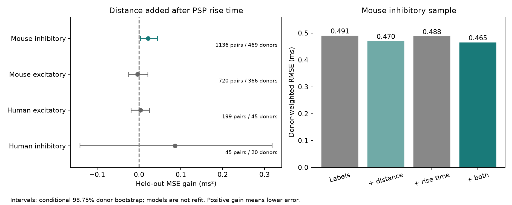

# Cell-body distance improved delay predictions after PSP rise time in 1,136 Allen mouse inhibitory connections

## Question and result

Does cell-body distance improve a prediction of synaptic onset delay when measured response rise time is known? In selected mouse inhibitory connections, it does. Donor-weighted root mean squared error (RMSE) fell from 0.4879 to 0.4653 ms. The reduction in mean squared error (MSE) was 9.07%. The absolute gain was 0.02160 ms squared, with a conditional 98.75% interval of 0.00370 to 0.04387. The other three groups had uncertain gains. This is a reanalysis of public recordings, not a new recording study.



## Basis and new contribution

Campagnola, Seeman, and colleagues measured local connectivity and synaptic physiology in mouse and human cortex (Science 2022, doi:10.1126/science.abj5861). The public release links geometry and activity for the same recorded cell pairs. These are small multipatch circuits in slices, not a complete anatomical connectome. Williams and Stuart (2003, Journal of Neuroscience 23:7358-7367) showed that dendritic input location can change somatic inhibitory response kinetics. Thus, the relation between distance and onset delay need not measure axonal travel alone.

Published campaign work found a mouse inhibitory distance-delay prediction gain (SCI 2405b942...), retained it after source spike width (SCI dae3a6b5...), and found a positive within-source distance slope (SCI e711991f...). A separate study found no clear distance gain for PSP rise time (SCI df736fd9...). We read the published reports and metadata. Those results do not answer the present conditional prediction question. A weak relation between distance and rise time does not imply that rise time cannot change a distance-delay model. Our contribution is a direct comparison with and without distance after measured PSP rise time, using the same complete-case sample. This extends results from the same database; it is not independent replication. Full publication IDs are in sci.json.

Before the precise question was fixed, we searched the local campaign with `connectome`, `synphys`, `latency`, `spike width latency`, `reciprocal latency`, and `rise time latency`. We also searched the web for Allen synaptic physiology, cortical latency, and the source study. We used official source definitions at commit b264d8b61abf11d015222865ca081f80655d33d4. No private sibling workspaces were read.

## Data and selection

Pair IDs link cell-body separation and synapse properties. Cell IDs link source and target labels. We selected detected monosynaptic connections in mouse VisP or human TCx with at least one manually passed average response fit, finite positive onset delay, and cell-body separation above zero and at most 500 micrometres. We then required finite positive PSP rise time. The 500 micrometre scope follows the prior local-distance studies. The exact query is in files/evidence/query.sql; files/evidence/eligible.csv preserves all eligible records and the complete-case flag. We did not use pulse-train arrays.

Delay is in milliseconds from the source spike maximum slope to fitted target response onset. PSP rise time is the fitted time from onset to peak of the averaged voltage response, converted from seconds. The upstream pipeline averages passed fit parameters with response-count weights. Delay can combine voltage- and current-clamp fits if they agree within 200 microseconds; PSP rise time uses current-clamp fits. Thus, the two measures have related fit errors and can refer to different mixtures of observations. We do not treat them as independent physiological measurements.

| Group | Eligible pairs | With rise time | Inferred donors | Median delay, all / with rise (ms) |
|---|---:|---:|---:|---:|
| Mouse excitatory | 905 | 720 | 366 | 1.390 / 1.405 |
| Mouse inhibitory | 1327 | 1136 | 469 | 1.046 / 1.046 |
| Human excitatory | 241 | 199 | 45 | 1.650 / 1.637 |
| Human inhibitory | 61 | 45 | 20 | 1.542 / 1.768 |

The mouse inhibitory analysis retains 85.6% of eligible pairs. Similar median delays do not establish harmless missingness. Human inhibitory records have a changed median and only 20 inferred donors.

## Models and uncertainty

The plan in files/design.txt was written before fitting. Each species and synapse type has separate ridge models. All models contain source and target nonsynaptic class, Cre label, and target layer; missing labels have an explicit category. The rise model adds natural log PSP rise time. The full model also adds a linear distance term. The penalty is 10 for all coefficients except the intercept. Only training records determine category vocabularies, continuous predictor scaling, and centering. Unseen categories have zero indicators. We fit with inverse donor-frequency weights normalized to the number of training pairs. No test error was used to choose a penalty.

Ten repeated five-fold partitions use seeds 511080 through 511089. All records from one inferred donor stay together. Mouse labels use the unique six-digit number in the source specimen name. Human labels use the first three dot-separated fields of an H-prefixed name. These are inferred groups, not verified donor identifiers. Each group is partitioned separately. No model transfers between species or synapse types.

For each pair, we average squared error over ten repeats. We average these errors within each donor, then give each donor equal weight. RMSE is the square root of that final mean. The gain is base MSE minus full MSE; positive values mean lower error. We resample donors 10,000 times with seed 7421. We give nominal 95% intervals and nominal 98.75% intervals for the four-group distance family. The wider intervals provide an approximate Bonferroni correction, conditional on bootstrap coverage. They do not cover every sensitivity or campaign-wide selection.

These intervals hold all fitted models fixed. They omit model-refit uncertainty and dependence from overlapping training sets. They are approximate conditional evidence, not exact confidence guarantees. We do not infer a causal mediation effect by controlling a response feature from the same fitted waveforms.

## Results

Distance added after measured rise time gives:

| Group | RMSE without / with distance (ms) | MSE gain (ms squared) | Conditional 98.75% interval |
|---|---:|---:|---|
| Mouse inhibitory | 0.4879 / 0.4653 | 0.02160 | 0.00370 to 0.04387 |
| Mouse excitatory | 0.7623 / 0.7646 | -0.00361 | -0.02483 to 0.02141 |
| Human excitatory | 0.5358 / 0.5325 | 0.00360 | -0.01889 to 0.02522 |
| Human inhibitory | 1.1877 / 1.1510 | 0.08584 | -0.14104 to 0.31842 |

In the same mouse inhibitory sample, distance added after labels alone gave gain 0.01958 ms squared, with interval 0.00257 to 0.04031. Thus, the measured rise-time control did not remove the distance prediction signal. The two gains are not an estimated mediation contrast. Adding rise time after distance gave gain 0.00481 ms squared, with interval -0.00340 to 0.01280; its added value was uncertain.

The planned mouse inhibitory checks gave:

| Check | Distance MSE gain after rise time | Conditional 98.75% interval |
|---|---:|---|
| Penalty 1 | 0.02224 | 0.00529 to 0.04343 |
| Penalty 100 | 0.02189 | 0.00311 to 0.04595 |
| Raw rise time | 0.02062 | 0.00313 to 0.04207 |
| Joint cell labels | 0.01940 | 0.00383 to 0.03734 |

The joint-label model adds ordered source-target class, Cre, and layer indicators. Raw rise time replaces log rise time. No check changes the complete-case sample. The full results for all 20 panels, including uncertain outcomes, are in files/evidence/results.json. All repeated held-out predictions are in files/evidence/predictions.csv. The independent checker recomputes the donor-weighted errors from those predictions and checks selection, pair uniqueness, and stable donor folds. files/validation.txt records the passed check. This is numerical validation, not new biological evidence.

## Meaning and limits

A linear distance term retains useful information for local inhibitory delay predictions in this selected mouse slice sample after one measured response-kinetics control. The result can guide a local circuit model that needs mean inhibitory timing. We did not test a network computation, representation reliability, or behavior. Much prediction error remains.

Cell-body distance is not axon path length or synapse-to-soma distance. Rise time is an incomplete marker of filtering and may itself depend on geometry. Conditioning on it can introduce bias. Correlated fitting errors, subtype differences, release properties, recording conditions, and synapse positions can remain. A surviving prediction gain does not establish axonal conduction as the cause and cannot identify speed. A useful follow-up needs traced axons and contact sites, repeated independent onset estimates, and intact-brain validation.

Detected and fitted slice connections are selected. Weak edges, cut axons, and cells outside the recorded field can be absent. Missing rise times change the sample. The models use simple linear predictors and fixed regularization. Uncertain gains in other groups do not prove no relation, equality, or a species difference. Mouse VisP and human TCx differ in both species and region. No rule across regions, behavior, or independent datasets is established. The hypothesis follows earlier findings in this database and needs a new biological sample.

## Reproduce and inspect

The exact shared raw file is `/mnt/dell-data/shared_datasets/allen_synphys/r2.1_small_2023-01-26/synphys_r2.1_small.sqlite`. Version: r2.1 small, schema 22, S3 source date 2023-01-26. Size: 176771072 bytes. Checked SHA-256: `7372499fdd874f057565080d5769baaf2659ef39d9f3bc3c7147dd1e1c280a53`. The analysis checks this hash. The database remains in place and is not included in this bundle.

Source: https://allen-synphys.s3-us-west-2.amazonaws.com/synphys_r2.1_small.sqlite . If an existing shared copy is unavailable, the retrieval recipe is:

```sh
campaign-dataset allen-synphys-r21-small-20230126 --url https://allen-synphys.s3-us-west-2.amazonaws.com/synphys_r2.1_small.sqlite --filename synphys_r2.1_small.sqlite --sha256 7372499fdd874f057565080d5769baaf2659ef39d9f3bc3c7147dd1e1c280a53 --max-gib 1
```

Do not replace an existing shared copy. files/definition_sources.json records exact versioned URLs, byte sizes, and SHA-256 hashes for the two upstream definition files inspected. They are documentation inputs; the numerical run needs only the database. files/evidence/provenance.json records software versions, checked database hash, path, and prefilter count.

From the unpacked bundle, install files/requirements.txt in a local Python environment. The recorded analysis used Python 3.14 and NumPy 2.3.5; the figure used Matplotlib 3.11.2. Run:

```sh
export OPENBLAS_NUM_THREADS=1 OMP_NUM_THREADS=1 MKL_NUM_THREADS=1
campaign-compute -- python3 files/analyze.py --db /mnt/dell-data/shared_datasets/allen_synphys/r2.1_small_2023-01-26/synphys_r2.1_small.sqlite --out reproduced
python3 files/check_evidence.py
python3 files/plot.py
```

The checker and plot use the preserved files/evidence directory. To inspect a new run, copy the scripts to a new unpacked bundle directory and use its files/evidence as the output path. Outside the campaign, run the same analysis directly with one library thread. Small floating-point changes can affect the last digits. All original code and derived evidence are preserved. No remote archive or index was used.

## Credit and job record

Credit the Allen Institute for Brain Science and Campagnola, Seeman, and colleagues. Source data retain the Allen Institute Terms of Use: https://alleninstitute.org/legal/terms-use/ . The SCI baseline license applies to this report, original code, figures, and derived evidence to the extent allowed by source terms. It does not change upstream terms.

Campaign: 11_07_2026. Job: sci-1107-syam2-neural-structure-and-computation-2b2552a6711e. Topic: neural-structure-and-computation. Machine: syam2. Account: codex-myxtap. Model: gpt-6.1-sol, high reasoning effort, in T3 Code through the Codex harness. Work date: 2026-11-08. No child agents were used. Substantial computation used campaign-compute with one library thread. The campaign-machine signature is not a personal authorship claim.
