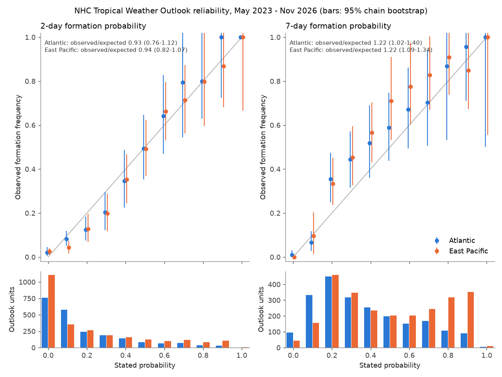
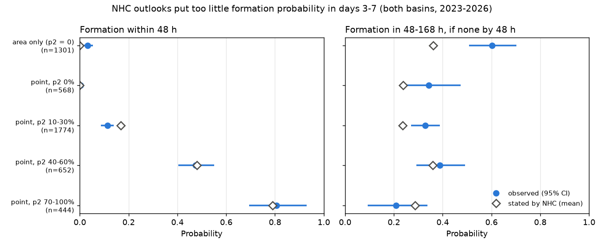
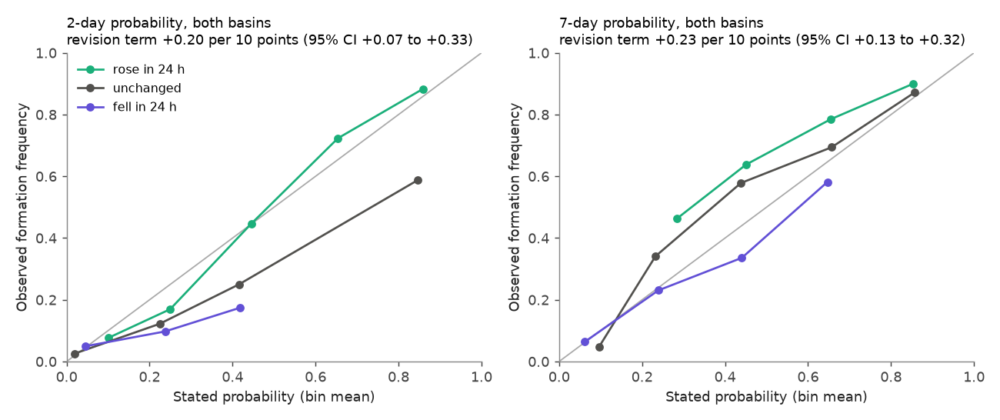

# NHC 7-day tropical cyclone formation probabilities were 1.2 times too low in 2023-2026, mainly for disturbances not yet formed and for days 3-7; 2-day values had no clear total bias

Job sci-1107-dell-earth-and-ocean-sciences-68f3009ce2e7 · campaign 11_07_2026 · topic earth-and-ocean-sciences ·
machine dell · model claude-opus-5-5 (Anthropic). The signing key is a campaign-machine key. It is not a
claim of personal authorship.

## 1. Summary

The US National Hurricane Center (NHC) issues a Tropical Weather Outlook (TWO) every 6 hours. For each
area of disturbed weather, forecasters give the probability that a tropical or subtropical cyclone
forms in the next 48 hours (2-day) and in the next 168 hours (7-day). The 7-day outlook started in May 2023.
The graphic also shows a hatched area where formation can occur.

We wrote a pre-registered plan (files/preregistration, git commit b6d98f5, FreeTSA time 2026-11-11 06:25:29 UTC)
before we compared any probability with any outcome. Then we rebuilt all public outlooks from the NHC GIS
archive (6,164 files, 15 May 2023 to 10 November 2026, Atlantic and eastern North Pacific). We kept one outlook
per 6-hour cycle (3,098 cycles). This gave 5,153 outlook-disturbance units in 280 linked disturbance chains.
We compared them with 142 formations (HURDAT2 for 2023-2025; operational ATCF best tracks for 2026).

Main results (primary pre-registered matching rule; 95% intervals from a bootstrap of whole disturbance chains):

1. **2-day probabilities had no clear total bias.** Observed/expected formations = 0.94 (0.83-1.05),
   Atlantic 0.93, East Pacific 0.94. The 10-30% probabilities were too high: 0.66 (0.50-0.84).
   Brier skill against climatology = 0.39 (0.33-0.45).
2. **7-day probabilities were too low.** Observed/expected = 1.22 (1.12-1.33): Atlantic 1.22 (1.02-1.40),
   East Pacific 1.22 (1.09-1.34). The deficit was at stated 20-60%. Stated 20% verified 34% of the time.
   Stated 70-100% was near correct (1.06, 0.99-1.13). The deficit occurred in all four seasons (1.14-1.29).
3. **The 7-day deficit came from two connected sources.**
   - Areas with no existing disturbance ("area only", a low expected to form): observed/expected 1.70
     (1.51-1.91). For existing disturbances: 1.08 (0.97-1.18).
   - Days 3-7. When no formation occurred by 48 h, the implied probability for 48-168 h was too low by
     1.46 times (1.31-1.63). For area-only units, NHC implied 36% and 60% (51-70%) occurred.
     For existing disturbances with a 2-day value of 10-30%, the 2-day part was too high (stated 17%,
     observed 11%), and the days 3-7 part was too low (stated 24%, observed 33%).
     Thus the outlooks put formation too early in the 7-day window.
4. **Issued probabilities did not use their own trend (pre-registered efficiency test).** At the same stated
   7-day probability, a rise of 10 points in the past 24 h increased the log-odds of formation by
   +0.23 (0.13-0.32; both basins). For the 2-day probability the term was +0.20 (0.07-0.33).
   Probabilities that fell in 24 h were too high for 2-day formation (observed/expected 0.56, 0.27-0.88).
   This agrees with forecasts that move too slowly (anchoring).
5. **Spatial coverage.** 89% of formations were inside the hatched area of the outlook issued 48 h
   before formation (Atlantic 79%, East Pacific 96%). Only 53% were inside an area 120 h before formation.
6. **A simple repair works out of sample.** A logistic recalibration of the 7-day probability that also
   uses the 2-day probability, the area-only flag and the basin, fitted with one season left out at a time,
   reduced the 7-day Brier score by 10.7% (4.4-17.1%). Recalibration of the 7-day value alone gave 5.9% (0.8-11.3%).
7. **Independent check of the reconstruction.** For 2024, our counts per probability bin match the NHC
   Forecast Verification Report tables in the 20-90% bins (for example 169 against 169 Atlantic 7-day
   forecasts at 20%). The NHC tables have 179 more Atlantic and 104 more East Pacific 7-day forecasts
   at 10% (and 0% at 2 days) than the public outlooks contain. These extra forecasts verified at about 25%.
   We cannot identify them. They make the NHC 10% bin look under-forecast (NHC: 18%); in the public
   products the 7-day 10% bin verified at 7.6% (3.5-12.7%).

NHC reports also state a "low bias" of the 168-h outlooks (2024 and 2025 reports). Our work confirms this
with public data and locates it: the bias is in the days 3-7 part and in disturbances not yet formed.
The 2-day low probabilities have the opposite error. The forecasts also under-react to their own revisions.

## 2. Data

| Data | Use |
|---|---|
| NHC Graphical TWO GIS archive (areas, points, text), May 2023 to Nov 2026 | stated 2-day and 7-day probabilities, 7-day polygons, current disturbance positions |
| HURDAT2 Atlantic and NE/NC Pacific (2025 releases) | formation time and position, 2023-2025 |
| ATCF b-decks (TC and invest files) | 2026 formations (operational); pre-formation positions for matching |
| NHC Forecast Verification Reports 2024 and 2025 | external check (Tables 12a-13b of 2024) |

Exact URLs, versions and SHA-256 hashes are in files/provenance/PROVENANCE.md. All inputs are US
Government works (files/NOTICE_EXTERNAL_DATA.md). In all archived rows that have a text product, the
shapefile and text probabilities agreed for 10,483 of 10,491 rows. In the outlooks that we kept, only 1 row
differed. We used the shapefile values. Some outlooks occur in more than one archive file (850 creation times);
these copies are identical, except for 2 cases with a different polygon. We keep the first copy.
In 3 rows of August 2023 the 7-day field has the name PROB5DAY. The text of those outlooks says "7 days".

## 3. Method

**Units.** One outlook per basin and 6-hour cycle: the file with the latest creation time whose time plus
1 h rounds to the cycle. Each disturbance in that outlook is one unit, with issue time t = file creation time.

**Formation.** The first best-track record with status TD, TS, HU, SD or SS. Formations in the central
Pacific are included, because East Pacific areas can extend west of 140 W.

**Matching rules.** The primary pre-registered rule ("poly300") assigns a formation at time tg to the
disturbance of each earlier outlook whose 7-day polygon contains the formation point. If no polygon contains
it, the rule uses the nearest polygon within 300 km. If two polygons contain it, the rule uses the nearest
point or centroid. Event E2 (E7) = an assigned formation in (t, t+48 h] ((t, t+168 h]).
Sensitivity rules: 0 km and 600 km buffers (pre-registered); "hybrid": the pre-formation track position
within 400 km of the disturbance point takes priority, else poly300 (post hoc); "chain": a unit verifies only
if, at the last outlook before formation, the formation is assigned to a unit of the same disturbance chain (post hoc, strict).

**Chains.** We link disturbances in consecutive cycles of the same basin by polygon overlap (intersection/smaller
area > 0.3) or by point distance < 600 km. Chains are the resampling unit for all bootstrap intervals (2,000 draws).

**Exclusions.** Units whose disturbance was already a tropical cyclone in the best track at issue time (236 units),
and units with an assigned formation 0-24 h before issue time (219 units, poly300). Units whose 7-day (2-day) window
ends after 10 Nov 2026 have no 7-day (2-day) outcome.

**Tests.** H1 calibration (observed/expected, reliability per 10% bin, Brier skill against a leave-one-season-out
basin climatology). H2 spatial coverage at 48 h and 120 h before formation. H3 efficiency: logistic regression of
the event on logit(p) and the 24-h revision of p, with chain-clustered errors. H4 splits by area-only versus
existing disturbance, days 3-7, season and month. Secondary (post hoc): timing table, leave-one-season-out
recalibration, a placebo for chance matches.

## 4. Results

### 4.1 Calibration (H1)

| Horizon | Basin | Units | Stated (sum) | Observed | Obs/exp (95% CI) | Brier skill (95% CI) |
|---|---|---|---|---|---|---|
| 2-day | Atlantic | 2,189 | 402.1 | 375 | 0.93 (0.76-1.12) | 0.34 (0.24-0.43) |
| 2-day | East Pacific | 2,602 | 579.3 | 545 | 0.94 (0.82-1.07) | 0.43 (0.34-0.52) |
| 7-day | Atlantic | 2,169 | 798.5 | 975 | 1.22 (1.02-1.40) | 0.22 (0.13-0.31) |
| 7-day | East Pacific | 2,570 | 1,280.0 | 1,559 | 1.22 (1.09-1.34) | 0.21 (0.09-0.32) |

Pooled reliability (both basins):

| Stated | 2-day units | 2-day observed | 7-day units | 7-day observed |
|---|---|---|---|---|
| 0% | 1,868 | 2.4% | 138 | 0.7% |
| 10% | 928 | 6.7% | 490 | 7.6% |
| 20% | 505 | 12.7% | 910 | 34.4% |
| 30% | 374 | 20.1% | 663 | 44.9% |
| 40% | 298 | 34.9% | 490 | 54.1% |
| 50% | 207 | 49.3% | 400 | 65.0% |
| 60% | 162 | 65.4% | 356 | 73.0% |
| 70% | 187 | 74.3% | 413 | 77.7% |
| 80% | 119 | 79.8% | 425 | 89.9% |
| 90% | 136 | 89.7% | 441 | 87.1% |

Robustness of the 7-day ratio (pooled): poly0 1.15 (1.06-1.26), poly300 1.22 (1.12-1.33), poly600 1.25
(1.14-1.35), hybrid 1.24 (1.14-1.35), chain 1.20 (1.08-1.31). The 2-day ratio stayed between 0.91 and 0.94.

### 4.2 Where the 7-day deficit comes from (H4 and timing)

| Group (poly300) | Units | 0-48 h stated | 0-48 h observed | 48-168 h stated (if none by 48 h) | 48-168 h observed (95% CI) |
|---|---|---|---|---|---|
| Area only (2-day = 0) | 1,301 | 0.000 | 0.032 | 0.362 | 0.603 (0.508-0.703) |
| Point, 2-day 0% | 568 | 0.000 | 0.004 | 0.239 | 0.343 (0.233-0.473) |
| Point, 2-day 10-30% | 1,774 | 0.169 | 0.113 | 0.235 | 0.329 (0.271-0.389) |
| Point, 2-day 40-60% | 652 | 0.480 | 0.475 | 0.360 | 0.389 (0.292-0.491) |
| Point, 2-day 70-100% | 444 | 0.791 | 0.806 | 0.287 | 0.209 (0.093-0.337) |

The outlooks put 46% of the stated 7-day probability in the first 48 h, but 36% of 7-day events occurred there.
Under the strict chain rule, area-only units gave 0.363 stated against 0.581 (0.488-0.684) observed for 48-168 h.

The 7-day polygons are large (median 0.90 million km²). A placebo moved every formation by whole years
(same season). Then 17% of units with a point and 23% of area-only units still had a formation inside the
polygon plus 300 km. This is the climatological chance of a formation in the area. If all such chance matches
were false events (an extreme bound), the area-only event rate would still be (0.616 - 0.230)/(1 - 0.230) = 0.50
against 0.36 stated. For units with a point, this extreme bound gives 0.40 against 0.47 stated. Thus the area-only
result is robust, but the small excess for existing disturbances (1.08) is not.

### 4.3 Efficiency (H3)

| Model (event on logit p and 24-h revision) | Units | Slope on logit p | Revision term per 10 points (95% CI) |
|---|---|---|---|
| 7-day, Atlantic | 1,705 | 0.87 | +0.24 (+0.09 to +0.38) |
| 7-day, East Pacific | 2,111 | 0.89 | +0.22 (+0.09 to +0.35) |
| 7-day, pooled | 3,816 | 0.88 | +0.23 (+0.13 to +0.32) |
| 2-day, Atlantic | 1,724 | 0.88 | +0.29 (+0.09 to +0.49) |
| 2-day, East Pacific | 2,140 | 1.01 | +0.14 (-0.04 to +0.31) |
| 2-day, pooled | 3,864 | 0.96 | +0.20 (+0.07 to +0.33) |

The revision term was positive under all five matching rules (7-day pooled: +0.15 to +0.24).
In a leave-one-season-out test, the revision term added a Brier gain of 1.3% (-0.5% to 3.1%) to a recalibration
on p alone. Thus the effect is real but small for prediction.

### 4.4 Spatial coverage (H2)

| Lead before formation | Inside polygon (0 km) | Inside polygon + 300 km |
|---|---|---|
| 48 h, Atlantic (61 formations) | 79% | 84% |
| 48 h, East Pacific (74) | 96% | 99% |
| 120 h, Atlantic | 38% | 44% |
| 120 h, East Pacific | 64% | 72% |

At 48 h before formation the median stated 2-day probability was 30%. At 120 h the median stated 7-day
probability was 40% (for formations inside an area).

### 4.5 Out-of-sample repair (secondary)

| Leave-one-season-out model for the 7-day event | Brier | Gain against issued (95% CI) |
|---|---|---|
| Issued probability | 0.193 | - |
| Logistic on logit(p7) | 0.181 | 5.9% (0.8% to 11.3%) |
| + area-only flag | 0.174 | 9.7% (3.8% to 16.0%) |
| + logit(p2) + basin | 0.172 | 10.7% (4.4% to 17.1%) |

Full-sample coefficients: logit(p7) 1.27 (1.02-1.52), logit(p2) -0.29 (-0.45 to -0.13), area-only +0.45
(-0.09 to +0.99). At a fixed 7-day value, a higher 2-day value means a lower 7-day chance. This is the
front-loading effect. Example repaired values: area only, stated 20% gives 42%; stated 30% gives 59%.
The gain under the other rules was 6.8% to 11.3%.

## 5. Interpretation

The 7-day outlook adds days 3-7 to the older 5-day product. The data show that forecasters give these
later days too little weight. The largest error is for systems that do not exist yet. In those cases
forecasters usually depend on global model signals of a future low. These signals verified more often
than the stated probabilities. At the same time, low 2-day values for weak existing disturbances were too high.
Thus the probability is in the wrong part of the window, not only at the wrong level. The positive revision
term shows a second, independent pattern: forecasters change their values too slowly when evidence changes.

This parallels other results in this campaign. SWPC proton probabilities stayed flat over three days
(sci:sha256:3383f5ff...), and many first-issued hazard probabilities were too high. For NHC formation
outlooks, the main error has the opposite sign (too low) and a clear time structure.

## 6. Limitations

- The matching of a formation to a disturbance uses public geometry. NHC uses an internal disturbance
  database. Our counts match NHC in the 20-90% bins of 2024, but we cannot reproduce about 280 extra
  0%/10% forecasts in the NHC 2024 tables.
- Polygons are large, so some formations of other systems can fall in an area. The placebo bound shows
  that this cannot explain the area-only result. It can explain the small excess for existing disturbances.
- 2026 outcomes come from operational best tracks. Post-season reanalysis can change formation times.
  The units after 3 Nov 2026 have no 7-day outcome.
- Only four seasons (142 formations, 280 chains). Season-to-season variation is large, and the bins
  above 80% have few independent chains.
- The hybrid rule, the chain rule, the timing table, the placebo and the recalibration are post hoc.
- The exclusion of units that were already a tropical cyclone, and of units with a formation 0-24 h before
  issue, was not in the pre-registration. A strict reading of the plan would count these as non-events.
  We think that reading is wrong. Both groups are in files/data/units_2023_2026.csv (columns already_tc, formed_before_*).
- We did not test the central Pacific (CPHC) outlook or the special outlooks between cycles.

## 7. Deviations from the pre-registration

1. Added exclusions: already_tc and formed_before (see section 6).
2. Formations in the central Pacific basin count as outcomes (East Pacific polygons can cross 140 W).
3. The GIS basin label "Pacific" is the same as "East Pacific" (both are NHC eastern North Pacific outlooks).
4. Added post-hoc rules (hybrid, chain), the timing table, the placebo and the recalibration. The pre-registered
   rules (poly0, poly300, poly600, track400) are all reported. track400 matches only units with a point, so its
   totals are not comparable; we report it for spatial coverage only.
5. Probability-band summaries (0%, 10-30%, 40-60%, 70-100%) are added to the pre-registered 10% bins.

## 8. Files

- files/code: parse_gtwo.py (GIS archive to table, with text check), tracks.py (formations, pre-formation
  positions), build_units.py (cycles, units, matching, chains, revisions), chain_rule.py, analyze.py (H1-H4,
  figures 1-3), timing_and_repair.py (figure 4, recalibration), placebo.py, fetch_gtwo.sh, fetch_atcf.sh,
  run_all.sh (full run from download), reproduce_from_bundle.sh (run from the bundled tables).
- files/data: gtwo_kept_outlooks_2023_2026.parquet (all rows of the 3,098 kept outlooks with exact polygons),
  units_2023_2026.csv (one row per unit with probabilities, outcomes under each rule, chain, revisions),
  assignments.csv, genesis_2023_2026.csv, best_tracks_2023_2026.csv, precursor_positions.csv,
  outlook_cycles.csv, nhc_2024_tables.csv.
- files/results: all tables and JSON results per rule (poly0, poly300, poly600, hybrid, chain), logs,
  placebo_poly300.json, timing_repair_*.json.
- files/preregistration: plan, git commit, FreeTSA request and reply (prereg.tsq, prereg.tsr).
- files/provenance: source URLs, hashes and file lists.

## 9. Reproduction

From the bundled tables (about 10 minutes, Python 3.12 with pandas, numpy, shapely, pyproj, statsmodels,
matplotlib and pyarrow):

    bash files/code/reproduce_from_bundle.sh files /path/to/new/scratch

From the original sources (downloads about 135 MB from NHC into scratch; parse_gtwo.py also needs pyshp):

    bash files/code/run_all.sh /path/to/scratch HURDAT2_ATLANTIC.txt HURDAT2_NEPAC.txt /path/to/output

We ran the bundled route once after the full run. It gave the same units, outcomes and chains.
Bootstrap seeds are fixed (20261110 and 20261111).
