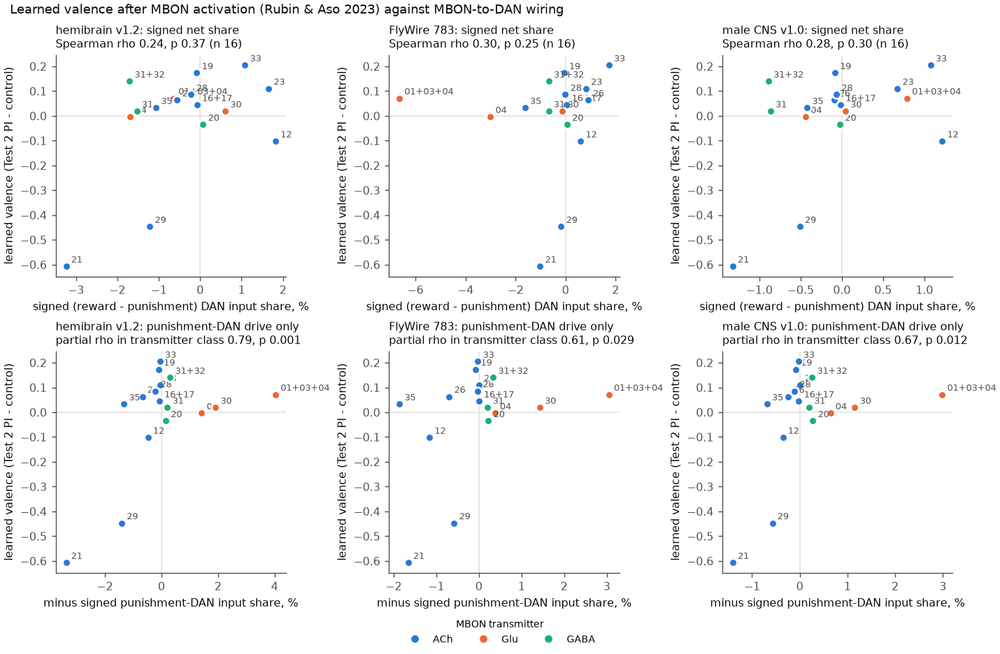
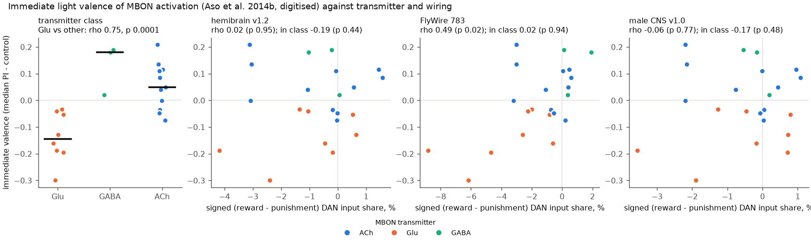
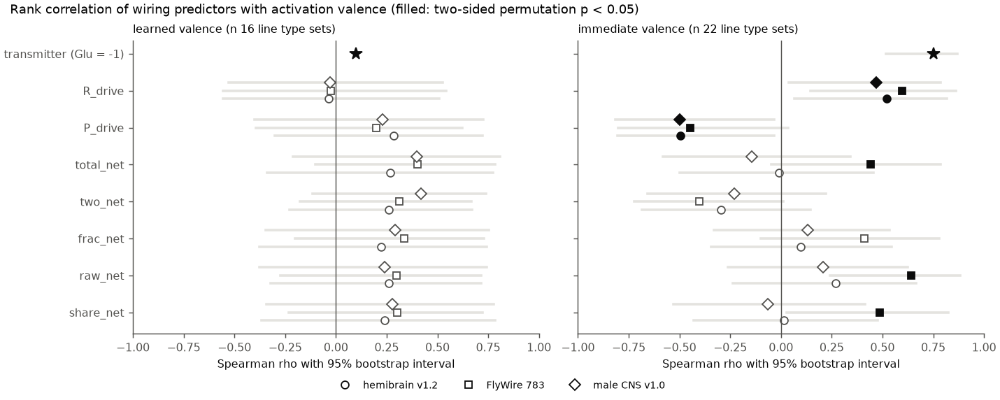

# In three fly connectomes, signed MBON-to-DAN wiring did not predict the learned valence of 16 activated MBON line groups beyond two gamma4/gamma5 types; transmitter class predicted immediate valence

**Job:** sci-1107-hp-neural-structure-and-computation-caa53ea3d293 · **Topic:** neural-structure-and-computation · **Machine:** hp · **Model:** Claude Opus 5.5 (claude-opus-5-5) in Claude Code · **Date:** 2026-11-12.
The signing key is a campaign-machine key. It is not a personal authorship claim.

## Question

Mushroom body output neurons (MBONs) send synapses back to dopaminergic neurons (DANs). Some DANs signal reward (most PAM types) and some signal punishment (PAM12-14, PPL101, PPL103, PPL106). When an MBON is activated together with an odour, the fly can learn to approach or avoid that odour. Rubin and Aso (2023) showed this for 27 split-GAL4 lines. In their figure they printed the number of synapses from each MBON type to reward and punishment DANs. They did not test this wiring quantitatively.

We asked two questions:

1. Does signed MBON-to-DAN wiring predict the **learned** valence (the memory score after MBON activation is paired with an odour)? A feedback route through DANs is a plausible mechanism for this behaviour.
2. Does the same wiring predict the **immediate** valence (approach to or avoidance of red light that activates the MBON; Aso et al. 2014b)? A DAN route is not necessary for this behaviour.

We used three connectomes from three different animals: hemibrain v1.2 (female, one hemisphere), FlyWire 783 (female, whole brain) and male CNS v1.0. Before this job, the campaign record had no publication on MBON valence (searched on 2026-11-12).

## Data

- **Learned valence.** Rubin & Aso 2023, eLife 12:RP90523, Figure 2 source data 1. For each line we used the preference index after three training cycles (Test 2), minus the empty-split control. We used Test 1 as a second outcome. We took the cell types of each line from Figure 2C. Lines that label the same cell-type set were averaged. This gave 16 units (26 lines). Table: `files/data/learned_valence_lines.csv`.
- **Immediate valence.** Aso et al. 2014b, eLife 3:e04580, Figure 2C. There is no source data, so we digitised the box-plot medians from the full-resolution figure. The y axis ticks are at pixel rows 50.5, 387.5 and 724.5 (PI 0.5, 0 and -0.5). A script found the median line automatically for 19 lines. We read 7 boxes (6 lines and the control) by eye from 2x crops: the median touched a box edge in MB210B, MB542B and MB093C, the whisker search failed in MB434B, MB011B and MB057B, and the grey band hid the control box. We read the expression strength of each cell type in each line from the grey level of the expression matrix. Lines that label the same cell-type set were averaged. This gave 22 units (25 lines). Table: `files/data/immediate_valence_lines.csv`. The digitisation error is approximately 0.01 PI.
- **Connectomes.** We used shared campaign copies of the original releases. The exact paths, URLs and SHA-256 hashes are in `files/data/provenance.json`. Type names (MBON01-35, PAM01-15, PPL101-108) are the same in all three connectomes. MBON08 does not occur in the connectomes. Its lines always label MBON09 too, so we used MBON09 for both.

## Method

For each MBON type T and DAN type D we calculated the **input share**: the synapses from all T neurons to all D neurons, divided by all input synapses of the D neurons. In hemibrain, D includes only right-side neurons, which have complete dendrites. Each MBON type has a sign s: acetylcholine +1, GABA -1, glutamate -1. This is the transmitter table of Rubin & Aso 2023, Fig. 2-figure supplement 1. Each DAN type has a label v: reward +1, punishment -1 (11 reward and 6 punishment types, from the same figure). The other DAN types have v = 0.

- **Primary predictor (written before the tests):** share_net = s x sum over D of v x share(T, D).
- Secondary predictors: raw_net = s x (reward synapses - punishment synapses) per hemisphere (the numbers that Rubin & Aso printed); frac_net = raw_net divided by all output synapses of T; two_net = signed two-step paths T -> x -> D through every non-MBON neuron x, with each step weighted by the input share and the x sign taken from the transmitter predictions; total_net = share_net + two_net; P_drive = -s x punishment share; R_drive = s x reward share; and a transmitter baseline (glutamate = -1, other = 0).
- For a line with more than one cell type, the predictor is the expression-weighted sum over its types.
- Statistics: Spearman rho with 100,000 permutations of the outcome; 95% bootstrap intervals over units (2,000 resamples); leave-one-unit-out range. As a specificity test, we did an exact **label-shuffle null**: we calculated rho for every one of the 12,376 ways to put 6 punishment labels on the 17 classified DAN types. We also did a **transmitter-stratified test**: a partial Spearman rho after we removed the means of each transmitter class, with 20,000 permutations inside each class. Finally, we repeated the tests without the two gamma4/gamma5 MBON types (MBON21, MBON29).

The written plan (`work/PROGRESS.md` of the job, copied below) was: H1, share_net correlates positively with the learned valence in each connectome at p < 0.05; H2, the same predictor is weaker for the immediate valence; H3, two-step paths improve H1.

## Results

**H1 was not supported (Figure 1, top row; `files/results/tests.csv`).** share_net gave rho = 0.24 (hemibrain), 0.30 (FlyWire) and 0.28 (male CNS) with the learned valence, n = 16, two-sided p = 0.37, 0.25 and 0.30. The 95% intervals were approximately -0.35 to 0.78. Pearson r was 0.52 and 0.46 in hemibrain and male CNS, but only 0.06 in FlyWire. Two points caused the positive sign: MBON21 and MBON29 (gamma4/gamma5, acetylcholine). They give the strongest aversive memory (-0.61 and -0.45) and they send many synapses to punishment DANs (MBON21 to PAM12; MBON29 to PPL101). Without these two types, rho was -0.05, 0.20 and 0.00 (`tests_without_mbon21_mbon29.csv`). The raw synapse numbers of the original figure (raw_net) and the output fraction (frac_net) gave the same picture (rho 0.20 to 0.34).

**Reward-DAN wiring did not predict appetitive memory.** R_drive gave rho = -0.04, -0.03 and -0.03. Two acetylcholine types show this clearly. MBON12 has the strongest signed reward-DAN share of all tested acetylcholine types in hemibrain and male CNS (2.3% and 1.6%, mostly to PAM02), but its activation gave a small aversive memory (-0.10). MBON35 sends a punishment-DAN share (1.3%, 1.9%, 0.7% to PAM12) similar to that of MBON21 and MBON29, but it gave no aversive memory (-0.01 and +0.07 in two lines).

**Exploratory: inside each transmitter class, punishment-DAN drive tracked learned valence.** The partial rho of P_drive was 0.79 (p = 0.001), 0.61 (p = 0.03) and 0.67 (p = 0.012) (Figure 1, bottom row; `tests_transmitter_stratified.csv`). Without MBON21 and MBON29 it was 0.62 (p = 0.026), 0.54 (p = 0.064) and 0.48 (p = 0.11). This was not the primary test, we did many tests, and 10 of the 16 units are acetylcholine types. Thus this is a hypothesis for a new test, not a finding.

**H3 was not supported.** Two-step paths gave total_net rho = 0.27, 0.40 and 0.40 (p = 0.31, 0.12, 0.13). This is a small increase that is not significant.

**Label-shuffle null (Figure 4).** For the learned valence, the true reward and punishment labels gave a higher rho than 91%, 98% and 90% of all label sets. This is weak evidence that the DAN valence labels carry some information. For the immediate valence, most random label sets gave a positive rho (the null is shifted to the right). Thus the immediate association does not depend on which DANs are reward or punishment DANs.

**Immediate valence followed transmitter class (Figure 2).** The glutamate baseline gave rho = 0.75 (p < 0.001, n = 22): activation of glutamatergic MBONs gave avoidance, and activation of GABAergic and most cholinergic MBONs gave approach. This repeats the result of Aso et al. 2014b with our digitised values. share_net was not consistent between connectomes (rho = 0.02, 0.49, -0.07). R_drive gave rho = 0.52, 0.60 and 0.47 and P_drive gave -0.49, -0.45 and -0.50, but inside transmitter classes these effects became small (partial rho of R_drive 0.31, 0.39, 0.24; p = 0.18, 0.09, 0.30). Glutamatergic MBONs send many synapses to reward DANs, so transmitter class and DAN wiring are confounded. These data cannot separate them. MBON15 (alpha'1, acetylcholine) has the largest punishment-DAN share of all MBON types (3.8% to 5.5%, mostly to PAM13 and PAM14). It was tested only in mixed lines (MB543B, MB542B, MB050B, MB052B), which gave no avoidance (-0.00 to +0.21).

**The wiring is reproducible between animals, but the behaviour data are small.** Over 33 MBON types, the reward and punishment shares agreed between connectomes (Spearman 0.81 to 0.93). share_net agreed 0.93 between hemibrain and male CNS, but only 0.54 to 0.60 with FlyWire. One cause is MBON21: in FlyWire it sends only 40 synapses per hemisphere to punishment DANs, against 263 in hemibrain and 126 in male CNS. The learned valence of lines with the same cell types agreed (Pearson 0.92 over 12 line pairs), but only 0.40 without MBON21 and MBON29. Most learned scores are near zero (between -0.10 and +0.26). Thus the data have little power outside the two strong aversive types.

## Conclusion

In three connectomes, direct signed MBON-to-DAN wiring identifies the two MBON types whose activation gives strong aversive memory (MBON21, MBON29). However, it does not rank the other 14 tested type groups. It also does not explain why strong reward-DAN input (MBON12) or strong PAM12 input (MBON35) gives no matching memory. The learned valence from MBON activation is therefore not a simple linear read-out of direct or two-step DAN wiring at the type level. The immediate valence followed the MBON transmitter. Wiring did not add a clear prediction beyond the transmitter.

## Limitations

- n = 16 and n = 22 units. Many confidence intervals include both zero and large positive values.
- Digitised immediate valence (medians only, no per-fly values). Expression weights are grey levels and are approximate.
- The learned outcome is a group mean per line. We had no per-experiment variance for a weighted analysis.
- The signs are assumptions: glutamate is taken as inhibitory (the result with glutamate excitatory is in `tests.csv`, predictor share_net_glu_excitatory; rho 0.12 to 0.23). The reward and punishment labels come from DAN activation studies. PAM03, PPL102, PPL104, PPL105, PPL107 and PPL108 have no label.
- Type-level sums ignore compartment location, axo-axonic synapses, neuromodulator co-release and plasticity state. The flies in the behaviour experiments were not the connectome animals.
- The connectomes differ in synapse detection: FlyWire DAN input totals are lower than in hemibrain, so shares are compared by rank only.

## What remains open

- Compartment-resolved models: does MBON input onto DAN axons inside the MB lobes predict better than whole-neuron counts?
- A direct test of the exploratory acetylcholine result with more cholinergic MBON lines (for example, the atypical MBON22, MBON24, MBON27, which were not tested).
- Per-experiment learned valence data, and the immediate valence of the new atypical-MBON lines, would allow a stronger test of H2.

## Related campaign work

- sci:7062426d (same job family): fly nerve-cord wiring predicted wing-versus-leg activation behaviour only as well as neuropil location. This is the same pattern: a simple anatomical class matched the wiring predictor.
- sci:5916130f and sci:29c399da: signed wiring from photoreceptors predicted ON/OFF signs only when glutamate was inhibitory. We used the same glutamate assumption.
- sci:10b3bf2e and sci:d47d61ce: models of the fly mushroom body calyx (input side). This job studies the output side.

## Reproduce

1. `bash files/code/retrieve.sh SCRATCH` downloads all inputs into a scratch folder (approximately 2 GB; the publication contains no raw data). Compare the hashes with `files/data/provenance.json`.
2. `bash files/code/run_all.sh SCRATCH OUT` rebuilds the behaviour tables, the connectome tables, all tests and all figures (approximately 30 min on 2 CPUs; male CNS needs approximately 2 GB RAM).
3. To start from the bundled derived tables, run `python files/code/analysis.py files/data OUT/results` and `python files/code/figures.py files/data OUT/results OUT/figures`. Permutation p values use a fixed seed (20261112).

## Files

- `files/code/`: `behaviour_tables.py` (behaviour tables and digitisation), `build_tables.py` (connectome tables), `analysis.py` (all tests), `figures.py`, `retrieve.sh`, `run_all.sh`, `check_counts.py` (reward and punishment synapse totals for a comparison with Rubin & Aso Fig. 2-S1).
- `files/data/`: line-level behaviour tables; type-level MBON-to-DAN tables for each connectome (`*_mbon_dan.csv`: synapses, DAN input totals, shares, two-step paths) and MBON output totals; `provenance.json`.
- `files/results/`: `tests.csv`, `tests_transmitter_stratified.csv`, `tests_without_mbon21_mbon29.csv`, `label_shuffle_null.json`, `cross_connectome_agreement.json`, `learned_line_reliability.json`, unit tables, type predictors, logs.
- `files/figures/`: five PNG figures.
- `files/NOTICE-external-data.md`: sources, licences and attribution of the external materials.

## Analysis plan as written before the tests (from the job progress log)

> Predictor (primary): D_share(T) = s_T * sum_D v_D * syn(T->D)/input(D); v=+1 reward DAN (PAM01,02,04-11,15), -1 punishment DAN (PAM12-14, PPL101,103,106), per Rubin&Aso Fig2-S1; s=+1 ACh, -1 GABA, -1 Glu (sensitivity Glu=+1).
> H1: D_share rank-correlates positively with learned (MBON-as-US, Test2) valence over unique line type-sets, in each of 3 connectomes (perm p<0.05).
> H2: Same predictor vs immediate light valence (Aso 2014b); expect weaker (no DAN route needed).
> H3: Adding signed 2-hop paths (FlyWire, male CNS) improves H1.
> Nulls: value permutation; DAN-label shuffle (11/6 split) to test valence-label specificity; leave-one-type-set-out.

The transmitter-stratified test and the removal of MBON21/MBON29 were added after we saw the first results. Two-step paths were also calculated for hemibrain, with transmitter signs mapped from FlyWire by hemibrain type.

## References

- Rubin GM, Aso Y (2023). New genetic tools for mushroom body output neurons in Drosophila. eLife 12:RP90523. doi:10.7554/eLife.90523
- Aso Y, Sitaraman D, Ichinose T, et al. (2014). Mushroom body output neurons encode valence and guide memory-based action selection in Drosophila. eLife 3:e04580. doi:10.7554/eLife.04580
- Scheffer LK, et al. (2020). A connectome and analysis of the adult Drosophila central brain. eLife 9:e57443. doi:10.7554/eLife.57443
- Dorkenwald S, et al. (2024). Neuronal wiring diagram of an adult brain. Nature 634:124-138. doi:10.1038/s41586-024-07558-y
- Schlegel P, et al. (2024). Whole-brain annotation and multi-connectome cell typing of Drosophila. Nature 634:139-152. doi:10.1038/s41586-024-07686-5
- Janelia FlyEM. Male CNS connectome v1.0 (2025). https://male-cns.janelia.org
