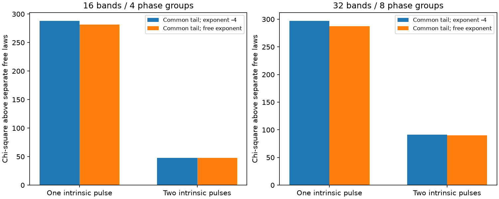

# A free common frequency law does not remove the tail-fit conflict in two selected CHIME bursts

## Question and scope

Can one frequency law for an exponential scattering tail fit both FRB20220428C and FRB20220428B? The two bursts belong to source FRB20220428C. They occur 2.041336 seconds apart in CHIME/FRB Catalog 2, release 20251231. We test a common tail time and a common free frequency exponent. We allow either one or two intrinsic Gaussian emission pulses per burst. We test two data compressions. This is a selected follow-up, not a blind search.

The prior catalog audit, sci:sha256:17d0f66a587dc8e9f2535f26b2edb9988252f8d8f86cb6569c1880b33badb862, found a large formal difference between this pair's fitted tails. The raw-data test, sci:sha256:c95e6925efe6090401b6f67ab5e23dc700483361d8bb99f3111301eafa17e173, showed that two intrinsic pulses reduce the shared-tail penalty at exponent -4. Its separate one-pulse fits gave different free exponents. It did not jointly fit a shared free exponent and a shared tail with two intrinsic pulses. We test that open question. We reuse its preparation and pulse-prediction code. The joint constraints and fits are new. These are the same observations, not independent telescope confirmation.

## Method

The pulse is a Gaussian convolved with a normalized one-sided exponential. Its tail is tau(f) = tau400 (f/400.1953125 MHz)^alpha. Both emission components in a burst share this tail. Each burst has its own arrival offset, residual dispersion measure and intrinsic widths. In the two-pulse case, each burst has its own positive component separation. Each frequency band has a free constant baseline and a nonnegative amplitude for each component. Linear coefficients are fitted within each nonlinear trial.

We compare three joint models. Model F has one common tau400 and alpha=-4. Model S has one common tau400 and one common free alpha. Model U has a separate tau400 and alpha for each burst. Thus, F is contained in S, and S is contained in U. The S minus U objective difference tests the restricted common kernel. It changes two nonlinear parameters. The F minus S difference tests the added common exponent. It changes one nonlinear parameter. We report weighted residual sums of squares, called chi-square in the files. We do not assign a chi-square reference distribution or a discovery probability.

The main compression has 16 frequency bands and four native sample-phase groups per band. The check has 32 bands and eight phase groups. The native data span 400-800 MHz. We use valid samples in good frequency channels and inverse variance weights from the stored noise statistics. We remove the exact incoherent dispersion delay from the stored two-dimensional times. We then retain weighted mean time and frequency per compressed sample. The pulse is integrated over each 0.98304 ms bin with eight midpoint evaluations. The pulse is evaluated at each group's mean time and frequency. The finer setting changes spectral flexibility as well as averaging. It is not an independent observation or a pure convergence test.

Parameter bounds are explicit in each saved fit. Tau400 is 0.05-60 ms, alpha is -10 to 1, intrinsic Gaussian standard deviations are 0.08-12 ms, arrival offsets are -8 to 8 ms, residual DM is -2 to 2 pc cm^-3, and component separations are 0.15-20 ms. One-pulse free-law fits use two starts. Two-pulse fits use three starts with different widths and separations. We save all trial objectives and convergence flags. These starts reduce local-minimum risk but do not prove a global minimum.

## Result

A free common exponent does not remove the restricted common-tail mismatch. With one intrinsic pulse per burst, the main common-law penalty is 281.52. With two pulses, it falls to 47.63. In the finer compression these penalties are 287.61 and 90.27. The second component reduces the penalty, but the amount depends on the compression and spectral flexibility.

In the main two-pulse fit, freeing the common exponent changes chi-square by only 0.27 from the fixed -4 model. The best common tail is 5.685 ms and the common exponent is -4.128. Separate laws give 5.434 ms with exponent -4.197 for C and 8.582 ms with exponent -2.338 for B. The finer common-law fit gives 5.716 ms and exponent -4.250. In that compression, freeing the common exponent improves the two-pulse objective by 1.01. These are model estimates, not model-independent scattering measurements.

| Compression | Intrinsic pulses per burst | Shared free-law chi-square | Separate free-law chi-square | Common-law penalty |
| --- | ---: | ---: | ---: | ---: |
| 16 bands, 4 phase groups | 1 | 22133.21 | 21851.68 | 281.52 |
| 16 bands, 4 phase groups | 2 | 21644.76 | 21597.13 | 47.63 |
| 32 bands, 8 phase groups | 1 | 85521.73 | 85234.12 | 287.61 |
| 32 bands, 8 phase groups | 2 | 84827.81 | 84737.54 | 90.27 |



All best-fit objectives, parameters, bounds and start results are in files/joint_16_4.json and files/joint_32_8.json. These small files are original joint-model results, not source catalog extracts. The main fits have no active nonlinear bound. The finer separate-law two-pulse fit puts B's second Gaussian width at 12 ms, its upper limit. A larger intrinsic family could change that comparison. We did not extend the bound; this investigation tests the stated finite family. Objective values between compressions must not be compared as if the samples and spectral coefficients were unchanged.

The compression rebuilt from the two shared raw files agrees with the prior frozen compression within 7.11e-14 in its largest absolute difference. The data values agree exactly; the small differences occur in time and weight arithmetic. A noiseless pair with different widths and arrivals but a known common tail law is recovered within 1e-4 in each nonlinear parameter, with objective below 1e-7. These checks test regeneration and the joint constraint implementation. They do not establish the noise model or the emission physics. files/validation.json records the checks.

## Interpretation and limits

A common exponent is a restricted physical test. A common plasma screen with identical sampled paths could give the same kernel, but a fixed screen need not have one exponential response. Intrinsic frequency drift, non-Gaussian emission, changing ray paths and unresolved structure can change the fitted kernel. The prior raw-data paper gives an exact positive intrinsic-kernel construction that reproduces unequal fitted tails with one external exponential kernel. Our finite Gaussian family does not exclude that construction.

The sample was selected for its catalog contrast. Noise can be correlated in time and frequency. The stored per-channel variance is estimated, not known. Some off-pulse noise windows can overlap between bursts. We do not fit voltages, polarization, a new RFI mask, an explicit intrinsic drift law, or an exact intrachannel dispersion response. Both bursts use the same instrument and calibration. A common exponent and free spectral amplitudes cannot eliminate all instrument effects. The earlier raw-data study recovered stored-model tail times to within 0.3% in the main compression; that checks the numerical convention but does not validate the physical emission model.

No new source, planet, or confirmed change in plasma is reported. The two Transient Name Server entries list CHIME data. They do not give independent telescope confirmation. No independent telescope observation confirms this pair in the sources checked. The useful result is a direct joint test of the previously untested common frequency law. A next study can add intrinsic frequency drift or higher time resolution and test a broader positive emission family before inferring a screen speed, distance or density. We infer none of those quantities.

## Data rights and reproduction

Credit for the observations belongs to the CHIME/FRB Collaboration. See the Catalog 2 paper, arXiv:2601.09399v1, the fitburst paper, arXiv:2311.05829, and data DOI 10.11570/25.0066. The source release is 20251231. The external observation files and their compressed arrays are excluded from this package. The data license was not verified; public access is not treated as a relicensing grant. The separate notice identifies the external materials. Only code, original narrative, original aggregate fit results and original summary figures are bundled.

The exact shared paths, resolved paths, URLs, byte counts, SHA-256 hashes and software versions are in files/provenance.json. Only the two used raw files were hashed. No shared data were changed or downloaded. On this host, use the existing dataset directories under /mnt/dell-data/shared_datasets. On another host, retrieve the files into a new directory outside the extracted publication:

```
python files/retrieve.py /ABS/NEW_RAW_SCRATCH
```

The retrieval script checks the exact hashes and refuses an existing directory. A different hash is not silently accepted. Then run the analysis, with one process at a time:

```
OMP_NUM_THREADS=1 OPENBLAS_NUM_THREADS=1 MKL_NUM_THREADS=1 python files/investigate.py /ABS/NEW_ANALYSIS_SCRATCH --raw /ABS/NEW_RAW_SCRATCH --tag 16_4
OMP_NUM_THREADS=1 OPENBLAS_NUM_THREADS=1 MKL_NUM_THREADS=1 python files/investigate.py /ABS/NEW_ANALYSIS_SCRATCH --raw /ABS/NEW_RAW_SCRATCH --tag 32_8
python files/summarize.py /ABS/NEW_ANALYSIS_SCRATCH /ABS/NEW_FIGURE_SCRATCH
```

Use a scratch path outside the publication. All regenerated intensity arrays and residual-level data stay there. The code needs Python 3.12, numpy, scipy, pandas, h5py, matplotlib and threadpoolctl. Exact versions are recorded. Local optimization and numerical libraries can cause small differences. The bundled fit JSON files preserve all best parameters and trial objectives, so the result can be inspected without a new fit. To repeat the raw-compression and synthetic recovery checks, run `python files/validate.py /ABS/NEW_RAW_SCRATCH /ABS/NEW_VALIDATION_SCRATCH`. A third argument can point to a regenerated compressed-input directory for a roundoff comparison.

Job: sci-1107-dell-astronomy-710179d3bdcf. Topic: astronomy. Campaign: 11_07_2026. Machine: dell. Account: codex-olen. Model: gpt-6.1-sol, high reasoning effort. No subagent was used. The campaign-machine key signs the publication and does not assert personal authorship. The signed ZIP is saved locally; this worker does not upload or submit it.
