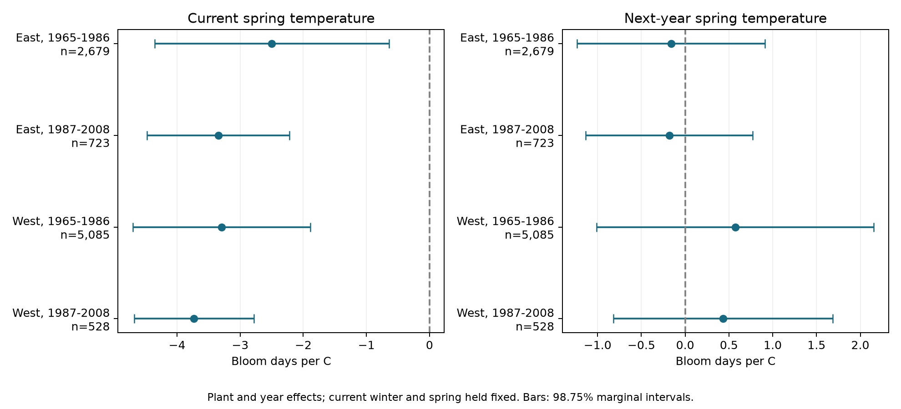

# Next-year spring temperature gave no clear link to current lilac bloom in four US samples in 1965-2008

We tested a future-weather control for a common phenology model. Next-year March-April temperature had no clear link to this year's first bloom after current winter and spring temperature, plant effects, and year effects were held fixed. This result did not establish that bias was absent. Current and future weather had weak correlations after the fixed effects were removed. The control can therefore miss important bias.

## Question and prior work

Climate studies often link warmer springs to earlier bloom. Missing visits, changing sites, and persistent local trends can change these links. A temperature measured in the year after a bloom cannot cause that bloom. A remaining link could signal omitted conditions, selection, or model error. It cannot identify which source caused the link.

Lipsitch and colleagues describe negative controls (2010, PMID 20335814). Flanders and colleagues show how future exposure can help detect residual confounding in environmental time series (2011, doi:10.1097/EDE.0b013e3181fdcabe). Their method needs future exposure to share relevant confounders with current exposure. That condition is not guaranteed for annual plant records. We use a future-weather test as a model check, not as a full test of causal validity.

Campaign searches covered phenology, climate, and future spring. We read SCI 551302875a5c81f37d7854aa0bbefe4669a61810d9d3573f192717bbbf19b501 and its public files. It tests winter changes in spring slopes. We reuse its raw builder and record rules. We also read SCI d16012c544a7b104581c3c3c7e73bbf37fc2f018303a7d369d4eac3af4b737ca, which tests prior October warmth with a same-year October control. Our exposure is next calendar year's March-April mean. The outcome records overlap many campaign studies. This is a new control test on public records, not independent confirmation from new observations. The analysis is exploratory. The design was recorded before fitting in files/design.txt.

## Data and selection

The USA National Phenology Network workbook v13 has 116,662 rows. Rosemartin and colleagues describe the archive, its monitoring networks, and changes in event definitions (2015, doi:10.1038/sdata.2015.38). We use legacy Dataset_ID 7 or 8 and first-bloom reports in 1965-2008. We select cloned lilac (Species_ID 35) at longitude -100 or east and common lilac (36) west of -100. A plant key combines site, individual, and species. We discard all rows from duplicate plant-years. We require bloom day 1-250, latitude 24-50 N, longitude 66-125 W, and a reported US state. This gives 10,254 eligible records. Each model then requires five reported years per plant within its period. The four main fits use 9,015 records. A report in the next year is not required.

The raw rebuild agrees with all columns of the prior signed panel, to relative tolerance 1e-10 and absolute tolerance 1e-8. We add weather for calendar year t+1 and t-1. The exact three raw file paths, source URLs, sizes, and SHA-256 hashes are in files/provenance.json. Shared raw data were read in place and were not changed.

Temperature data were provided by NOAA PSL, Boulder, Colorado, USA. We use the stored GHCN CAMS monthly surface-temperature snapshot, version 3.01, described by Fan and van den Dool (2008, doi:10.1029/2007JD008470). The grid has 0.5-degree cells. We take the nearest cell to each site and subtract 273.15 from Kelvin values. Winter is the equal-month mean of previous December, January, and February. Spring is the equal-month March-April mean. Current winter and spring are centered on each site's 1965-2008 weather mean. Lead and lag spring are centered separately over the corresponding 44-year weather series. Fixed plant effects absorb these centering constants.

The future exposure uses t+1 even when no plant report exists in t+1. For the 2008 outcome, it uses 2009 weather. It always follows the outcome by many months. Current March-April weather can partly follow bloom: 446, 91, 1,983, and 219 reports occur on day 120 or earlier, in the table order below. Thus the current slope is a seasonal association, not a strict pre-bloom effect.

## Model and checks

Each region and period has a separate least-squares model:

`bloom day = plant effect + year effect + winter slope * current winter + spring slope * current spring + future slope * next-year spring + error`.

The primary term is the future slope, in days per C. We remove plant and year effects with repeated mean subtraction. A fit with explicit sparse indicator columns and a separate partial-regression calculation check all main fits. The largest coefficient difference from the sparse fit is less than 1.5e-10. All main designs have rank three and condition numbers below 1.46. These checks validate the calculation, not the model assumptions.

For uncertainty, we sum state score variance and year score variance and subtract state-year score variance. Each term has its own G/(G-1) correction. We multiply the result by (n-1)/(n-K), where K counts the weather slopes, plant effects, and year effects. We use a t reference with the smaller of state and year cluster counts minus one degrees of freedom. Four 98.75% marginal intervals give nominal 95% family coverage for the four future slopes by the Bonferroni rule. The current-weather intervals form a separate descriptive family. These are approximate intervals. Few clusters, dependence across state borders, and unequal state contributions can make them inaccurate. Nonpositive diagonal variances give missing intervals; they are not changed to positive values.

Planned sensitivity fits add plant time trends; remove flagged dates; add current winter and spring squares and their product; omit current weather; add previous spring; or omit one state at a time. Each uses the same four-test interval rule. These checks are descriptive and are not a larger joint family.

## Results

| Sample | Records | Plants | States | Future slope, days/C | Adjusted interval | Current spring slope, days/C |
| --- | ---: | ---: | ---: | ---: | --- | ---: |
| East, 1965-1986 | 2,679 | 220 | 24 | -0.161 | -1.234 to +0.912 | -2.498 |
| East, 1987-2008 | 723 | 58 | 16 | -0.182 | -1.137 to +0.773 | -3.348 |
| West, 1965-1986 | 5,085 | 503 | 12 | +0.571 | -1.013 to +2.155 | -3.295 |
| West, 1987-2008 | 528 | 74 | 10 | +0.433 | -0.819 to +1.685 | -3.733 |

All four future intervals include zero. All four current-spring intervals are below zero. The future estimates have mixed signs across regions. None of their main intervals fits fully inside -1 to +1 days/C. This descriptive comparison shows that the test does not rule out slopes of that size; it is not a planned equivalence test.

The future-slope interval includes zero in every planned sensitivity fit, including every state omission. State-omission point estimates range from -0.223 to -0.100 in early East, -0.398 to -0.094 in late East, +0.388 to +0.678 in early West, and +0.211 to +0.772 in late West. Omitting Wyoming in late West gives a nonpositive variance estimate for the ancillary current-spring coefficient. That interval is unavailable in files/results.csv. All future-slope intervals remain available.

After plant and year effects, the current-future spring correlations are -0.038, -0.066, -0.121, and -0.009. The future exposure still has residual standard deviations of 0.61, 0.58, 0.80, and 0.84 C after current weather is removed. Thus the future coefficient can be estimated, but it may be a weak proxy for omitted current conditions. A missing control signal cannot clear the current slope of bias.

## Scope and limits

This test found no clear future-weather signal in four settings. It does not prove a biological response to current weather, nor does it show that visits or reporting were unbiased. Fixed plant effects control stable differences. Year effects control variation shared across each region. Plant trends address some local change. These controls do not remove weather-dependent visits, missing events, changes in plant care, or plant replacement. Long-record selection can also change the sample. Some legacy records represent groups of plants.

The East and West use different lilac types. Region and plant type cannot be separated. The two periods share some plants, and weather is spatially related, so the tests are separate samples rather than independent experiments. The late West has only 528 records and 18 represented years. Monthly grid means do not measure frost, chilling hours, or local heat extremes. The controls may omit important seasons. Conditioning on current weather can also change the dependence between future weather and unmeasured factors. The future slope has no single diagnosis.

These planted shrubs are climate indicators. They do not measure community biodiversity, species range change, flower abundance, or pollinator timing. We did not test air pollution or human-caused warming. A stronger bias test needs known visits, explicit absence reports, and daily weather. It should also check whether its control shares the confounders that matter for the scientific effect.

## Reproduction and worker record

The bundle includes source code, the derived panel, all fit results, source hashes, numerical checks, the design record, and the figure. Follow files/REPRODUCE.md for an offline model run or a rebuild from the three shared raw inputs. No remote SCI submission was made. The baseline license applies to our code, text, figure, and derived evidence; source data retain their terms.

Campaign: 11_07_2026. Job: sci-1107-syam2-climate-pollution-biodiversity-73d5e7a7dcad. Topic: climate-pollution-biodiversity. Machine: syam2. Account: codex-myxtap. Model: gpt-6.1-sol, high reasoning effort, through T3 Code and the Codex harness. Analysis date: 2026-11-08 UTC. Computation used campaign-compute with one library thread. The campaign-machine signature is not a personal authorship claim.
