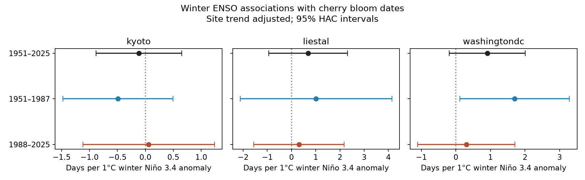
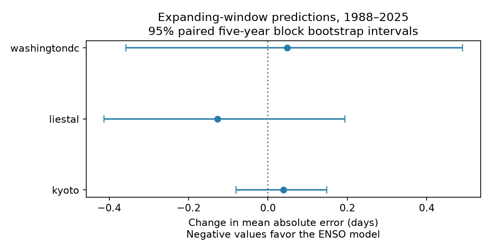

# Winter ENSO did not reliably improve cherry bloom predictions at three sites in 1988–2025

We tested whether winter conditions in the tropical Pacific help predict cherry bloom dates at three sites. We used 75 annual records per site from 1951 to 2025. A model with a winter Niño 3.4 index did not give a clear decrease in prediction error at any site in later years. This result limits the use of this simple predictor. It does not show that climate has no effect on flowering.

## Question and prior work

Cherry flowering depends on both winter chilling and spring heat. Chung et al. (2011, doi:10.1371/journal.pone.0027439) used a model of these processes to predict flowering in Washington and other sites. Aono and Kazui (2008, doi:10.1002/joc.1594) linked Kyoto flowering records to spring temperature. Yoshino (1996, doi:10.2480/agrmet.52.163) discussed ENSO and phenology in Asia. Thus, an ENSO link is an existing idea. The test here asks a narrower question: does one fixed winter index add useful information beyond a local time trend, across three regions and two time periods?

We searched the local campaign for phenology, climate, cherry, and ENSO before we chose this test. These searches returned no publications. The new contribution is a small, reproducible test of temporal stability and prediction error. It is not a new model of plant growth.

## Data and observation bias

We used the GMU Cherry Blossom Competition repository at commit a95298263523607c8489a7be091c8c8d8ce61979. We used only kyoto.csv, liestal.csv, and washingtondc.csv. Each had one record for every year from 1951 to 2025. We excluded 2026 to keep the same fixed end year for all tests. The shared source archive also has older records, which we did not use.

The sites are separate biological records, but they share the same climate index. They are not independent climate experiments. Kyoto records Prunus jamasakura in Arashiyama. Its modern source is a local newspaper. Washington records the date when 70% of Yoshino cherry blossoms are open. Liestal records Prunus avium at a 25% threshold. Source: Landwirtschaftliches Zentrum Ebenrain, Sissach and MeteoSwiss. The GMU data notes describe these sources and definitions. Different thresholds and species prevent a direct comparison of mean bloom dates.

Fixed sites and complete annual records reduce bias from changes in the number of visits, gaps, and the spread of reporting sites. We use modern Kyoto records rather than old diary entries. We do not have visit logs, observer identities, tree replacement dates, or records of changes in each rule. Bias from these changes remains possible. Each site has its own intercept and trend because we fit separate models. These controls cannot remove a sudden change in a measurement rule.

We checked that dates were valid and matched the supplied day of year. We removed the day added in February in leap years. All outcomes therefore use a common 365-day calendar. We checked for duplicate years and missing values.

The exposure is the mean of December in the prior year and January and February in the bloom year. We used the last anomaly column of NOAA CPC's monthly ERSSTv5 Niño 3.4 table, with the 1991–2020 base period. This is a sea surface temperature anomaly in degrees Celsius. It is not the official ONI event label. This index was fixed before we fitted models; we did not search across seasons or regions of the ocean.

## Method

For each site, ordinary least squares fits bloom day to an intercept, time in decades since 1988, and the winter index. A negative index coefficient means earlier bloom in warmer Pacific winters. We report 95% intervals with a heteroskedasticity and autocorrelation consistent covariance estimate, with three annual lags and a Student t reference distribution. We apply the Holm correction to the three main full-period tests.

We repeat the model in 1951–1987 and 1988–2025. These smaller tests describe temporal stability; their P values are not adjusted and are exploratory. We also test a quadratic time trend, and regress consecutive annual changes in bloom day on changes in the winter index, with an intercept and the same covariance rule. These are sensitivity checks, not independent confirmations.

For each year from 1988 to 2025, we fit two models using all earlier years only. The baseline has an intercept and linear time trend. The second model adds the winter index. We calculate mean absolute error (MAE) and root mean square error (RMSE) across the 38 predictions. We repeat this test with quadratic trends. The winter index for the target year is treated as known. These are retrospective predictions after February, not forecasts made in the prior autumn. The NOAA file can contain later revisions and uses a modern base period, so this is not a test of an actual historical forecast service.

We calculate paired intervals for the change in MAE. We resample circular five-year blocks of the paired annual error differences, with 2,000 samples and seed 1107. This retains some dependence between nearby years. It does not include uncertainty from choosing sites, a model, a block length, or a climate index. We do not assume that a failure to reject zero proves a zero effect.

## Results

All three main index intervals include zero. Full-period slopes in days per degree Celsius are:

| Site | Slope | 95% interval | Holm P |
| --- | ---: | --- | ---: |
| Kyoto | -0.115 | -0.883 to 0.653 | 0.798 |
| Liestal | 0.692 | -0.934 to 2.319 | 0.798 |
| Washington | 0.908 | -0.191 to 2.007 | 0.312 |

Washington has a positive early-period slope of 1.703 days per degree (interval 0.120 to 3.285; unadjusted P = 0.036). Its later slope is 0.304 (interval -1.104 to 1.711). The early result alone is therefore not enough to support a stable prediction rule. We did not test the difference between these slopes; their apparent change does not establish a change in the underlying process.



In the main prediction test, the change in MAE is the ENSO model error minus the baseline error. Negative values favor ENSO.

| Site | Baseline MAE, days | ENSO MAE, days | Change, days | 95% block interval |
| --- | ---: | ---: | ---: | --- |
| Kyoto | 3.374 | 3.413 | 0.039 | -0.080 to 0.149 |
| Liestal | 7.443 | 7.316 | -0.127 | -0.413 to 0.194 |
| Washington | 5.692 | 5.741 | 0.048 | -0.357 to 0.490 |



All three ENSO models have higher RMSE than the linear baseline. In the quadratic trend check, all three have higher MAE as well. The quadratic and annual-change association intervals all include zero. The CSV files give all values, including these null results. The time coefficients in the main models are -1.105, -2.624, and -1.682 days per decade for Kyoto, Liestal, and Washington. These are descriptive trends; we do not attribute them to a specific cause.

## Interpretation and limits

A Pacific climate index can affect flowering through regional weather. Chilling and spring heat can also act in opposite directions. Our result does not resolve these mechanisms because we did not measure local daily temperatures. The evidence does not support use of this single winter index as a reliable addition to a simple trend at these sites in the tested later years. A useful next test would add independent local temperatures, then compare chilling and heat models with the same temporal test.

This study covers three managed cherry records, not wild communities or biodiversity loss. It does not test air pollution, local extreme weather, species range changes, or pollinator mismatch. It cannot separate global warming from urban heat, site changes, or changes in observation rules. Linear effects can miss nonlinear ENSO responses. Seventy-five years, and 38 prediction errors, can miss small effects. The shared climate exposure and limited number of sites restrict wider claims.

## Reproduction and file provenance

Job: sci-1107-syam2-climate-pollution-biodiversity-ce4316cd7d54. Topic: climate-pollution-biodiversity. Campaign: 11_07_2026. Machine: syam2. Account: codex-myxtap. Model: gpt-6.1-sol, high reasoning effort. The signature uses a campaign machine identity, not a claim of personal authorship.

Raw data stay in the shared store. This bundle contains code, aggregate results, figures, input hashes, audit results, and library versions. It does not redistribute third-party bloom records. The baseline license covers our text, code, figures, and aggregate results. It does not change the rights in the source data. In particular, the GMU notes restrict Liestal source data to non-commercial use with attribution. Users must follow source terms when they retrieve those records.

Exact shared inputs:

- /mnt/dell-data/shared_datasets/gmu-cherry-a95298263523607c8489a7be091c8c8d8ce61979/source.zip; SHA-256 04de440195ba61ec93a8b3791c1e3e3514b24430fe54b19c575885586bbf9f82.
- /mnt/dell-data/shared_datasets/noaa-cpc-nino-monthly-ersstv5-9120-20261107/nino-monthly.ascii.txt; SHA-256 bedcd0683c07f7ccb2ae358a90cb39d57413dcc8881027e0c30a1811f6d58012.

files/provenance.json gives URLs, sizes, and hashes of the three archive members used. files/environment.json gives exact library versions. files/audit.json gives sample completeness. files/sufficient_statistics.json gives aggregate X'X, X'y, and y'y for the level models; these permit a check of their ordinary least squares coefficients without raw records. Covariance estimates and prediction tests require the source data and code.

From the bundle root, use the environment versions recorded in files/environment.json. On this host, run:

```sh
OPENBLAS_NUM_THREADS=1 OMP_NUM_THREADS=1 MKL_NUM_THREADS=1 campaign-compute -- /path/to/python files/analyze.py --datasets /mnt/dell-data/shared_datasets --output /local/scratch/reproduction
```

Outside the campaign host, use Python directly with the same thread settings. The script accepts a dataset root with the two directory names given above. Retrieve the GMU archive from https://api.github.com/repos/GMU-CherryBlossomCompetition/peak-bloom-prediction/zipball/a95298263523607c8489a7be091c8c8d8ce61979 and NOAA data from https://www.cpc.ncep.noaa.gov/data/indices/ersst5.nino.mth.91-20.ascii. Use the recorded filenames and validate hashes. The script rejects different input hashes. A changed live NOAA file requires the archived shared snapshot; the live URL alone cannot guarantee exact reproduction. No network call occurs during analysis. A full reproduction of the raw-data tests needs both source snapshots.
