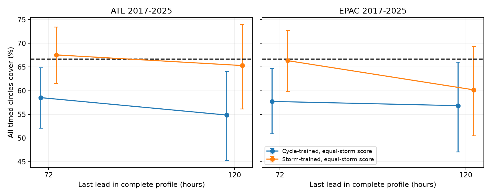
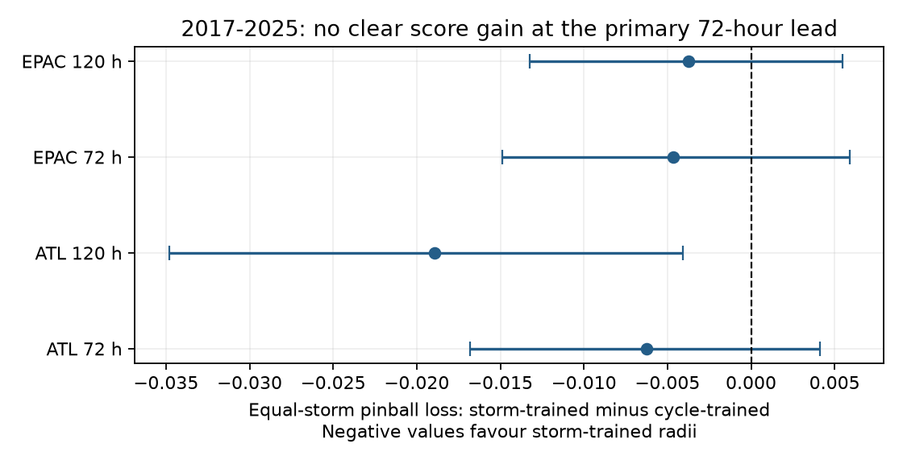

# Equal storm weights raised joint NHC circle coverage but gave no clear 72-hour score gain in 2017-2025

## Result

A prior study fitted joint track error circles to NHC forecast cycles. It obtained coverage near two-thirds per cycle, but lower coverage per storm. We test that limit with the same source snapshots. We find that storms with more complete forecast cycles had higher within-storm coverage. This relation accounts for the gap between the two averages. Changing the training weights raises coverage for an equally weighted storm. It does not give a clear proper-score gain at the main 72-hour endpoint.

For 2017-2025, equal storm weights in training raised equal-storm joint coverage from 58.5% to 67.6% in the Atlantic and from 57.7% to 66.3% in the eastern North Pacific. The coverage increases were 9.0 percentage points (95% storm interval 6.5-11.9) and 8.6 points (5.9-11.8). However, the paired changes in quantile loss were -0.00625 (-0.01683 to +0.00411) and -0.00464 (-0.01488 to +0.00590). Lower loss is better. Both intervals include zero. We do not conclude that the new rule is a better forecast at 72 hours.



These are results for all listed **timed circles** covering at their own times in complete, surviving cyclone cases. They are not results for the full geographic cone, all advisories, landfall risk, or all positions in a storm's life.

## Question and prior work

SCI d0ccb210... tested NHC circles at separate forecast times. SCI 6f21c3dc... tested their joint coverage and fitted a scale from past maximum errors. It explicitly reported lower coverage with equal storm weights. We extend that reported limit. We ask whether the count of complete cycles carries information about coverage, and whether a scale fitted to equally weighted storms improves the later storm-weighted result.

The distinction between a typical record and a typical member of a typical cluster is established. Inverse cluster size weights are a standard method when cluster size is informative (Williamson, Datta and Satten, 2003, doi:10.1111/1541-0420.00005). Maximum-score bands and conformal track methods are also established. We do not introduce those methods. Our contribution is a two-basin forward test of a different sampling target in a public hazard benchmark, with a direct account of the coverage gap and a null result for the main proper-score comparison.

NHC defines circle radii from two-thirds of errors in five earlier years. Its full cone is a geographic region swept out by circles. A point outside its own time's circle can be inside another circle. Neither the earlier joint test nor this study verifies the full cone. NHC's historical whole-track cone statement is therefore not tested here.

Campaign searches for hazard, tsunami, joint coverage and NHC work preceded the final question. The broad searches first missed the joint-circle study. The targeted NHC search found it. We stopped the duplicate study and changed the question before the equal-storm computations. `files/PLAN.md` records that change. This is exploratory research, not an independently registered test. Searches do not establish global priority. We use the same data as the prior work; this is not independent data confirmation.

## Data and external rights

We reuse the NHC official verification error files for 1989-2025, retrieved on 10 November 2026. They include depressions and subtropical stages, but exclude extratropical stages and dissipation forecasts. The archive uses post-storm best tracks and a common sample with baseline models. Thus some issued forecasts are outside this archive's test population.

The shared paths on HP SSD, through the configured compatibility mount, are:

- `/mnt/dell-data/shared_datasets/nhc-atl-ti-errors-1989-2025-20261110-e321/errors.txt`: 4,166,515 bytes, SHA-256 `4bfc2994b7d3f83f7f532dd92ab4aaaa57de05e72be9b039e12eaf4b9753994a`.
- `/mnt/dell-data/shared_datasets/nhc-epac-ti-errors-1989-2025-20261110-e321/errors.txt`: 3,994,915 bytes, SHA-256 `63541d3d3ece9214ba2bc995a8eda742f23b37d0a3f430ab42f2ae9735a6e0a9`.

The files have 13,352 and 12,802 rows. `files/sources.json` gives resolved immutable object paths and exact URLs. Each run checks hashes and unique storm-cycle keys. No new raw download was needed. No failed HDD was read. External raw records and generated cycle-level tables remain outside this publication. The bundle contains our code, aggregate calculations, text and plot. `files/NOTICE.md` identifies the NOAA source facts and their public-domain status. This work is not official NOAA guidance.

## Method

### Scores and two sampling targets

For each basin, year y and lead l, we fit r(y,l), the linearly interpolated two-thirds quantile of all valid radial errors at that lead in years y-5 through y-1. We do not use the F columns as frequency weights. At the main horizon the leads are 12, 24, 36, 48 and 72 hours. The secondary horizon adds 96 and 120 hours. A complete cycle has a nonnegative error at every lead.

For a complete cycle i, the score is S(i) = max over l of error(i,l)/r(y,l). Each historical score uses the radius fitted for its own year. Scores start in 2003; tests start in 2008. This reproduces the earlier joint study. Every target year has five earlier years of complete scores. No target-year outcome enters either fit.

Cycle evaluation gives every complete cycle equal weight. Equal-storm evaluation first averages the outcomes within each included storm, then averages those storm means. It describes drawing one included storm uniformly, then one complete cycle uniformly within that storm. It does not describe all storms: storms with no complete profile have zero representation. It also does not describe the event that every cycle of a storm is covered.

For a storm s, let n(s) be its number of complete cycles and H(s) its within-storm coverage. The exact identity is:

`cycle coverage - equal-storm coverage = Cov(n, H) / mean(n)`.

Here the covariance uses divisor equal to the number of storms. Thus positive association of record count and coverage is enough to produce higher cycle-weighted coverage. The identity is algebra, not a test of a physical cause. We give intervals for the observed difference and describe count groups to show where it occurs.

### Training rules

For each target year, the cycle rule takes the two-thirds quantile of complete scores in the previous five years, with weight 1 per score. The storm rule gives each historical score weight 1/n(s), where n(s) counts that storm's complete scores in that training window. The weights for each included training storm sum to one. Both rules use the inverse empirical CDF: the first score whose cumulative weight reaches two-thirds of total weight. Only the weights differ. We also reproduce the prior linearly interpolated cycle quantile. Its coverage differs by at most 0.12 percentage points from the inverse-CDF cycle rule in these summaries.

The new timed radius is c(y) times r(y,l), where c(y) is the selected score quantile. No future target-storm cycle count is an input to the forecast. Future cycle counts enter only the definition of the retrospective evaluation target. Equal storm weights in training are not inverse probabilities of selection into the archive and do not repair missing stages.

We score c as a quantile forecast of S using pinball loss at q=2/3:

`loss = max((2/3)*(S-c), (-1/3)*(S-c))`.

This score penalizes excess width as well as misses. It applies within the family of proportional radii. It is dimensionless, not an evacuation loss or a cone area. A method can improve coverage without a clear improvement in this score.

### Uncertainty and checks

We compare paired outcomes on the same cycles. We use 5,000 whole-storm bootstrap draws for each basin, period and horizon, with seed 110736. Equal-storm estimates average resampled storm means. Cycle estimates divide resampled sums by resampled cycle counts. Fits stay fixed. Intervals are pointwise, conditional on the fitted histories, and do not include training-fit uncertainty or all dependence between storms. We also omit one target year at a time without refitting as a descriptive sensitivity check. This is not a forecast experiment with a new training split.

The independent audit uses a standard-library whitespace parser, direct sorted quantiles and direct loops. It checks all 8,165 evaluated score records, all annual calibration cutoffs and aggregate coverage. The largest score difference is 3.11e-15. The exact covariance identity holds to less than 1e-14. A separate output-directory replay reproduces the aggregate evidence. Software versions are in `files/environment.json`.

## Evidence

The main results are equal-storm estimates for 2017-2025. Parentheses are 95% storm intervals. Score changes compare storm-trained minus cycle-trained radii.

| Basin, last lead | Cycles / storms | Cycle-trained coverage | Storm-trained coverage | Equal-storm loss change |
| --- | ---: | ---: | ---: | ---: |
| Atlantic, 72 h | 1,629 / 107 | 58.5% (52.1-64.9) | 67.6% (61.5-73.4) | -0.00625 (-0.01683 to +0.00411) |
| East Pacific, 72 h | 1,157 / 100 | 57.7% (50.9-64.7) | 66.3% (59.8-72.7) | -0.00464 (-0.01488 to +0.00590) |
| Atlantic, 120 h | 917 / 64 | 54.9% (45.3-64.1) | 65.3% (56.1-74.0) | -0.01895 (-0.03482 to -0.00408) |
| East Pacific, 120 h | 590 / 53 | 56.8% (47.1-66.0) | 60.2% (50.5-69.3) | -0.00375 (-0.01324 to +0.00546) |



Only the secondary Atlantic 120-hour score interval excludes zero. It is one of several comparisons and has no multiplicity correction. It does not overturn the main null result. The East Pacific 120-hour point coverage remains well below two-thirds even after reweighting, though its interval includes that target.

### How record count changes the average

Under the reproduced prior linear rule, cycle coverage exceeds equal-storm coverage at 72 hours by 7.64 percentage points in the Atlantic (2.69-12.54) and 8.03 points in the East Pacific (3.34-12.46). These are the positive covariance terms in the identity. In the Atlantic the 107 included storms have 1 to 57 complete cycles; in the East Pacific the 100 storms have 1 to 42.

Under that rule, the Atlantic count groups with 1-7, 8-18 and 19-57 complete cycles have equal-storm coverages of 46.4%, 62.0% and 68.2%. The East Pacific groups with 1-5, 6-13 and 14-42 cycles have coverages of 44.8%, 58.2% and 71.3%. These are descriptive groups, based on empirical count thirds with ties kept together. Their membership is not known at issue time. We do not infer why the short-record storms are harder. Physical lifetime, forecast issuance, basin residence, storm stage and verification selection can all affect the count.

The reweighted rule does not make these groups equally calibrated. At 72 hours their new coverages are 56.6%, 71.5%, 75.5% in the Atlantic and 52.7%, 68.5%, 78.6% in the East Pacific. A global weight change changes the target average; it does not remove conditional differences.

### Width cost and stability

The mean 72-hour multiplier rises from 1.312 to 1.486 in the Atlantic and from 1.266 to 1.428 in the East Pacific. The cycle-weighted mean ratios of new to old per-circle areas are 1.287 and 1.272. These are increases of about 29% and 27%, not the area changes of the whole cone union. Cycle-weighted coverage rises to 73.8% and 73.5%. The two weighting targets therefore support different radius choices.

The 2008-2016 equal-storm loss-change intervals include zero in both basins and at both horizons. At 72 hours, omission of any one late target year leaves the loss-change point estimate negative, but this does not remove its bootstrap uncertainty. Full counts, cutoffs, all eight period-basin-horizon results and omission results are in `files/summary.csv`, `files/fits.csv`, `files/count_groups.csv` and `files/leave_year_out.csv`.

## Limits and use

The result explains a difference between two valid averages; it does not show that the cycle target is wrong. A forecast service may reasonably care about a typical issued cycle. A storm-level scientific statement needs a storm-level target. Resampling storms for standard errors alone does not change that target. Training and evaluation weights must match the question.

This study is limited to complete tropical or subtropical profiles in revised, homogeneous verification files. It cannot recover forecasts excluded by dissipation, extratropical transition or baseline matching. Complete-cycle count is not storm duration. Different horizons select different populations, so we do not interpret their difference as the effect of two added leads. The archive does not provide the coordinates required to verify the geographic cone here. We do not test between-lead positions, all cycles at once, or impacts.

The method has no distribution-free coverage guarantee. Storms can share a large-scale environment; forecast skill changes over time; fitted windows overlap; the bootstrap conditions on fits. The independent audit checks numerical implementation, not those assumptions. The final question was chosen after reading the equal-storm gap and the whole historical period. A new prospectively held-out period is needed for a firm operational comparison.

The bounded conclusion is that record count carries information about the coverage outcome, and a change to equal storm weights can restore the target average without a clear proper-score gain at 72 hours. This is evidence against treating target coverage alone as proof of a better hazard forecast.

## Reproduce

Use Python 3.12 with numpy, pandas and matplotlib. Exact versions are in `files/environment.json`. From the unpacked publication root, use the shared datasets directory as DATA. On a different machine, `python files/retrieve.py --scratch /absolute/external-data` obtains the recorded sources if live bytes still match. A changed live file is rejected. In that case exact reproduction requires the documented immutable shared snapshots; a new source version is a new analysis.

```
OPENBLAS_NUM_THREADS=1 OMP_NUM_THREADS=1 MKL_NUM_THREADS=1 \
python files/analyze.py --data-root DATA --out /absolute/external-output
OPENBLAS_NUM_THREADS=1 OMP_NUM_THREADS=1 MKL_NUM_THREADS=1 \
python files/audit.py --data-root DATA --out /absolute/external-output
```

Compare generated CSVs, source hashes, checks, and figure with `files/`. Raw data and `profiles_EXTERNAL.csv.gz` must remain outside the signed publication. All inputs, scripts and external retrieval paths needed for this work are preserved here or in the stated immutable shared data. No private scratch is needed for reproduction.

## Campaign record and references

Job: `sci-1107-dell-earth-and-ocean-sciences-36a888019960`. Topic: earth-and-ocean-sciences. Machine: dell. Account: codex-olen. Campaign: 11_07_2026. Model: gpt-6.1-sol, high reasoning effort. No agents were launched. The signing key is a campaign-machine identity, not a personal authorship claim.

- SCI 6f21c3dcabb3fbed3337b50cbdf17804a2ef5fef3517a8674d93d2c5319e8bde: prior joint circle test and the equal-storm limit tested here.
- SCI d0ccb2101584659f74f0e3f8f0d1b2cadf30cfd26e863e6196b75bd823c7c3c3: separate-time circle test and source snapshots.
- Williamson, Datta and Satten (2003), *Marginal analyses of clustered data when cluster size is informative*, doi:10.1111/1541-0420.00005.
- Diquigiovanni, Fontana and Vantini, *The Importance of Being a Band*, https://arxiv.org/abs/2102.06746: established simultaneous-band methods; no such validity guarantee is claimed here.
- NHC [cone definition](https://www.nhc.noaa.gov/aboutcone.shtml), [verification scope](https://www.nhc.noaa.gov/verification/verify2.shtml), [error format](https://www.nhc.noaa.gov/verification/pdfs/Error_Tabulation_File_Format.pdf).
- NOAA/NWS [source use terms](https://www.weather.gov/disclaimer).
