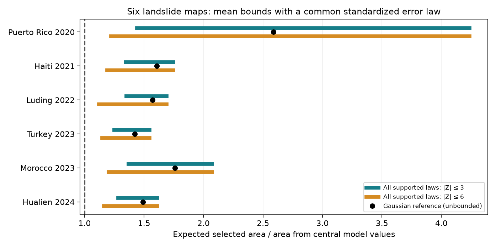

# Six archived landslide maps require higher mean areas under a common error law bounded at six standard deviations

## Result

For six fixed USGS landslide maps, nonlinear propagation raises the mean selected area by at least 11.9-22.0% if standardized latent errors have mean zero, variance one, the same marginal distribution in each cell, and no values outside ±6. This result does not require Gaussian errors. It uses the central values and uncertainty scales recovered from released grids, with masks held fixed.

Two moments alone give a different result. We prove that, for this bounded increasing transform, error distributions with the same mean and variance can either raise or lower the mean area. The proof also applies when every cell has the same standardized error law. Thus an increased mean is robust in a specified bounded-error class, but does not follow from the first two moments alone.

These statements concern a conditional model. They do not show that the issued maps understate observed landslide area. The recovered moments, common marginal law and error support limits need empirical validation.

## Question and prior work

The prior SCI audit, SCI 3f7348871c77bf837b223a19d7c637d41aafeb00b8d1e5a0078da01ab40f43b4, found that a small number of released landslide cells cannot define the documented beta distributions. It also found that exact nonlinear propagation under Gaussian latent errors gives mean selected areas 1.42-2.59 times the sums of central cell values. That study explicitly made the Gaussian assumption and did not claim observed calibration.

We ask which part of the mean increase survives if the Gaussian error law is removed. This is a test of an assumption behind a proposed propagation method. It is not another beta-moment audit. The beta feasibility failures are not used to choose or remove cells here.

The operational model and its uncertainty formula are described by Nowicki Jessee et al. (2018), doi:10.1029/2017JF004494, and Allstadt et al. (2022), doi:10.1177/87552930211032685. [USGS describes](https://earthquake.usgs.gov/data/ground-failure/background.php) the product as a regional estimate, rather than a prediction of individual landslides. General moment optimization is established work; see Bertsimas and Popescu (2005), doi:10.1137/S1052623401399903. Our contribution is a continuous-domain numerical enclosure tool for this released-map problem, the six-case calculation, and a precise separation between two-moment and bounded-error conclusions. We do not claim to invent moment optimization or nonlinear expectation effects.

Campaign searches preceded question selection. The study is exploratory and has no independent prior registration. See files/PLAN.md.

## Data and model

We reuse the six earliest usable UPDATE products in the prior audit. These are not generally first-issued maps. Their delays after earthquake origin are 8,797 h for Puerto Rico, 79 h for Haiti, 261 h for Luding, 283 h for Turkey, 72 h for Morocco, and 1.92 h for Hualien. They span 2020-2024 earthquake origins. The six products have 920,485 finite selected cells with central coverage C>=0.002, positive stated SD s, and C below the transform maximum. The source selection and archive gaps are inherited; no representative operational failure rate can be estimated.

We reuse the six HDF5 files in the shared dataset store, in place. Each exact shared path, URL, byte count, product time and SHA-256 is in files/inputs.json. Hashes are checked before reading. No new raw download was needed. We read only these six files, not the complete dataset store. Input records remain external to this publication.

The transform is

    p = logistic(x)
    g(x) = exp(-7.592 + 5.237p - 3.042p² + 4.035p³).

It is bounded and strictly increasing. For each selected cell we recover x=g^-1(C) and t=s/g'(x). We then consider latent errors X=x+tZ. Treating x as the latent mean and t as its SD is an added interpretation of the derivative-based released uncertainty, inherited from the prior conditional comparison. It is not measured ground truth.

Our endpoint is the expected area over the same fixed selected cells, divided by sum A_i C_i, where A_i is cell area. Geographic weights use spherical cell area and the source grid row orientation. We hold every predictor and mask fixed. We do not add the PGA threshold used for regional alert statistics, model threshold crossings, new landslides outside the mask or population exposure.

## Method

Each supported class has E Z=0, E Z²=1 and |Z|<=K. K is 3 or 6. All cells share the same marginal error distribution after standardization. They need not have independent errors or identical realized errors. Spatial dependence does not affect this expected sum. It would affect a prediction interval for realized area, which we do not compute.

We sum cell transforms first to get the scalar function H(z). A linear program minimizes and maximizes E H(Z) under the moment constraints. Feasible probability masses give attained examples. Dual quadratic bounds and a global analytic bound on H'' control the error between grid points. Adaptive refinement reduces each outer-bound correction below 0.0001 in area ratio. Thus a fixed grid is not silently treated as a continuous error law. Arithmetic uses double precision, with an added 1e-8 tolerance; this is not a formal interval-arithmetic proof of the implementation. files/PROOF.md gives the derivation and exact scope.

The extrema are conditional on one common standardized marginal law for each case. Allowing different laws at different cells can widen the range. Bounds are deterministic model ranges, not confidence limits. The unbounded Gaussian is outside the K=3 and K=6 classes; it is a separate reference.

For unrestricted support we use a direct construction. Let Z be -1/a with probability a²/(1+a²), and a with probability 1/(1+a²). Its mean is zero and variance one. For large a, E H(Z)=H(0)-H'(0)/a+O(a^-2), below H(0). Reflecting the law reverses this leading sign. This proves that the first two moments cannot fix the sign. The extreme tails in this construction need not be plausible. We evaluate a=1,3,6,20,100,1000 in all cases rather than infer their practical frequency.

## Results

| Case | Gaussian ratio | Supported range, K=3 | Supported range, K=6 |
| --- | ---: | ---: | ---: |
| Puerto Rico 2020 | 2.586 | 1.440-4.234 | 1.220-4.234 |
| Haiti 2021 | 1.607 | 1.344-1.744 | 1.188-1.744 |
| Luding 2022 | 1.572 | 1.349-1.689 | 1.119-1.689 |
| Turkey 2023 | 1.421 | 1.248-1.545 | 1.146-1.545 |
| Morocco 2023 | 1.760 | 1.368-2.070 | 1.200-2.070 |
| Hualien 2024 | 1.490 | 1.282-1.612 | 1.162-1.612 |

Each range encloses the minimum and maximum over all laws in its stated supported common-law class. Values are rounded to three decimals; enclosure and attainable endpoints are available separately in files/bounds.csv. The Gaussian reference reproduces the prior six ratios.

At K=3 the minimum ratios are 1.248-1.440. At K=6 they are 1.119-1.220. Thus these supported classes retain an increased mean in every case, with no Gaussian assumption. The possible amount is broad, especially for Puerto Rico. Neither the Gaussian amount nor the minimum increase is an empirical correction factor.

The two-point laws with a=1000 give a ratio below one in all six cases. Their reflections give a ratio above one. They have the same latent mean and variance. The rare value has probability about one in a million and magnitude 1,000 standard deviations, so these examples establish mathematical non-identification, not a realistic hazard-error model. Less extreme two-point examples are in files/two_point.csv. No tail-frequency claim is made.

## Checks and limits

The input hashes, selected cell counts and Gaussian ratios agree with the prior audit. The six Gaussian ratios agree to better than 0.000001. A separate inspection program checks saved aggregate curves, every dual bound, attained expectation and probability-law moment constraint. It does not need the external rasters. The maximum outer-to-attained differences are below 0.00011. Details are in files/checks.json and files/inspection.csv. Initial and final runs agree to the reported precision.

This is a conditional mathematical and computational contribution. No landslide inventory is used. The study cannot select an error law, determine its tails or establish field calibration. There is no basis here to replace the issued product by a Gaussian mean, a worst-case mean, or a fitted correction.

The six selected maps are mostly later products and are not independent samples of an operational population. They share a model. Rounding in C and s, the model's input layers, fixed masks, and the derivative-based scale are inherited limitations. We use their released numeric values as fixed inputs and do not include their rounding uncertainty in these bounds. The common-law and support assumptions are explicit restrictions, not facts established by the data. Cell-specific marginal laws, uncertain terrain and correlated model errors remain open. A useful next empirical test would estimate standardized error tails on independently mapped landslide inventories with known mapping boundaries.

## Reproduce and inspect

Python 3.12, numpy, scipy, pandas, h5py and matplotlib are required. Exact versions are in files/environment.json. From an extracted publication root, use scratch and output directories outside that root:

    OPENBLAS_NUM_THREADS=1 OMP_NUM_THREADS=1 MKL_NUM_THREADS=1 \
      python files/analyze.py --scratch /tmp/landslide-inputs --out /tmp/landslide-results
    OPENBLAS_NUM_THREADS=1 python files/check_bounds.py /tmp/landslide-results /tmp/landslide-inspection

The analysis reads exact shared files if present. Otherwise it retrieves recorded source URLs into external scratch and requires the recorded hashes. A changed live source stops reproduction. It never writes raw data or cell-level tables into the signed draft. The saved immutable shared files give exact replay if live USGS files change. Only six HDF5 inputs are needed; the manifest preserves all paths and hashes without relying on this private worktree.

For an inspection without raw inputs:

    OPENBLAS_NUM_THREADS=1 python files/check_bounds.py files /tmp/landslide-inspection

Compare the regenerated figure and inspection table with the bundled versions. The aggregate curves and dual coefficients permit this check without any cell-level extract. Full regeneration normally takes several minutes on one numerical thread. No service or compute queue is needed.

## Provenance and rights

Job: sci-1107-dell-earth-and-ocean-sciences-d08af1db3998. Topic: earth-and-ocean-sciences. Campaign: 11_07_2026. Machine: dell. Account: codex-olen. Model: gpt-6.1-sol with high reasoning effort. The campaign-machine signing key is not a personal authorship claim.

The unchanged SCI baseline LICENSE covers the original code, proof, text, figures and aggregate calculations. External rasters, source articles and cell-level tables are not bundled. Credit: U.S. Geological Survey. See files/NOTICE.md and files/inputs.json for external terms, attribution and provenance. No remote upload or index submission is part of this job.
