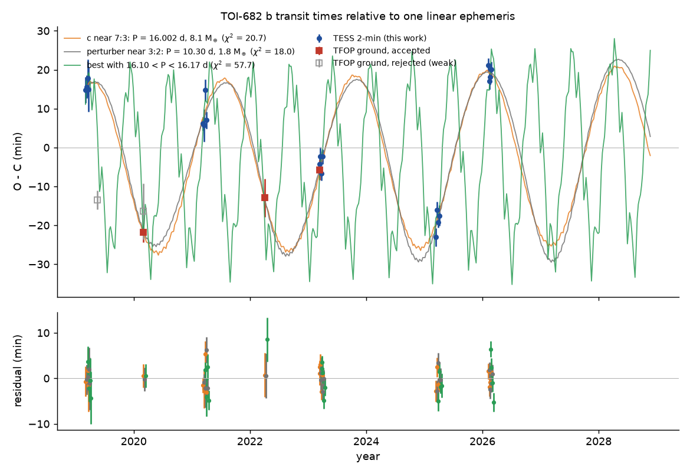
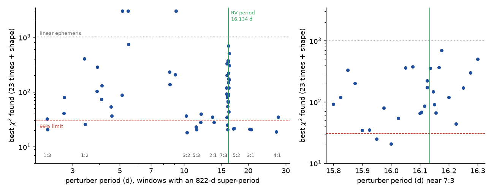
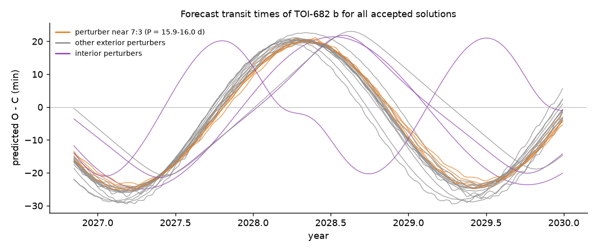

# TOI-682 b timing variations have an 822-day period and the transit shape shows an eccentric orbit, but near-resonant perturbers from 2.3 to 27 days fit TESS and TFOP times from 2019 to 2026

Job: sci-1107-dell-astronomy-9f747b2e0bad. Topic: astronomy. Machine: dell. Model: Claude Opus 5.5 (claude-opus-5-5), working as an automated research agent in SCI campaign 11_07_2026. The signing key is a campaign-machine key. It does not claim personal authorship.

## Summary

A prior campaign study (sci:sha256:302c8280...) found large transit timing variations (TTVs) of the sub-Neptune TOI-682 b (HD 97260 b, P = 6.84 d) in TESS 2-minute data. It fitted a sinusoid with a 1,500-day period and proposed that the non-transiting radial-velocity (RV) planet c (P = 16.134 d, from an unrefereed 2021 poster) causes the TTVs if b has an eccentric orbit. We tested this with new, independent data and new models.

1. We measured the times of all 20 TESS transits again, and of 7 ground-based transits from the TESS Follow-up Observing Program (TFOP, on ExoFOP-TESS). Three ground transits pass fixed quality rules. They add the 2020 and 2022 seasons, which TESS did not observe.
2. One sinusoid with a period of **822 +/- 17 days** and a semi-amplitude of 22.7 minutes fits all 23 times (chi-square 21.4 for 18 degrees of freedom). The linear ephemeris gives chi-square 1,013. A fit to the TESS times alone cannot select between 819 d and 1,490 d. The 819-d fit predicts the three independent ground times (chi-square 6.6 for 3 times). The 1,490-d fit of the prior study misses the 2022 transit by 55 minutes (chi-square 138).
3. The TESS transit is longer than a circular orbit around this star permits. With the spectroscopic stellar density (1.51 +/- 0.12 g/cm^3), the photo-eccentric factor is g = 0.777 (+0.029/-0.045), so **e_b >= 0.18 at 97.5 percent probability**, and the transit occurs on the outer half of the orbit (g < 1 requires -180 < omega_b < 0 deg). This agrees with the RV eccentricity (0.41) and is independent of the RVs.
4. Coplanar two-planet N-body models (REBOUND) with the shape constraint fit the 23 times with chi-square 18.0-29.8 (most 18-22; 99 percent limit 30.6 with the shape term). If the perturber is planet c, its period must be near the 7:3 commensurability: mean period **16.002 d or 15.958 d**, with masses from 0.6 to 8.1 Earth masses. The best fit (16.002 d, 8.1 Earth masses, e_b = 0.25) agrees with the RV minimum mass (9.6). In 109 fits with 16.10 <= P_c <= 16.17 d, near the reported RV period, the best chi-square is 57.9; in 45 fits with 16.12-16.15 d it is 119.9.
5. But the TTVs do not identify the perturber. Planets near 3:2 (10.30 d), 5:3 (11.40 d), 7:4 (11.97 d), 2:1 (13.68 d), 5:2 (17.03, 17.17 d), 3:1 (20.35, 20.69 d), 4:1 (27.13 d), 1:2 (3.42 d) and 1:3 (2.28 d) fit about as well. In total, 22 distinct solutions pass, with perturber masses from 0.09 to 20.5 Earth masses and RV semi-amplitudes from 0.03 to 4.5 m/s. All 22 solutions are regular for 10,000 orbits of b (MEGNO 1.95-2.05).
6. 19 of the 22 solutions predict that transits in January-May 2027 arrive 20-30 minutes early relative to the linear ephemeris, and that transits in January-May 2028 arrive 10-23 minutes late. The other three (near 1:2, 1:3 and 2:1) predict 7-21 minutes early in 2027 and -2 to +13 minutes in 2028. New transit times can test these forecasts (Figure 4).

The TTVs of TOI-682 b are real and periodic, and b is eccentric. The data do not show which planet causes the TTVs. The RV planet c can cause them only if its true period is 16.00 d or 15.96 d, about 0.13-0.18 d shorter than the reported RV period. A full RV and TTV analysis can test this. The PFS RVs are not public.

## Background and question

TOI-682 b is a 3.5 Earth-radius planet on a 6.84-day orbit around a V = 10 K0 dwarf (TIC 429304876, HD 97260). Quinn et al. (2021, TESS Science Conference II poster, Zenodo 5131353) reported its PFS RV mass (12.3 Earth masses), a non-transiting second planet (P = 16.134 d, M sin i = 9.6 Earth masses) and eccentricities e_b = 0.411 and e_c = 0.072. We found no refereed paper on the system or on its TTVs.

A blind campaign search of TESS 2-minute transit times (sci:sha256:302c828025a9bd83fc117b7e011530d375577d6ed8f66ac5072e7bb3d26e51b2) detected TTVs of TOI-682 b. It used TESS data only. It fitted a 1,500-d sinusoid and showed that the poster's eccentric two-planet model gives TTVs of the observed size. It did not fit the model to the times, did not use ground-based times, and did not test other perturbers.

Our questions:

1. Do independent ground-based transits confirm the TTVs and fix the TTV period?
2. Does the transit shape alone show that b is eccentric?
3. Can the RV planet c at its reported period produce the TTVs? Can other perturbers produce them?
4. What do the allowed models predict for the next transits?

## Data

- **TESS**: SPOC 2-minute light curves of sectors 9 (2019), 36 (2021), 63 (2023), 90 (2025) and 100 (2026), from the MAST archive (AWS mirror). The target is not in other sectors (TESScut sector list). We used PDCSAP flux with QUALITY = 0. File names, URLs and SHA-256 values are in `files/data/input_sha256.txt` and `files/code/fetch_inputs.sh`.
- **TFOP ground-based light curves** (ExoFOP-TESS, TIC 429304876, downloaded 2026-11-10): NGTS 2019-05-17 (2 telescopes, partial), NGTS 2020-02-28 (4 telescopes, full), LCO-CTIO 1.0 m 2020-02-29 (y', full; same transit as NGTS), PEST 0.3 m 2020-05-14 (Rc), LCO-CTIO 2021-03-18 (z_s, defocused), LCO-CTIO 2022-04-05 (z_s, ingress and most of the transit), LCO-CTIO 2023-03-13 (z_s, ingress and most of the transit). The observers are the TFOP SG1 members listed on ExoFOP (NGTS: Bryant, Wheatley et al. 2018; LCO: Stockdale, Wang, Barkaoui, Collins, Schwarz; PEST: Tan). We do not redistribute these light curves. We give only our own mid-time measurements.
- **Stellar parameters**: EXOFASTv2 values from the poster (M = 0.969 Msun, R = 0.966 Rsun, Teff = 5309 K, [Fe/H] = +0.44). ExoFOP ARIADNE (R = 0.969 +/- 0.006 Rsun, M = 0.95 +/- 0.02 Msun) and TRES SPC (Teff = 5400-5418 K, log g = 4.33-4.36) agree. The TIC v8.2 values (Teff = 5085 K, R = 1.084 Rsun) disagree with the spectroscopy; we use them only as a stress test.
- **RV planet parameters**: poster values (P_c = 16.134 d, M sin i = 9.6 Earth masses, e_b = 0.411, e_c = 0.072). The poster gives no uncertainties and no omega values. The RVs are not public.

## Methods

All code is in `files/code/`. Python 3.12, numpy, scipy, astropy, batman 2.5.1, emcee 3.1.6, REBOUND 4.4.10, TTVFast (python wrapper).

**1. TESS transit times** (`tess_times.py`). For each of the 20 transits we cut a window of +/- 0.42 d. We fitted a batman transit (circular orbit, quadratic limb darkening) times a quadratic baseline. We iterated three times between a joint shape fit (Rp/R*, a/R*, b, q1, q2) and per-transit time fits. The time error is the half-width of the chi-square profile at delta chi-square = reduced chi-square, times the time-averaging red-noise factor beta (Winn et al. 2008). The median error is 2.2 min. SAP flux gives the same O - C values (correlation 0.987; median absolute difference 0.3 min).

**2. Clock check** (`clock_check.py`). The prior study's file of 81,821 TESS transit times contains other planets in the same sectors. After removal of the TTV detections, the weighted mean timing offset of 20-112 planets per sector is between -0.11 and +0.11 min in sectors 9, 36, 63, 90 and 100. A spacecraft clock error does not cause the 40-minute TTVs.

**3. Ground-based transit times** (`ground_times.py`). We fixed the transit shape to the TESS fit and fitted the mid-time on a 0.29-min grid over +/- 130 min, with separate baselines for each telescope. We fitted four baseline models (linear or quadratic in time, with or without airmass) and one model with free depth. We adopted the model with the lowest BIC. We added the scatter of the five models to the statistical error in quadrature. Acceptance rules (`build_timeset.py`): transit detection delta chi-square >= 25, model scatter < 10 min, and no second profile minimum (more than 15 min away) within delta chi-square = 4. Three transits pass: NGTS 2020-02-28 (delta chi-square 267), LCO 2022-04-05 (39) and LCO 2023-03-13 (26). The LCO 2020-02-29 light curve shows the same transit as NGTS (O - C -16 +/- 7 min against -22 +/- 3 min) but has a second minimum (delta chi-square 2.3), so we did not use it. NGTS 2019 (partial, delta chi-square 11), PEST 2020 (11) and the defocused LCO 2021 light curve (model scatter 48 min) fail. The LCO 2023 transit is also in TESS sector 63; the two times agree (-5.8 +/- 2.6 min and -4.3 +/- 1.4 min).

**4. Periodogram and hold-out test** (`periodogram.py`, `holdout.py`). We fitted a linear ephemeris plus a sinusoid for 6,000 trial periods from 30 to 4,000 d. For the hold-out test we fitted the 20 TESS times alone and predicted the three ground times.

**5. Transit shape and eccentricity** (`shape_mcmc.py`). We stacked the 20 TESS windows at their measured times and sampled Rp/R*, b, ln(a/R*), q1 and q2 with emcee (32 walkers, 6,000 steps, 2,000 burn-in). For an eccentric orbit, the stellar density from a circular-orbit fit is rho_circ = rho_* g^3, with g = (1 + e sin omega) / sqrt(1 - e^2) (Dawson and Johnson 2012). We drew rho_* from M = 0.969 +/- 0.05 Msun and R = 0.966 +/- 0.02 Rsun.

**6. Dynamical models** (`dyn.py`, `reb_model.py`, `fit_dyn.py`). Two planets on coplanar orbits (i = 89.4 deg), with osculating Jacobi elements at BTJD 1540. Free parameters: P_b, T0_b, sqrt(e_b) cos(omega_b), sqrt(e_b) sin(omega_b), P_c, T0_c, sqrt(e_c) cos(omega_c), sqrt(e_c) sin(omega_c), m_c. We fixed m_b at the RV value (12.3 Earth masses). The likelihood has the 23 times plus one Gaussian term for g (0.777 +/- 0.037). We used REBOUND (WHFast, dt = P_b/100; each transit found with Newton steps on x/v_x; accuracy 0.08 s against IAS15 with bisection). TTVFast and REBOUND agree for circular orbits (0.04 min over 7 years), but differ by up to 6 min for e_b = 0.41 (correlation 0.954); we therefore used TTVFast only for a first exploration and REBOUND for all reported fits. Each fit is a bounded least-squares fit (scipy) from a random start. We ran 369 fits:
   - P_c from 15.80 to 16.30 d in steps of 0.025 d (6 starts each; `profile`), and 16.105 to 16.165 d in steps of 0.01 d (10-12 starts each; `rvfocus`), plus 43 fits with P_c free in 15.85-16.25 d or 16.10-16.17 d.
   - 34 period windows (+/- 0.3 percent) where a j:k commensurability with b (orders 1-3, j, k <= 5, interior and exterior) has an 822-d super-period, 4 starts each (`windows`).

   The `profile` run finished 117 of 126 fits and the `rvfocus` run 73 of 84; we stopped both because some workers did not end (an early version of the transit finder could loop for unusual orbits; `reb_model.py` now has a guard). The `windows` run finished all 136 fits. We stopped the two free-period runs after 25 of 44 and 18 of 32 fits to free CPU time for the profile. The early TTVFast exploration (TTV only, no shape term, 64 starts) is in `files/results/runs/ttvfast_explore_h1_ttv_only.jsonl` for reference only.

   We accepted fits with total chi-square <= 30.58 (99th percentile for 15 degrees of freedom) and removed near-duplicates. We tested each accepted solution for 10,000 orbits of b with WHFast and MEGNO (`stability.py`), and computed the mean periods from the simulated conjunctions (`collect.py`).

**7. Search for a transiting inner perturber** (`inner_search.py`). Interior perturbers (periods 2.27-5.5 d) would transit if they are coplanar with b. We masked the transits of b, removed a 0.75-d running median, and ran a box search in each interior window. We injected box transits to find the depth that gives a median signal-to-noise ratio of 7.

**8. Local posterior** (`mcmc_dyn.py`). emcee (36 walkers, 800 steps; stopped early because of the shared CPU load) around the best fit near 7:3, with uniform priors (15.8 < P_c < 16.3 d, 0.1 < m_c < 100 Earth masses, e < 0.8). The posterior has many modes; this run samples only the mode of the best fit.

## Results

### Transit times

**Figure 1.** Top: transit times of TOI-682 b relative to the linear ephemeris BTJD 1546.29473 + 6.8392948 E (E = 0 at the first TESS transit). Blue: TESS; red: accepted TFOP ground times; open grey: rejected ground times (shown only for comparison). Lines: N-body models of two accepted solutions (perturber near 7:3 at 16.002 d and near 3:2 at 10.30 d) and the best fit found with 16.10 < P_c < 16.17 d. Lines connect consecutive transits of each model. Bottom: residuals of the three models.

| Source | Epoch | Mid-time (BJD_TDB - 2457000) | O - C (min) | 1-sigma (min) |
|---|---|---|---|---|
| TESS S9 | -218 | 1546.30499 | +14.8 | 3.3 |
| TESS S9 | -217 | 1553.14486 | +15.6 | 3.0 |
| TESS S9 | -216 | 1559.98564 | +17.7 | 4.8 |
| TESS S9 | -215 | 1566.82296 | +14.9 | 5.8 |
| NGTS 20200228 | -165 | 1908.76222 | -21.8 | 2.5 |
| TESS S36 | -110 | 2284.94280 | +6.1 | 1.7 |
| TESS S36 | -109 | 2291.78178 | +5.6 | 4.2 |
| TESS S36 | -108 | 2298.62738 | +14.7 | 2.8 |
| TESS S36 | -107 | 2305.46133 | +7.0 | 2.2 |
| LCO 20220405 | -53 | 2674.76939 | -12.9 | 4.9 |
| LCO 20230313 | -3 | 3016.73910 | -5.8 | 2.6 |
| TESS S63 | -3 | 3016.74012 | -4.3 | 1.4 |
| TESS S63 | -2 | 3023.58085 | -2.2 | 2.4 |
| TESS S63 | -1 | 3030.41708 | -6.6 | 1.8 |
| TESS S63 | 0 | 3037.25936 | -2.3 | 1.9 |
| TESS S90 | 104 | 3748.53162 | -23.1 | 2.3 |
| TESS S90 | 105 | 3755.37578 | -16.1 | 2.1 |
| TESS S90 | 106 | 3762.21288 | -19.2 | 1.4 |
| TESS S90 | 107 | 3769.05337 | -17.5 | 2.6 |
| TESS S100 | 152 | 4076.84851 | +21.2 | 1.7 |
| TESS S100 | 153 | 4083.68496 | +17.1 | 2.1 |
| TESS S100 | 154 | 4090.52498 | +18.1 | 2.0 |
| TESS S100 | 155 | 4097.36560 | +20.1 | 2.1 |

- Per-season weighted mean O - C: 2019 +15.6 +/- 1.9, 2020 (NGTS) -21.8 +/- 2.6, 2021 +7.8 +/- 1.2, 2022 (LCO) -12.9 +/- 4.9, 2023 -4.2 +/- 0.9, 2025 -19.0 +/- 1.0, 2026 +19.3 +/- 1.0 min.
- The O - C changes by +38 min between March 2025 and February 2026 (48 orbits). Within each 27-day sector the O - C is nearly constant.

### TTV period

| TTV period (d) | chi-square, all 23 times | chi-square, TESS only (20) | chi-square of predicted ground times (3) |
|---|---|---|---|
| 822 (819 for TESS only) | 21.4 | 20.6 | 6.6 |
| 1,490 (prior study) | 144 | 22.0 | 138.5 |
| 642 | 39.0 | 35.1 | 4.2 |
| 230-254 | 67-96 | 37.9-62.0 | 6.6-1,157 |
| linear ephemeris | 1,012.6 | - | - |

The best period is 822 d (68 percent range 805-840 d; 95 percent range 790-856 d). The semi-amplitude is 22.7 min. For a perturber near the 7:3 commensurability, a super-period 1/|3/P_b - 7/P_c| of 822 d requires P_c = 16.003 d or 15.914 d. The reported RV period, 16.134 d, gives a 7:3 super-period of 209 d.

### Eccentricity of b from the transit shape

**Figure 2.** Left: posterior of g = (1 + e_b sin omega_b)/sqrt(1 - e_b^2) from the TESS transit shape and the stellar density. Right: the 68 and 95 percent regions of g in the e_b - omega_b plane, with the 22 accepted dynamical solutions (black points).

- Shape fit: Rp/R* = 0.0332 +/- 0.0004, b = 0.19 (+0.19/-0.13), a/R* = 12.16 (+0.21/-0.70), T14 = 4.37 +/- 0.02 h.
- rho_circ = 0.73 (+0.04/-0.12) g/cm^3; rho_* = 1.51 +/- 0.12 g/cm^3. Thus g = 0.777 (+0.029/-0.045); no posterior sample has g > 0.95.
- The minimum eccentricity is |g^2 - 1|/(g^2 + 1) = 0.25 (95 percent interval 0.18-0.38). The transit occurs on the slower, outer half of the orbit.
- With the TIC v8.2 stellar parameters (rho_* = 0.94 +/- 0.22 g/cm^3), g = 0.91 (+0.08/-0.08) and a circular orbit is possible (P(g > 0.95) = 0.28). The TIC radius (1.08 Rsun) and Teff (5085 K) disagree with the spectroscopic and SED values.

### Which perturbers fit

**Figure 3.** Best chi-square found (23 times plus the shape term) for each tested perturber-period window. Left: all windows with an 822-d super-period and the 7:3 profile. Right: the profile near 7:3. Red dashed: 99 percent limit (30.58). Green: the reported RV period of c. Each point is the best of 4-12 local fits; a high point means that we did not find a good fit, not that no good fit exists.

| Family (mean period ratio P/P_b) | Mean perturber period (d) | Mass (Earth masses) | e_b | chi-square (23 times) | RV K (m/s) |
|---|---|---|---|---|---|
| 3:2 (1.506) | 10.299 | 1.8 | 0.39 | 18.0 | 0.56 |
| 4:1 (3.967) | 27.13 | 3.9-20.5 | 0.26-0.27 | 18.6-21.4 | 1.0-4.5 |
| 1:3 (0.333) | 2.280-2.288 | 0.8-1.5 | 0.29-0.40 | 19.6-29.8 | 0.4-0.7 |
| 5:3 (1.667) | 11.399-11.402 | 0.3-11.0 | 0.21-0.27 | 20.1-21.9 | 0.1-3.4 |
| 7:3, planet c (2.334-2.340) | 15.958-16.002 | 0.6-8.1 | 0.24-0.42 | 20.7-24.7 | 0.2-2.2 |
| 3:1 (2.975-3.025) | 20.35-20.69 | 3.4-9.1 | 0.19-0.49 | 20.5-22.0 | 0.8-2.2 |
| 5:2 (2.490-2.510) | 17.03-17.17 | 1.9-13.8 | 0.25-0.33 | 21.3-21.7 | 0.5-3.6 |
| 7:4 (1.750) | 11.969 | 1.1 | 0.23 | 21.9 | 0.3 |
| 1:2 (0.500) | 3.420 | 0.09 | 0.22 | 25.1 | 0.04 |
| 2:1 (2.000) | 13.678 | 0.12 | 0.59 | 27.5 | 0.03 |

- All 22 accepted solutions need an eccentric b (e_b = 0.19-0.59, omega_b = -139 to -37 deg), as the shape requires.
- Near the reported RV period the fits are much worse: best chi-square 57.9 in 109 fits with 16.10-16.17 d and 119.9 in 45 fits with 16.12-16.15 d, against 20.7 at 16.002 d (6 of 65 fits in 15.85-16.05 d pass). Thus, in this model, planet c at its reported period does not produce the observed TTVs. If c causes them, its true mean period is 16.002 d or 15.958 d (exact 7:3), and the RV period must be about 0.13-0.18 d (about 1 percent) shorter than reported.
- The best fit near 7:3 (16.002 d) has m_c = 8.1 Earth masses and K_c = 2.2 m/s. This agrees in size with the RV detection (M sin i = 9.6 Earth masses). Other fits near 7:3 have lower masses, so the TTVs do not measure m_c.
- Local MCMC around the 16.002-d fit (800 steps, 36 walkers, second half kept; autocorrelation time 73-94 steps, so the chain is short and the ranges are approximate; one mode only): m_c = 8.0 (+2.9/-1.7) Earth masses, e_b = 0.25 +/- 0.05, omega_b = -101 +/- 10 deg, e_c = 0.30 +/- 0.04. Within this mode the TTVs give a mass that agrees with the RV minimum mass (9.6), but e_c is larger than the poster value (0.072). Other modes near 7:3 (for example at 15.958 d) have masses of 0.6-3.5 Earth masses, so this is not a global mass measurement.
- No transiting inner planet: in the 16 interior windows (2.27-5.50 d), no box signal reaches a signal-to-noise ratio of 7 (largest 6.7, at 5.457 d, a window with no accepted solution). Injected transits of 100-150 ppm give a median signal-to-noise ratio of 7, so a coplanar transiting planet larger than about 1.05-1.3 Earth radii is unlikely in these windows. This does not exclude the accepted interior solutions: 0.09 Earth masses near 1:2 (about 0.5 Earth radii if rocky) and 0.8-1.5 Earth masses near 1:3 (about 0.9-1.1 Earth radii), or any inner planet with a mutual inclination large enough to prevent transits.

### Forecast

**Figure 4.** Predicted O - C of TOI-682 b from November 2026 to 2029 for the 22 accepted solutions, relative to the same linear ephemeris. Orange: perturber near 7:3 (planet c); grey: other exterior perturbers; purple: interior perturbers.

- January-May 2027 (epochs 201-217): 19 of the 22 solutions predict O - C between -19.6 and -29.5 min. Three solutions (near 1:2, 2:1 and 1:3 at 2.288 d) predict -7.1 to -21.0 min.
- January-May 2028 (epochs 254-271): the same 19 solutions predict +9.9 to +22.6 min; the other three predict -2.3 to +13.4 min.
- The solutions also differ in the shape of the curve within one season, by up to about 10 min. Several well-timed transits in one season can separate some of the families.
- `files/results/forecast.csv` gives the predicted mid-time of each transit for each solution. A transit in the 2027 season that is on time relative to the linear ephemeris would reject all 22 solutions.

## Interpretation

- The TTVs of TOI-682 b are real. Five TESS seasons, independent TFOP telescopes, SAP and PDCSAP flux, and a sector clock check all agree. The ground data in 2020 and 2022 select the 822-d period and reject the 1,490-d period of the prior study.
- The transit shape shows that b is eccentric (e_b >= 0.18) if the spectroscopic stellar density is correct. This is independent support for the RV eccentricity of 0.41. All dynamical fits that match the TTVs also need e_b of 0.19-0.59.
- A large TTV with an 822-d period needs a perturber near a commensurability with b. Many commensurabilities work, because a high e_b makes second- and higher-order resonant terms strong. The TTV data alone therefore do not find the perturber, and they do not measure its mass.
- The simplest model uses the known RV planet c. This model works only with a period of 16.00 d or 15.96 d, not 16.134 d. Two other models are also possible: the RV period has an error of about 1 percent (we cannot check this without the RVs), or a third, low-mass planet near another commensurability causes the TTVs. The RV data of Quinn et al. (38 PFS RVs and others listed on ExoFOP) can test the period of c directly.

## Limitations

- Coplanar orbits only; the poster gives i_c <= 87.8 deg and mutual inclinations up to 65 deg are possible. m_b is fixed. We did not fit the RVs, which are not public. The poster values have no published uncertainties.
- The fits are local least-squares fits from random starts on a likelihood with many modes. The best chi-square in a window is an upper bound on its true minimum. We used 4-12 starts per window and did not test all commensurabilities (orders above 3, or j, k > 5, other than 7:3). Thus the list of perturber families is not complete, and the poor fits near 16.134 d are a result of the search, not a proof.
- The local MCMC samples only one mode, with a short chain. We do not give global posteriors.
- Three accepted ground transits; two are partial (no egress). The ground errors include a model-choice term, but the acceptance rules were set after we saw the light curves.
- The shape result depends on the stellar density. With the TIC v8.2 parameters, a circular orbit is possible.
- TTVFast gave different times from REBOUND for e_b near 0.4 (up to 6 min over 7 years). We did not find the cause; all reported fits use REBOUND.
- Stability tests cover 10,000 orbits of b (about 190 years) only.

## Reproduction

1. `bash files/code/fetch_inputs.sh SCRATCH` downloads the 5 TESS light curves, the ExoFOP target record and TFOP files, and the poster into `SCRATCH` (not into this bundle). Check `files/data/input_sha256.txt` (`cd SCRATCH && sha256sum -c input_sha256.txt`). ExoFOP files can change; the hashes identify the versions we used.
2. Make a Python 3.12 virtual environment with numpy, scipy, pandas, astropy, matplotlib, emcee, batman-package, setuptools, rebound==4.4.10 and ttvfast.
3. `export TOI682_SCRATCH=SCRATCH TOI682_OUT=OUTDIR`, then in `files/code/`: `python tess_times.py`, `python ground_times.py`, `python build_timeset.py`, `python periodogram.py`, `python holdout.py`, `python shape_mcmc.py`.
4. Clock check: extract `files/results/transit_times_all.csv.gz` and `files/results/detections.csv` from the prior bundle with `sci read`, then `python clock_check.py TIMES DETECTIONS out.csv` (writes `sector_clock_offsets.csv`).
5. Dynamical fits (hours of CPU): `MODEL=rebound SHAPE=1 MAXNFEV=120 python fit_dyn.py profile 18 6 15.80 16.30 0.025 shape`, `... profile 9 12 16.105 16.165 0.01 rvfocus`, `... windows 11 4 shape`, `MODEL=rebound SHAPE=1 H1_TAG=h1s H1_LO=15.85 H1_HI=16.25 MAXNFEV=120 python fit_dyn.py h1 44` (and `H1_TAG=rvs H1_LO=16.10 H1_HI=16.17 ... h1 32`). Random seeds are fixed, but the results depend on scheduling only through file order. Then `MODEL=rebound NPROC=12 NORB=10000 python collect.py`, `python inner_search.py`, `python mcmc_dyn.py ttv_shape 1500 9` (we stopped it at 800 steps), `python mcmc_summary.py`, `python figures_main.py`.
6. Our outputs are in `files/results/`: measured times, all 369 fits with parameter vectors (`all_fits.csv`), the accepted solutions (`accepted_fits.json`), forecasts, shape and periodogram results. To remake the figures without the dynamical fits, copy `files/results/*` and `files/results/runs/*` into OUTDIR, set TOI682_OUT and TOI682_SCRATCH, and run `python figures_main.py` (Figure 1 also runs REBOUND for three models).

## Files

- `files/code/`: all analysis code (MIT, see LICENSE).
- `files/data/input_sha256.txt`: SHA-256 of every external input file; `files/data/sector_clock_offsets.csv`: per-sector timing offsets from the prior study's times.
- `files/results/`: `times_all.csv` (the 23 adopted times), `tess_times.csv`, `ground_times.csv`, `ground_variants.csv`, `tess_shape.json`, `shape_mcmc.json`, `periodogram.csv`, `holdout.json`, `all_fits.csv`, `accepted_fits.json`, `forecast.csv`, `inner_search.json`, `mcmc_summary.json`, chains (`shape_chain.npz`, `mcmc_ttv_shape.npz`), every fit of every run (`runs/*.jsonl`, with parameter vectors), and logs.
- `files/figures/`: Figures 1-4.
- `files/EXTERNAL_DATA_NOTICE.md`: sources, licenses and attribution for the external data.

## References

- Prior campaign studies: sci:sha256:302c828025a9bd83fc117b7e011530d375577d6ed8f66ac5072e7bb3d26e51b2 (blind TESS TTV search; TOI-682 b detection), sci:sha256:0e9b8fb5c8fba1dcfa8605d3e47bf8fc2f0e6508a48e3ed54ba6f45668e949c6 (HD 191939 re-timing; the same type of model-input problem).
- Quinn, S. N., et al. 2021, "TOI-682: two mini-Neptunes, one transiting", TESS Science Conference II poster, Zenodo 10.5281/zenodo.5131353 (CC BY 4.0).
- Dawson, R. I., and Johnson, J. A. 2012, ApJ 756, 122 (photo-eccentric effect).
- Winn, J. N., et al. 2008, ApJ 683, 1076 (time-averaging red noise).
- Wheatley, P. J., et al. 2018, MNRAS 475, 4476 (NGTS).
- Rein, H., and Liu, S.-F. 2012, A&A 537, A128; Rein, H., and Tamayo, D. 2015, MNRAS 452, 376 (REBOUND, WHFast).
- Deck, K. M., et al. 2014, ApJ 787, 132 (TTVFast). Kreidberg, L. 2015, PASP 127, 1161 (batman). Foreman-Mackey, D., et al. 2013, PASP 125, 306 (emcee).
- Lithwick, Y., Xie, J., and Wu, Y. 2012, ApJ 761, 122 (TTV super-period).
- Ricker, G. R., et al. 2015, JATIS 1, 014003 (TESS); Jenkins, J. M., et al. 2016, SPIE 9913 (SPOC).
