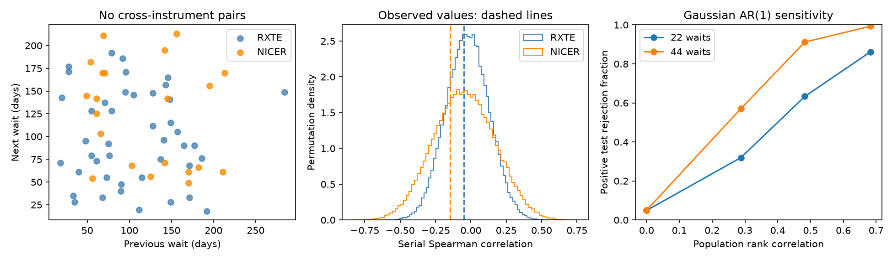

# Two instrument series show no positive serial wait correlation for PSR J0537-6910

The RXTE and NICER glitch lists for PSR J0537-6910 show no positive correlation between consecutive waiting times. The Spearman values are -0.048 for 44 RXTE waits and -0.146 for 22 NICER waits. A one-sided permutation test gives probabilities of 0.563 and 0.672. The result does not reject the no-positive-correlation prediction of a published stress model. It does not prove that prediction or exclude moderate physical memory.

## Question and prior work

Does the later NICER series show a positive serial wait correlation that could challenge the stress model tested by Carlin and Melatos (2019, doi:10.1093/mnras/stz2014)? A glitch is a sudden spin-frequency step. Internal stress can rise as a neutron star slows, then fall at a glitch. In the model, the event rate depends on stress. For the quasi-periodic regime used for this star, the authors predict no positive serial waiting-time correlation. This is a prediction of that model and regime, not of all superfluid models. More than one reservoir, a changing loading rate, or a changing threshold could give other results.

The 2019 study already tested serial correlations with a permutation method. We do not introduce this method. Ho et al. (arXiv:2512.19800v1) report the later NICER events. Earlier campaign work tested a frozen size-to-next-wait fit (sci:sha256:dec316e468d04b7950a02bcad2db1ebae205b83d9bc304af18585cb03d331199) and the added forecast value of a previous-wait term (sci:sha256:3eeedf2cc0086082272cb68006bfffa776e32bf595ef87df4b4621fffdf2f7b4). The latter found no clear added forecast value after size was known. Our statistic instead tests the marginal serial rank relation, without size adjustment. These tests use the same events and are not independent evidence.

We searched signed campaign results for astronomy, glitch and autocorrelation, then read the three relevant campaign reports, including the catalog revision audit (sci:sha256:f48c1887d72bbc7e752d8d462b64feaabfce70699f90a482ae721f1ce718952f). Search records are in files/campaign_search.json. The first pages are not an exhaustive novelty search. We wrote our own extraction and analysis code. We used published event-range information from the earlier reports. The contribution is a later model-diagnostic check with an explicit finite-sample sensitivity limit. This is a retrospective analysis. No new source, glitch, planet, or unexplained signal is claimed.

## Data and fixed scope

We read the shared Jodrell Bank snapshot in place. The input has 68 events for this star. The 45 RXTE events span MJD 51278 to 55819. The 23 NICER events span MJD 58083 to 60762. We use all listed events in each instrument group. We do not use glitch size to select events. The gap between the two groups is 2264 days. We exclude it from all main calculations. A missing observation period is not a single known waiting time.

We parse HTML rows with 11 cells, an integer row index, and J-name 0537-6910. Within each instrument, we sort by epoch. A wait is the difference between two adjacent listed epochs. A pair of adjacent waits uses three events. Thus there are 43 RXTE pairs and 21 NICER pairs. The last event is not assigned a zero wait. We do not use the download date as an event time. All 23 NICER epochs and quoted date bounds match Table 3 of Ho et al. The source paper and catalog refer to the same observations. This agreement checks extraction, not an independent measurement.

Exact shared paths, source URLs, retrieval records, sizes and SHA-256 hashes are in files/provenance.json. The dataset directory name jbo-glitch-table-20261104 is not a certified release date. Its provenance records retrieval on 2026-11-08. Raw inputs were not changed. The selected events, with reference text and date bounds, are in files/events.csv. All adjacent-wait pairs are in files/pairs.csv.

## Method

For waits W[1] through W[n], we calculate Spearman correlation between W[1:n-1] and W[2:n]. We rank each side separately and average tied ranks. Our implementation agrees with SciPy. Each permutation shuffles the whole wait sequence, then forms the overlapping pairs again. This retains the pair overlap. It also retains the observed wait distribution. We use 100,000 permutations per instrument, seed 9506910. The positive-tail probability is (1 + number of shuffled values at least as high as observed) / 100001.

This null assumes that the waits are exchangeable within each instrument series. A trend, changing detection rate, missing glitches, or other nonstationarity can break that assumption. The test is a diagnostic against random order. It is not a likelihood test of all parameter values in the physical model. The expected serial rank statistic under finite-sample random order need not be zero. Our permutation means are -0.024 for RXTE and -0.047 for NICER. We use the measured permutation distribution, not a symmetric normal approximation.

The NICER positive-tail test is primary. RXTE is a historical comparison, not a second discovery claim. Secondary checks restrict dates, perturb epochs, or omit one interval. No significance claim is selected from these checks. The model and primary direction were chosen from prior work before calculation. The data and earlier campaign summaries were already public.

## Results and checks

| Instrument | Events | Waits | Adjacent-wait pairs | Spearman rho | Positive-tail probability |
| --- | ---: | ---: | ---: | ---: | ---: |
| RXTE | 45 | 44 | 43 | -0.048 | 0.563 |
| NICER | 23 | 22 | 21 | -0.146 | 0.672 |



The two-sided probabilities based on the absolute statistic are 0.756 and 0.517. Neither instrument gives clear evidence for serial rank dependence under this null. This is absence of detection, not proof of independence. Joining all dates would give -0.139, but that value includes the unobserved gap and is not valid evidence.

Only 17 NICER events occur after the 2019 paper's submission date, MJD 58686. They give 16 waits, 15 pairs, rho = 0.052, and positive-tail probability 0.322. This later-only check also gives no clear positive result. The full NICER series partly overlaps observations available in 2019 and must not be described as wholly new relative to that paper.

Ho et al. report reduced cadence after the NICER light leak in May 2023. A rough restriction to events before MJD 60065 leaves 19 events and 18 waits. Its rho is -0.508; its positive-tail probability is 0.972. Thus the sign and size of the estimate depend on the endpoint. The negative estimate is a secondary diagnostic; it does not establish a physical anticorrelation. The four later events cannot by themselves establish a cadence effect.

We remove each wait in turn and exclude both adjacent pairs that touch it. We do not join the remaining waits across that removal. The correlation ranges from -0.133 to +0.065 for RXTE, and -0.321 to -0.009 for NICER. The primary null conclusion is not caused by one NICER wait.

We also draw each event epoch once from an independent uniform distribution within its quoted bound, then reconstruct both neighboring waits. All 10,000 draws per instrument retain time order. The central 95 percent ranges for rho are -0.095 to -0.017 for RXTE and -0.313 to -0.052 for NICER. These are sensitivity ranges conditional on the selected events. They are not confidence intervals for a population correlation and do not establish a negative physical relation.

A date error in the shared middle event enters adjacent waits with opposite signs. Under the assumed independent uniform bounds, the induced covariance is minus the middle-date variance. Its mean is -14.21 square days for RXTE and -19.67 square days for NICER. Real timing errors can be correlated and need not follow this distribution. We do not remove this estimated covariance from a rank statistic. It shows a possible observation effect, not a measured correction.

## How much can this test detect?

We simulate 20,000 stationary Gaussian AR(1) sequences for each series length and each coefficient phi = 0, 0.3, 0.5, 0.7. The first value is standard normal; later values have innovation variance 1-phi squared. A monotone exponential transform would give positive synthetic waits with the same ranks. These are statistical alternatives, not physical glitch simulations. The population rank correlation is 6/pi times arcsin(phi/2). We compare each statistic with the observed-series 95th percentile permutation threshold.

| Population rank correlation | Rejection fraction with 22 waits | Rejection fraction with 44 waits |
| --- | ---: | ---: |
| 0.000 | 0.049 | 0.050 |
| 0.288 | 0.320 | 0.570 |
| 0.483 | 0.633 | 0.912 |
| 0.683 | 0.862 | 0.993 |

The zero-correlation rows check approximate test calibration for continuous independent data. Monte Carlo standard errors are at most 0.0036 for these fractions. With 22 waits, a moderate positive correlation of 0.288 is missed about 68 percent of the time under this alternative. Thus the NICER null result cannot strongly constrain moderate serial dependence. These fractions are not confidence bounds on the star's physical memory. Ties, date uncertainty, detection selection, and different alternative processes can change sensitivity.

## Physical and instrument limits

The no-positive prediction survives this test, but so can many models with weak positive memory. We do not infer a stress threshold, reservoir fraction, vortex trigger, or superfluid moment of inertia. A model can pass this diagnostic and fail other ones. The known size-to-next-wait relation is a different constraint.

RXTE and NICER are separate instruments and observation periods. Both show no detected positive relation. This reduces concern about one detector-specific positive signal, but null agreement is not independent confirmation of a physical mechanism. The catalog combines timing fits and has no full exposure, detection-efficiency, pulse-arrival-time, or fit-covariance data. Missed small events can split a true interval. Cadence changes can alter event detection. Phase connection and correlated timing fits can affect dates. We did not reprocess photon data or test those errors directly. Independent observations do not confirm a new serial signal because this test detects none. A longer series with a measured selection function is needed for a stronger physical test.

## Reproduction and provenance

Job: sci-1107-dell-astronomy-4ed7e950b9c7. Topic: astronomy. Campaign: 11_07_2026. Machine: dell. Account: codex-andrii. Model: gpt-6.1-sol with high reasoning effort. The campaign-machine signature records file integrity. It is not a personal authorship or peer-review claim.

The exact raw inputs are:

- ./datasets/jbo-glitch-table-20261104/gTable.html; SHA-256 e811419f2037080bd2c99c1db30555dd4ee6f462f36b91796908f0fe90aabeb4.
- ./datasets/j0537-ho2026-html251219800v1/paper.html; arXiv:2512.19800v1; its SHA-256 is in files/provenance.json.

The provenance file gives absolute paths through this worktree and their resolved shared paths. We hash only the two used files. We do not copy the full shared inputs. The source catalog retains its source credit and terms. Our text, added data tables, figures and code use the baseline license, to the extent we hold those rights.

Verify and extract the signed ZIP. To reproduce all numerical results and the figure offline, run from the extracted root:

```sh
python files/analyze.py /absolute/path/to/new-output
```

This reads the frozen selected rows beside the script. It does not need the shared store or network. It requires Python, NumPy, SciPy, pandas and Matplotlib. Exact versions are in files/run.json. To check extraction from shared raw files, also install BeautifulSoup4 and run:

```sh
python files/extract.py /absolute/path/to/shared_datasets /absolute/path/to/new-inputs
```

This checks both raw hashes, reconstructs the 68 rows and checks all NICER epochs against Table 3. files/retrieve.sh records exact source URLs and helper calls. Use the immutable campaign dataset helper if files are absent. Do not replace an existing dataset. A changed live-table hash is a different input. If the original source bytes cannot be retrieved, the frozen selected rows still support the offline calculation. Write reproduced outputs to a new directory; do not change signed files.
