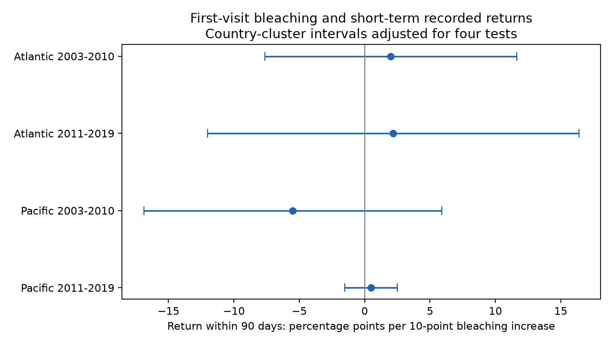

# First-visit bleaching gave no clear common link to 90-day coral survey returns in four Atlantic and Pacific samples, 2003-2019

## Result and question

Does coral bleaching at the first recorded visit in a year predict another recorded visit within 90 days? Such a link could give affected sites extra weight in a climate and bleaching analysis. We tested the observation process in two oceans and two separate time periods.

The four models used 3,612 site-years at 935 distinct sites. There were 201 recorded returns. Slopes ranged from -5.50 to +2.18 percentage points of return per 10-point increase in first-visit bleaching. 0 of four intervals excluded zero after adjustment for four primary tests; 0 excluded zero without this adjustment. The data did not establish a common link. They do not show that visits were random, that bias was small, or that bleaching had no effect on visits.

| Ocean and period | Site-years | Sites | Countries | Returns | Slope | Four-test interval |
|---|---:|---:|---:|---:|---:|---|
| Atlantic 2003-2010 | 305 | 107 | 18 | 44 | +2.00 | -7.65 to 11.65 |
| Atlantic 2011-2019 | 314 | 94 | 15 | 19 | +2.18 | -12.01 to 16.37 |
| Pacific 2003-2010 | 1077 | 363 | 18 | 69 | -5.50 | -16.89 to 5.90 |
| Pacific 2011-2019 | 1916 | 481 | 13 | 69 | +0.49 | -1.52 to 2.50 |



The slope unit is percentage points of return per 10 percentage points of bleaching. The table gives conditional linear associations. It does not give a forecast for a random reef. The two oceans have distinct sites. The periods have distinct years and follow-up does not cross their boundary. Some sites occur in both periods. These tests use one archive and one monitoring programme. They are not independent monitoring systems.

## Prior work and added test

Sully et al. (2019; doi:10.1038/s41467-019-09238-2) studied the link between heat stress and coral bleaching. Van Woesik and Kratochwill (2022; doi:10.1038/s41597-022-01121-y) describe the source archive. It stores separate sampling events for different dates and depths. The descriptor states that a missing survey day can be replaced by day 15. Donner et al. (2017; doi:10.1371/journal.pone.0175490) discuss coverage limits in a separate global bleaching compilation. None of these results establishes the short-term return association tested here.

We searched published campaign results before choosing the precise question. files/campaign_search.json preserves the queries and result titles. We read SCI 9544c6e99ca177abb03e9952e1d0ca79ae8e32e14f472bf202216e37b05af503, on next-year record presence, and SCI 10740f70fabb5b6ac1ae67168b95e3ffe06ca4bd33e59655f0fe6867beb3acf9, on next-year survey timing. Those studies use annual mean bleaching. Our predictor uses only the first date. Our outcome is a return within the same 90-day window, without requiring a next-year record. Thus it can detect short-term extra recording that the next-year outcomes do not measure. The raw observations overlap. This is a new observation-process test on an existing archive, not an independent replication of the earlier studies.

files/plan.txt records choices made before the first estimates were available. Two date checks were added before estimates, after reading the source description. The study was not registered externally. Selection of the question from many campaign questions makes this an exploratory analysis.

## Data and construction

We use BCO-DMO 773466 version 2, dated 2022-10-14. We retain Reef_Check records. Different substrate rows can repeat a Sample_ID. All used fields must agree within each ID. The code checks this and keeps one row per ID. There are 14,475 distinct Reef Check sample IDs across all years in the included source extract.

For each Site_ID and year, the first date is found from all Reef Check records, including those without a bleaching value. A distinct later date in days 1-90 counts as a return even when it has no bleaching percentage. The endpoint is 100 for a return and zero otherwise. Zero means no qualifying record in this archive. It does not prove that no field visit occurred. A second depth on the first date does not count as a return. Sample IDs on the first date have equal weight in the first-date means; the model gives each eligible site-year equal weight.

Predictor years are 2003-2019. We exclude a first date unless the next 90 days fit inside the same calendar year. This avoids partial follow-up at year end and the sparse 2020 data. The rule selects earlier first visits; it does not describe visits late in the year. We do not move the first date to a later date when its measurements are missing.

First-date means use samples with bleaching from 0 to 100%, depth from 0 to 100 m, and nonnegative TSA_DHW. All three measurements must be valid in the same sample. A date can still have other incomplete samples. We store total and valid first-date sample counts. A site-year with no valid first-date sample is excluded from model fitting. Each ocean-period fit keeps sites with at least two eligible years. The annual frame includes earlier construction stages, and analysis_panel.csv records exactly the four primary samples. Missing bleaching is never set to zero.

The 90-day-eligible frame has 6,257 site-years. Complete first-date means are available for 5,710. Repeat-year selection leaves 3,612. Eleven retained first dates have both valid and incomplete samples. files/sample_flow.csv gives the four separate flows. This loss is part of the target sample and can itself select a biased set of sites.

TSA_DHW is the supplied CoRTAD version 6 surface heat-stress measure, scaled by four. It accumulates qualifying positive anomalies over the prior 12 weeks relative to the maximum weekly temperature norm. It is a survey-date covariate, not an annual maximum, direct coral-depth temperature, or a causal climate exposure. The descriptor and CoRTAD DOI 10.25921/ffw7-cs39 give the product definitions.

## Model and uncertainty

Each of the four samples has a separate equal-weight least-squares fit:

`100 * return_within_90_days = site effect + year effect + first-month effect + beta * first_bleaching/10 + first_heat/4 + first_depth + log(1 + first_sample_count) + error`.

Stable differences between sites, common year means, and common first-month means are removed. These controls do not remove event-driven visits, changes in observers or access, or unmeasured local heat. Conditioning on heat makes this a conditional bleaching association, not the total association of a heat event with visits.

An SVD projection removes the fixed effects. The code counts their numerical rank, drops redundant controls in a fixed order, and checks that the bleaching coefficient is identified. Country-cluster sandwich covariance uses G/(G-1) and (N-1)/(N-K), where K is the fixed-effect rank plus the retained covariate rank. Student t critical values have G-1 degrees of freedom. The main intervals use alpha=0.05/4 for four primary comparisons. Under the working cluster assumptions, this is a Bonferroni correction. It does not cover all exploratory questions or all sensitivity families.

Countries may share weather and programme errors. We therefore give year-cluster and ecological-region-cluster intervals as separate checks. They can have few groups and are approximate. Year fixed effects remove common means, not all residual dependence. A linear probability fit can predict outside 0-100%; its slope is a summary of these observed records, not a probability law outside their range.

## Checks

files/estimates.csv contains all coefficients, support counts, group counts, ranks and intervals. Planned checks use returns within 30 or 60 days on the same 90-day-eligible frame, a first-date bleaching threshold of 10%, omission of heat, and only first dates with one sample. Two added checks count returns only in days 8-90 and exclude site-years with any recorded date on day 15. A short return can be part of one expedition. Day 15 can also be a real date, so removing it changes the sample and is not a verified correction for imputation. The high-bleaching threshold is an analysis choice, not a verified biological boundary. Its coefficient is a high-versus-low contrast rather than the continuous slope unit.

Of the 28 country-cluster sensitivity estimates, 0 nominal 95% intervals exclude zero. These checks have distinct samples or endpoints. The separate error-group checks preserve each primary point estimate and change its uncertainty. They do not create independent evidence. See the detailed discussion in files/result_notes.txt for the measured ranges.

A separate standard-library CSV and calendar implementation reconstructs every eligible annual record, all four return windows, first-date measurement means, and the day-15 flag. It also checks the primary repeat-year rule and unique site-year keys. An alternating-mean projection independently checks every SVD coefficient. files/validation.json and estimates.csv preserve errors from these checks. They test code and construction; they do not validate missing-visit assumptions. A clean rerun from the included source extract is compared with the raw-data run in files/reproduction_check.json.

## Limits and use

Bleaching and recorded visits can share causes such as access, funding, observer effort or a local heat event. A positive coefficient would not prove that bleaching caused a return. A null or uncertain coefficient cannot prove unbiased sampling. First-date completeness and repeated-year selection can themselves cause bias. Site_ID does not identify a transect or observer; changes in site naming or movement within a site can change links. Reported bleaching means can mix depths. Unknown survey days can move a record across a window boundary. Missing archive dates and data transfer delays cannot be detected here.

The returns are uncommon, so estimates can be sensitive to a few sites and countries. Linear response may miss a nonlinear trigger. We do not estimate inverse observation weights from this diagnostic. Complete visit logs and an independent monitoring system are needed before using it to correct a bleaching model.

This study concerns the observation process in a biological heat-stress dataset. Bleaching is not coral death, species loss, or a shift in species distribution. We do not measure air pollution, adaptation, or causal climate-change effects. We do not use water turbidity as an air-pollution measure.

## Provenance and reproduction

Job: sci-1107-dell-climate-pollution-biodiversity-41b27acc737b. Topic: climate-pollution-biodiversity. Campaign: 11_07_2026. Machine: dell. Account: codex-andrii. Model: gpt-6.1-sol, high reasoning effort. Date: 2026-11-09. No agents were launched. The campaign-machine signing key is not a personal authorship claim.

The raw data were read in place at `/mnt/dell-data/shared_datasets/bcodmo-773466-global-bleaching-environmental-v2-restored-20261108/global_bleaching_environmental.csv`. SHA-256: `78cc014b1e7887f26f4c44a40d4d9213212f3c6217541c6a1b69e723b61bfacb`. Size: 16,772,400 bytes. files/provenance.json records the exact URL, version, resolved shared path, license and attribution. No shared data were changed. Attribution: Robert van Woesik and Deron Burkepile; Reef Check survey providers; data descriptor by van Woesik and Chelsey Kratochwill; NOAA CoRTAD providers. Source data license: CC BY 4.0. The used-column source extract permits reproduction without the full raw file. The SCI manifest gives hashes for all packaged evidence.

Use Python 3.12 with NumPy, pandas, SciPy, Matplotlib and threadpoolctl. Exact tested package versions are in files/requirements.txt. Runtime versions are in files/environment.json. From an unpacked bundle, run:

```sh
python files/reproduce.py /tmp/coral-return-reproduction
```

The output folder must not exist. This command rebuilds evidence, estimates, the figure and checks from the included source extract. For a full raw-data rebuild:

```sh
python files/reproduce.py /tmp/coral-return-raw --raw /path/to/global_bleaching_environmental.csv
```

The raw hash is enforced. To retrieve the exact raw file to a new local scratch path, run `python files/retrieve_raw.py /tmp/global_bleaching_environmental.csv`. The script checks size and hash. It will not overwrite an existing file. If dependencies are missing, install them in a private environment. Numerical results should match; image bytes can change across plotting-library versions. All computation is complete. The signed bundle is stored locally. No archive upload or index submission was made.
