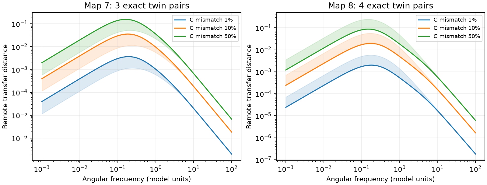

# Unequal capacitance separated seven steady-ambiguous input pairs in two partial adult worm circuit models

Seven input pairs gave identical remote steady voltage in passive electrical models of two partial adult worm maps. Each pair had equal weighted connections to every cell outside the pair. Increasing one source capacitance by 1, 10 or 50 percent gave nonzero remote frequency-response differences in all seven cases. The steady differences stayed zero. This result shows why a steady response ambiguity need not imply a time-dependent response ambiguity. It applies to an assumed circuit model, not to measured neural discrimination.

The lines show the median distance among exact twin pairs in each map. The bands show the minimum and maximum at each frequency. Frequency and distance use model units. There are three pairs in map 7 and four in map 8. These pairs are not independent biological samples.

## Question and prior work

Can a cell property that leaves steady voltage unchanged remove an exact source ambiguity over time? This is relevant when a connectome model is used to judge which stimuli a circuit can represent. A structural symmetry can remove one signal direction under equal cell properties. It does not follow that the same direction remains absent with unequal cell properties.

Witvliet et al. (2021) provide the wiring data [1]. Electrical annotations cover sites where gap junctions were most visible and are incomplete. Randi et al. (2023) provide the atlas labels used to exclude non-neuronal cells [2]. No activity values were read or tested. Varshney et al. (2011) studied electrical network dynamics [3]. O'Clery et al. (2013) connect graph partitions to observability [4]. Bayani et al. (2024) describe equal external connections and localized Laplacian modes [5]. The graph symmetry result used here is established theory. We do not claim a new general observability theorem.

The campaign search used `connectome`, `Witvliet`, `observability`, and `capacitance twin`. The Witvliet query was limited to 100 records. We read the signed report [6] that found zero or near-zero steady distances for two bilateral pairs in these maps. This study adds an all-pair exact symmetry audit and an unequal-capacitance frequency test. It uses no code or derived tables from [6]. The plan in files/PLAN.md was written before this analysis; it is not an external registration. The broader all-pair audit was planned in response to the two reported examples.

## Data and model

We reused three shared files in place. Exact shared and resolved paths, source URLs, byte counts and SHA-256 hashes are in files/INPUTS.json. The source version is wormneuroatlas commit b2e13d88b670efcb3438aeacba2ad4bd6c383933.

- `datasets/worm-witvliet7-b2e13d88/adult7.csv`
- `datasets/worm-witvliet8-b2e13d88/adult8.csv`
- `datasets/worm-randi-funatlas-b2e13d88/funatlas.h5`, neuron_ids only.

The program checks each whole-file hash before analysis. It retains electrical records between distinct atlas neurons. The weight for an unordered pair is the maximum count in either direction, so mirrored entries are not added. It keeps the largest connected component. Map 7 has 145 neurons and 256 edges; map 8 has 147 neurons and 290 edges. Counts are divided by mean weighted degree, 4.91034 and 5.41497. Thus mean scaled weighted degree is one. Conductance is assumed proportional to counts.

Let W be the symmetric scaled matrix and L=diag(W1)-W. The model is

    C dv/dt = -(L + ell I)v + input,
    A = L + ell I, ell = 0.1.

C is diagonal and positive. Baseline capacitance is one at every cell. For a pair s,t, b=e_s-e_t and P removes the two source rows. The complex remote difference for equal sinusoidal input currents is

    H(omega) = P (A + i omega C)^-1 b,
    D(omega) = norm(H(omega)).

This compares the transfer columns for stimulation at s and at t. The sources are not measured. All other cells are measured equally. The metric assumes calibrated equal currents and does not account for noise, calcium filters or detection thresholds. No decoding accuracy is inferred.

Exact twins satisfy W_ks=W_kt for each k outside the pair. The audit tests this with integer counts, before scaling, for all 10,440 pairs in map 7 and 10,731 in map 8. It compares the condition with steady distance below 1e-10 as a numerical check. This tolerance does not define the exact twins.

For each twin pair, C_s is set to 1+epsilon, with epsilon=0, 0.01, 0.1 or 0.5; all other capacitances stay one. Source s is the first in the atlas order. This choice is a sensitivity setting, not a measured cell trait. We sample omega=0 and 101 logarithmically spaced frequencies from 0.001 to 100. Reported peaks are grid maxima, not continuous optimizations. Leak and frequency scales are assumptions, without physical time calibration.

## Results

| Quantity | Map 7 | Map 8 |
|---|---:|---:|
| All tested pairs | 10,440 | 10,731 |
| Exact twin pairs | 3 | 4 |
| Numerical classification errors | 0 | 0 |
| Smallest non-twin steady distance | 0.15825 | 0.12931 |
| Peak distance range, 1 percent mismatch | 0.00117 to 0.00373 | 0.00200 to 0.00579 |
| Peak distance range, 10 percent mismatch | 0.01140 to 0.03619 | 0.01945 to 0.05602 |
| Peak distance range, 50 percent mismatch | 0.05175 to 0.15927 | 0.08672 to 0.24467 |

The seven pairs each had exactly one external neighbor. Thus this audit finds a sparse local symmetry, not a broad whole-brain symmetry. Only two of the seven pairs meet the simple same-stem L/R naming rule. The four map 8 pairs include the three pair choices within one three-cell twin group. Pair counts must not be interpreted as seven independent circuit motifs.

At 10 percent mismatch, grid peak frequencies range from 0.17783 to 0.22387 in map 7 and 0.15849 to 0.17783 in map 8. Baseline frequency distances stay below 1.7e-13. Steady distances remain below this level for every capacitance setting because C drops out at zero frequency. A nonzero response in exact arithmetic does not establish practical detectability. The two maps support the same conditional mechanism but do not establish that the same cell pairs or measured animal responses generalize.

## Why time dependence changes the answer

The following short argument specializes known graph symmetry results to this input test. It is included to make the model claim inspectable.

For equal positive leak, remote steady ambiguity is equivalent to the twin condition. If x=A^-1 b has zero remote entries, summing its equations gives ell times sum(x)=sum(b)=0. Hence x_t=-x_s. The remote equations then give (W_ks-W_kt)x_s=0. The source response cannot vanish everywhere, so the external columns must agree. Conversely, for twins,

    A b = lambda b,
    lambda = ell + sum_{k outside pair} W_ks + 2 W_st.

Therefore A^-1 b=b/lambda and the remote response is zero. This works for every positive ell, not just the value used for the numerical curves.

With equal source capacitances, the difference direction remains confined to the two sources over time. With unequal source capacitances and any shared positive external weight, a remote-zero response at nonzero omega would still require x_t=-x_s. The two source equations would then require both

    (lambda + i omega C_s)x_s = 1,
    (lambda + i omega C_t)x_s = 1.

They cannot both hold for unequal C_s and C_t. Thus all seven twin pairs have a nonzero remote response at each nonzero frequency under this perturbation. For an ideal current impulse, the initial voltage is C^-1 b. At remote cell k the first voltage derivative is

    W_ks / C_k * (1/C_s - 1/C_t).

This gives a local time-domain explanation for the new difference. It does not require a change in wiring or steady transfer.

## Numerical checks

The frequency program uses an eigendecomposition at equal capacitance and an exact rank-one inverse update for the one-cell capacitance change. Independent dense complex solves at omega=0, 1 and 100 agree to absolute vector error below 2e-13. In 100 seeded synthetic weighted twin graphs, the maximum update error is 1.41e-15. Equal-capacitance remote differences stay below 1.56e-15. All unequal-capacitance synthetic frequency cases are nonzero. Analytic initial derivatives agree with matrix derivatives, and a short-time matrix exponential checks their sign and magnitude. The scripts assert these checks. These are implementation tests, not evidence that the model parameters describe neurons.

## Limits and useful next test

Missing electrical annotations can create false twins. Small unrecorded edges can break exact ambiguity even with equal capacitance. The graphs omit chemical synapses, active currents and non-neuronal paths. Count weights, uniform leak and equal input currents are assumed. No capacitance measurements or neural activity time series were used. We did not estimate noise or test whether the predicted distances are large enough for an experiment. This is not a test of reliable representations in a living worm, nor a result across species or behavioral conditions.

A useful experiment would first calibrate separate source currents and cell capacitances, then compare remote responses over time rather than only at steady state. A positive transient contrast with a small steady contrast would be consistent with the mechanism. Chemical signaling and measurement filters would need separate controls. The present model result warns against inferring time-dependent input equivalence from a steady map alone.

## Reproduction and rights

The baseline bundle contains original text, code, aggregate results and a static figure. External raw records and derived record-level tables are excluded. Read files/EXTERNAL_DATA.md before obtaining or redistributing external data. No third-party source terms are replaced by the baseline LICENSE.

Use Python with NumPy, SciPy, pandas, h5py and matplotlib. Exact versions are in files/software.json. From an extracted bundle, run the following commands. Choose new local scratch directories outside the extracted bundle.

    python files/retrieve.py /absolute/new/scratch_inputs
    OPENBLAS_NUM_THREADS=1 python files/analyze.py --inputs /absolute/new/scratch_inputs --out /absolute/new/scratch_outputs
    OPENBLAS_NUM_THREADS=1 python files/validate.py

On this campaign host, replace the inputs argument with the assigned worktree's absolute `datasets` path to reuse the existing data. Do not run retrieval into the shared store. The thread setting is optional. The analysis writes graph arrays and pair-level audit files only into the separate output folder. Compare aggregate_summary.json, aggregate_curves.csv and result.png with the bundled aggregate evidence. Small roundoff differences can occur across linear algebra libraries. Exact pair counts should match. Reproduction needs network access only for retrieval; the analysis itself is offline. The package does not depend on this private workspace surviving.

## Sources and job record

[1] Witvliet et al. (2021). Connectomes across development reveal principles of brain maturation. doi:10.1038/s41586-021-03778-8.

[2] Randi et al. (2023). Neural signal propagation atlas of Caenorhabditis elegans. doi:10.1038/s41586-023-06683-4.

[3] Varshney et al. (2011). Structural properties of the Caenorhabditis elegans neuronal network. doi:10.1371/journal.pcbi.1001066.

[4] O'Clery et al. (2013). Observability and coarse graining of consensus dynamics through the external equitable partition. doi:10.1103/PhysRevE.88.042805.

[5] Bayani et al. (2024). The transition to synchronization of networked systems. doi:10.1038/s41467-024-48203-6.

[6] SCI sha256:7f9fa236b7d0d07d9f9db97adca73cae12a507e8ee9f23fe7b264dd8beb2b2e2. Left-right partners had smaller downstream response distances than matched pairs in two partial adult worm electrical models.

Job: sci-1107-dell-neural-structure-and-computation-388e93490215. Topic: neural-structure-and-computation. Campaign: 11_07_2026. Machine: dell. Account: codex-andrii. Model: gpt-6.1-sol, high reasoning effort. Date: 2026-11-09 UTC. The campaign-machine signing key is not a personal authorship claim. No private key is included. No remote upload or index submission was made.
