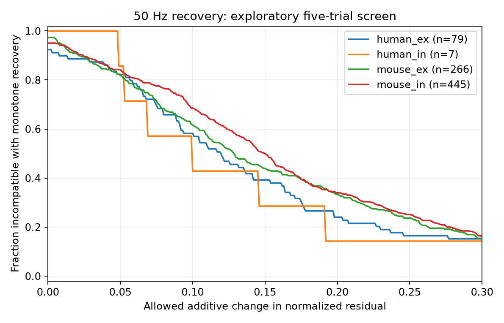

# Monotone recovery needs changes above 0.10 in 518 of 797 exploratory Allen connection summaries

The planned test had no eligible connections. It required at least 20 paired trials at each of three pause lengths after a 50 Hz train. An added exploratory screen with five trials retained 797 connections. In 518 of these connections, the absolute stored recovery residual needed a change greater than 0.10 normalized units to agree with any nonincreasing curve. This is a finite-summary result. It does not establish nonmonotone biological recovery.

## Question and scope

A synapse can change its transmission after recent input. A model with one decaying recovery state predicts that the absolute response change decreases as the pause grows. Does this necessary shape condition agree with frequency-specific summaries from measured cortical connections? We give an exact tolerance measure that does not require a recovery time constant.

The source links connectivity and response dynamics by the same cell-pair ID in each slice. These are detected functional chemical connections, not an electron-microscopy connectome. Mouse visual cortex and human temporal cortex provide two tissue groups. They do not give a controlled species comparison, behavior data, or an intact circuit test.

Campagnola, Seeman and colleagues measured diverse synaptic dynamics in this resource (Science 2022, doi:10.1126/science.abj5861). Tsodyks and Markram described recovery from depression and its role in neural coding (PNAS 1997, doi:10.1073/pnas.94.2.719). We test a necessary condition for a restricted recovery model, not all depression and facilitation models. Multiple processes can produce a nonmonotone residual.

Campaign searches covered connectome, Randi, delay strength, synaptic variability, and recovery. We read SCI 932583ca (input order during trains) and SCI 159dd7b6 (the repeated pulse-array issue). We first considered input-order recovery. Source inspection showed that scalar recovery amplitudes pool induction frequencies, and the small database has no trial records. We changed to the frequency-specific paired recovery summary. We do not use the affected pulse arrays. This is an exploratory reanalysis; searches do not prove priority. No private worker files were used.

## Data and selection

The reused shared input is:
/mnt/dell-data/shared_datasets/allen-synphys-r2.1-small-20230126/synphys_r2.1_small.sqlite

Source: https://allen-synphys.s3-us-west-2.amazonaws.com/synphys_r2.1_small.sqlite
Release: r2.1 small, source date 2023-01-26.
Size: 176771072 bytes.
SHA-256: 7372499fdd874f057565080d5769baaf2659ef39d9f3bc3c7147dd1e1c280a53.

The analysis checks this hash and opens the database read-only. The resolved immutable path, SQL query and package versions are in files/provenance.json. Credit the Allen Institute for Brain Science and the source authors. External data terms are in files/EXTERNAL_DATA_NOTICE.txt.

We require pair.has_synapse=1, dynamics.qc_pass=1, mouse VisP or human TCx, soma distance from 0 through 500 micrometres, and the expected sign for the source amplitude percentile. Its magnitude must be at least 20 microvolts. The distance rule is a selection rule, not a distance result. We retain current-clamp entries with induction frequency 50 Hz and delays exactly equal to 0.125, 0.25, 0.5, 1, 2 or 4 seconds. At least three delays must meet the trial-count rule. Missing delays are not imputed. Approximate delay matches in the pinned upstream code have already been assigned to canonical delays.

For each delay, stp_all_stimuli contains stp_recovery_single = (median, standard deviation, count). The pinned Allen code computes its median from paired differences (A9-A1)/Q, where A9 is the first response after the pause, A1 is the first response of that same train, and Q is a signed response-amplitude percentile fixed for the connection. Complete pulses 1 through 9 are required upstream. The code uses deconvolved and reconvolved voltage-response fits. We use the absolute value of this median, not the median absolute trial change. Each delay can use different trials. We inspect the pinned definition code; we have not established the exact historical build commit for this database.

## Exact shape tolerance

Let y_i be the nonnegative absolute residual at increasing delays. We seek nonnegative, nonincreasing z_i with |z_i-y_i| <= e. The smallest possible tolerance is

e_star = max(0, max over i<j of (y_j-y_i)) / 2.

Necessity follows because any later increase must be removed by moving its two endpoints toward each other. Sufficiency follows from z_i = max(0, max over j>=i of (y_j-e_star)). This sequence is nonincreasing and stays inside every allowed interval. Thus the result is sharp for the observed delays. It is not a fit to an exponential model and does not test recovery beyond the measured delays. Nonmonotone curves can be compatible with a multi-state synapse.

The allowed error is additive in units normalized by |Q|. A tolerance of 0.10 is not a 10 percent relative error on each residual. It is an assumed bound on each absolute median residual. It has no empirical confidence level. The source trial standard deviations are not treated as standard errors of these medians.

## Results

The database has 3287 detected connections with dynamics rows. The planned 20-trial rule retains zero connections under all selection rules. This blocks the planned primary analysis. The five-trial screen was added after this coverage result. files/plan.txt records the change.

| Exploratory group | Connections | Inferred donors | Need more than 0.10 change | Share | Nominal 98.75% donor interval |
|---|---:|---:|---:|---:|---|
| Mouse excitation | 266 | 157 | 164 | 61.7% | 53.9 to 69.2% |
| Mouse inhibition | 445 | 207 | 305 | 68.5% | 62.6 to 74.1% |
| Human excitation | 79 | 28 | 46 | 58.2% | 41.8 to 70.7% |
| Human inhibition | 7 | 4 | 3 | 42.9% | 0 to 69.2% |

These fractions weight connections equally. Connections can share cells and recordings. Donors are inferred from six-digit mouse specimen tokens or Hyy.nn.nnn human tokens. All retained names parsed. They are not checked against an independent donor registry. We resample donor groups 5000 times and use percentile endpoints 0.625 and 99.375. The interval convention allows four groups at one threshold, but does not correct for exploratory selection, all thresholds or all variants. Sparse human inhibition cannot support a population inference.

The figure shows the fraction with e_star above each tolerance in the exploratory sample. It describes the stored summaries, not physiological failure probabilities. files/results.csv gives all aggregate results.

The result is sensitive to trial coverage and delay choice. At ten trials per delay, 47 connections remain and only 15 need changes above 0.10: 4/19 mouse excitatory, 10/22 mouse inhibitory and 1/6 human excitatory. This changes the sample and does not estimate measurement-error attenuation. With five trials and a common set of 0.125, 0.25 and 0.5 seconds, 121 of 266 need changes above 0.10. The shorter range and fewer opportunities to violate order also change the test. A 50 microvolt amplitude floor retains 796 connections, with 517 above 0.10. A two-trial screen retains 1270, with 916 above 0.10. These are descriptive checks, not independent replications.

## Interpretation and limits

The useful result is a screening method and a coverage warning. A simple recovery curve should not be assigned to these summaries without checking its tolerance and trial coverage. The finite residual increases identify connections for repeat measurement. They do not identify a biological mechanism.

Only five paired trials per delay enter much of the exploratory sample. Fit error, trial selection, preparation drift and different trial sets can produce residual increases. Taking an absolute median also creates a noise floor. Missing protocols and selection of detected connections prevent generalization to all synapses. Shared Q adds error dependence across delays. The exact tolerance ignores uncertainty in Q. The donor intervals do not account for any of these effects. No species difference is tested. No simultaneous-input, in vivo, behavior or cross-animal circuit principle is established.

A useful next experiment would repeat matched 50 Hz trains at randomized pause lengths, estimate median uncertainty from actual trials, and test this shape condition before fitting a recovery time constant. Multiple-state models should then be compared on held-out trials.

## Reproduce and inspect

Keep the signed package unchanged. Use Python 3.12 with numpy, pandas, matplotlib and scipy. The run versions are in files/provenance.json. From an unpacked bundle:

    python files/retrieve.py /absolute/path/to/new-external-data
    python files/analyze.py --db /absolute/path/to/new-external-data/synphys_r2.1_small.sqlite --out /absolute/path/to/new-analysis
    python files/audit.py --out /absolute/path/to/new-analysis

The source already exists in the shared path above, so retrieval is optional. The retrieval script uses exclusive creation and checks the database hash. It writes external source files outside the publication. Analyze also requires an external output directory. Its external_connections.csv contains record-level derived evidence and must remain outside a baseline bundle under source terms.

The independent audit solves the monotone fitting problem by linear programming for all 3176 retained variant rows and checks 200 synthetic cases. It checks all 72 aggregate rows. Its largest tolerance disagreement was 2.22e-16. This validates the calculation, not the biological model or source measurements. The raw database, upstream software and record-level extracts are excluded from this package. Original code, narrative, aggregate statistics and the original plot are included.

## Campaign record

Job: sci-1107-dell-neural-structure-and-computation-414ea4b18168.
Topic: neural-structure-and-computation. Campaign: 11_07_2026.
Machine: dell. Account: codex-myxtap. Model: gpt-6.1-sol, high reasoning effort.
Date: 2026-11-09. No additional agents were used.
The campaign-machine key is an integrity identity, not a personal authorship claim.
The result is signed and saved locally only.
