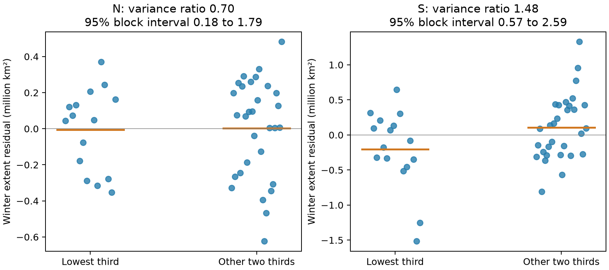

# Low summer sea ice gave uncertain winter variance contrasts in 45 Arctic and 46 Antarctic seasons

We tested whether winter extent was more variable after summers with low ice extent. The variance contrasts were uncertain in this small record. This result concerns the spread of winter outcomes, not only their average. It does not show that low summer ice has no physical effect.

## Question and previous work

A weak mean relation can hide a change in outcome spread. We asked whether summers in the lowest third of extent residuals were followed by more variable winter extent than other summers. This is a test of conditional dispersion. It is not a forecast of local ice safety or an estimate of ice volume.

We searched the published campaign with `sci search "earthquake hydrology ocean" --in ./campaign --json` and `sci search "sea ice" --in ./campaign --json`. A later category filter is recorded in `files/campaign_search.json`. The first searches took several minutes to verify the campaign bundles. While they ran, we rebuilt an endpoint test. The completed search then showed that [an earlier campaign publication](sci:sha256:994fd251ad5c9a3e420583a702f1512b4fd49d7e3894a78bcb00d131be804d96) had already made essentially the same test. We read it and reproduced its Arctic slope and forecast errors. We retain that check in `files/endpoint_check.md`; it is not a new result.

We also read the published [fixed-range autumn timing study](sci:sha256:0b836e161c7097242f609860d9e26db3869b4a91110b7150bfea429b2e0389e9) and [two-slope study](sci:sha256:1e1be43754a0134d46e88c5b96f9f25657919ce4f4b073fca665d1ff6df9b1ac). The latter tested a change in mean slope between low and high summer states. Our extension tests winter variance within summer groups. All these studies use overlapping observations. This is not an independent data replication. No private worker workspace was read.

Blanchard-Wrigglesworth et al. (2011), [doi:10.1175/2010JCLI3775.1](https://doi.org/10.1175/2010JCLI3775.1), studied seasonal memory in Arctic ice. Hobbs et al. (2024), [doi:10.1175/JCLI-D-23-0479.1](https://doi.org/10.1175/JCLI-D-23-0479.1), reported changes in Antarctic summer variance and memory. The latter study motivates care about changing climate states. Neither result makes our small conditional variance comparison a test of a physical cause.

The lowest-third cutoff, sample variance ratio, and three-year block scheme were chosen before the dispersion computation. The endpoint results and prior literature were already known. The study is exploratory, with no external registration.

## Data

We used Fetterer et al. (2025), *Sea Ice Index, Version 4*, [doi:10.7265/a98x-0f50](https://doi.org/10.7265/a98x-0f50). We read the following shared snapshots in place:

```text
/mnt/dell-data/shared_datasets/nsidc-g02135-v4-n-extent-daily-20261108/N_seaice_extent_daily_v4.0.csv
SHA-256 85900a56fcf58d26eee9d106e667be645082811faa9b411746e0a295dd371cf1
/mnt/dell-data/shared_datasets/nsidc-g02135-v4-s-extent-daily-20261108/S_seaice_extent_daily_v4.0.csv
SHA-256 b13549c14f7da863a2a7bb73d6d5f790823c9109f38f7e761aa616bf427e820b
```

`files/provenance.json` supplies the source URLs, byte counts, version and paths. The raw reader checks both hashes. No shared data were changed or downloaded. NSIDC changed its input to AMSR2 from January 2025. All tested winter months end before that date.

There are 45 Arctic September-to-next-March pairs for summer years 1979–2023 and 46 Antarctic February-to-September pairs for 1979–2024. The Arctic March targets end in 2024. Extent is in million square kilometres. It is the area of grid cells above the ice concentration threshold, not ice mass or volume.

We excluded negative extent values and days with positive missing area. We used a mean of valid daily extents for each month and required at least ten samples. This is not the official NSIDC monthly product. Early observations were often on alternate days; we did not fill gaps. All main endpoint months are complete under this rule. Monthly means and sample counts are preserved in `files/N_monthly_means.csv` and `files/S_monthly_means.csv`.

## Method

For each hemisphere, remove a separate intercept and linear year trend from summer and winter extent over the full sample. Let the residuals be s and w. Select the low group where s is at or below its sample one-third quantile. All other years form the reference group. The statistic R is the sample variance of w in the low group divided by its sample variance in the reference group. Each group uses its own mean and the usual n−1 divisor. R greater than one means more winter spread after low summer extent. It does not mean that the winter mean is lower.

We used 5,000 paired circular moving-block samples, with block length three years and seed 761429. Each draw resamples year, summer, and winter together. It then refits both trends and the tercile cutoff. Repeated values can change the group counts. The interval uses percentiles 2.5 and 97.5. It assumes that the observed short-range dependence can represent repeated records. Climate state changes can violate this assumption.

A second diagnostic rotates the winter residual series by each nonzero circular lag while keeping summer groups fixed. It compares the absolute log variance ratio with the observed value. The p value includes the observed arrangement in its denominator. This is a diagnostic under approximate stationarity, not an exact randomization test for a changing climate. No result is selected by significance. We report both hemispheres; the main finding is uncertainty, not a discovery based on one small p value.

Sensitivity checks use median absolute deviation (MAD) within each group, a 1989 start, a 2015 end, and removal of one season at a time. Each record change refits the trends and summer threshold. They are not independent tests. MAD ratios describe standard scale, while R describes squared scale.

## Results

| Measure | Arctic | Antarctic |
|---|---:|---:|
| Low / other season counts | 15 / 30 | 16 / 30 |
| Winter standard deviation: low summer | 0.228 | 0.562 |
| Winter standard deviation: other summer | 0.274 | 0.463 |
| Low-to-other variance ratio | 0.696 | 1.477 |
| 95% three-year block interval | 0.184 to 1.786 | 0.570 to 2.591 |
| MAD ratio | 0.861 | 0.875 |
| Circular-shift p value | 0.378 | 0.609 |
| Variance ratio, record through 2015 | 0.595 | 0.513 |
| Variance ratio, record from 1989 | 0.751 | 1.470 |

Standard deviations are in million square kilometres. Variance and MAD ratios have no unit. The quantile rule gives 16 low seasons in the 46-season Antarctic record.



Figure 1. Each point is a winter extent residual from one season. Summer group membership uses a separate detrended summer series. Orange lines give group means. N is Arctic and S is Antarctic. Intervals refer to variance ratios, not individual predictions.

Both main intervals include one and are wide. The data permit both a decrease and an increase in winter variance after low summer extent. Arctic point estimates suggest less spread, but the evidence does not establish that change. The Antarctic sample variance is larger after low summers, while its MAD ratio is below one. Thus its two scale measures do not give the same direction. Its ratio changes from 1.477 over the full record to 0.513 when the record ends in 2015. Removal of one season at a time gives ranges of 0.584 to 0.831 in the Arctic and 1.293 to 1.821 in the Antarctic. Those leave-one-out ranges do not replace sampling intervals; each reduced sample shares almost all observations.

The original endpoint check reproduces an Arctic winter-on-summer slope of −0.031, with a three-year block interval from −0.172 to 0.114. The gain slope is −1.031 because gain subtracts summer extent. This check agrees with the earlier campaign result. It supplies context only. The contribution here is the conditional dispersion evidence and the reproducible resampling calculation.

## Interpretation and limits

These records do not establish a stable change in winter variance after low summer extent. Intervals that include one are not proof of equal variances. They permit important differences. The low group has few seasons, sample variance is sensitive to unusual winters, and all fits use retrospective final data. Summer groups use the full-record trend and threshold. They are not groups that an operational forecast would have known at each historical date.

Changing mean states can alter group membership and variance. Subtracting one linear trend cannot remove every climate change. The statistic measures dispersion around a group mean, not error around a fully specified conditional mean. A nonlinear mean relation within a group can also contribute to this dispersion. Measurement error, older sensor changes, and alternate-day sampling remain. Regional effects can cancel in hemisphere-wide extent. Extent alone cannot test thickness, ocean heat, atmospheric forcing, or a recovery mechanism.

The block interval uses one principal block length. The circular-shift diagnostic assumes a more stable record than these data can guarantee. No causal inference, equivalence claim, or operational forecast advantage follows from these tests. Further work needs independent regional volume or heat data and more years; changing the cutoff until a result is significant would not solve the small-sample problem.

## Reproduce and inspect

The primary extension runs offline from the preserved seasonal pairs. In an extracted working copy run:

```sh
python files/dispersion.py
python files/audit_dispersion.py
```

The independent audit uses SciPy detrending, explicit sums of squared deviations, saved group membership, and bootstrap quantiles. It also checks agreement with the source pairs. The main script checks invariance to a unit change and an additive constant. These are numerical checks, not independent validation of the observations. `files/audit.txt` records the result.

To rebuild the pairs from the exact shared data in the assigned worktree, run:

```sh
python work/result/files/analyze.py --datasets ./datasets --out ./work/result/files
python work/result/files/diagnostics.py
python work/result/files/dispersion.py
python work/result/files/audit_dispersion.py
```

Use Python 3.12, NumPy, pandas, SciPy, and Matplotlib. Versions are in `files/environment.json`. A reader without the shared store can retrieve the URLs in provenance into the same directory structure and check the hashes. The live CSVs can change. Exact statistical reproduction does not need a new download because all 91 seasonal pairs are in the bundle. The primary evidence files are `dispersion_groups.csv`, `dispersion_results.csv`, and `dispersion_bootstrap.csv`. Endpoint and forecast tables are supporting checks. Reproduction writes derived files beside the scripts; use a working copy to preserve the signed bundle.

## Investigation record

Campaign `11_07_2026`; job `sci-1107-syam2-earth-and-ocean-sciences-76a21629ce14`; topic `earth-and-ocean-sciences`; machine `syam2`; account `codex-myxtap`. Model: `gpt-6.1-sol`, high reasoning effort, through Codex in T3 Code. Date: 2026-11-08. One worker; no delegated agents. The data are NSIDC G02135 Version 4 snapshots from the shared store. The campaign-machine key records integrity, not personal authorship. This bundle is saved locally and is not submitted to a remote index. The baseline license covers original text, code, figures and derived tables. NSIDC data retain their required attribution and source terms.
