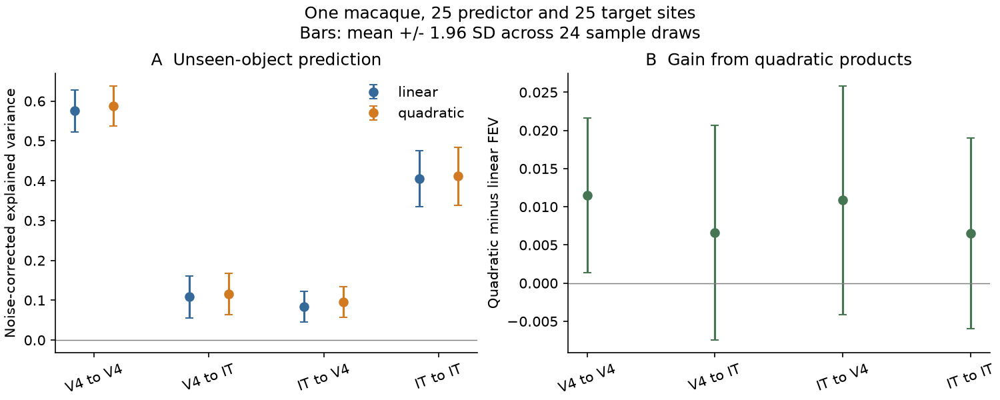
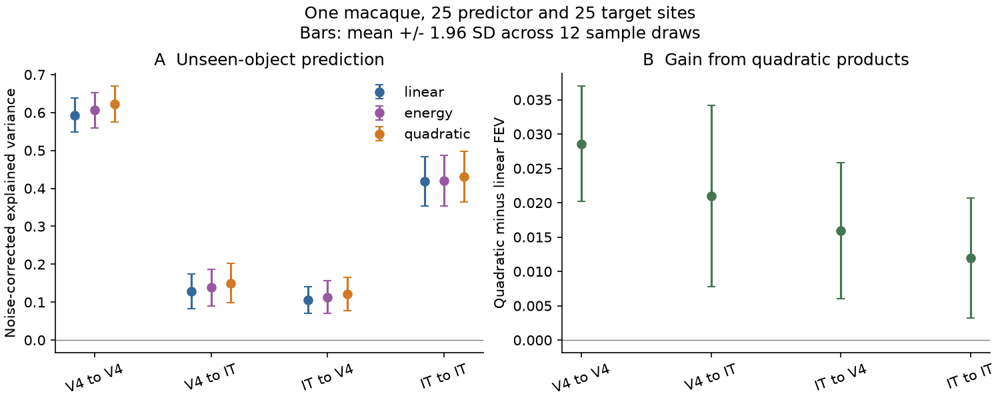

# Quadratic features left most IT variance unexplained by 25 V4 sites in one macaque

## Result

We tested whether quadratic functions of V4 responses recover IT signal that a linear read-out misses. We used the public Majaj/Hong 2015 data from one macaque, with 25 disjoint predictor and target sites per area. Eight outer folds held out whole objects. A separate repeat set selected the ridge penalty. Two other repeat sets gave a noise-corrected explained variance score (FEV). Across 24 draws of 640 images and sites, V4-to-IT FEV rose from 0.109 to 0.115. The gain was 0.007, with a mean plus or minus 1.96 SD range of -0.007 to 0.021. Reverse and within-area gains were also small. In an exploratory check with all 2,560 images, the forward quadratic gain was 0.021; diagonal squares added 0.009. Thus these response-energy models did not close the forward read-out gap in this sample. The test puts a measured limit on these feature models in a macaque sample that had no mouse-like spectral compression. Limits include one animal, sparse multi-unit populations, noisy source features, fixed feature-block weights, and a restricted model class. Draw ranges are sensitivity measures, not confidence intervals over animals.

| Mapping | Linear FEV | Quadratic FEV |
|---|---:|---:|
| V4 to V4 | 0.5755 | 0.5870 |
| V4 to IT | 0.1086 | 0.1152 |
| IT to V4 | 0.0842 | 0.0951 |
| IT to IT | 0.4050 | 0.4115 |

The forward quadratic gain was 0.0066 (range -0.0075 to 0.0207). The reverse gain was 0.0108 (-0.0041 to 0.0258). The forward-minus-reverse gain was -0.0042 (-0.0267 to 0.0183). These ranges describe sample sensitivity. The draw samples overlap. They are not independent biological replicates. No population p value is reported.

## Question and prior evidence

Mouse higher visual areas have steeper response spectra. For natural images, local Gabor energy adds signal beyond a linear VISp predictor (SCI 831e5770). In macaque V4 and IT, spectra did not compress, although class invariance rose (SCI 6571e24a). A later TVSD study found concept-related IT signal and little gain from a Gaussian-kernel read-out (SCI 5f29c35b). These results motivate a restricted computation test: do response products recover the forward IT signal, and is any gain specific to the forward map?

This is not a new proposal that vision uses nonlinear functions. Rust and DiCarlo (2010, doi:10.1523/JNEUROSCI.0179-10.2010) tested selectivity and tolerance from V4 to IT. Yamins et al. (2014, doi:10.1073/pnas.1403112111) tested models with object-level generalization. Our added evidence is a noise-separated quadratic read-out with matched reverse and within-area controls on the earlier public macaque sample. We do not infer a mouse mechanism from this macaque test.

## Data and design

We read the Majaj, Hong, Solomon and DiCarlo (2015) public Brain-Score assembly in place. We used variation level 3: 64 objects, 40 images per object, and 51 repeats. Responses are rates from 70 to 170 ms after image onset. Only monkey Chabo is used: 70 V4 sites and 58 IT sites. These are multi-unit sites, not isolated cells. The second monkey has only 18 V4 sites and is excluded to permit disjoint matched populations of 25 sites. Exact paths, versions, source URLs, file sizes and verified SHA-256 values are in files/provenance.json. No source data were downloaded for this study; both required files were already in the shared store.

Each of 24 primary draws selected 50 sites per area, then assigned 25 to predictors and 25 to targets. The groups are disjoint for within-area tests. Ten random images per object gave 640 conditions. The seed was 78200 + draw. Eight outer folds held out whole objects. Three inner folds also held out objects. All four mappings used the same folds and repeat partitions in a draw.

Each site was divided by its single-trial SD across all source responses. This scale is an unsupervised global estimate, not a training-fold estimate. Repeats were split per image into four disjoint groups of 12 (three repeats unused). Group 1 supplied predictors, group 2 supplied tuning targets, and groups 3 and 4 supplied independent fitting/scoring targets A and B. The ridge penalty was selected using only group 2 on inner folds. It was then fixed for both A and B fits. This avoids selecting a common penalty on the same target noise used in the cross-repeat score.

## Feature and score methods

Linear features are the source responses centred on the training fold. Full quadratic features contain all 325 unique products of 25 responses, with off-diagonal products multiplied by sqrt(2). Their dot product equals the squared dot product of the centred source responses. The quadratic model concatenates linear and quadratic blocks. Each block is centred and scaled to unit mean squared norm on the training fold; the combined block is divided by sqrt(2). This fixes equal block weights. The model does not tune separate weights or select arbitrary nonlinear functions. All feature centres and block scales are learned inside each inner or outer training fold. Ridge penalties are 15 log-spaced values from 0.0001 to 1000. Training-target means give an intercept.

For held-out predictions P_A and P_B, let Ybar=(Y_A+Y_B)/2 and Pbar=(P_A+P_B)/2. After joining the predictions from all outer folds and centring each matrix over all conditions, FEV = [2<Pbar,Ybar> - <P_A,P_B>] / <Y_A,Y_B>. Inner products sum across conditions and target sites. Independent target partitions remove target trial-noise bias under independent, zero-mean repeat noise and a fixed penalty. Source noise is not corrected. Penalty selection is independent of target halves A and B. Global data scales are estimated once, so strict independence is approximate at that preprocessing step.

We report mean, sample SD, min, max and mean +/-1.96 SD across draws. This is a sensitivity summary, not an animal-population interval. The main planned contrasts were forward gain minus reverse gain and forward gain minus V4 within-area gain. Exact values are in files/primary/contrasts.csv. We did not use the contrast with IT within-area gain as a separate decision rule.

## Exploratory checks

After five primary draws, we added a 12-draw check using all 2,560 images and a second model with only the 25 diagonal squares. This test asks if more training images or a smaller energy feature set changes the result. The extension uses the same scheme and seeds but is not a paired training-size test: image selection changes later random-number use. The dated plan records this change.

| Mapping | Linear FEV | Quadratic FEV |
|---|---:|---:|
| V4 to V4 | 0.5934 | 0.6220 |
| V4 to IT | 0.1293 | 0.1502 |
| IT to V4 | 0.1055 | 0.1214 |
| IT to IT | 0.4188 | 0.4307 |

With all images, forward full-quadratic gain was 0.0210 (0.0077 to 0.0342), and forward diagonal-energy gain was 0.0094 (0.0009 to 0.0179). The full-quadratic gain was positive in all 12 large-image draws. Its mean was larger than in the primary run. This is evidence of a small nonlinear benefit in this sampled design, not evidence of no benefit. More images did not make either tested expansion close the gap to within-IT prediction. No parameter search followed these checks.

## Validation and interpretation

Synthetic linear, pure quadratic and unrelated targets pass the same outer-fold code. Linear FEV was about 1 for a linear signal. For a pure quadratic signal, quadratic FEV was about 1 and linear FEV was about 0. Both models gave about 0 for an unrelated target. Exact scores are in files/validation.json. A fresh run of primary draw 0 from the packaged implementation produced a byte-identical result (files/reproducibility_check.json). These checks establish code behaviour on the tested simulations; they do not establish power for all weak or high-dimensional nonlinear signals.

The primary quadratic gain closes only 2.2% of the difference between the mean within-IT linear score and the mean V4-to-IT linear score. This is a descriptive matched-sample benchmark, not a noise ceiling or an estimate of missing circuit information. The measured forward gains are small compared with this gap. Response squares and pairwise products of the recorded V4 sites therefore leave most of that gap open. Similar gains in other mappings limit a claim that these features reveal a computation specific to the forward hierarchy. This supports a narrow negative result about these sampled features and training procedures. It does not prove that IT cannot be computed from V4 or that energy pooling is absent. The small Gaussian-kernel gains in TVSD are consistent with this result, although the two experiments differ greatly.

## Limits

- One animal and 25 source sites per draw. Unrecorded V4 units can carry relevant signal. Scores are conditional on these arrays, stimuli, time window and preprocessing.
- Quadratic features of noisy repeat means contain noise and noise-variance terms. We do not use independent-repeat products to estimate unbiased response products. Target noise correction does not remove this source error.
- Equal feature-block weights and one ridge penalty limit the model. Failure of this fit does not reject all energy models, learned spatial pooling, deep networks, recurrence, or a larger V4 representation.
- Objects, not categories, were held out. Training and test objects can share categories. No claim of unseen-category transfer is made.
- The source records are averaged multi-unit rates. The data do not support a causal circuit claim or a species difference from these tests alone.
- Sample-draw ranges do not include uncertainty across animals. The large-image and diagonal-energy tests were added after early results.

## Reproduction and rights

Install the versions in files/requirements.txt in a private Python environment if needed. Run `bash files/reproduce.sh /absolute/separate_scratch /absolute/separate_output` from the extracted publication. This retrieves and hash-checks the two public files, builds the external tensor, runs validation, runs 24 primary and 12 extension draws, and writes aggregate tables and figures outside the publication. Two sequential analysis jobs use one numerical thread each. The recorded study ran at most two such compute processes concurrently, within the assigned 2-CPU limit. On this host the analysis took several minutes; input extraction also took several minutes.

For reuse in this campaign, set DATASETS to the shared datasets path and call cache.build_mh() with cache.OUT set to local scratch. Then run analyze_primary.py SCRATCH OUT 24, analyze.py SCRATCH EXTENSION_OUT 12, and summarize.py on each output. Do not write scratch into the signed publication. Per-draw files checkpoint progress; a restart skips completed draws.

The package contains only our code, narrative, figures and population aggregate scores. Raw rates, metadata, unit arrays and image-level derivatives remain external. See files/NOTICE_EXTERNAL_DATA.md for attribution and source terms. The exact SCI baseline LICENSE is unchanged. The legacy helper code is attributed to SCI 6571e24a.

## Campaign provenance

Campaign 11_07_2026. Job sci-1107-dell-neural-structure-and-computation-5ab4512f9561. Topic neural-structure-and-computation. Machine dell. Account codex-olen. Model gpt-6.1-sol, high reasoning effort, through the Codex harness in T3 Code. No child agents were used. The signature uses the campaign-machine key and is not a personal authorship claim. Analysis date: 2026-11-11. Code and evidence needed for reproduction are in this package or in the explicit external retrieval sources. No private scratch is needed to reproduce the result.
