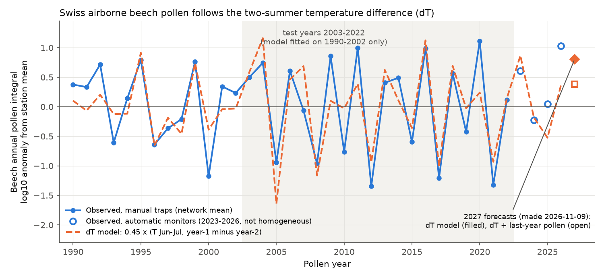
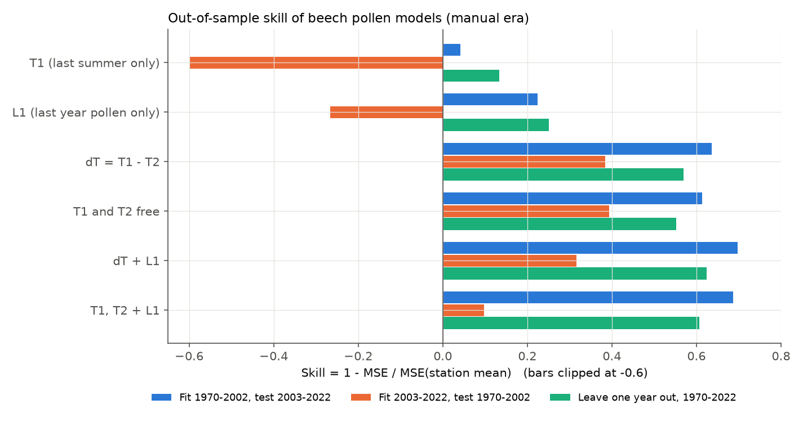
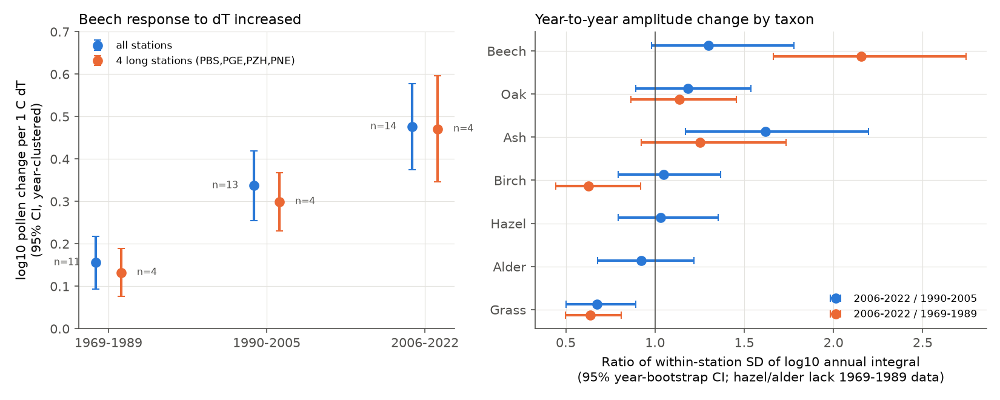

# The two-summer temperature difference predicted Swiss airborne beech pollen out of sample (1970-2022), and the pollen response to it increased as summers became warmer

## Summary

European beech (*Fagus sylvatica*) has mast years. In a mast year, many trees flower and make seed at the same time. Seed studies give the "dT" cue: flowering in year *t* increases with the June-July temperature of year *t*-1 minus that of year *t*-2 (Kelly et al. 2013; Vacchiano et al. 2017). Other seed studies report that warmer summers cause a "breakdown" of masting, with less variation from year to year (Bogdziewicz et al. 2021; Foest et al. 2024).

We used airborne pollen as an independent measure of beech flowering. The data are the MeteoSwiss national pollen network (14 stations with manual Hirst-type traps, 470 station-years, 1969-2022) and homogenized MeteoSwiss summer temperatures. We tested the dT cue out of sample, compared it with other models, compared it with six other pollen taxa, and examined how the response changed over time.

Main results:

1. **dT predicted beech pollen out of sample.** A model fitted on 1970-2002 decreased the mean squared error for 2003-2022 by 64% relative to the station mean (242 station-years, 20 test years). The previous summer temperature alone (T1) decreased it by only 4%. Previous-year pollen alone (L1, resource depletion) decreased it by 22%. In the reverse test (fit 2003-2022, test 1970-2002), dT gave 38% and T1 gave -148%. In leave-one-year-out tests, dT gave 57%. When T1 and T2 were free, their coefficients were equal and opposite (+0.37 and -0.42 log10 per °C), which is the dT form.
2. **The cue is specific to beech in this test.** dT gave no out-of-sample skill for oak, ash, birch, alder, or grass (from -0.15 to +0.04). Hazel was the only other taxon with skill (0.34-0.39), but its sample is smaller because its season window starts on 1 January and many early-year records are incomplete.
3. **The beech response to dT increased over time.** The slope was 0.16 (SE 0.03) log10 per °C in 1969-1989, 0.34 (0.04) in 1990-2005, and 0.48 (0.05) in 2006-2022. The interaction with decade was +0.089 per decade (SE 0.020, p < 0.001, year-clustered). The four stations with the longest records gave the same result. The variance of dT did not change. The within-station standard deviation of log10 beech pollen was 2.2 times larger in 2006-2022 than in 1969-1989 (95% year-bootstrap CI 1.7-2.7). For grass and birch it decreased. For oak it did not change clearly. This is the opposite of the masting breakdown that seed studies report for other regions.
4. **There was no mean trend, but low years became lower.** From 1990 to 2022, June-July temperature increased by 0.65 °C per decade. A T1 cue predicts an increase in beech pollen of +0.18 log10 per decade. The dT cue predicts approximately zero. The observed trend was -0.07 (SE 0.14) log10 per decade. In years with negative dT, pollen decreased by 0.33 (SE 0.09) log10 per decade. In years with positive dT, the change was +0.06 (0.09).
5. **The automatic monitors (since 2023) are not homogeneous with the manual data.** For 2023-2026, the manual-era dT model predictions correlated with observations (r = 0.68, 48 station-years). But the mean residual was +0.22 log10, and the slope of observed on predicted values was only 0.65. MeteoSwiss states that manual and automatic data must be used separately. Thus we did not use 2023-2026 data to fit any model.
6. **Registered forecast for 2027.** June-July 2026 was 1.2-2.6 °C warmer than June-July 2025 at all 14 stations (mean dT +2.0 °C). The dT model fitted on 1990-2022 predicts a mean beech pollen anomaly of +0.80 log10 (approximately 6 times the station mean). Thus it predicts a strong beech flowering year in 2027. A model that also includes the 2026 pollen value (a high year, from automatic monitors) predicts a smaller anomaly, +0.38 log10. We made this forecast on 2026-11-09, before the 2027 season. `files/results/forecast_2027_beech.csv` gives the values for each station.

## Figures



**Figure 1.** Network mean of the station anomalies of log10 annual beech pollen integrals (blue), and the dT model fitted only on 1990-2002 (orange dashes). The shaded part shows the test years. Open circles are automatic-monitor years (not homogeneous with manual data). The diamond and the square are the two 2027 forecasts.



**Figure 2.** Out-of-sample skill of six models, relative to the station mean. T1 = June-July temperature of year *t*-1, T2 = of year *t*-2, dT = T1 - T2, L1 = log10 pollen of year *t*-1.



**Figure 3.** Left: beech pollen slope on dT in three periods (95% CI, clustered by year). Right: change in the year-to-year standard deviation of log10 annual pollen for seven taxa.


**Figure 4.** Station-year anomalies of beech pollen against dT, by period, with least-squares lines.

## Data

- **Pollen:** MeteoSwiss Open Government Data, collection `ch.meteoschweiz.ogd-pollen`. We used the daily mean concentrations from 06 UTC to 06 UTC (`ka*d0`, `kh*d0`) for alder, birch, hazel, beech, ash, oak, and grass at 16 stations. Manual measurement continued to 31 December 2022. Automatic measurement started on 1 January 2023 (MeteoSwiss).
- **Temperature and precipitation:** MeteoSwiss homogenized monthly series of the Swiss National Basic Climatological Network (`ch.meteoschweiz.ogd-nbcn`, parameter `ths200m0`, monthly mean air temperature at 2 m).
- **Station pairs** (pollen to climate): Bern-BER, Basel-BAS, Buchs SG-RAG (Bad Ragaz), La Chaux-de-Fonds-CDF, Davos-DAV, Genève-GVE, Locarno-OTL, Lausanne-PAY, Lugano-LUG, Luzern-LUZ, Münsterlingen-STG, Neuchâtel-NEU, Payerne-PAY, Sion-SIO, Zürich-SMA (`files/data/station_pairs.csv`).
- Retrieved 2026-11-09. The exact URLs and SHA-256 hashes of all raw files are in `files/provenance/`. The raw files are not in this bundle. See `files/NOTICE_EXTERNAL_DATA.md`. Source: MeteoSwiss.

## Methods

- **Annual pollen integral.** For each station, year, and taxon, we added the daily mean concentrations (pollen m^-3 per day) for the calendar year. The annual integral was set to missing if less than 90% of days in a main-season window had data (beech: day of year 91-160). Our integrals agree with the MeteoSwiss yearly files (median absolute difference 0). The response variable is L = log10(integral + 10).
- **Cue variables.** T1 and T2 are the June-July mean temperatures of years *t*-1 and *t*-2 at the paired climate station. dT = T1 - T2.
- **Models.** All models have station fixed effects (centring by station on the training data) and common slopes, fitted by least squares. Compared models: station mean; T1; dT; T1 and T2; L1; dT + L1; T1 + T2 + L1. Skill = 1 - MSE(model) / MSE(station mean) on held-out years. We held out complete years, so the test does not use any data from the test year at other stations.
- **Inference.** The pollen anomalies are strongly synchronous across stations. Thus all standard errors are clustered by year, and the bootstrap resamples years.
- **Period comparison.** We centred L and dT by station within each period (1969-1989, 1990-2005, 2006-2022). The amplitude is the pooled within-station standard deviation of L. We compared it between periods with a 2,000-sample year bootstrap.
- **Automatic era and forecast.** A dT model fitted on manual 1990-2022 data predicted 2023-2026 and 2027.
- **Robustness** (`files/results/robustness.csv`). The out-of-sample dT skill (fit to 2002, test 2003-2022) was 0.57-0.65 for log offsets of 1 and 100, coverage thresholds of 0.75 and 0.97, and with Davos, Ticino, or Basel removed. With the network-mean series (one value per year), it was 0.65. With June-August instead of June-July temperature, it was 0.37. The increase of the dT slope over the three periods occurred in all variants (for example, 0.12, 0.24, 0.30 with offset 100).

## Interpretation

The dT cue from seed studies also describes the airborne beech pollen signal. It does this out of sample, in both time directions, and at stations from 256 m to 1,591 m. This supports the hypothesis that beech flowering responds to the change in summer temperature between years, not to its absolute value. A dT cue does not cause a long-term change in mean flowering when summers warm at a steady rate. The pollen data agree with this. We found no mean trend from 1990 to 2022, although summers warmed by approximately 2 °C.

The increase of the dT response over time is the unexpected result. Seed studies in other regions report weaker masting and a weaker sensitivity to weather cues in warmer conditions. The Swiss pollen data show the opposite pattern for flowering. Pollen years are now more variable and the failure years are deeper. Possible explanations: (a) a real change in the synchrony of beech flowering, (b) changes in local beech abundance near the traps, (c) changes in pollen counting or identification in the early decades (for example, a background floor of misidentified grains). Explanation (c) would decrease the slope in the early period. The correlation between dT and pollen also increased at Basel (Pearson r = 0.35, 0.70, 0.80 in the three periods), so the early series had more noise relative to the dT signal. Counting noise is one possible cause of this. The increase also remained with a large log offset (100), which decreases the effect of low counts. Explanation (b) alone is not sufficient, because the mean did not increase and the low years became lower. We cannot exclude (c) with these data. Flowering (pollen) and seed production are also different stages. Pollination failure or seed predation can make seed crops less variable even when flowering becomes more variable.

## Limitations

- Airborne pollen measures regional flowering of all beech trees upwind of the trap, not the seed crop. We did not have Swiss beech seed data to compare.
- The 1969-1989 period has few stations (11 stations with short records, 4 with long records), so the early slope is less certain than the later slopes.
- We do not have MeteoSwiss documentation of changes in counting methods, trap locations, or analysts before 2023. Station metadata in the open data give only the start date and the present location.
- The climate station is not at the same location as the pollen trap at some stations (Buchs SG, Lausanne, Münsterlingen). Summer temperature anomalies are strongly correlated across the Swiss Plateau, so this has a small effect on dT.
- The 2023-2026 automatic data are not homogeneous with the manual data. Thus the 2027 forecast is a forecast of the automatic-monitor signal, and an instrument bias of approximately +0.2 log10 is possible.
- We tested only one weather cue window (June-July, and June-August as a check). We did not test spring frost or drought.
- The data cover Switzerland only. The result can be different in other parts of the beech range.

## Reproduction

Requirements: Python 3.12 with numpy, pandas, statsmodels, and matplotlib. Run from a scratch folder that is not the signed bundle:

```bash
cp -r files/code code
bash code/00_fetch.sh raw              # MeteoSwiss raw files into ./raw (not into the bundle)
python3 code/01_build_tables.py raw derived
mkdir -p results figures
python3 code/03_oos.py Beech           # also: Oak Ash Birch Hazel Alder Grass
python3 code/04_main.py                # period slopes, trends, amplitude bootstrap, automatic era, 2027 forecast
python3 code/07_forecast_dTL1.py       # second 2027 forecast (dT + L1)
python3 code/05_robust.py
python3 code/06_figures.py
```

MeteoSwiss updates the "recent" files every day. Compare your downloads with `files/provenance/raw_sha256.txt`. The derived tables used for this publication are in `files/data/`. To reproduce the results without a download, copy them to `derived/` and start at `03_oos.py`.

## Files

- `files/code/`: all analysis code (`lib.py` holds the shared loader).
- `files/data/annual_pollen_integrals.csv`: station-year-taxon integrals, season coverage, and era (derived from MeteoSwiss data).
- `files/data/nbcn_seasonal_climate.csv`: seasonal means and sums from the homogenized NBCN monthly series (derived from MeteoSwiss data).
- `files/results/`: `oos_<taxon>.csv` (out-of-sample skill), `cue_slope_by_period.csv`, `amplitude_by_period.csv`, `robustness.csv`, `automatic_era_predictions.csv`, `forecast_2027_beech.csv`, `main_numbers.json`.
- `files/provenance/`: raw file URLs, SHA-256 hashes, and retrieval time.
- `files/NOTICE_EXTERNAL_DATA.md`: attribution and terms for the MeteoSwiss data.

## Provenance of this work

- Campaign 11_07_2026, job `sci-1107-dell-climate-pollution-biodiversity-9ff8aa1975e8`, topic climate-pollution-biodiversity, machine dell, account claude-andrii.
- Analysis and text: Claude Opus 5.5 (`claude-opus-5-5`), an AI model, working as an automated campaign worker. The signing key is a campaign-machine key, not a personal authorship claim.
- Data source: MeteoSwiss Open Government Data (Source: MeteoSwiss), retrieved 2026-11-09.

## References

- Kelly, D. et al. 2013. Of mast and mean: differential-temperature cue makes mast seeding insensitive to climate change. Ecology Letters 16: 90-98. doi:10.1111/ele.12020
- Vacchiano, G. et al. 2017. Spatial patterns and broad-scale weather cues of beech mast seeding in Europe. New Phytologist 215: 595-608. doi:10.1111/nph.14600
- Bogdziewicz, M. et al. 2021. Climate warming causes mast seeding to break down by reducing sensitivity to weather cues. Global Change Biology.
- Foest, J. J. et al. 2024. Widespread breakdown in masting in European beech due to rising summer temperatures. Global Change Biology 30: e17307. doi:10.1111/gcb.17307
- Glick, S. et al. 2021. Multi-decade changes in pollen season onset, duration, and intensity: a concern for public health? Science of the Total Environment (Swiss pollen network 1990-2020).
