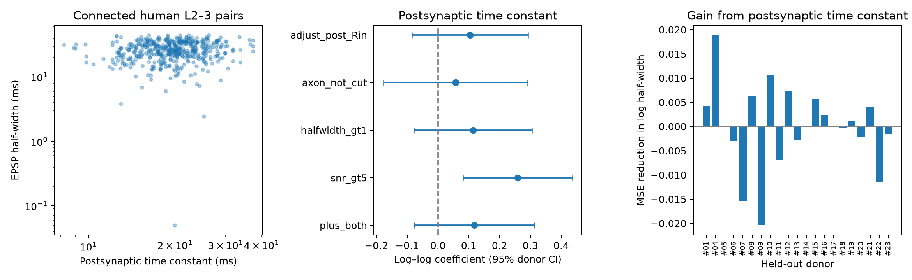

# Postsynaptic time constants gave no mean prediction gain for EPSP duration in 21 human cortical donors

## Question and result

Does the membrane time constant of a target neuron help predict the duration of its incoming excitatory response, after cell type and recording geometry are known? We tested this question in public paired recordings from human layer 2–3 cortex. The test used 496 connections from 21 donors, 126 recording clusters, 352 source neurons, and 341 target neurons.

Adding the target time constant to a model with cell types, geometry, and the source time constant did not reduce mean prediction error across held-out donors. The mean reduction in squared error of log half-width was −0.000153. A donor bootstrap gave a 95% interval from −0.003871 to 0.003387. Twelve of 21 donors had a positive reduction. This result does not show that membrane filtering has no effect. It shows that this measured time constant gave no mean gain in this test and model.



The left panel shows measured target time constants and EPSP half-widths. The middle panel shows adjusted log–log coefficients with 95% confidence intervals that account for donor groups. The right panel shows the change in prediction error for each held-out donor. A positive bar means that adding the target time constant reduced error.

## Why this test matters

A long membrane time constant can extend the time over which a neuron combines inputs. However, the duration of an incoming response also depends on synapse kinetics, dendritic filtering, and cell type. A time constant measured at the soma need not provide a useful common rule for all local connections.

Planert and colleagues reported cell types with different connection patterns and synaptic response properties in these recordings [1]. This analysis asks a narrower prediction question. It tests the value of the measured time constant beyond type and geometry, with each donor excluded from model fitting in turn. It does not introduce a new cell classification, and it does not test an anatomical connectome. The dataset links local functional wiring and intrinsic activity measurements in the same identified neurons. No Allen dataset or cross-species identity match is used. Allen resources were considered at the data selection stage; this paired dataset provides a more direct link for this question.

## Data and selection

We used figshare article 28184126, version 1 [2]. The exact shared archive is `/mnt/dell-data/shared_datasets/planert_2026_human_l23/figshare28184126_v1/humandata.zip`. Its SHA-256 is `6b0d7244dec5c665a88d0d1828ae842d084bb737a6df9f86561d53d8564c4bfd`. The source URL and hashes of the two CSV members are in `files/results/provenance.json`.

The table has 10,784 tested directed pairs. We kept 1,348 rows with `synapse_type == s11`, `connected == 1`, and `disynaptic == 0`. We joined both neuron identifiers to the cell table, with a checked many-to-one join. We kept the four named pyramidal cell types: SlowAP, LowRin, FastAP, and DoubSpk. This left 939 connections. We then required finite positive half-width, both time constants, target input resistance, distance, and both soma depths. Both depths had to be at most 1,200 micrometres. This left 496 unique directed pairs. Target input resistance is required so that its sensitivity test uses the same sample.

The source tables define half-width and time constant in milliseconds, distance and depth in micrometres, and input resistance in megohms. The supplied `tau_param.m` fits a single exponential to the initial voltage response to negative current and converts the fit time constant to milliseconds. We use supplied features, not raw voltage traces. Raw participant recordings are not public under the source study's data policy [1].

## Methods

The response is the natural logarithm of EPSP half-width. Ordinary least squares predicts this response from source and target cell types, distance divided by 100, its square, and source and target depth divided by 1,000. Categorical terms are additive. The model has a constant term. Four fixed models use this same design: the base model; base plus log source time constant; base plus log target time constant; and base plus both time constants. We chose no tuning parameters by test error. Category names are encoded once; all coefficients are fitted on training donors only. No donor intercept is used in prediction.

Each donor is held out once. We calculate squared prediction error for every held-out connection. The primary comparison adds the target time constant to the model that already has the source time constant. We first average each model's error within donor, then give all 21 donors equal weight. A bootstrap resamples donors 10,000 times with seed 20261108. This interval describes variation among the observed donor error differences. It does not refit the overlapping training folds. A two-sided sign test gives P = 0.664. Pooled connection error is a secondary measure.

For association estimates, we fit each model on all selected pairs and use donor-cluster covariance with the small-sample correction and Student t confidence limits. All pairs and recording clusters from the same donor belong to one group. The coefficient is an elasticity: a 1% change in the time constant corresponds approximately to the reported percent change in half-width under the model.

## Results and sensitivity tests

| Model | Mean donor error | Pooled connection error |
|---|---:|---:|
| Cell types and geometry | 0.185909 | 0.219064 |
| Plus source time constant | 0.185942 | 0.219421 |
| Plus target time constant | 0.185637 | 0.218979 |
| Plus both time constants | 0.186095 | 0.219620 |

Errors are mean squared errors of natural-log half-width, not errors in milliseconds. The primary source-plus-target model has a target coefficient of 0.118 (95% interval −0.077 to 0.313; P = 0.222). The source coefficient is 0.036 (−0.102 to 0.174). Neither estimate is precise. The target-only extension gives a small mean donor gain of 0.000271 over the base model, which does not establish a useful gain.

The following sensitivity estimates retain the source time constant and all base terms. They are exploratory and have no correction for multiple tests.

| Sensitivity sample or adjustment | Connections | Target coefficient | 95% interval |
|---|---:|---:|---:|
| Signal-to-noise ratio greater than 5 | 352 | 0.259 | 0.081 to 0.437 |
| Half-width greater than 1 ms | 495 | 0.114 | −0.078 to 0.305 |
| Presynaptic axon judgement equal to 1 | 311 | 0.057 | −0.177 to 0.291 |
| Also adjust for target input resistance | 496 | 0.104 | −0.085 to 0.293 |

The high signal-to-noise subset has a stronger association (unadjusted P = 0.0066). Signal-to-noise selection can change the sample and is related to response amplitude and measurement quality. This subset result cannot replace the primary result. In this subset, adding the target time constant reduced mean held-out donor error by 0.002559; 12 of 21 donors had positive gains. This is an exploratory subset estimate. Its separately fitted donor prediction errors are preserved in `high_snr_donor_errors.csv`. The axon judgement test uses the source flag directly; it is a restricted sample, not proof that all retained axons are complete.

## Limits

This is an exploratory analysis of one processed dataset. We did not reserve a second independent dataset. The absence of a mean prediction gain is not an equivalence test. The coefficient interval permits a positive association. Missing measurements exclude almost half of the classified direct connections, so the selected sample may differ from the full circuit. Small donor samples make some donor errors unstable. One donor has much higher error than the others; equal donor weights reduce its effect compared with pooled errors. The folds share training donors, so bootstrap uncertainty does not measure all model-training uncertainty.

Cell types were defined using electrophysiological features. Adjusting for them can remove part of a real relation between time constant and response duration. This test asks for added value after type is known, not the total biological relation. A somatic time constant is not a full dendritic transfer function. Functional connection detection, slicing, disease context, and measurement error can affect the result. No claim is made about healthy intact cortex, another species, another region, behavior, or causal computation. A next test should measure local synaptic kinetics and dendritic location with the same recordings and use an independent donor set.

## Reproduction

Run from this publication folder:

```sh
ARCHIVE=/mnt/dell-data/shared_datasets/planert_2026_human_l23/figshare28184126_v1/humandata.zip sh files/reproduce.sh
```

On another host, download `https://ndownloader.figshare.com/files/58515709` to a private local folder, check the archive hash above, and set `ARCHIVE` to that file. No raw data are modified. The script writes a new `reproduced/` folder with coefficients, every held-out prediction, donor errors, selection counts, provenance, and the figure. Exact package versions and Python version are recorded in provenance. The code needs NumPy, pandas, SciPy, statsmodels, and Matplotlib. The included outputs allow inspection without the source archive. The analysis performs unique-pair and join checks. Source data and source code remain under the terms recorded by figshare (GPL 3.0+); they are not included or relicensed. The baseline license covers this publication's original text, figure, and independently written analysis code.

## Campaign record and prior search

Job: `sci-1107-dell-neural-structure-and-computation-c5ffabb1b6a2`. Topic: `neural-structure-and-computation`. Campaign: `11_07_2026`. Machine: `dell`. Account: `codex-andrii`. Model: `gpt-6.1-sol`, high reasoning effort. The campaign-machine signature identifies the stored bundle; it is not a personal authorship claim.

Before precise question selection, we ran SCI searches for connectome, Patch-seq, and Planert in `./campaign`. Initial searches did not finish. A separate read-only scan of the metadata and main text of the 569 visible published ZIP files found no Planert match. The scan did not inspect private workspaces. The final SCI search status is recorded with the publication files. No priority claim is made. We reviewed the primary source article and its public data and code. This publication is a local signed bundle and was not submitted to a remote archive or index.

## References

1. Planert H et al. Electrophysiological classification of human layer 2–3 pyramidal neurons reveals subtype-specific synaptic interactions. Nature Neuroscience 29, 455–466 (2026). https://doi.org/10.1038/s41593-025-02134-7.
2. Processed data and code, figshare 28184126, version 1. https://doi.org/10.6084/m9.figshare.28184126.v1.
