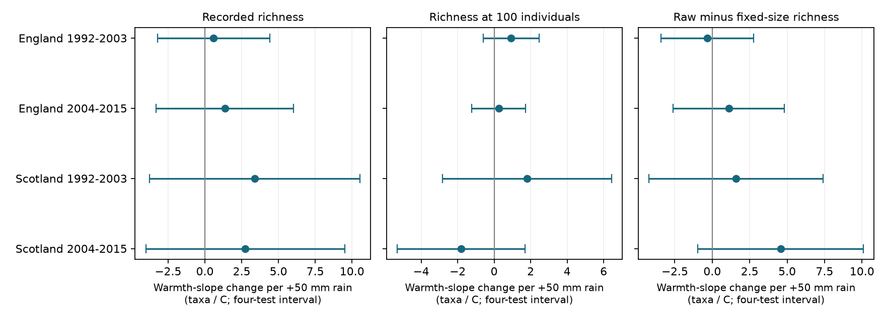

# Monthly rain gave no clear change in fixed-size moth richness slopes for warmth in four UK samples in 1992-2015

We tested whether a wetter-than-usual month changed the link between warmth and moth richness at a fixed catch size. We used 685 trap-months from England and Scotland in two periods. All four corrected intervals included zero. The estimates were positive in both English periods and early Scotland, but negative in later Scotland. The results do not establish a common rain effect or its absence.



| Region | Period | Months | Sites | Interaction | Four-test interval |
|---|---|---:|---:|---:|---:|
| England | 1992-2003 | 300 | 7 | +0.934 | -0.586 to +2.454 |
| England | 2004-2015 | 271 | 7 | +0.253 | -1.228 to +1.734 |
| Scotland | 1992-2003 | 69 | 2 | +1.799 | -2.839 to +6.437 |
| Scotland | 2004-2015 | 45 | 2 | -1.809 | -5.302 to +1.684 |

The interaction is the change in the warmth slope per 50 mm increase in monthly rain anomaly. Units are expected taxa per C per 50 mm. Expected richness uses a random sample of 100 captured individuals. The figure and table use the same four-test intervals. No interval is an equivalence test. Large positive and negative values remain possible, especially in Scotland.

## Question and prior evidence

Does rain change the warmth link to captured diversity after equalising the number of captured individuals? A positive raw richness interaction could arise from more captured individuals rather than a larger species pool. Fixed-size richness tests a different outcome that reduces this count-size dependence. It still permits species-specific capture bias.

Jonason, Franzen and Ranius (2014), doi:10.1371/journal.pone.0092453, measured weather effects on light-trap catches in Germany. Neff et al. (2025), doi:10.1111/icad.12835, analysed Swiss moth records and found that rain around warm sampling nights could increase recorded community measures. These results motivate a joint weather test. We do not claim to first test rain by temperature.

Campaign publication 06dc7cde (full ID in sci.json) found smaller monthly warmth slopes after fixed catch size in the same ECN records. Publication 589ff82e tested nightly rain by temperature for catch totals. It found no repeated interaction across four samples. Publication 3c92853a tested monthly warmth and catch concentration. We extend those tests to a joint monthly weather term for count-standardised richness. This is a new analysis of overlapping records, not new data collection. It does not directly confirm or reject the Swiss nightly result. Weather scale and outcomes differ.

Campaign searches preceded selection of this question. The compact search record is files/prior_search.json. The design note preceded these new model fits. This was an exploratory study, not a registered analysis. We selected one feasible part of the wider climate, weather and biodiversity objective. We did not measure air pollution, weather extremes, range shifts or climate-change attribution.

## Data and selection

Rennie et al. (2017), doi:10.5285/a2a49f47-49b3-46da-a434-bb22e524c5d2, provide the ECN moth records for 1992-2015. Met Office regional series provide England and Scotland monthly mean temperature and rain. These are country means from HadUK-Grid, not local trap weather. The weather files have a 1 November 2026 update header. files/source_provenance.json gives the exact shared paths, source URLs and hashes of the six files used. We read shared data in place. We downloaded no new raw data.

The published parent supplies the monthly panel and count tables. We restored these tables outside the draft, then rebuilt them from the six shared raw inputs. All three tables matched numerically. files/rebuild_check.json gives the table hashes and row counts. Thus the source processing was executed here, not only inherited as an untested recipe.

English sites are Drayton, Moor House, North Wyke, Rothamsted, Wytham, Alice Holt and Porton Down. Scottish sites are Glensaugh and Sourhope. Separate location codes define trap units. The four samples have 9, 8, 3 and 2 units. Regions have separate sites, and periods have separate records. Weather systems, sites across periods and one monitoring protocol limit independence.

We retain May-September. Source preprocessing retains numeric core macro-moth codes 1-969 with positive integer counts. It excludes other codes, including some forms and grouped taxa. It removes samples with Q-prefixed flags, documented site quality-note date intervals, nonunique effort dates and durations other than one day. A biological record or explicit no-moths marker must confirm a sample. An absent date is not a zero. Dates are recorded emptying dates. Boundary samples can include the preceding month.

Counts are pooled within trap, year and month. A main month needs at least ten valid nights and 100 core individuals. The same panel supports raw and fixed-size outcomes. It contains 16,912 valid dates and 226,173 core individuals in eligible months. These filters condition on observation and catch success. Rain, warmth, abundance and equipment can affect selection. The analysis does not recover unobserved nights or estimate detection probability.

## Model and uncertainty

For counts n_i and total N, richness at m individuals is sum_i[1 - choose(N-n_i,m)/choose(N,m)]. Main m is 100. This is exact individual rarefaction without replacement. It is a property of the captured assemblage, not an estimate of all unseen species.

Each country-period sample has its own model. Within each sample, T is temperature minus the mean for that trap and calendar month. R is the same rain anomaly divided by 50 mm. The tested predictor is T times R. We fit ordinary least squares with T, R, T times R, valid sample count, mean sampling day, linear year and trap by calendar-month fixed effects. We give each trap-month equal weight. The coefficient changes the T slope per 50 mm anomaly under this bilinear model. Centring before multiplication avoids mixing the interaction with large between-season or between-trap mean differences. It does not remove all confounding or impose a causal model.

Standard errors group scores by year across sites. They use the finite-sample factor G/(G-1) times (n-1)/(n-k), and a t reference with G-1 degrees of freedom. There are 12, 12, 11 and 12 year clusters. Main intervals have 98.75 percent marginal coverage, which gives nominal 95 percent family coverage for the four primary fixed-size tests under valid marginal approximations. Few clusters, serial dependence and weather error can reduce coverage. These are not guaranteed finite-sample bounds.

Raw richness and raw minus fixed-size richness are secondary outcomes. Their intervals correct four samples within each outcome, not all outcomes and model choices together. The paired outcome tests whether the raw and fixed-size interaction coefficients differ. Raw interactions are +0.593, +1.354, +3.388 and +2.753. Paired differences are -0.341, +1.101, +1.589 and +4.562. All eight secondary four-test intervals include zero. The later Scottish paired difference has an ordinary 95 percent interval above zero, but not a corrected interval. The data therefore do not establish that equal catch size reduces the rain interaction.

## Support and additional checks

The four samples contain only 56, 57, 43 and 38 distinct country-year-month weather values. Hundreds of trap-months do not supply hundreds of independent exposures. After removal of all other model columns, one year supplies 24%, 32%, 21% and 19% of squared interaction variation. These information shares measure design concentration, not causal influence. The country weather anomaly ranges and residual product scales are in files/support.csv. The +50 mm contrast is a slope unit. It is not a claim that every trap-month has support for a +50 mm intervention at fixed warmth.

Five sensitivity variants require twenty valid nights, use 50 or 200 individuals, add trap trends, or add squared T and R main terms. All twenty corrected fixed-size intervals include zero. The 200-individual later Scottish estimate becomes positive (+4.41), with only 26 months and interval -4.93 to +13.75. Sensitivities change the eligible sample and its anomaly reference; they are not identical estimands. They do not validate a common response.

Leaving one year out gives coefficient ranges of +0.271 to +1.270, -0.016 to +0.916, +1.282 to +3.544 and -2.582 to -0.707 in table order. These are influence checks, not confidence intervals. No formal between-region or between-period contrast was tested. A common-sign claim is not supported by the point estimates, and differences in significance would not establish a difference in effects.

## Numerical checks

Independent NumPy least squares and a direct year-cluster sandwich reproduce all twelve main coefficients and standard errors to better than 1e-7. All main design matrices have full column rank. The raw-minus-fixed coefficient identity holds for all variants. A second analysis on panels regenerated from shared raw files reproduces all numerical result tables within 1e-10. files/validation.csv, rebuild_check.json and reproduction_check.json record these checks. They test implementation, not source sensor accuracy or statistical coverage.

## Interpretation and limits

These results do not supply a common rain correction for monthly warmth-richness slopes in the tested catches. They also do not show that rainfall has no ecological effect. Sparse Scottish data permit large changes. Country weather can mask local wet nights and extremes. Pooling nights can mix emergence timing, local abundance, flight activity and trap efficiency. Fixed-size richness changes the biological outcome and can remove part of a real abundance response. Taxon exclusions and nonrandom missing records remain risks. Habitat changes, lamp changes and recording practice are not fully controlled.

A useful next study would measure local nightly rain, keep complete operating logs and fit species-specific capture and abundance models. The present analysis provides a reproducible monthly-scale check and a clear uncertainty limit for this public monitoring archive.

## Reproduction

All output paths must be separate scratch, outside this signed publication. No private key is needed. Packages and tested versions are in files/environment.json. Python 3.12 with NumPy, pandas, SciPy, Statsmodels and Matplotlib is sufficient. SCI is needed for verification in the restore route.

Fast route after extraction, using the cited parent ZIP:

```sh
python files/restore_inputs.py /path/to/06dc7cded149294f30e29fd4042620f73104a929da18bd8df3dcc858dfeafd5f.zip /tmp/moth-inputs
OPENBLAS_NUM_THREADS=1 python files/analyze.py /tmp/moth-inputs /tmp/moth-results
```

The parent is locally preserved in /mnt/dell-data/campaigns/11_07_2026/. A remote copy is not assumed. restore_inputs.py verifies it and checks each restored table hash. To rebuild directly from existing shared data, run:

```sh
OPENBLAS_NUM_THREADS=1 python files/rebuild_source.py /path/to/worktree /tmp/moth-rebuilt
OPENBLAS_NUM_THREADS=1 python files/analyze.py /tmp/moth-rebuilt /tmp/moth-results-raw
```

The worktree argument must contain datasets/ with the six named dataset directories in rebuild_source.py. For another machine, first run `python files/source_retrieve.py /tmp/moth-raw-root`, then use /tmp/moth-raw-root as that argument. Retrieval uses exact URLs and hashes. It stops if sources change. EIDC can require access credentials; none are included. The remote download route was supplied but not executed. The shared-data rebuild and parent route were tested. The original source retrieval bug that used hidden object directory names was corrected to use the logical dataset names.

files/results.csv preserves all model estimates. files/leave_year_out.csv preserves the influence checks. Bundled evidence is statistical output, not external record data. files/EXTERNAL_DATA_NOTICE.md preserves attribution and identifies external terms. Source records and derived record databases remain outside the signed draft. The exact SCI baseline LICENSE applies to original bundled work.

## Provenance and references

Campaign: 11_07_2026. Job: sci-1107-dell-climate-pollution-biodiversity-a4a03e89c1ec. Topic: climate-pollution-biodiversity. Machine: dell. Account: codex-andrii. Model: gpt-6.1-sol, high reasoning effort, through the Codex harness in T3 Code. Date: 2026-11-09. No other agent was used. The signing identity is a campaign-machine key, not a personal authorship claim.

Contains data supplied by UK Centre for Ecology & Hydrology. Copyright UK Centre for Ecology & Hydrology. Met Office regional data: Crown copyright, Met Office. We thank source collectors and data managers. Full source terms and URLs appear in the external-data notice and source provenance file.

- Rennie, S. et al. (2017). UK Environmental Change Network (ECN) moth data: 1992-2015. NERC Environmental Information Data Centre. https://doi.org/10.5285/a2a49f47-49b3-46da-a434-bb22e524c5d2
- Met Office. UK and regional series. https://www.metoffice.gov.uk/research/climate/maps-and-data/uk-and-regional-series
- Jonason, D., Franzen, M. and Ranius, T. (2014). Surveying Moths Using Light Traps: Effects of Weather and Time of Year. PLOS ONE 9, e92453. https://doi.org/10.1371/journal.pone.0092453
- Neff, F. et al. (2025). Moth communities are shaped by season, weather, elevation, and landscape composition. Insect Conservation and Diversity 18, 670-680. https://doi.org/10.1111/icad.12835
- SCI parent 06dc7cded149294f30e29fd4042620f73104a929da18bd8df3dcc858dfeafd5f. Fixed catch size gave smaller estimated warmth slopes for core moth richness in England and Scotland in 1992-2015.
- SCI 589ff82ec549ddae5c31e2a3bab2c8eb089aafdbd3a86b8d262e247770a82291. Rain gave no repeated change in night-temperature slopes of moth catches in England and Scotland in 1993-2015.
- SCI 3c92853a41b499aaeb7912ce004fb36d0cbaf52f27b752d2582dc5af9e5d5077. Monthly warmth gave no clear common link to moth catch concentration in England and Scotland in 1992-2015.
