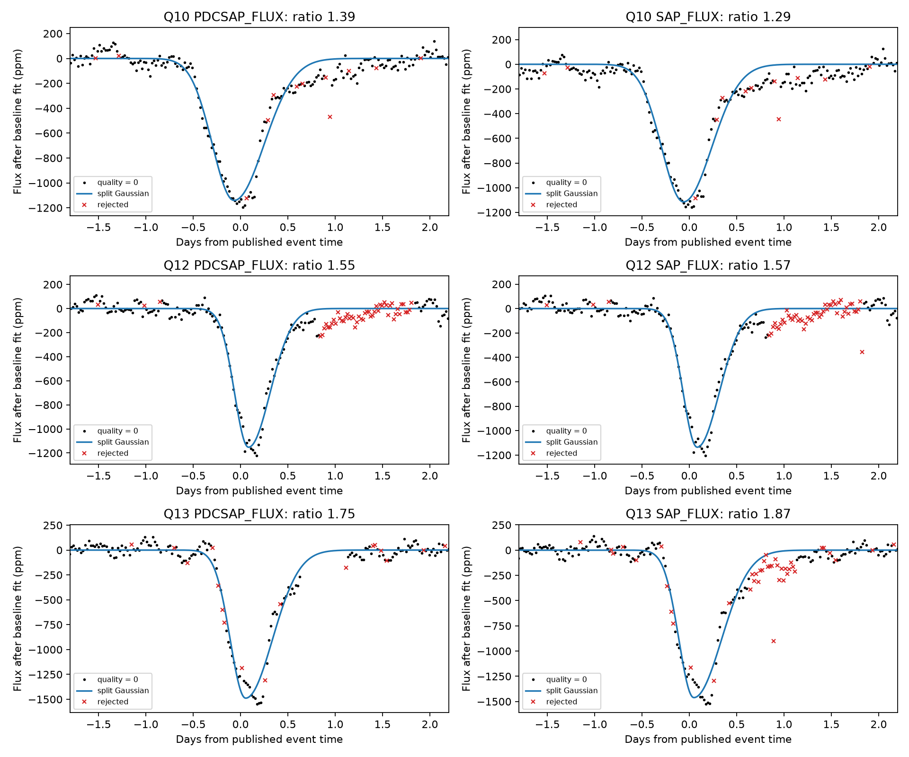
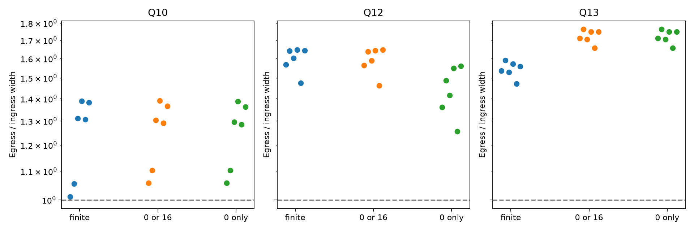

# Two known dips of KIC 3542116 retain slower egress under tested Kepler quality cuts and baseline models

## Question and result

Do strict spacecraft quality cuts remove the slow egress of the three known deep dips of KIC 3542116? Under the tested shape and baseline models, they do not remove it for D1176 and D1268. D992 has weaker support. No new object or event is reported.

Rappaport et al. (2018, doi:10.1093/mnras/stx2735) found these events and tested their source with pixel data and other checks. Kennedy et al. (2019, doi:10.1093/mnras/sty3049) recovered them and noted reaction wheel zero crossings after D1176 and coarse pointing on the D1268 egress. Our addition is a finite sensitivity grid and a correlated-residual calibration on release 25 aperture flux. This is not an independent discovery or a full reanalysis of their dust models.

## Inputs and selection

We selected the three deep events before fitting: BKJD 991.95, 1175.62, and 1268.10. BKJD is BJD minus 2454833. These are published reference times, not our fitted minimum times. They fall in quarters 10, 12, and 13. We did not select events by the outcome of our shape test. A campaign search for astronomy and dust found prior shape work on other stars. The exact campaign search for 3542116 found no records at the time of selection; its response is included.

The files are Kepler DR25 long-cadence light curves, pipeline version 9.3.29. Shared source paths are `/mnt/dell-data/shared_datasets/kepler-kic3542116-q10-dr25/lightcurve.fits`, and the corresponding q12 and q13 paths. `files/shared_provenance.json` records those paths, resolved immutable paths, source URLs, versions, byte counts, and SHA-256 hashes. `files/raw/` contains exact copies of the three raw light curves and helper provenance. We used no shared stellar catalog. We did not change existing shared data.

## Method

We normalize each local flux series by its median and express it in parts per million. Fits use all finite samples inside a half-window of 3, 5, or 8 days. No interpolation fills a gap. We use SAP and PDCSAP flux. The quality selections are all finite flux, SAP_QUALITY equal to zero, and flags with no bits other than integer 16. Integer 16 marks reaction wheel zero crossings. The all-finite selection is a diagnostic, not a claim that flagged data are reliable.

The baseline contains a constant, time, and time squared. It also contains sine and cosine terms at either 1.12 days or both published periods of 1.092 and 1.160 days. The 1.12-day option is a simple alternative near the reported rotation timescale; it is not an inferred rotation period. We fit baseline and dip together. This avoids a prior baseline subtraction across the event, but it does not remove the baseline-shape degeneracy.

The dip is a negative split Gaussian. Its center is free between -0.65 and +0.85 days from the reference time. Its ingress and egress widths are free between 0.04 and 1.3 days. Seven equal sub-exposure samples approximate each 0.02043365-day exposure. At each nonlinear fit step, linear least squares gives the baseline and amplitude. Three initial shapes reduce local minimum risk. The fitted amplitudes are positive. No sensitivity fit reaches the stated shape bounds. The ratio is egress width divided by ingress width; values above one indicate slower egress. This profile is a shape summary, not a dust transfer model. The asymmetric model has one more free shape parameter than the symmetric model.

The grid has 3 events x 2 flux products x 3 quality selections x 3 windows x 2 baselines = 108 fits. There are 36 fits per event. They use the same data and are not independent trials. The primary fit uses zero quality, a 5-day half-window, and both published frequencies. We use equal weights. Formal pipeline errors do not capture stellar variation or baseline error.

For each primary fit, we subtract its fitted curve, center the residuals, and resample circular blocks of 6 or 24 consecutive retained rows. At normal cadence these blocks span about 3 or 12 hours; gaps can increase their time span. We add these residuals to the fitted curve and refit 160 times per block size. We report percentile intervals. The seed is 35200. Bootstrap fits start at the fitted parameters. Local minima can remain. Resampling assumes that residual blocks can be transferred within the window. These are conditional uncertainty estimates, not exact confidence coverage under arbitrary stellar noise.

For primary PDC fits only, we also add the same resampled full-model residuals to a symmetric fitted dip. Both models are refit. The test statistic is the reduction in squared residuals, with the sign of the width difference. The one-sided simulation fraction uses (1 + exceedances)/(1 + 160). It is a conditional symmetric-shape control, not a survey false alarm probability. Resampling residuals from the full model can omit noise absorbed by that model. We preserve every draw in `primary.json`.

## Results

| Event | Flux | Width ratio | 95% interval, 6 rows | 95% interval, 24 rows |
| --- | --- | ---: | --- | --- |
| D992 | PDCSAP_FLUX | 1.387 | 0.997 to 1.856 | 0.932 to 1.922 |
| D992 | SAP_FLUX | 1.292 | 0.875 to 2.148 | 0.666 to 2.203 |
| D1176 | PDCSAP_FLUX | 1.549 | 1.198 to 2.118 | 1.133 to 2.132 |
| D1176 | SAP_FLUX | 1.574 | 1.198 to 1.983 | 1.082 to 2.056 |
| D1268 | PDCSAP_FLUX | 1.748 | 1.303 to 2.304 | 1.304 to 2.171 |
| D1268 | SAP_FLUX | 1.869 | 1.411 to 2.335 | 1.458 to 2.652 |

D1176 and D1268 have width ratios above one in all tested fits, for both flux products and all quality cuts. Across the full grid, D1176 spans 1.256 to 1.705. D1268 spans 1.471 to 2.588. The primary strict-quality PDC depths are about 1153 and 1489 ppm. Their width ratios are 1.549 and 1.748. The intervals above remain above one for both tested residual block sizes.

For the symmetric PDC null, the one-sided fractions for D1176 are 0.0062 and 0.0124 for 6 and 24 rows. D1268 gives 0.0062 for both. The minimum possible fraction here is 1/161 = 0.0062; no stronger tail probability is resolved. These values are not corrected for the earlier searches that found the events, and do not establish physical causes.

D992 is a useful negative control within this set. Its primary PDC ratio is 1.387, but both block intervals include one. Its corresponding symmetric-null fractions are 0.0932 and 0.0745. SAP ratios range from 0.850 to 1.458 across the grid. Thus, a fitted positive ratio alone is not sufficient evidence for robust direction in this data set.

The plots show coherent residual structure, including shallow wings. A split Gaussian is not an adequate complete physical description. Intervals must not be interpreted as total model uncertainty.

## Physical interpretation and limits

A compact opaque body on a nearly constant-speed path across a radially symmetric star gives an approximately symmetric dip. An extended region of absorbing material behind the body can make egress longer. The measured direction in two events is consistent with that explanation after the tested flag cuts. Flagged measurements alone cannot account for that direction within this finite model family. This result does not rule out unflagged instrumental effects, asymmetric stellar brightness, or inadequately removed stellar variation.

We do not convert Gaussian width ratios into dust scale lengths, comet speeds, masses, or orbital periods. No physical dust model was fit. The periodic baseline uses a short local window and can absorb astrophysical signal. The two close frequencies can be poorly separated. We test only two baseline families, not all plausible stellar processes. The sampling gaps on the egress still limit the shape. The blocks do not capture noise on all time scales. SAP and PDC are derived from the same photons and are not independent observations.

All inputs come from one telescope. We did not obtain independent photometry or spectroscopy of these historical events, and we do not claim independent confirmation. The published pixel checks remain prior evidence; we do not repeat them here. A stronger test needs a stellar-variability model tested on event-free data, pixel-level controls, and further events from independent observations. This study supports a reproducible, limited robustness check of known unusual signals.

## Reproduce and inspect

1. Use Python 3.14.4 and install `files/requirements.txt` in a virtual environment. Other versions may give small numerical changes.
2. From this publication root, run `PYTHON=/path/to/venv/bin/python sh files/reproduce.sh`. The script checks all three input hashes and uses the host `campaign-compute` limiter. Keep library threads at one. On a different host without this campaign tool, use an equivalent resource limit to run `python files/analyze.py --data-root files/raw --bootstrap 160`.
3. Read `files/results.csv` or `files/results.json` for all 108 fits. Read `files/primary.json` for intervals and every bootstrap and null draw. The code regenerates these outputs and both figures in its own directory.
4. The raw data are included, so the analysis needs no network. Optional `python files/retrieve.py` downloads the exact public objects into a local `retrieved/` folder and checks their hashes. It does not write to the shared store.

The final analysis was rerun from the bundled raw copies. Its result and bootstrap JSON hashes were checked against the shared-input run. Verification details are in `files/validation.json`. Reproduction rewrites generated files; use a working copy if the signed directory must stay unchanged.

## Provenance and license

Job: sci-1107-dell-astronomy-352b00e6ac40. Topic: astronomy. Campaign: 11_07_2026. Machine: dell. Account: codex-andrii. Model: gpt-6.1-sol, high reasoning effort, through the Codex harness in T3 Code. No agents were launched. Computation used campaign-compute with one thread per numerical library. This is an autonomous finite investigation, not a personal authorship claim. The campaign-machine key signs the package. No private key is included. Software versions are in `requirements.txt`; execution details are in `environment.json`. The baseline license applies to our text, derived data, figures, and code. Public source observations retain their source attribution and terms.
