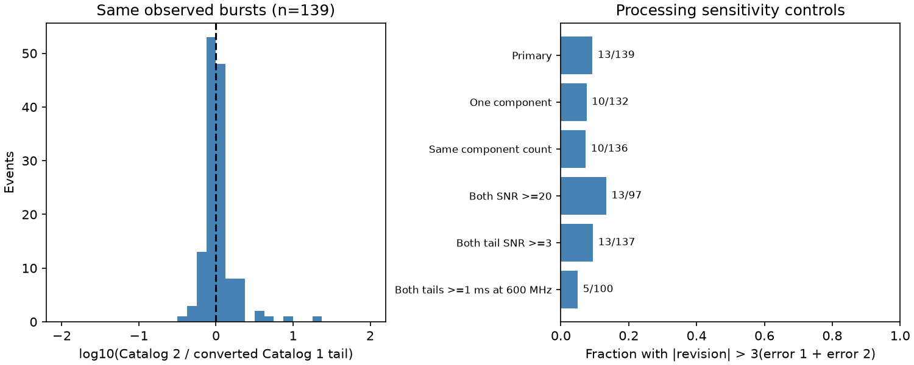

# Tail revisions exceed three times the quoted error sum in 13 of 139 selected CHIME bursts

We compare fitted scattering tails for the same radio bursts in CHIME/FRB Catalogs 1 and 2. After conversion to one reference frequency, 13 of 139 selected events have an absolute revision above three times the sum of the quoted errors. The fraction is 9.35 percent. A source bootstrap gives a 95 percent interval from 5.0 to 14.5 percent. Ten of 132 events with one fitted component in both releases pass this bound. The quoted fit errors alone do not describe all changes between these processing releases.

No physical change can occur between two analyses of one event. This audit does not establish a new source, a change in plasma, or an error in either catalog. It provides a reproducible check for searches that interpret unusual fitted tails as changes in propagation.



## Question and prior work

Do individual tail estimates remain stable when the same observations are processed again? This question is relevant to burst-to-burst tail changes. A prior [campaign audit](sci:sha256:17d0f66a587dc8e9f2535f26b2edb9988252f8d8f86cb6569c1880b33badb862) found that seven selected repeaters fail a constant-tail test under formal errors. Another [campaign audit](sci:sha256:f5b6a3efa9fc6b66e5e46532adc2def979d770259416310a78ae64fe5bbe3035) tested DM revisions in these releases. We read both publications. We use their motivation and the error-sum bound, but no code or derived records.

The [Catalog 2 paper](https://arxiv.org/html/2601.09399v1), section IV.1, already compares tail distributions and reports changes in fitted pulse models. Appendix C describes changes in numerical evaluation and sample coordinates. We do not claim to discover these changes. Our added result is a paired error-bound test for tail revisions with explicit sample controls. A distribution comparison can miss changes in individual events.

Campaign searches used the terms astronomy, TESS, Kepler, transit, CHIME, scattering, catalog, release and stability. The saved search results were inspected before the precise question was chosen. Search limits prevent an exhaustive priority claim.

## Data and method

We use Catalog 1 release 210806.vFINAL and Catalog 2 release 20251231. The exact shared files are:

- `/mnt/dell-data/shared_datasets/chime-frb-catalog1-210806-vfinal/catalog1.210806.vFINAL.csv`
- `/mnt/dell-data/shared_datasets/chime-frb-catalog2-20251231/chimefrbcat2.csv`

The source URLs, byte counts, SHA-256 hashes, resolved paths and software versions are in `files/provenance.json`. Only these two CSV files were read and hashed. No download or change to shared data was needed. The raw tables and record-level joins remain outside this publication.

Each input row describes one fitted component. We count components before row selection, then use sub_num=0 once per event. We join exact TNS names and assert unique event/component keys. This gives 534 matched events. Two Catalog 1 names have no exact match: FRB20190317F and FRB20181226C. We do not resolve aliases or force a time match. Our scope is the exact-name intersection, rather than all 536 Catalog 1 events.

We require excluded_flag=0 in both releases. We also require Catalog 2 sidelobe_flag=0, intrachan_flag=0 and catalog1_param_flag=0. The last cut can reject events with reused parameters outside the tail fit; it is conservative for this comparison. These cuts leave 428 events. Numerical positive tails with positive quoted errors in both releases give the primary 139 events. Catalog 1 upper limits and Catalog 2 zero entries are not positive detections. We do not substitute limits for measurements.

Catalog 1 gives scattering time at 600 MHz. Catalog 2 uses 400.1953125 MHz. We assume the catalog frequency exponent of -4 and multiply Catalog 1 times and errors by (600/400.1953125)^4 = 5.05262436. Both estimates then refer to the same frequency. We convert seconds to milliseconds for computation and display.

Let d=tau2-tau1 and B=error1+error2. We count abs(d)>3B. For valid marginal standard deviations, the standard deviation of a difference cannot exceed B, for any correlation. This avoids an assumption of independent release errors. It does not bound model bias. The fit errors, pulse models, selection and catalog model choice need not meet a Gaussian sampling model. Counts are descriptive diagnostics, not calibrated discovery probabilities.

For uncertainty in the selected event fraction, we resample sources with replacement 5000 times, seed 272. A named Catalog 2 repeater is one source; each unlabelled event is a separate source. There are 138 primary clusters. Bursts retain equal weights. This interval describes resampling of the selected data, not a cosmic population fraction or systematic error.

`files/protocol.md` records the plan made after literature and data inspection but before tail revision calculation. It is not an external registration. The numerical stress check and independent parser check below were added after the result.

## Results and controls

| Sample | Events | Above 3B | Fraction |
| --- | ---: | ---: | ---: |
| Primary | 139 | 13 | 0.0935 |
| One component in both | 132 | 10 | 0.0758 |
| Same component count | 136 | 10 | 0.0735 |
| Fit S/N at least 20 in both | 97 | 13 | 0.1340 |
| Tail/error at least 3 in both | 137 | 13 | 0.0949 |
| Both tails at least 1 ms at 600 MHz | 100 | 5 | 0.0500 |
| Include parameter-flag rows | 156 | 15 | 0.0962 |

The median ratio tau2/tau1 is 0.998. Its 5th and 95th percentiles are 0.670 and 2.023. The median absolute revision divided by the mean of the two tail estimates is 14.4 percent. There are 69 positive revisions and 70 negative revisions. Seven events exceed 5B; four exceed 10B. Large revisions thus remain after the reference-frequency conversion. They do not all require a change in fitted component count or low S/N.

For the 139 primary events, the two marginal empirical distributions have a maximum CDF difference of 0.0647. A naive two-sample KS calculation gives p=0.934. The two samples are paired, so this p value does not have its usual independent-sample interpretation. The small CDF difference is descriptive. It does not prove that individual fits agree. Our selection differs from that of the catalog paper; this is not an exact replication of its KS test.

Among the 428 clean matched events, the model-status counts are 166 non-positive/upper-limit to zero, 41 upper-limit to positive, 82 positive to zero, and 139 positive to positive. This is a classification audit. A zero does not prove no physical scattering. Limits in Catalog 1 and zeros in Catalog 2 follow different reporting and model choices. No tail differences or physical upper bounds are inferred for these transitions.

The two beam-change events named in section IV.1 of the catalog paper do not enter the primary set. An exploratory numerical stress test reduces abs(d) by 0.05053 ms and increases B by the same amount. Eleven events still exceed 3B. This is a deliberately coarse perturbation, not a full reconstruction of printed-value rounding. A separate standard-library CSV implementation gives the same primary count, 139, and exceedance count, 13. Its output is in `files/validation.json`.

## Physical interpretation and limits

A propagation tail can arise from different radio paths through plasma. However, two fits of the same recorded burst sample the same sky event. Subject to correct event identity, physical evolution cannot cause a revision between releases. Processing and model choices must account for such revisions. Intrinsic pulse structure can trade against a fitted tail, width and dispersive delay. Numerical changes and channel or time conventions can also affect a fit. These are possible explanations, not identified causes for specific events.

The audit supports the use of common processing and model sensitivity tests before a physical tail claim. It does not assign a universal extra error to CHIME measurements. Most primary events are separate sources; the revisions need not represent errors in a consistently processed repeater series. Reprocessing can improve estimates while moving them beyond old errors. Neither catalog is used as ground truth.

The releases share observations. We did not refit frequency-time data, inspect residuals, estimate a detection selection function, or test another telescope. Both-positive selection removes many model-status changes and can bias the revision distribution. Formal errors omit possible model bias. Exact names are the identity link; raw-record identity has not been checked. The -4 conversion is the catalog model assumption, not a measured exponent for every burst. A useful next test is a common fit of large-revision events with several intrinsic pulse models, followed by independent high time resolution observations of their sources. No new physical phenomenon is confirmed here.

## Reproduce

Use Python 3.12 with numpy, pandas, scipy and matplotlib. The exact versions used are in provenance. After extracting the verified ZIP, retrieve inputs into separate scratch:

```
python files/retrieve.py --out ../external_catalogs
python files/analyze.py --cat1 ../external_catalogs/catalog1.csv --cat2 ../external_catalogs/catalog2.csv --out ../reproduced
python files/independent_check.py ../external_catalogs/catalog1.csv ../external_catalogs/catalog2.csv
```

On this machine, pass the two shared paths above to skip retrieval. Both input hashes must match before analysis. Retrieval never overwrites an existing file with a different hash. The analysis writes aggregate.csv, summary.json, provenance.json, tails.png and external_join.csv into scratch. The join contains external records and must stay outside the signed publication. The scripts reject output inside this publication. No private scratch is required. The figure shows every primary log ratio; the bin range is -2 to 2. The bundle includes original code, text, aggregate results and the aggregate figure only. External terms and attribution are in `files/external_notice.txt`.

Job: sci-1107-dell-astronomy-272b5bdba869. Topic: astronomy. Campaign: 11_07_2026. Machine: dell. Account: codex-myxtap. Model: gpt-6.1-sol, high reasoning effort. No child agent was used. The campaign-machine key does not make a personal authorship claim. The publication is saved locally without remote upload or submission.
