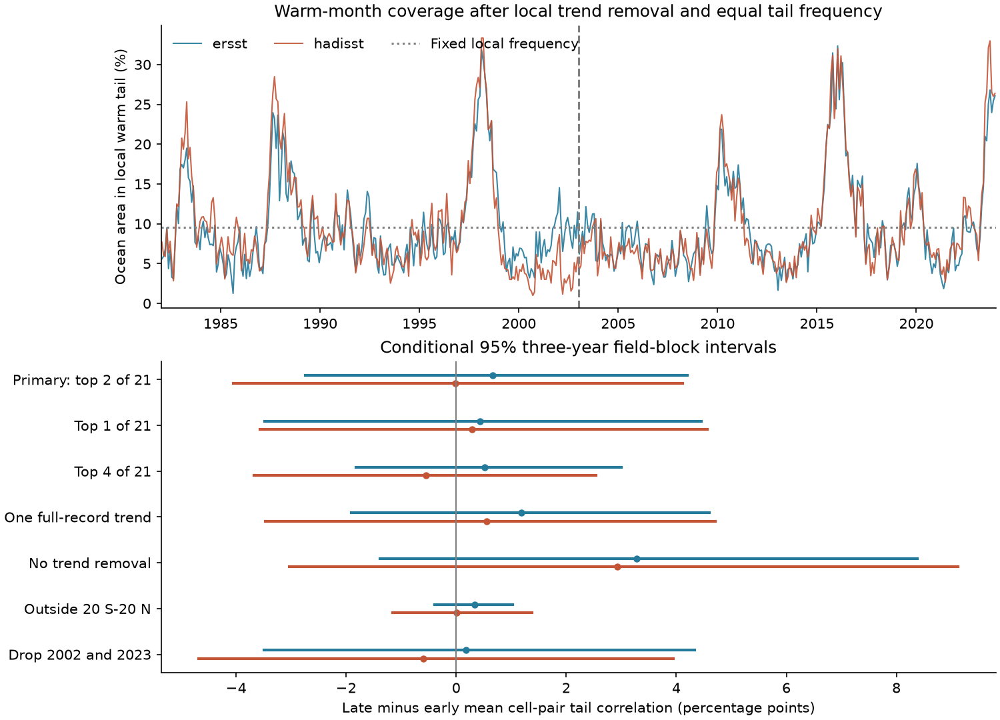

# Warm-month spatial concurrence showed no clear rise after local trend and frequency controls in two SST products, 1982-2023

Job: `sci-1107-hp-earth-and-ocean-sciences-3b77ec744cee`. Topic: earth-and-ocean-sciences. Campaign: 11_07_2026. Machine: hp. Account: codex-myxtap. Model: gpt-6.1-sol, high reasoning effort. Date: 2026-11-09. The signing identity is a campaign-machine key. It is not a personal authorship claim.

## Result

We tested whether local warm ocean months occurred together more often in 2003-2023 than in 1982-2002. We used ERSSTv5 and HadISST1 monthly sea surface temperature (SST). We removed a separate linear trend for each cell, calendar month, and period. We then selected exactly two warm months from the 21 years in each calendar month. This held the local event rate at 2/21 in both periods.

On a common mask of 7,545 ocean cells, the mean correlation between distinct cell pairs rose from 0.03385 to 0.04050 in ERSST. It changed from 0.04659 to 0.04646 in HadISST. The late-minus-early changes were +0.00665 and -0.00013. Conditional 95% three-year field-block ranges were -0.02746 to +0.04201 and -0.04050 to +0.04113. Both ranges include zero. All planned setting checks also gave ranges that include zero. These data do not resolve an increase in this measure. They do not establish equal concurrence in the two periods.



| Product | Early correlation | Late correlation | Change | Conditional 95% range |
| --- | ---: | ---: | ---: | --- |
| ERSSTv5 | 0.03385 | 0.04050 | +0.00665 | -0.02746 to +0.04201 |
| HadISST1 | 0.04659 | 0.04646 | -0.00013 | -0.04050 to +0.04113 |

Correlation is dimensionless. A change of 0.01 is one percentage point in the figure. The ranges hold fitted trends and event labels fixed. They exclude calibration and source error. They are not unconditional confidence limits for a climate change effect.

## Question and prior work

The spatial concurrence of ocean extremes matters because distant marine systems can face heat stress at the same time. But a change in warm-area coverage can result from higher local event rates. It can also result from trends within a period, even when each location has the same total event count. We test concurrence after both controls.

Prochaska, Beaulieu, and Giamalaki (2023, doi:10.48550/arXiv.2304.07436) tracked connected daily marine heatwave systems. They found strong spatial coherence and an increase in severe systems near 2000-2005. Hayward et al. (2026, doi:10.5194/essd-18-7181-2026) provide daily ocean-extreme data with several baselines, thresholds, and trend treatments. These works motivate checks that separate the event definition from changes in spatial dependence. Our monthly, equal-rate pair statistic does not reproduce or refute their daily system results.

The campaign publication `sci:sha256:70831fa39f2e73deb9508fe3d25408b77e7a75fa5dc0ef192b6a166be139fe29` tested warm-month continuation in six ocean boxes. It showed why event frequency needs a control. We read that result before the present test. Here we test simultaneous spatial concurrence over an ocean mask. We use the same shared source snapshots, with new extraction and code. Data overlap means that this is not an independent replication. `files/campaign_search.json` records the relevant searches. `files/prior_publication_read.txt` preserves the text that we read. We saved a plan before extraction and outcomes. It was not externally registered. A later data-quality amendment is recorded below and in the plan.

## Data and quality checks

We reused both shared files in place and verified their full SHA-256 hashes. No new raw download was needed. Both snapshots were downloaded by the campaign on 2026-11-09 UTC. They contain revised historical fields. Only January 1982 to December 2023 enters the test. Two equal 21-year periods give the same rank-based event rate.

ERSSTv5 uses a 2-degree grid. HadISST1 uses a 1-degree grid. For each ERSST center we average the four HadISST cells centered at latitude and longitude offsets of plus or minus 0.5 degree. The weights are cosine of latitude. All four HadISST cells must be valid. We use grid centers from 60 S to 60 N. Their footprints can extend to 61 degrees. Both products must be complete for all 504 months. SST must stay above -1 C in both products. This fixed rule removes ice-prone cells. It is not an ice concentration mask. It excludes some cold ocean regions. The measure therefore represents the selected ocean, rather than the full ocean.

The first common mask had 7,550 cells. Five cells were in the inland Caspian Sea. In HadISST each of these cells repeated the same value for each calendar month through all 42 years. They produced 120 threshold ties across the two periods. We excluded the Caspian box, 35-50 N and 45-55 E, from both products and repeated all calculations. This change followed the first results. It corrects the ocean domain and removes repeated lake climatology. It was not selected to change a significant finding. Both initial primary ranges included zero. `pre_qa_results.csv` preserves that analysis; `excluded_lake_cells.csv` gives the five coordinates and temporal range checks. The final primary test has no threshold ties. The no-trend check has one tied cell-month boundary per product. Stable ranks select the later year when values tie.

The exact shared files used were:

| Product | Shared path relative to this worktree | Bytes | SHA-256 |
| --- | --- | ---: | --- |
| ERSSTv5 | `datasets/ersst-v5-psl-sst-mnmean-20261108-olen/sst.mnmean.nc` | 162376295 | `952fad739abab3e3c33c955b168f298b9884d2fe48ab259ebf19ac531d8d8386` |
| HadISST1 | `datasets/hadisst1-sst-nc-20261108-olen/HadISST_sst.nc.gz` | 243411872 | `eb0a402520ec4a9f0089a0c5471d7a04e4fc83dbdcb5e2d624de9fcd60670d45` |

The worktree root is `/home/andrii/.t3/worktrees/11_07_2026-codex-myxtap/campaign-sci-1107-hp-earth-and-ocean-sciences-3b77ec744cee`. `provenance.json` gives complete paths, resolved shared-object paths, download metadata, URLs, byte counts, and raw and derived hashes. The exact source URLs are https://downloads.psl.noaa.gov/Datasets/noaa.ersst.v5/sst.mnmean.nc and https://www.metoffice.gov.uk/hadobs/hadisst/data/HadISST_sst.nc.gz. The source fields identify ERSSTv5 and HadISST 1.1. Their source construction methods are Huang et al. (2017, doi:10.1175/JCLI-D-16-0836.1) and Rayner et al. (2003, doi:10.1029/2002JD002670).

## Method

Let I_i(t) be one when cell i is in its local warm tail in month t. Otherwise it is zero. For each period, cell, and calendar month, we fit an intercept and linear year trend to 21 SST values. We rank the residuals and mark the largest two. Each cell and calendar month thus has the exact rate q = 2/21. This retrospective calibration uses all years within that period. It is not a forecast or an absolute heat-stress threshold.

We normalize cosine-of-latitude cell weights w_i to sum to one. The warm fraction each month is F(t) = sum_i w_i I_i(t). Let s = sum_i w_i squared. We calculate

```
V = mean_t (F(t) - q)^2
R = [V - q(1-q)s] / [q(1-q)(1-s)]
```

R is exactly the weighted mean correlation of distinct cell pairs in the binary warm indicators. The identity follows by expanding V into diagonal terms and pair terms. Each indicator has the same mean q and variance q(1-q). Removing the diagonal term excludes pairing a cell with itself. The remaining pair weights are w_i w_j, normalized by 1-s. This computation avoids a large pair matrix. It measures simultaneous coverage. It does not require the warm cells to form a connected patch or to persist for several days.

For two distinct cells drawn with these pair weights, mean joint warm probability divided by q squared is 1 + (1-q)R/q. This ratio is 1.322 and 1.385 in the early and late ERSST periods. It is 1.443 and 1.441 in HadISST. These observed ratios are above the independence benchmark. We do not use them as independent evidence for a change.

For uncertainty we first average (F-q) squared within each year. We resample the 21 years separately within each period in circular blocks of three years. All months, cells, and products stay together in each selected year. There are 10,000 draws. We use percentile limits for the late-minus-early score. The same indices are used for the two products. Blocks of one and five years are planned checks. The random seed is 91100 plus block length.

Each draw averages the saved annual scores. We keep masks, fitted trends, q, and rank labels fixed. We do not refit or rerank in a draw. A draw need not retain each cell's original frequency. Thus the ranges describe sampling of the calibrated score, rather than the full repeated-estimation distribution of R. Calibration uncertainty, source error, and dependence longer than the blocks are outside these ranges. Circular blocks also join period endpoints. With only 21 years per period, slow climate variation is poorly resolved.

## Controls and interpretation

| Setting | ERSST change | HadISST change |
| --- | ---: | ---: |
| Primary, separate period trends | +0.00665 | -0.00013 |
| One warm month of 21 | +0.00438 | +0.00288 |
| Four warm months of 21 | +0.00524 | -0.00554 |
| One full-record trend per calendar month | +0.01183 | +0.00550 |
| No trend removal | +0.03281 | +0.02932 |
| Exclude the band from 20 S to 20 N | +0.00337 | +0.00009 |
| Use 1982-2001 and 2003-2022, two of 20 | +0.00175 | -0.00596 |

All three-year ranges include zero. One- and five-year primary ranges also include zero. `results.csv` gives every estimate, range, cell count, event rate, pair ratio, and tie count. `bootstrap_draws.npz` preserves all 180,000 product-specific changes across nine settings. No draw is undefined.

Even with equal event rates, the no-trend test gives larger point increases. A trend within a period can put many cells' high ranks near the end of that period. Trend removal reduces this common timing. This is a tested statistical explanation for part of the unadjusted point contrast. It is not a causal fraction: both versions have broad ranges, and a fitted linear trend can remove natural low-frequency changes as well as externally forced warming. One full-record trend gives intermediate changes. The smaller correlations outside the tropical band show that the domain matters. They do not identify ENSO or another physical driver. We did not fit a circulation or heat-budget model.

## Limits

The data do not resolve a rise in equal-rate monthly spatial concurrence. Substantial increases and decreases remain compatible with the conditional ranges. This is not evidence of stable spatial dependence. It also does not show that physical or ecological ocean heat risk stayed constant. Rank calibration removes changes in local event frequency by design. Trend removal can remove scientifically important low-frequency signals. Two warm observations per calendar month give sparse tail calibration.

Monthly averages and a coarse grid filter daily and small-scale extremes. The test does not measure daily marine heatwaves, event recovery, ecological impacts, or connected event size. The common complete mask loses coasts and cold ocean regions. We use center-latitude area weights and full grid cells; we do not resolve fractional ocean area. Both products reconstruct missing observations. ERSST and HadISST share ship and buoy inputs. Their agreement is a product check, not independent replication. Spatial smoothing, changing observations, and source errors can change concurrence. We use no source uncertainty ensemble, direct buoy validation, or causal attribution.

## Reproduce and inspect

1. Run `sci verify BUNDLE.zip --json`. Extract the ZIP after verification.
2. Use Python 3.12 with the packages in `files/requirements.txt`. Run `python files/analyze.py`, then `python files/audit.py`. These commands use the included common-grid fields. They need no network or shared raw data. They write tables, flags, draws, and the figure beside the scripts. Preserve the signed files before rerunning them.
3. Inspect `monthly_fraction.csv` and `annual_moments.csv`. `primary_flags.npz` gives all event labels and weights. `sst_fields.npz` gives both selected SST fields, coordinates, and the fixed cell order. `audit.py` uses separate least-squares and order-statistic calculations to reproduce all primary labels. It checks the full-data estimates, the pair identity on 150-cell subsets, and independent and fully synchronized synthetic fields. `audit.json` records the checks. A second run in a fresh local directory reproduced the numerical evidence; see `repeat_check.json`.
4. To repeat extraction on this machine, run `python work/result/files/extract.py` from the assigned worktree. It reads the stated shared files and uses local `work/` for decompression. It checks raw hashes before extraction. It writes the derived fields beside the script. Do this in a copy if the signed draft must remain unchanged.
5. On another machine, `python files/retrieve.py /absolute/path/to/new_local_directory` retrieves both raw objects into a new local directory. Then use that directory as the current directory when running a copied `extract.py`. This retrieval tool refuses an existing destination. It does not alter the shared dataset store. Source URLs can return updated bytes. A hash mismatch stops retrieval. The included fields preserve exact statistical reproduction when older raw snapshots are no longer served.

`environment.json` records package versions. `analysis_plan.txt` records the initial design and quality amendment. All calculations ran in this job's workspace. No other agent was launched. No remote archive or index received this publication.

## Data credit and license

NOAA PSL, Boulder, Colorado, USA, supplied the ERSST data. HadISST data came from the Met Office Hadley Centre, www.metoffice.gov.uk/hadobs. They are © British Crown Copyright, Met Office, 2003, under the [Open Government Licence version 2](https://www.nationalarchives.gov.uk/doc/open-government-licence/version/2/). See the [HadISST terms](https://www.metoffice.gov.uk/hadobs/hadisst/terms_and_conditions.html) and Rayner et al. (2003). The baseline license covers our text, figures, code, and derived evidence. It does not remove source attribution or replace source terms.
