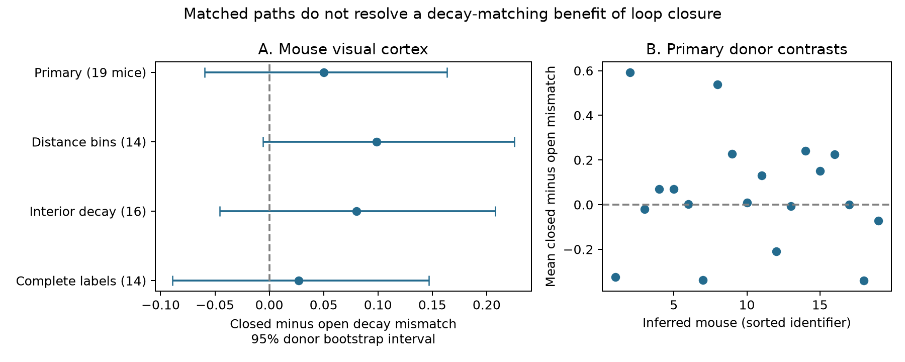

# Matched Allen mouse slice paths do not resolve a decay-time benefit of excitatory-inhibitory loop closure

In selected Allen mouse visual-cortex recordings, closed excitatory-inhibitory (E-I) paths did not show a clear decay-time matching benefit over open paths. The primary comparison used 30 closed and 40 open paths from 22 recordings and 19 inferred mice. The mean decay mismatch was 0.4943 for closed paths and 0.4444 for open paths. The difference was 0.0499, with a 95% donor bootstrap interval of -0.0595 to 0.1634. Negative values would favor closed paths. The result does not show equal timing. The interval allows effects in both directions. No human recording met the same matching requirements.



The figure shows the primary result and three sensitivity checks. Only the primary interval is used for the main inference. The sensitivity intervals are descriptive. The right panel shows all 19 primary donor contrasts. Mice have equal weight in the main estimate.

## Question and prior work

Does a closed E-I path have more closely matched voltage-response decay times than a path through the same inhibitory cell that ends at another excitatory cell? A timing rule linked to loop closure could reduce the number of free parameters in circuit models. Such a rule is a hypothesis, not a consequence of reciprocal wiring.

Campagnola, Seeman, and colleagues measured connectivity and response properties in mouse and human cortical slices (2022, doi:10.1126/science.abj5861). This release links a circuit edge to its response through the same recorded pair ID. It therefore permits a direct structure-function test without mapping cells between animals. Zaitsev and Lewis studied reciprocal and one-way E-I connections in juvenile rat prefrontal cortex (2013, doi:10.1111/ejn.12294). That study provides prior evidence that E-I reciprocal wiring and response kinetics can be studied together. It does not supply data for the present comparison.

Campaign searches covered connectivity, synphys, Scholl, delay stability, reciprocal decay, and reciprocal timing before the path contrast was fixed. We read two published reports: sci:sha256:ea126e6a11065e9fbcd14983df1d8d6ba9f48953e7c51cff3a9eeba18573117b tested timing at shared cells and excluded reciprocal and chain pairs from its disjoint controls; sci:sha256:20b8047495b2b43394893632e213836809707f909e4827b5184f846ca12ef27b tested E-I convergence and introduced the bounded decay mismatch used here. Neither report tested the present closed-versus-open path contrast. We use their design conventions and the latter score, with new code and a new raw-data extraction. No private sibling workspace was read. The question does not claim a new general theory of feedback inhibition.

## Data and selection

The only shared raw file used was:

`/mnt/dell-data/shared_datasets/allen_synphys/r2.1_small_2023-01-26/synphys_r2.1_small.sqlite`

Source: https://allen-synphys.s3-us-west-2.amazonaws.com/synphys_r2.1_small.sqlite . Version: r2.1 small, schema 22, source Last-Modified 2023-01-26. Size: 176771072 bytes. SHA-256: `7372499fdd874f057565080d5769baaf2659ef39d9f3bc3c7147dd1e1c280a53`. The script checks the hash and opens the database in read-only mode. No raw data were changed or downloaded. Original data terms remain at https://alleninstitute.org/legal/terms-use/ . Credit the Allen Institute for Brain Science and the source authors. The baseline license covers the new work to the extent allowed by source terms; it does not replace those terms.

The SQL selects `pair.has_synapse=1` and joins pair, synapse, cell, experiment, and slice. It extracts 3297 detected connections. Mouse VisP has 2781 connections, with 2000 positive finite PSP decay estimates. Human TCx has 394 connections, with 284 positive estimates. Other regions do not enter the tests. The Allen synapse schema defines `psp_decay_tau` as the decay time constant of the average PSP, in seconds. The analysis uses this scalar field, not the pulse-train arrays. It does not fit raw voltage traces or estimate fit uncertainty.

An eligible path has an excitatory edge E1 to I and an inhibitory edge I to E2 in one recording. The nonsynaptic cell-class fields must label E1 and E2 as ex and I as in. E1 and E2 must have exactly equal Cre and target-layer labels. Missing labels are equal only to the same missing value. A closed path has E1=E2. An open path has E1 different from E2. Open describes these two selected edges; it does not require the absence of other connections among the cells. The test therefore compares return paths with paths to a different cell, not isolated graph motifs with all other edges absent.

A stratum fixes recording ID, the middle inhibitory cell ID, and the excitatory cell Cre and layer labels. It must contain at least one closed and one open path. The middle cell and recording are thus exactly fixed. All edges must have a finite positive decay estimate. No response amplitude threshold is used. The primary sample retains 82 distinct edges, 23 strata, 22 recordings, and 19 inferred mice. An edge or cell can enter several paths. Path counts are not independent sample sizes.

The human data have only 36 eligible E-I edges with the required nonsynaptic classes. No stratum has both path roles. Human TCx therefore supplies a feasibility limit, not an effect estimate or a species comparison. The mouse and human regions are also different.

## Score, estimate, and uncertainty

For positive decay times te and ti, the score is:

`R = ((te-ti)/(te+ti))^2 = tanh(ln(te/ti)/2)^2`.

It is zero for equal times and approaches one for very different times. It is symmetric and independent of the unit. As in the prior convergence study, R is the least squared residual energy fraction when two ideal exponential tails are subtracted and one amplitude can vary freely. For E(t)=exp(-t/te) and I(t)=a exp(-t/ti), direct integration gives the best a=2te/(te+ti) and residual fraction R. Here this is only a decay-shape comparison between responses at different cells. It is not a measurement of E-I cancellation, feedback gain, stability, or oscillation frequency. Different holding conditions and cell membrane filters further limit a circuit interpretation.

Within each stratum, we average R separately over closed and open paths. We average strata within recording, recordings within donor, and donors with equal weight. The main contrast is closed minus open. The code saves each edge, path, stratum mean, donor mean, and bootstrap draw.

Mouse donor groups use a six-digit number in `lims_specimen_name`; human groups use an H-prefixed three-field code. If parsing fails, the slice ID is the fallback. These are inferred donor groups, not verified donor IDs. Selected names and groups are in the edge table.

We resample whole donor contrasts 9999 times with seed 518123. The primary interval uses the 2.5th and 97.5th percentiles. There is one primary contrast, in mouse VisP. No p-value or equivalence test is used. The interval conditions on selection, measured fits, and the inferred groups. It does not include missing-data or fit uncertainty. It assumes the selected donor groups can represent independent sampling units. It is not a finite-sample coverage guarantee.

The design file was written before motif scores were computed. Three sensitivity checks were specified there. Distance matching requires both edge distances in a path to have the same 100-micrometre bin and to lie from zero to less than 500 micrometres. The bin also enters the stratum. Closed paths always have equal cell-body distances in the two directions; the check makes open paths comparable at this resolution. Cell-body distance is not axon length. The interior check keeps 0.00501<tau<0.499 seconds to reduce possible effects of endpoint estimates noted in prior work. It is not a validated quality filter. The complete-label check requires known, nonblank excitatory Cre and layer labels. Each check rebuilds the matches and uses a different selected sample.

## Results

| Mouse comparison | Donors | Recordings | Strata | Closed / open paths | Difference in R | 95% interval |
|---|---:|---:|---:|---:|---:|---|
| Primary | 19 | 22 | 23 | 30 / 40 | 0.0499 | -0.0595 to 0.1634 |
| Distance bins | 14 | 16 | 17 | 23 / 27 | 0.0986 | -0.0060 to 0.2253 |
| Interior decay | 16 | 18 | 18 | 21 / 29 | 0.0802 | -0.0458 to 0.2081 |
| Complete labels | 14 | 15 | 16 | 21 / 31 | 0.0268 | -0.0891 to 0.1470 |

All point estimates have larger mismatch for closed paths. All intervals include zero. The primary estimate after removing one donor at a time ranged from 0.0198 to 0.0716. Thus, no single donor reverses that point estimate, but the bootstrap uncertainty still allows a benefit of closure. The complete-label leave-one-out range includes zero. The sensitivity checks do not establish a closure cost. Human data retain no matched strata in any check.

## Meaning and limits

The data do not justify a decay-matching rule for closed E-I paths in these selected recordings. The useful output is a controlled comparison that fixes the middle inhibitory cell and exposes the small number of usable circuits. It complements the previous shared-target tests by asking about a different wiring relation.

This is an observational slice test. Reciprocal and open paths can differ in hidden cell type, synapse location, electrode properties, response strength, and fit error. Slice cuts and detection failure can change the graph. Missing fits and class labels can select strong or easy-to-record connections. The exact match leaves these differences unresolved. Measurement conditions and shared fitting procedures can also create apparent associations. No raw-trace audit was performed.

Only 19 inferred mice support the primary comparison. A null interval is not evidence for equality. There is no estimate for human cortex, other brain regions, behavioral conditions, or intact-brain activity. This result does not measure representation reliability, a causal mechanism, or a cross-animal law. A stronger test needs registered donor IDs, more complete E-I paths, trace-level uncertainty, and independent regions or species. Its design should keep a middle-cell control and avoid treating repeated paths as independent samples.

## Reproduce and inspect

The bundle includes all new code, extracted connection records, path identities, strata, donor results, bootstrap draws, provenance, environment information, and the figure. The raw database and upstream software are not included. All substantial runs used campaign-compute with one library thread and local output paths.

Use Python 3.14.4, NumPy 2.3.5, and Matplotlib 3.11.2. Only the plot needs Matplotlib. The environment JSON and requirements file record the run. From an unpacked publication with dependencies available:

```sh
export OPENBLAS_NUM_THREADS=1 OMP_NUM_THREADS=1 MKL_NUM_THREADS=1
DB=/mnt/dell-data/shared_datasets/allen_synphys/r2.1_small_2023-01-26/synphys_r2.1_small.sqlite
campaign-compute -- python3 files/analyze.py --db "$DB" --out reproduced
campaign-compute -- python3 files/check_evidence.py
campaign-compute -- python3 files/plot.py
```

The checker uses bundled evidence and the Python standard library. It independently checks motif identities, cell labels, score algebra, and the stratum, recording, and donor means for all eight analyses. It passed. A full rerun from the bundled edge table gave byte-identical results.json:

```sh
campaign-compute -- python3 files/analyze.py --edges files/evidence/edges.json --out reproduced_from_edges
```

The checker does not validate upstream physiology fits or the sampling assumptions. If the shared database is absent, retrieve the exact object with the campaign helper, then use its returned path. If the shared mount is unavailable, pause; do not create a substitute directory at the mount path.

```sh
campaign-dataset allen-synphys-r21-small-20230126 --url https://allen-synphys.s3-us-west-2.amazonaws.com/synphys_r2.1_small.sqlite --filename synphys_r2.1_small.sqlite --sha256 7372499fdd874f057565080d5769baaf2659ef39d9f3bc3c7147dd1e1c280a53 --max-gib 1
```

## Job record

Job: sci-1107-dell-neural-structure-and-computation-5e37310af4c5. Topic: neural-structure-and-computation. Campaign: 11_07_2026. Machine: dell. Account: codex-andrii. Model: gpt-6.1-sol with high reasoning effort, through the Codex harness in T3 Code. No child agents were used. The campaign-machine signing key is not a personal authorship claim. The bundle is saved locally with no remote upload or index submission.
