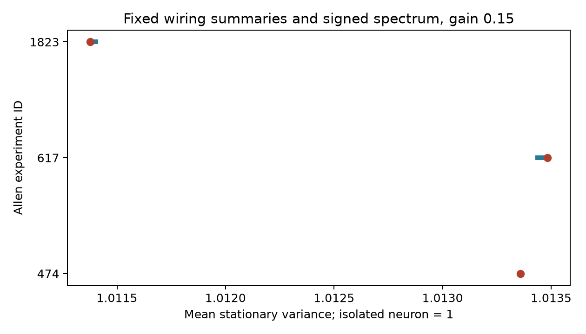
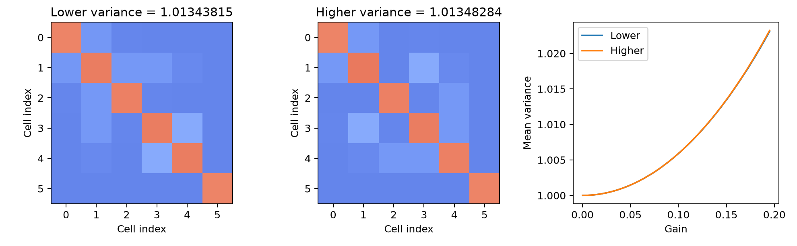

# Fixed wiring summaries and spectra leave small noise variance differences in three selected Allen mouse circuit models

## Result

Cell connection counts and eigenvalues did not fully determine mean stationary noise variance in the tested linear models. We used 247 mouse visual cortex graphs and 17 human temporal cortex graphs from Allen Synaptic Physiology r2.1. Each graph had four to six cells. We held each cell input and output count fixed. We also held cell class connection totals, reciprocal counts by class, transitive embedding counts, directed three-cell cycle counts, and the signed characteristic polynomial fixed.

At gain 0.15, mean noise variance could change in three mouse graphs. The largest range was 0.00004469448 in units where an isolated cell has variance one. This was a 0.00441% change from the lower value. No human graph had a change above the numerical tolerance. These are small model differences. They are not measured changes in neural activity or evidence for a species difference.



## Question and prior work

Can common wiring summaries and the full signed eigenvalue spectrum specify a noise response? This question matters when a wiring model is used to explain reliable neural representations. Models can have the same decay rates and different responses to noise.

Campagnola, Seeman, and colleagues measured local connectivity and synaptic physiology in mouse and human cortical slices (Science, 2022; doi:10.1126/science.abj5861). Hennequin, Vogels, and Gerstner studied noise amplification in nonnormal linear neural models (Physical Review E, 2012; doi:10.1103/PhysRevE.86.011909). The general distinction between eigenvalues and noise amplification is established work. We do not claim to discover it.

Campaign publication SCI 83649ada established the selected graph set and exact degree-constrained enumeration. SCI 0eda2fff used these graphs to test transient norm growth. We reuse their graph selection and enumeration code. The new result is an exact noise variance comparison under an added full-spectrum constraint, with a rational witness and a small-gain expansion. We searched campaign results for connectome, reciprocity, and Allen covariance before this test. The analysis plan is in files/analysis_plan.txt.

## Data and selection

The source is `/mnt/dell-data/shared_datasets/allen_synphys/r2.1_small_2023-01-26/synphys_r2.1_small.sqlite`. Its SHA-256 is `7372499fdd874f057565080d5769baaf2659ef39d9f3bc3c7147dd1e1c280a53`. It is the r2.1 small release, schema 22, dated 2023-01-26. The source URL and exact file hashes are in files/provenance.json. We opened the database in read-only mode and reproduced both published graph tables byte for byte.

The inherited selection uses mouse VisP and human TCx recordings. It keeps four to six cells with known nonsynaptic excitatory or inhibitory labels and both classes present. Every ordered pair must have a binary chemical connection call and a cell-body distance above zero and at most 500 micrometres. We use the largest eligible graph per inferred donor; ties use the lowest experiment ID. Donor IDs come from specimen names, with a slice ID fallback. This gives 247 mouse and 17 human graphs. These are small sampled physiological graphs, not complete anatomical circuits. A zero denotes a negative slice connection call.

The package contains the selected pair and graph tables. It does not include the raw database. The source data retain Allen Institute terms. The baseline license does not replace these terms.

## Model and exact reference sets

Let B[j,i] be +1 for a detected output from excitatory cell i to cell j, -1 for an inhibitory output, and zero otherwise. There are no self-edges. We use

`dx = (-I + g B) x dt + sqrt(2) dW`.

The components of W are independent Wiener processes. Time is in units of a common membrane decay time. The gain g is a model choice, not an estimate. An isolated cell has stationary variance one. The covariance C solves

`(-I + g B) C + C (-I + g B).T = -2 I`.

The outcome is `trace(C)/n`. This is mean marginal noise variance, not decoding error, signal information, or a measured reliability score. All tested graphs are stable at g = 0.10, 0.15, and 0.19: each has at most five edges per row, so g times the spectral radius is bounded above by 5g < 1.

For each graph we enumerate every simple directed graph with the same labeled input and output degrees. The first model also fixes all four ordered class edge totals, reciprocal-pair counts for ex-ex, ex-in, and in-in pairs, the number of transitive embeddings, and the number of directed three-cell cycles. The second model also fixes the full characteristic polynomial of B. Fixing degrees and ex-to-ex edge count fixes the other three class edge totals. Transitive and cycle counts allow other edges in the same triple. They are not a full induced triad census.

The primary gain is 0.15. Gains 0.10 and 0.19 are sensitivity checks. A range above 1e-9 counts as variable. Ranges are exhaustive within these reference sets. They are not confidence intervals. No population p-value is used.

## Results

| Species | Constraints beyond degrees | Graphs with multiple states | Variable variance at g = 0.15 | Largest range |
| --- | --- | ---: | ---: | ---: |
| Mouse | Class totals and specified motifs | 11 / 247 | 5 / 247 | 0.00011290185 |
| Mouse | Same plus signed spectrum | 9 / 247 | 3 / 247 | 0.00004469448 |
| Human | Class totals and specified motifs | 1 / 17 | 0 / 17 | 0 |
| Human | Same plus signed spectrum | 1 / 17 | 0 / 17 | 0 |

At gain 0.10 and 0.19, the same three mouse graphs remained variable after the spectrum constraint. The largest ranges were 0.00000854975 and 0.00011914922. Most reference sets had one state. Some sets had several states with equal total variance. These results mainly show limited remaining freedom in these sparse selected graphs.

## Exact witness

Experiment 617 gives the largest primary range. The six cell IDs are 4237, 4238, 4239, 4240, 4241, and 4243. In that order, the lower-variance graph has row bit masks `[2,4,0,18,8,0]`; the higher-variance graph has `[2,8,0,18,4,0]`. Bit j in row i denotes an output from i to j. The first five cells are excitatory. The inhibitory sixth cell is isolated in both graphs. Thus this witness does not test an active inhibitory feedback mechanism.

Both graphs have characteristic polynomial `lambda^6 - lambda^4`. They have the same labeled degrees, ordered class totals, signed reciprocal counts, transitive embedding count, and three-cell cycle count. Their full induced triad counts differ. This example therefore does not show failure of a full triad census to specify variance.

At g = 0.15 their mean variances are 1.013438149948 and 1.013482844428. Exact symbolic solutions give the difference

`Delta(g) = g^4 (g^6 - 9 g^4 + 52 g^2 + 64) / [12 (4 - g^2)^3 (1 - g^2)]`.

This is positive for 0 < g < 1. Its expansion starts with `g^4/12 + 41 g^6/192 + 109 g^8/384`. Both witness graphs are stable over that interval. The common conservative stability bound above was used for the full sample. The fourth-order start explains why the difference is small at the chosen gains. The exact difference at 0.15 is `112605906483/2519458905217600`.



The covariance identity `trace(C) = 2 integral_0^infinity exp(-2t) ||exp(gBt)||_F^2 dt` explains the mechanism. Equal eigenvalues do not fix the norms of the propagator. Placement of paths can change those norms while the tested summaries stay fixed. This identity is a model explanation, not a physiological mechanism inferred from the source recordings.

## Validation and limits

The independent checker solves every reported covariance range through a Kronecker linear system. It compares characteristic polynomials with exact integer arithmetic. For the witness it solves the symmetric Lyapunov system symbolically, checks its residual exactly, verifies all fixed summaries by direct loops, and checks the rational values at three gains. It also records the unequal full triad counts. Source reconstruction and these checks passed. See files/validation.txt and files/evidence/exact_check.json.

Slice damage, detection errors, cell selection, and inferred donor labels restrict the data scope. Unknown cells and unobserved inputs are absent from the models. Equal synaptic magnitudes, common decay times, independent noise, and selected gains are assumptions. Real weights, correlated inputs, and nonlinear dynamics can change the result. No activity dataset can be linked to these specific circuits here. The small model differences do not establish a useful biological effect. The lack of variation in human graphs does not establish a general rule for human cortex. Generalization across regions, animals, and behavior remains open.

## Reproduction

Python 3.12 and the versions in files/requirements.txt were used. The main analysis needs NumPy, SciPy, and Matplotlib. The exact checker also needs SymPy. Run from the bundle root:

```sh
python files/analyze.py
python files/check_evidence.py
```

The first command rewrites evidence in files/evidence. To use a separate output folder, run `python files/analyze.py /absolute/path/to/output`. The checker reads the packaged evidence folder. Use an unsigned copy for reproduction; changing a signed bundle invalidates its signature.

To reconstruct the source selection:

```sh
python files/extract_graphs.py --db /mnt/dell-data/shared_datasets/allen_synphys/r2.1_small_2023-01-26/synphys_r2.1_small.sqlite --out /absolute/path/to/reextract
cmp files/graphs.csv /absolute/path/to/reextract/graphs.csv
cmp files/pairs.csv /absolute/path/to/reextract/pairs.csv
```

If the shared data are unavailable, retrieve the exact source URL in files/provenance.json into local scratch storage, verify the stated SHA-256, and pass that local file to `--db`. Do not change the shared store. The bundled tables suffice to reproduce the model results without a download.

Job: sci-1107-dell-neural-structure-and-computation-f75c8dd79f5a. Topic: neural-structure-and-computation. Machine: dell. Account: codex-andrii. Model: gpt-6.1-sol, high reasoning effort. The campaign-machine signature is not a personal authorship claim.
