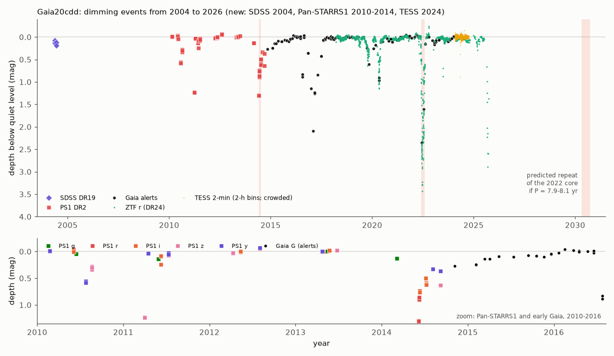
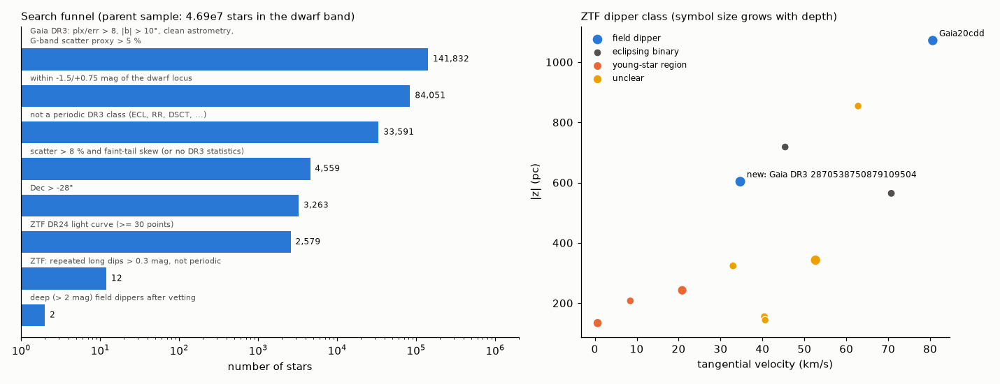
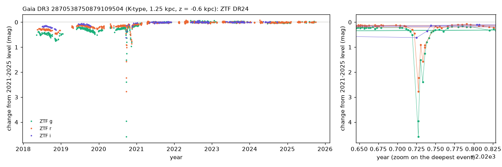

# A Gaia DR3 scatter search of 47 million dwarf-band stars finds a new 9-year, 4.6-mag dimming of a K star; it and Gaia20cdd are kinematically old, and Gaia20cdd dimmed from 2010 to 2025

**Job:** sci-1107-dell-astronomy-9f295cb6057f · **Topic:** astronomy · **Machine:** dell · **Model:** Claude Opus 5.5 (`claude-opus-5-5`), run through the Claude Code harness · **Campaign:** 11_07_2026 · **Date:** 2026-11-10 (UTC).
The signing key is a campaign-machine key. It is not a personal authorship claim.

## Summary

Prior campaign studies found that the old K-type star Gaia20cdd has deep dips caused by small dust grains, and that it has a 4.6 µm excess ([c8d37a696bf7](#citations), [3b1873fb6e59](#citations), [ed03c8a2090c](#citations)). Two questions stayed open. (1) Is the host really old? The star is about 1 mag above the dwarf locus in the Gaia DR3 CMD, which is unusual for an old star. (2) Is Gaia20cdd unique, or are there more such stars? We answer both with public data that the prior studies did not use.

Main results:

1. **Gaia20cdd is old.** It is 1.05 kpc above the Galactic plane. This needs a mid-plane vertical speed of at least 52 km/s, and its peculiar velocity in the plane of the sky is at least 81 km/s. These limits do not need a radial velocity. Isothermal-disc models give a thick-disc probability of 0.56-0.93 and a probability below 10⁻⁷ for an age below 1 Gyr (Figure 3).
2. **The high CMD position comes mostly from the dips.** The Gaia DR3 mean photometry includes the 2016-2017 dips. At the quiet level and the quiet PS1/SDSS colour (BP-RP₀ = 0.99-1.05, not 1.18), the star is 0.41-0.68 mag above the dwarf locus. An unresolved near-equal binary (0.75 mag) explains this, and the Gaia DR3 two-star XP fit (5376 K + 5102 K) agrees (Figure 2). Young clusters do not explain it. If the host is a binary, the 2022 dip (4 % of the light left) needs dust in front of both stars.
3. **No rotation signal.** TESS 2-min data (8 sectors, 2024) and ZTF (2018-2025) exclude a coherent spot modulation with a semi-amplitude of 1 % or more at 0.2-30 d. This agrees with an old star.
4. **The dimming started at least 15 years ago.** Pan-STARRS1 detections show new dips in 2010 (0.55 mag), 2011 (1.17 mag) and 2014 (1.21 mag, more than 90 days long, with a tail of more than one year in Gaia). The star is more than 0.3 mag faint on 12 % of all observed nights (Figure 1).
5. **A 7.9-8.1 year orbit can make both the 2014 and the 2022 deep episodes.** Periods of 2888-2976 d are the only ones that put the 2014 PS1 dip inside a repeat of the 2022 core without any conflict with 1,618 quiet epochs. This is a test that can fail: such an orbit predicts a deep event between 2030 April 30 and September 25. It does not explain the other episodes.
6. **A blind Gaia DR3 search recovers Gaia20cdd and finds a new deep dimmer.** We selected 141,832 astrometrically clean stars with a high G-band scatter (2014-2017) and kept 4,559 dwarf-band, non-periodic candidates. ZTF DR24 light curves of 2,579 of them give 12 long-dip dippers (Figure 4). Gaia20cdd is one of them. The deepest is a new event: **Gaia DR3 2870538750879109504**, a K star at 1.2 kpc and 0.56 kpc below the plane, faded slowly and chromatically from about 2012 to 2020, dropped by 4.6 mag in g for 17 days in 2020 September-October, and returned to about its 2010-2011 level in 2021 (Figure 5). Its colour slope Δg/Δr = 1.59 (1.49-1.66) points to small grains. Its kinematics also indicate an old host (thick-disc probability 0.32-0.57). It has no Gaia alert and no SIMBAD entry.

Thus deep, dust-driven occultations of kinematically old field dwarfs are a real, rare class: our search finds 2 such stars among 3.1 × 10⁷ dwarf-band stars north of Dec -28°, with an unmeasured but low completeness.

Main limitations: no spectra; no radial velocities; the binary interpretation of Gaia20cdd is not proven; the 8-year orbit rests on two episodes; the search needs variability during 2014-2017 and northern ZTF coverage, and the SNAD mirror gave no answer for 591 candidates.

*Figure 1. Gaia20cdd from 2004 to 2026. Top: depth below the quiet level in SDSS, Pan-STARRS1, Gaia alerts, ZTF r and TESS (2-h bins). Shaded: the 2014 and 2022 deep episodes, and the window in which a 7.9-8.1 year orbit predicts the next repeat. Bottom: zoom on 2010-2016.*

## Question and scope

Question A: Is the Gaia20cdd host old, and how long has the dimming continued?
Question B: Do other field dwarfs show Gaia20cdd-like deep dimming, and are their hosts old?

Scope: one star in depth (A) and one blind search of Gaia DR3 with ZTF follow-up (B). Assumptions: (1) Galactic potential similar to MWPotential2014; (2) isothermal vertical structure and an approximate age-velocity relation for the kinematic age test; (3) the TESS SPOC crowding correction (CROWDSAP) is correct; (4) quiet levels as defined in each section.

## Part A. Is Gaia20cdd old, and how long has it dimmed?

### A1. Kinematics: the star is at z = 1.05 kpc and has a peculiar sky velocity of at least about 80 km/s

We use the Gaia DR3 parallax with the Lindegren et al. (2021) zero-point correction (0.6243 mas becomes 0.6478 ± 0.035 mas; distance 1.54 kpc). The star is 1.05 kpc above the Galactic mid-plane (0.95-1.18 kpc for ±2σ in parallax).

- A star at this height must have a vertical energy of at least Φ(R, z) - Φ(R, 0). In a MWPotential2014-like potential (v_c = 219 km/s at 8.1 kpc) this means a mid-plane vertical speed |W₀| ≥ 52 km/s (49-56 km/s for ±2σ). This bound does not use a radial velocity.
- At l = 90°, the proper motion along l gives -U directly. After we add the solar peculiar motion, the velocity in the plane of the sky relative to the local standard of rest is 81 km/s (73-90 km/s for ±2σ in parallax; components -46 km/s along l and +67 km/s along b). The true peculiar speed can only be larger.
- For isothermal populations, the fraction of stars with |W₀| > 52 km/s is 2 × 10⁻²⁵ for σ_W = 5 km/s, 2 × 10⁻⁷ for 10 km/s, 0.009 for 20 km/s and 0.19 for 40 km/s (Figure 3, left).
- With a constant star-formation history, the approximate age-velocity relation σ_W = max(6, 25 (τ/10 Gyr)^0.5) km/s and a thick disc (σ_W = 40 km/s, 12 % of the local density), the probability that the star belongs to the thick disc is 0.75 (0.56-0.93 when the thin-disc normalisation is 30 or 20 km/s at 10 Gyr). The model probability of a thin-disc age below 1 Gyr is about 5 × 10⁻¹¹, and below 3 Gyr it is 4 × 10⁻⁴.

These model probabilities depend on the assumed Gaussian tails. The robust result is this: a young (< 1 Gyr) star at this position needs a vertical speed of 5-8 times the dispersion of young stars. Only a runaway star could do this. Thus we confirm with a quantitative test that the host is old, as the prior study assumed.

### A2. CMD: the quiet colour removes most of the over-luminosity; an unresolved binary explains the rest

The Gaia DR3 mean photometry includes the deep 2016-2017 dips. The DR3 mean G (16.32) is 0.21 mag fainter than the quiet alert level (16.11), and the DR3 colour BP-RP = 1.18 is redder than the quiet colours from other surveys:

- PS1 quiet g - r = 0.529 gives BP-RP = 1.007 ± 0.026 with a relation that we fit to 326 non-variable field stars within 0.5° (scatter 0.026 mag).
- SDSS (2004) g - r = 0.685 (0.585 on the PS1 system) gives BP-RP = 1.07. The SDSS epochs are 0.08-0.19 mag fainter than the PS1 quiet level, so this colour can be slightly reddened.
- Gaia DR3 GSP-Phot gives no parameters for this star. The DR3 multiple-star classifier (MSC), which fits the XP spectrum with two stars, gives T_eff = 5376 K and 5102 K, log g = 4.8 and 4.6, A₀ = 0.14 and a distance of 1663 pc. These temperatures agree with BP-RP ≈ 1.0, not 1.18.

At the quiet level (M_G = 5.13 ± 0.12 after A_G = 0.04) and the quiet colour (BP-RP₀ = 0.99-1.05), the star is 0.41-0.68 mag above the median dwarf locus of 38,000 Gaia stars within 100 pc (Figure 2). With the DR3 colour it would be 1.04 mag above the locus, which no single star or binary can explain. An unresolved binary of two similar dwarfs is 0.75 mag above the locus. Thus the quiet position agrees with a near-equal binary (as the MSC fit suggests) or with a metal-rich single star. Young clusters do not explain it: at BP-RP ≈ 1.0, K stars of NGC 2547 (about 35 Myr) and IC 2602 (about 40 Myr) are already on the locus (Figure 2).

Consequence: if the host is a near-equal binary, the deepest dip (g flux 4 % of normal, 2022) requires that the dust covers more than 92 % of the light of both stars. The occulting structure must then be larger than the projected separation of the binary, or the dust must surround both stars.

### A3. TESS 2-min photometry in 2024 shows no coherent rotation signal above 1 %

TESS observed Gaia20cdd (TIC 207463517) at 2-min cadence in sectors 75-79 and 81-83 (2024 January-September). The prior studies used only full-frame images. The star gives 11-21 % of the light in the SPOC aperture (CROWDSAP), and the PDCSAP flux is corrected for this. In 2-h bins the scatter is 1.2-2.9 % of the stellar flux.

- In injection tests on the combined 2-h light curve, a coherent sinusoid with a semi-amplitude of 1 % (0.5-12 d periods) is recovered in 30 of 30 cases. Thus such a signal is absent. Signals of 0.5 % are not recovered (2 of 30), because the red noise of the crowded aperture gives peaks of about 0.6 %.
- The highest peak in each sector moves between 2.3 and 8.7 d (semi-amplitudes 0.4-1.2 %). Thus there is no coherent spot period.
- Young K dwarfs usually show spot modulation at the percent level. A semi-amplitude limit of 1 % does not prove old age, but it agrees with it.
- The 2024 TESS data contain no dip deeper than about 5 % of the stellar flux. The only exception is a ramp at the start of sector 78 (2-h bin at 0.44). ZTF shows no dip at that time, so this is a scattered-light artefact that the crowding correction amplifies.

ZTF DR24 gives the same result for 2018-2025. We removed dip windows (±30 d) and points more than 0.08 mag faint, and subtracted seasonal medians (2,271 points in g, r and i). The Lomb-Scargle search (0.2-30 d, daily alias bands masked) recovers a 1 % semi-amplitude sinusoid in 19 of 20 injections. The highest peak (27.2 d, semi-amplitude 0.66 %) lies near the lunar month, and its neighbours at 28.0 and 29.8 d have almost the same power. Thus it is probably a systematic signal, not rotation. The scatter of the cleaned ZTF data (0.037 mag) is larger than the photometric errors. Low-level dimming outside the masked windows can cause this.

### A4. New dips in 2010-2014 (Pan-STARRS1) extend the active period to at least 15 years

Pan-STARRS1 DR2 has 81 single-epoch detections of Gaia20cdd (2010-2014). These data were not used before. They show (Figure 1):

| Date | Band | Depth below PS1 quiet level (mag) |
|---|---|---|
| 2010 Jul 25 (MJD 55402) | y | 0.53-0.56 |
| 2010 Aug 21 (MJD 55429) | z | 0.22-0.28 |
| 2011 Mar 31 (MJD 55651) | z | 1.16-1.17 |
| 2011 Jun (MJD 55722) | r, i | 0.20, 0.16 |
| 2014 Jun 6-10 (MJD 56814-56818) | r, i | 0.77-1.21, 0.65-0.68 |
| 2014 Jul 13-15 (MJD 56845-56847) | i | 0.41-0.54 |
| 2014 Aug-Sep (MJD 56875-56907) | y, z | 0.30-0.34, 0.57 |

The Gaia alert light curve starts in 2014 October. It shows the star 0.27 mag below its quiet level in 2014 November and a slow recovery through 2015 (0.15 mag in March, about 0.08 mag until late 2015). Thus the 2014 episode was deep (more than 1.2 mag in r) and long (more than about 90 days), and it had a shallow tail of more than one year. The two SDSS epochs of 2004 are 0.08-0.19 mag below the PS1 quiet level. This difference is larger than the typical SDSS-PS1 transformation error (a few hundredths of a magnitude), but we do not claim a dip from two epochs.

Over all surveys, 12 % of the observed nights are more than 0.3 mag deep (ZTF 11.7 % of 1175 nights; Gaia alerts 12.2 % of 90 nights), and 5 % are more than 1 mag deep.

### A5. One dust structure on a 7.9-8.1 year orbit can make both the 2014 and the 2022 deep episodes

We repeated the strict recurrence test of the prior study with 1618 quiet epochs (depth < 0.1 mag) from ZTF, Gaia and PS1. The core of the 2022 dip (MJD 59732-59793, deeper than 1 mag) can recur with a period P only if no quiet epoch falls inside a predicted core window. Many long periods pass this test. Only periods of 2888-2976 d (7.9-8.1 yr) also put all 18 deep PS1 points of 2014 June-July inside a predicted core window (±30 d). For such an orbit, the semi-major axis is 3.7-3.8 au for one 0.8 M☉ star, or 4.6-4.8 au for a 1.6 M☉ binary. This agrees with the 2.3-4.8 au limit of the prior study for bound circular orbits.

This is a consistency test, not a detection of a period. It uses one pair of episodes, and it does not explain the other episodes (2010-2011, 2016-2017, 2019-2020, 2023, 2025). It gives a test that can fail: if one structure makes the 2014 and 2022 events, a deep (> 1 mag) event will occur between MJD 62621 and 62769 (2030 April 30 to September 25).

## Part B. A blind search for Gaia20cdd-like dimming of field dwarfs

### B1. Method

Gaia20cdd has `phot_g_mean_flux_over_error` = 60 from 301 G observations. The G-band scatter proxy A_G = √N / (flux/error) is therefore 0.29 (29 % scatter), whereas quiet stars of the same brightness have about 0.01. The 2016-2017 dips fall inside the Gaia DR3 window (2014.6-2017.4). We used this proxy to search all of Gaia DR3:

1. `q_ampsearch.adql` (AIP mirror of `gaiadr3.gaia_source`): parallax/error > 8, 11 < G < 18.5, 0.7 < BP-RP < 3.8, |b| > 10°, RUWE < 1.4, `ipd_frac_multi_peak` ≤ 2, at least 100 G observations, and A_G > 0.05. This gives 141,832 stars.
2. `select_dippers.py`: the star must be within -1.5 to +0.75 mag of the dwarf locus (84,051 stars). The locus is an iterative median of 38,000 Gaia DR3 stars within 100 pc. We removed periodic Gaia DR3 classes (`vari_classifier_result` ECL, RR, CEP, DSCT|GDOR|SXPHE, ELL, LPV, CV, SOLAR_LIKE), which leaves 33,591 stars. We then require A_G > 0.08, and a G-band skewness above 1 (faint tail) where DR3 `vari_summary` exists. Most stars (4,420 of 4,559) have no DR3 variability statistics, and we kept them. This gives 4,559 candidates, of which 3,263 are at Dec > -28° and can have ZTF data.
3. The parent sample is the same selection without the scatter cut: 46.9 million stars in the dwarf band (30.8 million at Dec > -28°). We counted it with a binned query (`q_parent_count.adql`).
4. `ztf_dips.py`: ZTF DR24 light curves (SNAD mirror, 1.5" cone; 2,579 stars have at least one ZTF object with 30 or more good points). The rules were fixed before inspection. A dip point is more than max(0.2 mag, 5σ) below the median. The dip criteria are: a robust depth of at least 0.3 mag, dip points on 2 or more nights, fewer than 30 % of points in dip, few bright points, and a faint-tail skewness above 1. A "long dip" also needs the neighbouring observed night (within 3 d) to be in dip for at least 30 % of dip nights, and one run of dip nights at least 3 d long. Long dips with a phase-fold R² > 0.5 at the Lomb-Scargle period (or twice it) are "periodic".
5. `dipper_followup.py`, `dipper_vet.py`: a gallery for visual checks, a box-least-squares eclipse search, SIMBAD (CfA mirror), the Gaia alert index, and kinematics.

### B2. Result of the search

| Step | Stars |
|---|---|
| Gaia DR3 clean, A_G > 0.05 | 141,832 |
| in the dwarf band | 84,051 |
| not a periodic DR3 class | 33,591 |
| A_G > 0.08 and faint tail (or no DR3 statistics) | 4,559 |
| Dec > -28° | 3,263 |
| ZTF DR24 light curve | 2,579 (591 empty mirror answer after retries, 92 without a ZTF object of 30 or more points, 1 unreadable file) |
| ZTF classes | 1,928 quiet, 313 brightening, 201 short dips (eclipse-like or single-night), 112 other, 13 periodic, **12 long-dip dippers** |

The 13 periodic stars are all short-period binaries (0.17-0.53 d, fold R² = 0.72-0.97). This shows that the period test works.

The 12 long-dip dippers (table below, Figure 4) are:

| Gaia DR3 source_id | G | BP-RP (DR3) | ϖ (mas) | b (°) | z (pc) | v_tan (km/s) | ZTF depth (mag) | dip nights | group | note |
|---|---|---|---|---|---|---|---|---|---|---|
| 2870538750879109504 | 16.41 | 1.56 | 0.80 | -28.7 | -603 | 35 | 3.92 | 84 | field dipper | new deep event (B3) |
| 1624711296862985472 | 16.32 | 1.18 | 0.62 | +42.0 | 1071 | 81 | 3.52 | 123 | field dipper | Gaia20cdd (recovered) |
| 5472490854315476992 | 15.21 | 1.49 | 1.31 | +26.8 | 343 | 53 | 3.35 | 18 | unclear | PS1: changes > 1.5 mag incl. brightenings |
| 2919882251457757184 | 17.98 | 1.93 | 1.03 | -14.5 | -243 | 21 | 2.47 | 22 | young-star region | Mon/CMa region; SIMBAD LP? |
| 3217147490749190144 | 14.91 | 1.86 | 2.36 | -18.4 | -134 | 1 | 2.14 | 11 | young-star region | Orion; SIMBAD T Tauri star |
| 670038915634131072 | 17.63 | 2.29 | 2.50 | +22.8 | 155 | 40 | 0.98 | 13 | unclear | M dwarf; 2020 isolated deep points |
| 2474567470838756608 | 15.92 | 1.77 | 1.67 | -70.9 | -565 | 71 | 0.86 | 62 | eclipsing binary | SIMBAD CRTS eclipsing binary |
| 3768075658908734720 | 16.45 | 1.80 | 1.96 | +39.4 | 324 | 33 | 0.74 | 36 | unclear | faint 2018-2019, quiet after |
| 2995662418205574656 | 14.90 | 1.54 | 1.49 | -18.0 | -208 | 8 | 0.73 | 6 | young-star region | 1.5 mag above locus, v_tan 8 km/s; SIMBAD V* |
| 3487241456960388608 | 16.17 | 1.31 | 0.78 | +33.9 | 718 | 45 | 0.71 | 33 | eclipsing binary | SIMBAD CRTS eclipsing binary |
| 2411083039544553088 | 16.77 | 1.46 | 1.02 | -60.4 | -854 | 63 | 0.66 | 33 | unclear | short dips in all seasons; no period found |
| 2743554675517852672 | 14.85 | 2.00 | 5.71 | -55.2 | -144 | 41 | 0.54 | 12 | unclear | M dwarf; dips in 2021, 2025 |

Groups: 2 field dippers, 2 eclipsing binaries, 3 stars in or near young-star regions, 5 unclear. The reasons for each label are in `files/code/vet_labels.json`. z and v_tan use the uncorrected DR3 parallax.

Gaia20cdd is one of the 12. Thus a fixed, blind rule recovers it from 47 million dwarf-band stars. The search does not find the other dwarf dimmers of the prior study (Gaia20emj, Gaia20bkx, Gaia19dpn, Gaia21dgg). Their A_G values are 0.016-0.048, below the 0.05 limit, because their dips started after the DR3 window. Thus the search finds only stars that dimmed in 2014-2017 and again in 2018-2025.

### B3. A new event: a 9-year, 4.6-mag dimming of the K star Gaia DR3 2870538750879109504

Gaia DR3 2870538750879109504 (PSO J351.8105+30.7388, AllWISE J232714.50+304419.7; RA 351.81047°, Dec +30.73879°; G = 16.41) has no SIMBAD entry within 3" and no Gaia alert. No other Gaia source lies within 23". RUWE is 0.93.

- **Star.** GSP-Phot gives T_eff = 4450 K and log g = 4.31 (DR3 mean, which includes dimmed epochs), and ESP-HS gives type K. The corrected parallax is 0.828 ± 0.061 mas (1.21 kpc). 2MASS J - Ks = 0.53 and AllWISE W1 - W2 = -0.04 ± 0.05: no 4.6 µm excess at the AllWISE epoch (2010).
- **Light curve** (Figure 5). PS1 shows a constant star in 2010-2011 (r = 16.09). The star then fades: r +0.08 mag in 2012.6, r +0.16 and g +0.25 mag in 2013.8, i up to +0.29 mag in 2014.9. Gaia DR3 (2014.6-2017.4) gives A_G = 0.088. In ZTF (2018-2020) the star is 0.35 (g), 0.20 (r) and 0.15 (i) mag below its later level, with slow changes. On 2020 September 18 to October 5 (MJD 59110-59127) it drops by 4.6 mag in g (2.8 mag in r) for about 17 days. A second dip of 1.0 mag follows 22-42 days later (MJD 59149-59169). From 2021 to 2025 the star is constant at about its 2010-2011 level.
- **Colour.** Same-night ZTF pairs give Δg/Δr = 1.59 (95 % interval 1.49-1.66, 175 pairs). This is steeper than interstellar dust with R_V = 3.1 (1.42) and much steeper than Gaia20cdd (1.12). Thus the occulter is chromatic in the optical. This points to small (sub-micron) grains; partial covering and scattering can also change the slope, and we did not model them. This differs from the grey (Δg/Δr ≈ 1.0) occultations of some giants, which need large grains or opaque material.
- **Kinematics.** The star is 0.56 kpc below the plane, so it needs |W₀| ≥ 32 km/s. The isothermal-disc model gives P(thick disc) = 0.32-0.57 and P(age < 1 Gyr) = 10⁻⁶ to 4 × 10⁻⁴. Thus the host is probably old, but this test is weaker than for Gaia20cdd.
- **CMD.** As for Gaia20cdd, the DR3 colour (BP-RP = 1.56) is redder than the PS1 quiet colour (g - r = 0.76, about BP-RP 1.27 with the Gaia20cdd field relation). We do not give a CMD offset because the extinction (SFD E(B-V) = 0.14) and the quiet level are uncertain.

A smooth, chromatic, multi-year fade with one deep, short core agrees with the transit of a large, dusty structure: for example, a disc or a dust cloud around a companion, or a debris cloud from a collision. A single event cannot give a period. It resembles ASASSN-24fw (an 8-month, 4.1 mag dimming of a main-sequence star; arXiv:2507.03080), but its wings last about 9 years and it is more chromatic. A spectrum and infrared photometry are necessary to test for gas or warm dust.

### B4. Rate

Among 30.8 million dwarf-band stars at Dec > -28°, the search finds 2 kinematically old field stars with dips deeper than 2 mag that started before 2017 and continued into the ZTF era (Gaia20cdd, Gaia DR3 2870538750879109504). The completeness is low and not measured: the star must be variable in 2014-2017 (A_G > 0.08), lie north of -28°, have a SNAD answer (2,579 of 3,263), and the dip must be sampled on adjacent nights. So the value 2 / 3.1 × 10⁷ ≈ 7 × 10⁻⁸ per star is a lower limit on the fraction of field dwarfs that show such events during a ~10-year window.

## Interpretation

- **Gaia20cdd.** The host is old: its height and velocity rule out a young thin-disc star unless it is a runaway. Its quiet position in the CMD fits a near-equal binary, and it has no rotation signal above 1 %. The deep dimming started at least 15 years ago (2010), and every survey that covers 2010-2025 (PS1, Gaia, ZTF) shows dips. The star is more than 0.3 mag faint on 12 % of nights. Small grains (prior NEOWISE result) have short lifetimes near a K star, so the dust must be made again and again for more than 15 years. A planetesimal collision cascade, or a disintegrating body on a 4-5 au orbit (if the 7.9-8.1 year repeat is real), agrees with this. If the host is a binary, the 2022 dust screen covered both stars. This favours a circumbinary structure, or a structure larger than the binary separation.
- **Gaia DR3 2870538750879109504.** One long, chromatic event with a deep core, around a probably old K star without a 4.6 µm excess in 2010. A large dusty structure (for example, a disc around a companion) that crossed the star from about 2012 to 2021 agrees with the light curve. Its strong colour slope points to small grains, unlike the grey occultations in some giants.
- **Population.** The two deep field dippers that a blind search finds are both on kinematically old stars. Young-star dippers are common in star-forming regions, but such events on old field dwarfs are rare: at least 2 in 3 × 10⁷ stars over a 2014-2025 window, with low completeness.

## Data and provenance

All retrievals were made on 2026-11-09/10 (UTC-8). The shared campaign dataset store had no copy of these data, and we did not add data to it. SHA-256 hashes of the inputs that we used are in `files/data/input_sha256.txt` and `files/data/ztf_snad_sha256.txt`. External terms and credits are in `files/NOTICE-external-data.md`.

| Data | Source and version | Use | In this bundle |
|---|---|---|---|
| Gaia DR3 search sample | AIP Gaia TAP (`gaiadr3.gaia_source`), query `q_ampsearch.adql`, 141,832 rows, job 184b6bee-edf8-4189-bd7d-efb5c0cf9df1 | Part B | no; counts and derived statistics only |
| Gaia DR3 variability joins | AIP TAP, `vari_classifier_result` (85,032 rows), `vari_summary` (88,384 rows) | Part B | no |
| Gaia DR3 100-pc sample | AIP TAP, `q_ms100pc.adql` (random_index < 3×10⁸), 38,408 rows | dwarf locus | locus medians (`search/ridge.csv`) |
| Gaia DR3 parent counts | AIP TAP, `q_parent_count.adql` (binned counts) | rate | totals only |
| Gaia DR3 clusters | AIP TAP cone + proper-motion cuts (Pleiades, Praesepe, IC 2602, NGC 2547) and ESA TAP (M67) | Figure 2 | no |
| Gaia DR3 target rows, zero-points | ESA/AIP TAP; Lindegren et al. (2021) zero-point (`gaiadr3-zeropoint` 0.1.0) | kinematics | values written in `kinematics_age.py` |
| ZTF DR24 | SNAD mirror API v3, release `dr24`, 1.5" cones, 3,263 queries | Part B | derived statistics (`search/ztf_metrics.csv`) |
| ZTF DR24 of Gaia20cdd | bundle 3b1873fb6e59, `files/data/gaia20cdd_ztf_dr24.csv` (IRSA) | Part A | no (read with `sci read`) |
| Gaia alert light curve of Gaia20cdd, alerts index | bundle c8d37a696bf7 | Part A, vetting | no |
| TESS SPOC 2-min | MAST, TIC 207463517, sectors 75-79, 81-83 (`tess2024...-s_lc.fits`) | Part A | 2-h bins |
| Pan-STARRS1 DR2 | MAST catalog API, `detection` and `mean` tables (objID 179322452240698210, 144883518104497164, 77581562170979783) and a 0.5° field around Gaia20cdd | Parts A, B | no |
| SDSS DR19 | SkyServer `PhotoObjAll`, 2 epochs of Gaia20cdd | Part A | no |
| AllWISE, SFD | IRSA TAP `allwise_p3as_psd`; IRSA DUST service | Part B, extinction | no |
| SIMBAD | CfA mirror TAP, 3" cones around the 12 dippers | vetting | labels and reasons (`code/vet_labels.json`) |

## Method summary (Part A)

- `kinematics_age.py`: Galactic height, minimum vertical speed (MWPotential2014-like potential), sky velocity relative to the LSR (solar motion of Schönrich et al. 2010), and the isothermal-population age posterior.
- `select_dippers.py` (dwarf locus), `colour_relation.py` (PS1 g - r to BP-RP, 326 field stars), `fig_gaia20cdd.py` (CMD with cluster sequences; reddening E(B-V) from SFD × 0.86, A_G = 2.74 E(B-V), E(BP-RP) = 1.339 E(B-V)).
- `tess_spoc.py`: QUALITY = 0, 2-h median bins of PDCSAP flux per sector, dip search, Lomb-Scargle 0.2-13 d, injection test.
- `rotation_ztf.py`: ZTF quiet-time Lomb-Scargle 0.2-30 d with masked daily alias bands and an injection test.
- `history.py`: merged light curve (SDSS, PS1, Gaia alerts, ZTF, TESS), quiet levels, strict recurrence test over 400,000 periods (200-6000 d); `duty_cycle.py`.

## Limitations

- No spectra and no radial velocities. The kinematic age test uses only the height and the sky velocity, an approximate age-velocity relation and isothermal tails. A runaway star is not excluded.
- The binary interpretation of Gaia20cdd rests on the CMD offset and the Gaia DR3 two-star XP fit. The quiet colour depends on a few PS1 g epochs (BP-RP₀ 0.99-1.05) and is uncertain by about 0.05 mag.
- The 7.9-8.1 year repeat uses one pair of episodes. Other periods are allowed if the 2014 and 2022 episodes come from different structures.
- The TESS PDCSAP flux of a crowded target (11-21 % of the aperture light) depends on the SPOC crowding correction and on constant neighbours. The 2-h scatter (1.2-2.9 %) limits dip detection to about 5 %.
- The search finds only stars that varied by more than 8 % in Gaia DR3 (2014-2017), north of -28°, with SNAD answers (591 of 3,263 candidates had none). Sparse sampling lowers the persistence test. We did not measure completeness. The eclipse test with box least squares was stopped (too slow on the shared host); eclipsing binaries were identified with SIMBAD and visual checks only. Five of the 12 dippers stay "unclear".
- For the new dipper, the quiet level and extinction are uncertain, the colour slope is dominated by the shallow phase, and the 2010 AllWISE epoch was already near the start of the fade.

## Reproduction

1. `files/code/fetch_inputs.sh WORKDIR CAMPAIGN_DIR` retrieves all inputs into `WORKDIR/scratch` and `WORKDIR/prior` (several hours on a loaded host; TAP results can differ in row order).
2. `files/code/run_all.sh WORKDIR` runs all steps and writes `WORKDIR/out`. Compare `out/` with `files/data/`.
3. Software: Python 3.12, numpy, pandas, scipy, astropy 8.0, matplotlib; `gaiadr3-zeropoint` (pip) for parallax zero-points.

Compute note: the analysis ran on a shared host with load averages of 130-400. This forced simpler choices (for example, the persistence pre-filter before the periodogram in `ztf_dips.py`, which was added before any classification result was seen).

## Files

- `files/code/`: all scripts and ADQL queries; `vet_labels.json` (hand labels with reasons).
- `files/data/kinematics_age.json`, `*_age_posterior.csv`: kinematic age tests.
- `files/data/gaia20cdd/`: TESS summary and 2-h bins, recurrence test and scan, duty cycle, colour relation, CMD offsets, ZTF rotation summary.
- `files/data/search/`: search counts, dwarf locus, ZTF metrics of 3,263 candidates (our statistics only), follow-up summary, vetting table.
- `files/data/new_dipper/summary.json`: episodes, low state and colour slope of Gaia DR3 2870538750879109504.
- `files/figures/`: Figures 1-5 and the dipper gallery.

*Figure 2. Gaia DR3 CMD (dereddened). Grey: stars within 100 pc; line: median dwarf locus; dashed: equal-mass binary; colours: cluster members. Open circle: Gaia20cdd with DR3 mean photometry (includes dips). Filled circle: quiet level with the PS1/SDSS colour range.*

*Figure 3. Kinematic age test for Gaia20cdd. Left: fraction of an isothermal population that reaches z = 1.05 kpc, against its vertical dispersion. Right: age posterior of the thin-disc part (constant star formation, approximate age-velocity relation).*

*Figure 4. Left: the Gaia DR3 photometric-scatter search. Right: height and tangential velocity of the 12 ZTF long-dip dippers by vetting group.*

*Figure 5. ZTF DR24 light curve of Gaia DR3 2870538750879109504 relative to its 2021-2025 level; right: zoom on the 2020 September-October event.*

`files/figures/gallery_dippers_0.png` shows the ZTF light curves of all 12 dippers.

## Citations

- Prior campaign studies: sci:sha256:c8d37a696bf74dc1e6f47a8079ff078175951c1fffc365baf3a2350b8674eadd (Gaia alert screen; uses, challenges: its main-sequence ridge is too bright at the colour of Gaia20cdd), sci:sha256:3b1873fb6e59a7e75db94c629abc34466d17bcd5354b157a3334dfe8483f24fe (Gaia20cdd NEOWISE and grain sizes; uses, supports), sci:sha256:ed03c8a2090cba6bac5bab674ca7a558491a635ff4cf0cbc696bae1714e68c38 (NEOWISE dwarf dippers), sci:sha256:842147d01deb9a8eeb192929bda102a857d8df4c984c432d57c261a06d6eff17 (white-dwarf dimming search), sci:sha256:cc955b57aa2eb0ade455a1e7e01e9b93feaa0c223775d9f9bace7a7c6d5fcc28 (Hipparcos-Gaia fades).
- Gaia Collaboration, Vallenari et al. 2023 (Gaia DR3), doi:10.1051/0004-6361/202243940; Lindegren et al. 2021, doi:10.1051/0004-6361/202039653; Hodgkin et al. 2021, doi:10.1051/0004-6361/202140735.
- Bellm et al. 2019, doi:10.1088/1538-3873/aaecbe; Masci et al. 2019, doi:10.1088/1538-3873/aae8ac; SNAD ZTF mirror, https://db.ztf.snad.space.
- Ricker et al. 2015 (TESS), doi:10.1117/1.JATIS.1.1.014003; Chambers et al. 2016 (PS1), arXiv:1612.05560; Tonry et al. 2012, doi:10.1088/0004-637X/750/2/99; Wright et al. 2010 (WISE), doi:10.1088/0004-6256/140/6/1868; Schlafly & Finkbeiner 2011, doi:10.1088/0004-637X/737/2/103.
- Bovy 2015, doi:10.1088/0067-0049/216/2/29; Schönrich et al. 2010, doi:10.1111/j.1365-2966.2010.16253.x; Aumer & Binney 2009, doi:10.1111/j.1365-2966.2009.15053.x.
- Comparison objects: ASASSN-24fw, arXiv:2507.03080; KH 15D-like ZTF systems, arXiv:2206.00813.
