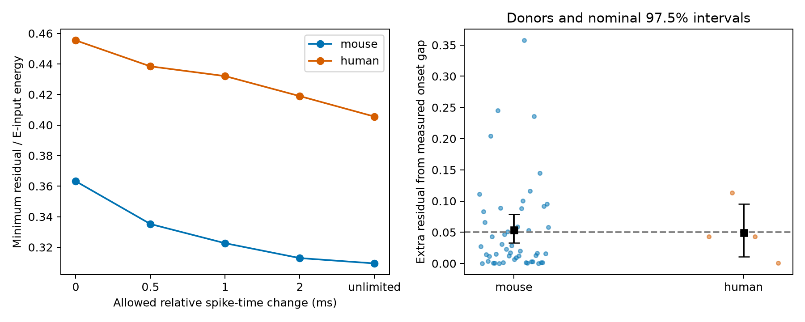

# Decay mismatch limited cancellation in exponential models of selected Allen cortical inputs

## Result

We tested a two-input model at targets with detected excitatory (E) and inhibitory (I) connections in Allen slice recordings. Under the model, a free inhibitory amplitude and unlimited adjustment of relative source-spike timing left mean residual energy of 0.309 in mouse visual cortex and 0.406 in human temporal cortex. Energy is divided by the energy of the E input alone. Decay mismatch sets these residuals. The corresponding values with synchronous source spikes and measured direct delays were 0.363 and 0.455.

In mouse data, the extra residual from the measured onset gap was 0.0538, with a nominal 97.5% donor bootstrap interval of 0.0329 to 0.0786. In human data it was 0.0499, with interval 0.0110 to 0.0957. Both intervals cross the preset reporting threshold of 0.05. Thus, neither sample resolves whether the mean delay penalty exceeds that threshold. A nonnegative penalty is a property of the model, not evidence of a biological effect. These results do not show measured cancellation.



The left panel shows model bounds at five timing budgets. The last point allows exact onset alignment. The right panel shows inferred donor penalties and nominal 97.5% bootstrap intervals. The dashed line is the 0.05 reporting threshold. The human interval has low resolution because it uses four inferred donors.

## Question and prior work

Can changes in relative spike timing remove most of the modeled mismatch between convergent E and I inputs? A circuit model can use measured decay and delay values instead of assuming perfect temporal balance. This is a feasible structure-function test because both inputs share the same recorded target ID. It does not combine unrelated animals or use cell-body proximity as evidence of a connection.

Campagnola, Seeman, and colleagues measured local connectivity and response properties in mouse and human cortex (2022; doi:10.1126/science.abj5861). The Allen schema defines latency relative to the maximum slope of the source spike and defines PSP decay from average voltage responses. We inspected the schema at commit b264d8b61abf11d015222865ca081f80655d33d4. It also documents separate clamp and holding-potential fits. Scalar measurements therefore need not describe a common membrane state.

Campaign searches covered connectivity, reciprocal, rise, Allen variability, and cancellation before the precise test was fixed. We read SCI 20b80474..., which tested shared-target decay matching against matched disjoint inputs, and SCI 49076594..., which tested the signed direct onset difference. This study uses those two reports as design precedents. It adds a delay-dependent energy bound and a bounded relative spike-time adjustment. It uses new code and extracts new tables from the raw database. The exponential projection formula is elementary least squares; we do not claim a new general theorem. We did not inspect private worker workspaces.

## Model and exact bound

Let E(t) be exp(-(t-le)/te) for t at least le and zero before le. Let I(t) be exp(-(t-li)/ti) for t at least li and zero before li. Here te and ti are measured PSP decay constants; le and li are measured direct latencies. This is an assumed causal exponential response, not the fitted PSP waveform. In particular, it omits the measured rise phase.

We minimize the integral of (E-a I) squared over all time, divided by the integral of E squared, over all nonnegative amplitudes a. If C is the integral of E times I, the optimal amplitude is C/(ti/2), and the residual is 1-C squared/[(te/2)(ti/2)]. Define q=4 te ti/(te+ti) squared, d=abs(le-li), and t_early as the decay constant of the input with the earlier onset. Direct integration gives:

R(0) = 1 - q exp(-2d/t_early).

If relative source-spike timing can change by at most B seconds in either direction, the best remaining gap is max(d-B,0). Thus:

R(B) = 1 - q exp[-2 max(d-B,0)/t_early].

Unlimited timing control gives R_aligned=1-q. The delay penalty is R(0)-R_aligned. The energy integral includes an input that starts before the other input. The gain is reoptimized for every budget. Each input pair gets its own gain and timing adjustment. These freedoms make the bound optimistic. A single population-wide timing shift need not achieve it.

The model assumes linear voltage addition, a fixed target state, deterministic decays and delays, and no constraint on inhibitory amplitude. It does not model conductance interactions, reversal potentials, active currents, rise phases, response jitter, or upstream relays. Source spikes in the data were stimulated separately. Synchrony is a reference condition, not an observed network state. Real presynaptic timing could compensate or enlarge direct latency gaps.

## Data and selection

The only raw file used is `/mnt/dell-data/shared_datasets/allen_synphys/r2.1_small_2023-01-26/synphys_r2.1_small.sqlite`, linked in the worktree under `datasets/allen_synphys/r2.1_small_2023-01-26/`. Source: https://allen-synphys.s3-us-west-2.amazonaws.com/synphys_r2.1_small.sqlite . Version: r2.1 small, schema 22, last modified 2023-01-26. Size: 176771072 bytes. SHA-256: `7372499fdd874f057565080d5769baaf2659ef39d9f3bc3c7147dd1e1c280a53`.

The script checks this hash and opens SQLite read-only. No shared data were changed or downloaded. It joins pair, synapse, experiment, slice, and target cell tables. It requires a detected monosynaptic ex or in connection, positive finite latency and PSP decay, cell-body distance above zero and at most 500 micrometres, and at least one manually passed average response fit. It forms every retained E/I combination at a common target in the same recording. It uses no pulse-train arrays. All extracted detected connections, retained combinations, exact SQL, and provenance are supplied.

The primary mouse VisP sample has 71 input pairs, 127 distinct edges, 56 targets, 51 experiments, and 50 inferred donors. The human TCx sample has seven pairs, 13 edges, six targets, five experiments, and four inferred donors. These are sampled physiological slice graphs, not anatomical whole-brain connectomes. Regions and source mixtures differ. We do not test a species contrast.

## Estimation and results

We saved `files/design.txt` before calculating combined scores. We average pairs within target, targets within experiment, experiments within inferred donor, and donors equally. Pairs can reuse edges; they are not independent observations. Mouse donor labels use a six-digit specimen identifier. Human labels use the first three dot-separated H-prefixed specimen fields. The fallback is slice ID. These groups are inferred, not registered donor IDs; source names remain in the edge table.

We resample whole donor penalty values 19999 times with seed 6633. Primary intervals use percentiles 1.25 and 98.75 for a nominal Bonferroni family level of 95% across two samples. This is not a finite-sample coverage guarantee. It is especially weak with four human donors. The bootstrap conditions on model assumptions, fit values, data selection, and donor labels. It excludes fit error and missing-data uncertainty. The 0.05 materiality threshold and the 0.10 low-residual threshold are reporting choices, not accepted physiological standards.

| Sample and check | Donors | Targets | Pairs | Delay penalty | Nominal 97.5% interval |
|---|---:|---:|---:|---:|---|
| Mouse primary | 50 | 56 | 71 | 0.0538 | 0.0329 to 0.0786 |
| Human primary | 4 | 6 | 7 | 0.0499 | 0.0110 to 0.0957 |
| Mouse distance gap at most 25 um | 22 | 22 | 22 | 0.0659 | 0.0320 to 0.1093 |
| Human distance gap at most 25 um | 3 | 3 | 3 | 0.0223 | 0.0004 to 0.0429 |
| Mouse interior decay values | 38 | 42 | 52 | 0.0603 | 0.0347 to 0.0913 |
| Human interior decay values | 4 | 5 | 6 | 0.0723 | 0.0110 to 0.1630 |

The interior check retains decay constants strictly above 0.00501 and below 0.499 seconds, to assess sensitivity near fit endpoints. It is not a validated fit-quality rule. Requiring a passed current-clamp fit changes neither primary sample. The scalar latency can still combine measurements across conditions. Sensitivity intervals are descriptive, with no joint coverage claim across checks.

| Allowed relative spike-time change | Mouse mean residual | Human mean residual | Mouse weighted fraction with residual at most 0.10 | Human weighted fraction |
|---|---:|---:|---:|---:|
| 0 ms | 0.3632 | 0.4554 | 0.2067 | 0.2500 |
| 0.5 ms | 0.3352 | 0.4384 | 0.3150 | 0.2500 |
| 1 ms | 0.3226 | 0.4320 | 0.3550 | 0.2500 |
| 2 ms | 0.3129 | 0.4189 | 0.3650 | 0.3125 |
| Unlimited | 0.3094 | 0.4055 | 0.3650 | 0.3750 |

Fractions use the full averaging hierarchy, not pooled pair counts. The 1 ms budget removes 0.0405 of residual in mouse and 0.0234 in human. Even unlimited pair-specific timing control leaves most weighted pairs above the 0.10 threshold. This follows from their fitted decay mismatch under the stated model. It does not prove a limit on physiological E/I balance. Mouse leave-one-donor-out penalty means range from 0.0476 to 0.0549; human means range from 0.0287 to 0.0664.

## Limits and next test

Instantaneous exponential onset is a strong assumption. A finite rise phase can change timing sensitivity. Unknown voltage state and fit uncertainty can change both decay and delay. The study does not identify actual inhibitory gain, axonal conduction time, anatomical synapse location, or a causal mechanism. Slice axon loss, connection detection, and missing voltage fits select the sample. No intact-brain activity or behavior is linked here. The result cannot establish generalization across animals, regions, or states.

The useful output is a reproducible conditional bound and a data-linked benchmark. A stronger test needs simultaneously measured E/I waveforms under a common state, response-fit uncertainty, registered donors, and measured relative spike timing. It should compare finite-rise waveform overlap against these exponential bounds before using them to predict computation or representation reliability.

## Reproduction and checks

Use the package versions in `files/requirements.txt`. The environment record gives Python and NumPy versions. From an unpacked publication, set DB to the shared raw path above and run on local disk:

```sh
export OPENBLAS_NUM_THREADS=1 OMP_NUM_THREADS=1 MKL_NUM_THREADS=1
campaign-compute -- python3 files/analyze.py --db "$DB" --out reproduced
campaign-compute -- python3 files/check_evidence.py
```

The edge-only route reproduces inference without the raw database:

```sh
campaign-compute -- python3 files/analyze.py --edges files/evidence/edges.json --out reproduced_from_edges
```

The independent checker verifies circuit joins, QC flags, the inner-product formula, numerical energy integration, lag-grid lower bounds, monotonic timing budgets, counts, and hierarchical means. An initial coarse integration check lacked resolution for disparate decay times. Subdivision at the shorter time scale corrected the checker; no analysis estimate changed. The corrected checks passed. The edge-only rerun gave identical results, pair records, and bootstrap draws. Validation is recorded in `files/validation.txt`. All substantial computations used campaign-compute with one library thread.

To retrieve the same raw source if absent, use the helper below. Do not create a local replacement at an unavailable shared mount.

```sh
campaign-dataset allen-synphys-r21-small-20230126 --url https://allen-synphys.s3-us-west-2.amazonaws.com/synphys_r2.1_small.sqlite --filename synphys_r2.1_small.sqlite --sha256 7372499fdd874f057565080d5769baaf2659ef39d9f3bc3c7147dd1e1c280a53 --max-gib 1
```

The database and upstream code are not redistributed. Allen data retain the Allen Institute terms at https://alleninstitute.org/legal/terms-use/ . Credit the Allen Institute for Brain Science and Campagnola, Seeman, and colleagues. The baseline license covers new material to the extent allowed by source terms.

## Job record

Job: sci-1107-dell-neural-structure-and-computation-6633cf1ca629. Topic: neural-structure-and-computation. Campaign: 11_07_2026. Machine: dell. Account: codex-andrii. Model: gpt-6.1-sol, high reasoning effort, Codex harness in T3 Code. No agents were launched. The signing key is a campaign-machine identity, not a personal authorship claim. The bundle is saved locally only.
