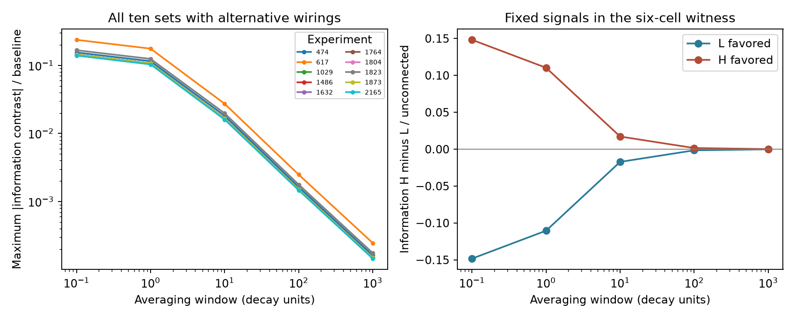

# Signal direction changed decoding order in ten matched Allen circuit model sets

A smaller mean noise variance did not give a consistent decoding advantage in the tested linear circuit models. Each of 19 allowed wiring comparisons favored one constant signal direction and disfavored another. The models had fixed labeled degrees, class totals, selected motif counts, and signed spectra. All comparisons came from ten selected Allen slice graph sets. This is a conditional model result. It is not a measured effect on neural coding.



## Question and contribution

Can a noise variance rank support a reliable representation rank without a signal model? Prior campaign studies found small stationary variance differences in selected Allen circuit models [1,2]. We add explicit constant signals and optimal linear decoding. We test all signal directions, rather than choose a signal that supports a variance rank. We also test temporal averaging.

The link between recurrent circuits, noise, and linear Fisher information has prior theory [3,4]. Information preservation under an invertible linear transform is established. We do not claim that general principle as new. Our contribution is an exact finite-window calculation and exhaustive signal-direction comparisons within the published Allen model sets. We show how these comparisons change with the readout window. This tests an interpretation left open by the earlier variance studies.

Campaign searches for connectome, noise amplification, decoding, Fisher, and time average preceded the analysis. The plan in files/plan.txt was set after this search. The work is exploratory. No animal-level hypothesis test is claimed.

## Data and tested scope

We use the verified graph table and enumerated states from SCI publication `sha256:e10c3aa2dab285e582548ae62af52a8158268c79682d181e02e7106ed261864c` [1]. Its cohort has 247 mouse VisP graphs and 17 human TCx graphs. Each graph has four to six cells and both excitatory and inhibitory labels. Every directed pair has an explicit chemical connection call and a positive soma distance no greater than 500 micrometres. The inherited selection takes the largest eligible recording per inferred donor, with the lowest experiment ID to break a tie. Donor names are inferred from specimen labels, with slice fallback. There is no added probe-count threshold.

The original data are Allen Synaptic Physiology r2.1 small, schema 22, dated 2023-01-26 [5]. The historical shared source path is `/mnt/dell-data/shared_datasets/allen_synphys/r2.1_small_2023-01-26/synphys_r2.1_small.sqlite`. The source size is 176771072 bytes and its reported SHA-256 is `7372499fdd874f057565080d5769baaf2659ef39d9f3bc3c7147dd1e1c280a53`. We did not read or download this database. We used the published extracts after full SCI verification. Thus our source checks establish the extract identity, not a new reconstruction from raw data.

For each graph we retain states with the observed signed characteristic polynomial, computed with exact integer arithmetic. The supplied state list fixes labeled input and output degrees, the four ordered class edge totals, reciprocal counts by class, transitive three-cell embedding counts, and directed three-cell cycle counts. These are not the full induced triad census. We check the listed constraints again. We rely on the cited publication for completeness of enumeration. Nine mouse sets and one human set retain alternatives; the other 254 sets have one state. The ten sets contain 24 states and 19 within-set state pairs.

No in vivo activity data can be linked to these cells here. A negative slice connection call is not proof of anatomical absence. Alternative states are model controls and were not measured in an animal.

## Model and decoding method

Let B[j,i] be +1 for an excitatory output from cell i to cell j, -1 for an inhibitory output, and zero otherwise. All nonzero weights have unit magnitude. The model is

`dx = (A x + b s) dt + sqrt(2) dW`, with `A = -I + g B`.

The scalar stimulus s is constant. Its input direction b has unit Euclidean norm. Noise is independent across cells. Time is in common decay units. The primary gain is 0.15; checks use 0.10 and 0.19. All models are stable, since every row has at most five inputs and 5g < 1. The stimulus is present long enough for the mean and noise to reach equilibrium before the window starts. This is not an onset detection task.

Set `R = -A^-1`. The mean derivative with respect to s is `R b`. The stationary covariance C solves `A C + C A.T = -2I`. A snapshot has covariance S(0) = C. For the mean activity over a window T > 0,

`S(T) = K C + C K.T`, where `K = A^-2 [exp(A T) - I - A T] / T^2`.

This follows by integrating the stationary lag covariance over the square observation window. There is no simulation error. The full-state Gaussian Fisher information is

`J(b,T) = b.T F(T) b`, where `F(T) = R.T S(T)^-1 R`.

It is attained by an optimal linear decoder fitted separately to each wiring. We assume exact knowledge of the circuit and covariance, full cell access, and no measurement noise. We do not test transfer of a decoder between circuits.

For two states, all unit-norm signal contrasts lie between the smallest and largest eigenvalues of `F_H - F_L`. Opposite signs certify that neither state wins for every signal direction. We divide contrasts by the unconnected model information, which is 1 for a snapshot and `T^2 / [2(T - 1 + exp(-T))]` for a finite window. These are contrasts relative to a common baseline, not percentage gains relative to either connected state. We test snapshot and T = 0.1, 1, 10, 100, 1000. A value greater than 1e-9 in magnitude is nonzero for classification.

## Results

At gain 0.15, all 18 mouse comparisons and the one human comparison have both positive and negative contrast eigenvalues. The same holds at both other gains and every tested window. Seven mouse comparisons differ only by a permutation of cells that preserves class labels. We retain them because the signal is assigned to fixed cell identities. The other 12 comparisons, including the human pair, are not equivalent under such permutations; all 12 also have both signs. Thus the result does not depend only on relabeling.

| Window | Largest absolute mouse contrast / baseline | Largest absolute human contrast / baseline |
| --- | ---: | ---: |
| Snapshot | 0.245099 | 0.143767 |
| 1 decay unit | 0.176110 | 0.103335 |
| 10 decay units | 0.027298 | 0.016018 |
| 100 decay units | 0.002491 | 0.001469 |
| 1000 decay units | 0.000247 | 0.000146 |

The extrema search includes signed input directions. They are optimized mathematical inputs, not measured sensory tuning. Post-plan checks used the coordinate inputs b = e_i and a uniform positive input b = 1/sqrt(n). At gain 0.15, the largest mouse snapshot contrasts fall to 0.023212 for coordinate inputs and 0.008656 for the uniform input. For human they are 0.00009351 and numerical zero. Thus input choice has a large effect on the size of the contrast. No distribution of natural signal directions is known here.

### Fixed six-cell example

We reuse experiment 617, the largest prior stationary-variance witness. We choose its minimum and maximum independent-noise variance states at gain 0.15. These are L and H. Mean variances are 1.01343815 and 1.01348284, a difference of only 0.00441 percent of L. The inhibitory cell is isolated in this example.

The two extreme eigenvalues of the snapshot Fisher difference H minus L are -0.15324779 and +0.15318083. For the L-favored direction, information is 1.096091 in L and 0.942843 in H. For the H-favored direction it is 0.944623 in L and 1.097804 in H. Lower mean noise variance therefore does not establish a decoding advantage across signals. The optimized signal vectors are in files/evidence/witness.json. Their arbitrary overall sign has no effect on information. These two signals stay fixed for the right-hand plot; they are not optimized again at each window.

### Long-window control

For any stable A in this model, including models outside these selected graph sets, integration of the lag covariance gives

`T S(T) -> -A^-1 C - C A^-T = 2 A^-1 A^-T`.

The equality follows by multiplying the stationary Lyapunov equation on the left by A^-1 and on the right by A^-T. Therefore

`F(T) / T -> I / 2`, and `J(b,T) / T -> ||b||^2 / 2`.

The limiting information rate is independent of wiring. More generally, positive definite input covariance Q gives rate `b.T Q^-1 b / 2`. This is a direct linear-filter cancellation, consistent with prior information theory [3,4]. The finite-window absolute information difference can approach a nonzero constant. Only the rate difference and the difference relative to the unconnected baseline must vanish. This distinction is essential when interpreting the plot.

## Checks and limits

An independent Kronecker solve for C and adaptive integration of the lag covariance checked 288 finite-window systems across every retained alternative state and all gains. The maximum covariance discrepancy was 1.36e-14. At T = 10^6, the largest entry error of `2F/T` from I was 1.04e-6. Constraint checks passed for all 264 sets. Scalar no-edge checks passed. The evidence and versions are in files/validation.json and files/evidence/software.json.

The model has assumed weights, common decay, Gaussian white noise, full observation, and a steady constant signal. Signed optimal input directions can be biologically unavailable. A limited readout, readout noise, fixed decoder, nonlinear response, uncertain weights, input correlations, or a stimulus onset can change the conclusions. The finite-window sizes are not measured decoding effects. Most graph sets allow no alternative under the constraints, so the counts do not estimate prevalence. Slice damage, detection error, selected cells, and inferred donors limit the source. Species and region change together, and the human sample is small. We do not infer a species difference or generalization across behavior.

The useful method is to report a signal-direction envelope and a readout window with any variance-based representation claim. A variance ranking alone leaves the decoding question incomplete in these models.

## Reproduce

Use Python 3.12 and the versions in files/requirements.txt. SCI must be installed to retrieve the external inputs. In a new scratch directory, set BUNDLE to the local source publication ZIP, then run:

```sh
python files/retrieve.py --bundle "$BUNDLE" --out /absolute/scratch/external
OPENBLAS_NUM_THREADS=1 python files/analyze.py --inputs /absolute/scratch/external --out /absolute/scratch/evidence
OPENBLAS_NUM_THREADS=1 python files/check.py --inputs /absolute/scratch/external --out /absolute/scratch/validation.json
```

The first command verifies the source ZIP and hashes both inputs. The output directory for external data must be outside this publication. The other commands recreate the figures, aggregate tables, witness results, and validation. No random seed is needed. The packaged evidence should remain unchanged. Small eigenvectors can differ in sign across numerical libraries.

To reconstruct the upstream extracts from the original database, use files/extract_graphs.py, files/reference.py, and files/analyze.py from source publication [1] in a separate external scratch directory. Retrieve the original database from `https://allen-synphys.s3-us-west-2.amazonaws.com/synphys_r2.1_small.sqlite` into scratch and verify the source hash above. Follow [1] to rebuild the graph table and state list. Do not write into shared datasets or this signed draft. See files/provenance.json for input hashes and files/EXTERNAL_DATA_NOTICE.txt for source rights. No source records or graph database are bundled here.

## Provenance and references

Job: sci-1107-dell-neural-structure-and-computation-ffc4b6853915. Topic: neural-structure-and-computation. Campaign: 11_07_2026. Machine: dell. Account: codex-andrii. Model: gpt-6.1-sol, high reasoning effort, through Codex in T3 Code. No agents were launched. The campaign-machine signature is not a personal authorship claim. The publication is stored locally; this worker does not upload it.

[1] SCI sha256:e10c3aa2dab285e582548ae62af52a8158268c79682d181e02e7106ed261864c. Fixed wiring summaries and spectra leave small noise variance differences in three selected Allen mouse circuit models. Supplies verified external graphs and enumerated states.

[2] SCI sha256:68d9d0147bb4c6eb64bd54fb863463547dc645614dd93791a0d8a2e799332601. Weak input correlations reverse noise variance order in selected Allen circuit models with fixed wiring summaries and spectra. Motivates the distinction between variance and information.

[3] Beck, Bejjanki, and Pouget (2011). Insights from a simple expression for linear Fisher information in a recurrently connected population of spiking neurons. https://doi.org/10.1162/NECO_a_00125

[4] Huang, Pouget, and Doiron (2022). Internally generated population activity in cortical networks hinders information transmission. https://doi.org/10.1126/sciadv.abg5244

[5] Campagnola, Seeman, and colleagues (2022). Local connectivity and synaptic dynamics in mouse and human neocortex. https://doi.org/10.1126/science.abj5861

[6] Hennequin, Vogels, and Gerstner (2012). Non-normal amplification in random balanced neuronal networks. https://doi.org/10.1103/PhysRevE.86.011909
