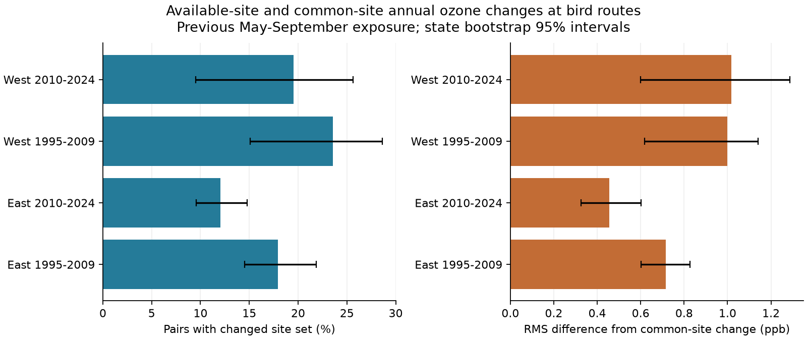

# Changes in available ozone sites altered annual exposure estimates at US bird routes in 1995-2024

We compared two ways to measure annual ozone change at repeated bird surveys. One uses all available sites within 50 km of a route start. The other uses only sites with data in both years. The site set changed in 12.1-23.5% of pairs across four region and period samples. Root mean square (RMS) differences between the two annual changes were 0.45-1.02 parts per billion (ppb). The same-site method had support for 99.55% of the selected pairs. These results show a measurable dependence on site availability. They do not show which exposure measure is closer to the true exposure of birds.



## Question and prior work

Can changes in the available ozone sites alter annual exposure contrasts at bird survey routes? This is a useful check before a test of pollution and weather effects on biodiversity. Ozone can vary with weather. A change in its estimated value can also reflect a change in measurement sites. This study separates these two exposure calculations. It does not test ozone damage or a climate effect.

Liang et al. reported bird conservation benefits from limits on ozone precursor emissions with eBird data ([2020 study](https://doi.org/10.1073/pnas.2013568117)). A prior campaign publication built a national Breeding Bird Survey (BBS) panel with seasonal ozone and weather. We reuse that verified panel, not its ecological models. Its publication ID is `sha256:2603c41c0fe979d3cf70d08c3bdfb1b052386c2cee04f2e9e054d5c5fa10d6a2`.

A separate campaign audit found 28 changes in the nearest selected ozone site in a four-state survey sample. No change had enough data for a full two-site comparison (SCI `sha256:37e77b48e8b865be7b1bd5ca169648d7e9191f12817d3433f6371cdc1fa4ef50`). Our question is related but distinct. We test a multi-site seasonal average across the lower 48 US states. A common-site estimate needs at least one shared site, rather than data for every site in both years. We do not treat the different samples as independent biological validation. Their raw sources overlap.

We searched the signed campaign for phenology, climate, pollution, birds, ozone, monitor composition and annual ozone. We also searched public prior work and read EPA data definitions. The plan in `files/plan.txt` was fixed before the new result calculations. This study was not externally registered. All planned results are reported.

## Data and scope

Direct inputs are the national parent's `panel.csv.gz` and `ozone_monitor_windows.csv.gz`. We verified its complete bundle before extraction. Both files are included under `files/source/`. They contain 74,446 bird survey rows and 75,725 ozone site-window rows before the new filters. The parent panel uses standard accepted BBS runs in the lower 48 states. Its code and README describe its bird and exposure filters. We include the relevant exposure code and its raw retrieval script.

The underlying bird source is the USGS BBS 2025 release for 1966-2024, ScienceBase item `691cfb53d4be021d1d89b482`. The ozone source is the EPA AQS daily ozone archive for 1994-2024. The parent selected daily maximum 8-hour values under the 2015 standard, retained non-excluded event summaries, and averaged instruments at each site and date. It then took seasonal site means. See [EPA file definitions](https://aqs.epa.gov/aqsweb/airdata/FileFormats.html). Multiple pollutant standards must not be counted as separate readings.

We read the shared raw route file to retain coordinate precision. Its exact logical path is `/mnt/dell-data/shared_datasets/usgs-bbs-2025-routes/Routes.csv`. Its SHA-256 is `baeee8510dc811d68891bc3fa14c47f8ea21565fe6f6c48e7029e4f4bff24556`. It is the same 2025 release used by the parent. Its source URL and resolved shared path are in `files/provenance.json`. `files/source/route_coordinates.csv` preserves the coordinates used here. The raw CSV has non-UTF-8 route names; the coordinate extraction uses Latin-1 input decoding. No shared data were changed.

The direct-input hashes are in `files/provenance.json`. The inherited raw URLs, versions and hashes are in `files/source/provenance.json`. Those inherited hashes are records from the signed parent; we did not reread its raw daily ozone or bird count archives. No new data were downloaded. The package supports offline reproduction from the direct inputs.

## Method

We pair surveys in consecutive years with the same route and observer. Both surveys must have a finite previous-season ozone estimate in the parent panel. East is longitude greater than -100 degrees. West is longitude at or below -100 degrees. Survey periods are 1995-2009 and 2010-2024. We do not pair across the period boundary. Missing survey years are not bridged. A survey can occur in two pairs. Routes, observers and sites can recur across periods.

For a bird survey in year t, exposure is mean ozone in May-September of year t-1. Thus, a pair of bird surveys ending in year t compares ozone in years t-2 and t-1. The title uses bird survey years; the full ozone comparison spans 1994-2023. At least 75% of the 153 nominal season days must be present at each site. This is a study filter, not an EPA regulatory design-value calculation.

We use all sites within 50 km of the route start. Site coordinates are the first coordinates for that site in the parent site table, as in the parent join. Weights are inverse distance, with a 1 km lower bound on distance. The route coordinates and site coordinates are fixed across years. This does not audit historical site or route movement.

Let E0 and E1 be the inverse-distance means using each year's eligible sites. The available-site annual change is A = E1 - E0. Let K be the intersection of the two site sets. Recompute each year using only K, with the same fixed distance weights. Their difference is C, the common-site annual change. The diagnostic difference is D = A - C. If K is empty, C and D are not defined. We report those pairs separately. If the site sets are equal, D must be zero.

D measures dependence on the site set relative to the common-site calculation. It is not a pure causal effect of network change. The common sites can sample a different part of the local ozone field. Their daily data can also be missing on different dates. A change in eligibility can result from missing days, the coverage filter, site codes or network changes. We do not determine which cause applies.

We report the changed-set percentage among all eligible pairs. RMS(D), the count with |D| at least 2 ppb, and the sign check use pairs with common-site support. The sign check requires A and C to have opposite signs and each to have magnitude at least 1 ppb. This avoids counting tiny sign changes. The thresholds are diagnostic choices, not bird toxicity limits. RMS is the square root of the mean squared value; the ratio of RMS values is not a share of variance explained.

Sensitivity analyses use a 25 km radius or at least 90% season coverage. Each uses the same parent candidate pairs, then requires both new available-site estimates. Sample sizes change. These checks do not represent a randomized intervention.

For the changed-set percentage and RMS(D), we give state-block bootstrap 95% percentile intervals, with 2,000 draws and seed 11072026. A state brings all its pairs. This addresses repeated records within a state but not shared ozone and weather across state borders, selection, or all spatial dependence. The West has only 15-16 state blocks. Intervals are approximate. We do not test regional differences, and no causal inference depends on an interval excluding zero.

## Results

| Sample | Pairs | Changed site set | No common site | RMS A, ppb | RMS D, ppb (95% interval) | Pairs with absolute D at least 2 ppb | Opposite signs, both at least 1 ppb |
|---|---:|---:|---:|---:|---|---:|---:|
| East 1995-2009 | 12,137 | 17.9% | 65 | 4.73 | 0.715 (0.601-0.826) | 296 (2.45%) | 33 |
| East 2010-2024 | 11,034 | 12.1% | 37 | 3.64 | 0.455 (0.326-0.601) | 86 (0.78%) | 4 |
| West 1995-2009 | 2,561 | 23.5% | 18 | 3.98 | 1.000 (0.619-1.140) | 135 (5.31%) | 15 |
| West 2010-2024 | 3,223 | 19.5% | 11 | 3.66 | 1.018 (0.601-1.286) | 100 (3.11%) | 17 |

There were 28,955 pairs in total. Site sets changed in 4,740 pairs. Of these, 131 had no common site. The common-site estimate was defined for 28,824 pairs, or 99.55% of all selected pairs. In 617 supported pairs, |D| was at least 2 ppb. There were 69 sign changes under the magnitude rule. Stable site sets accounted for 24,215 pairs and gave D = 0, as required by the calculation.

Among changed-set pairs with common-site support, RMS(D) was 1.71, 1.33, 2.08 and 2.32 ppb in table order. The fraction with |D| at least 2 ppb was 14.0%, 6.6%, 23.1% and 16.2%. The largest absolute differences in the four samples were 13.27, 17.72, 12.10 and 18.17 ppb. These are exposure diagnostics, not large estimated biological effects. A small group of records can have large ecological model influence, which was not measured here.

| Check | East early: n; RMS D | East late: n; RMS D | West early: n; RMS D | West late: n; RMS D |
|---|---|---|---|---|
| 50 km, 75% days | 12,137; 0.715 | 11,034; 0.455 | 2,561; 1.000 | 3,223; 1.018 |
| 25 km, 75% days | 5,402; 0.736 | 5,085; 0.362 | 1,087; 1.094 | 1,373; 0.604 |
| 50 km, 90% days | 11,710; 0.813 | 10,717; 0.580 | 2,341; 1.243 | 3,015; 1.165 |

RMS values use the supported subset in each cell. Narrowing the radius reduced sample size and changed-set frequency, but did not remove the discrepancy. Raising the coverage requirement increased the changed-set percentage to 21.8-30.4%. A stricter day filter can itself change the site set. This does not establish that lower coverage is better: coverage and spatial stability are different measurement properties. All sensitivity counts, intervals and sign checks are in `files/results/summary.csv`.

The nonzero discrepancies occur in both regions and both periods. This is repeat evidence for an exposure measurement issue. Shared sources, recurring routes, nearby sites and broad weather prevent a claim of four independent tests of a biological mechanism.

## Limits and use

The result applies to selected accepted roadside surveys with nearby ozone sites and repeated observers. It does not apply to all habitat. The parent already excludes surveys without ozone coverage. Our support fraction is conditional on that selected sample, not national exposure coverage.

Neither A nor C is ground truth. The route start can be far from the rest of a roughly 40 km bird route. A fixed site can change instruments, coordinates or methods. The seasonal means do not measure inhaled dose or peak episodes. Missing days and seasonal ozone variation can enter C and D. We did not rebuild or audit the raw daily summaries. Parent rounding is retained. The largest difference between our reconstructed exposures and the saved parent exposures was 0.0005 ppb, consistent with its output rounding.

Keeping observer identity fixed reduces one source of bird observation change. It does not control detection, survey timing, habitat change or pollution error. We fit no bird-response model. We therefore do not establish bias in an ecological slope, harm to birds, changes in species distributions, an extreme-weather effect, or long-term climate damage. We also do not estimate how D depends on temperature. The method is useful before those tests: report both available-site and common-site exposure changes, and report the records without common support. An automatic correction is not justified by this audit.

## Reproduction and checks

From an extracted bundle, use Python 3.12 with `files/requirements.txt`:

```sh
python3 files/analyze.py /tmp/ozone-site-audit
python3 files/validate.py /tmp/ozone-site-audit
```

The analysis reads only included source files. It writes pair evidence, site evidence, all summary results, checks and a static PNG to the output directory. Do not use the signed bundle as the output directory. `validate.py` writes its check record to the output directory. The original check record is included as `files/validation.json`.

An independent standard-library implementation reconstructed the primary selection by route-year lookup and recomputed all 28,955 annual contrasts from saved site evidence. Its maximum arithmetic difference was below 6e-11 ppb. Stable sets gave zero discrepancy. A second full run reproduced all five analysis output files byte for byte. These checks verify arithmetic and data flow, not exposure validity or causal assumptions.

`files/source/fetch_data.sh` records the parent's raw URLs. `files/source/provenance.json` records their expected hashes. Full upstream panel reconstruction is in the cited parent publication. For the one shared raw file read here, `files/extract_coordinates.py RAW_ROUTES_CSV OUTPUT_CSV` checks the exact hash and extracts the retained coordinates. No raw store scan is needed.

## Job and rights

Job: `sci-1107-dell-climate-pollution-biodiversity-f0cadd3d26de`. Topic: `climate-pollution-biodiversity`. Campaign: `11_07_2026`. Machine: `dell`. Account: `codex-andrii`. Model: `gpt-6.1-sol`, high reasoning effort, through the Codex harness in T3 Code. No child agents were used. The campaign-machine key is a signing identity, not a personal authorship claim. No private key is included. This publication is saved locally only. The SCI baseline license applies subject to source rights and attribution.
