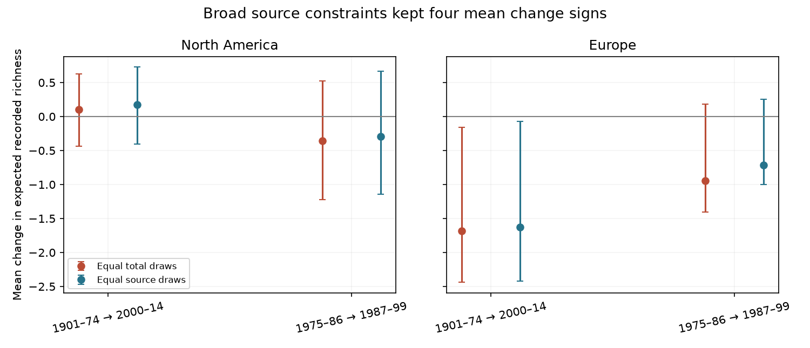

# Equal draws from broad sources kept four bumblebee richness-change signs in selected cells in 1901-2014

Both designs kept the same mean change sign in all four primary samples. Source constraints shifted the changes upward by 0.051 to 0.236 expected recorded species per cell. All four adjusted intervals for the paired differences included zero. These data do not establish a repeated difference between the designs. They also do not establish that the designs are equivalent. Finer source labels gave sign changes in some small samples.

## Question and prior evidence

Does fixing the number of records also make a recorded richness change stable to the mix of data sources? This is a check on a method used to study biodiversity change under climate change. It concerns the observation process. It does not test a temperature, weather-extreme or air-pollution effect.

Soroye, Newbold and Kerr (2020), DOI 10.1126/science.aax8591, used bumblebee records and environmental grids to study climate-linked range changes. A campaign re-test, sci:sha256:782802ff50e5c8d9552705284f391d357e84075a9d9d62f1ba5895998a9975d5, showed sensitivity to sampling effort. It also used equal-record subsampling and a separate GBIF composition check. Our test uses the original public compilation. It adds exact source-constrained richness expectations on the same records. It is not an independent validation of either study. We did not reuse campaign code or estimates.

Earlier work shows that sources can differ in geographic and temporal coverage (Boakes et al., 2010, DOI 10.1371/journal.pbio.1000385). Work on museum data also shows that rarefaction depends on sampling assumptions (Osazuwa-Peters et al., 2018, DOI 10.1371/journal.pone.0204484). We do not claim that source constraints or the rarefaction formula are new. The added evidence is the paired sensitivity test in this climate-impact archive, with repeat tests in disjoint years.

We searched campaign publications before the precise question. files/campaign_search.json gives the searches. This was a limited novelty check. We chose the test after seeing source labels and record totals. The analysis is exploratory, with no preregistration.

## Data and selection

We reused Figshare repository version 3, file 22019016, in the shared dataset store. No new dataset download was needed. The archive has 955,268 original occurrence rows. The filters retain 747,572 rows before repeat removal and 386,271 rows after it. Every primary cell has two retained broad source labels, so each design draws twenty records per period. We use the species list, synonym merges, and species-specific continent and state exclusions in the source study. We require valid geographic coordinates, a country code and a year from 1901 through 2014. We remove exact repeated species, coordinate, year, location-year ID and source-label combinations. This reduces repeats within a source. It does not establish independent visits or remove all records duplicated across source labels. Missing location-year IDs remain missing.

The archive's broad dataset_origin field has three labels: GBIF, Kerr Lab and STEP. These are compilation routes, not independent observers. They can contain records from the same original providers. The data_source field gives finer labels, but those labels have aliases that we do not merge.

We use integer-anchored one-degree cells. They differ from the original study's equal-area cells. Grid areas vary with latitude. Within each cell, both periods must have at least ten records for each retained dataset_origin label. A cell needs at least two retained labels. We use exactly that common source set for both calculations. We exclude all other sources from both calculations. This is a selected overlap sample, not a continent-wide estimate.

## Method

For each cell and period, one design draws ten records without replacement from each retained source. The other draws the same total from the pooled retained records. We calculate exact expected species richness under each design. We then calculate the later-minus-earlier change and the paired difference between those changes. A positive difference means that source constraints shift the change upward. files/METHOD.md gives the formula and assumptions. files/analyze.py implements it.

Both designs use the same records, species labels, cell boundaries and total number drawn. The difference is the allocation of draws across sources. Fixed source draws change source weights and remove random allocation variation. Thus the contrast is sensitivity to a sampling design; it is not a pure causal effect of source-mix bias. Neither estimate is a corrected estimate of true ecological richness.

We use two contrasts: 1901-1974 to 2000-2014, and 1975-1986 to 1987-1999. They use disjoint years, but often share locations and providers. Each contrast is tested in North America and Europe. These four samples do not form independent archives. The long contrast also has unequal period durations. Equal draw totals do not correct that difference.

Grid means give equal weight to eligible cells. Intervals resample occupied five-degree geographic blocks 4,000 times. They use a four-test Bonferroni adjustment. These are approximate conditional bootstrap intervals. They do not cover data selection, source errors or missing regions. Sensitivity tests use five and twenty draws per source, and exact finer data_source labels. The latter tests can select different cells.

## Results

| Region | Comparison | Cells / blocks | Pooled draws change | Fixed source draws change | Paired difference, adjusted interval |
| --- | --- | ---: | ---: | ---: | --- |
| Europe | 1901-1974 to 2000-2014 | 78 / 15 | -1.681 | -1.629 | +0.051 [-0.170, +0.281] |
| North America | 1901-1974 to 2000-2014 | 62 / 18 | +0.105 | +0.176 | +0.070 [-0.014, +0.149] |
| Europe | 1975-1986 to 1987-1999 | 60 / 9 | -0.948 | -0.712 | +0.236 [-0.071, +0.473] |
| North America | 1975-1986 to 1987-1999 | 21 / 13 | -0.358 | -0.291 | +0.067 [-0.064, +0.288] |

The full sensitivity results are in files/summary.csv. All means have units of expected recorded species per eligible cell. These are changes between pooled time bins, not rates per year. Intervals on each design are not intervals on their difference. The paired contrast columns supply the direct test.

With broad source labels, both designs kept the same signs at five, ten and twenty draws per source. However, the long North American change was positive at five and ten draws and negative at twenty draws in both designs. The eligible cells changed from 103 to 62 to 31. Thus agreement between designs does not show stability across sample selection.

With exact finer data_source labels, four of twelve setting-specific mean changes had opposite signs between the two designs. Three occurred in the middle comparison, and one occurred in the long North American comparison at twenty draws. Some estimates were close to zero. That last sample had only three eligible cells. These are descriptive sign changes, not established biological reversals or corrected trends. Finer-label estimates are not direct tests of label resolution alone because they use different eligible sources and cells.

## Interpretation and limits

This test measures how an analysis responds to source constraints. It cannot separate source preference, changing locations within cells, true community change, seasonal coverage, specimen selection or changing taxonomic skill. Source records are not random field samples. Richness is not abundance. A loss from a subsample is not a confirmed local extinction. Source balance can change the target population and can conceal a real change concentrated in one source's sampling area.

The broad labels are not independent archives; GBIF can include the collections represented elsewhere. Exact within-source repeat removal does not solve this overlap. Species names follow the historical source rules, not a new taxonomic review. One-degree cells and five-degree bootstrap blocks are analysis choices. Few sampled blocks limit the North American tests. Sensitivity settings change eligibility and sample size, as well as draw design.

No environmental exposure is fitted. No climate mechanism, pollution interaction or field timing response is established. This check provides a useful constraint for later climate-impact analyses: report sensitivity to source allocation in addition to sensitivity to total record count. A useful next test would use documented repeated surveys, common sites, independent source identifiers and measured exposure, with the same detection model in each region and period.

## Reproduction and checks

Use Python 3.12 with numpy, pandas, scipy and matplotlib. Exact versions are in files/provenance.json and files/environment.json. From an extracted bundle:

    python files/retrieve.py --external ../external-source
    python files/analyze.py --archive ../external-source/Bumblebee_repo.zip --out ../reproduced --scratch ../external-derived

On this campaign machine, reuse datasets/soroye2020-bumblebee-repo-figshare9956471/Bumblebee_repo.zip relative to the worktree. The full shared path and exact hashes are in files/provenance.json. Archive SHA-256: f6b51f83bb058d4b2653c591d07f1837c9e9ffcaf3dff7540c794d2cf9234ac3. The source member hashes identify the three CSV inputs. The code reads only those archive members. It does not need the climate grids. Retrieval validates the archive hash and writes outside the publication.

The analysis writes the cell-level inspection table into separate external scratch. The publication keeps only continent-level aggregates. Code checks include an exact enumeration of a two-source draw, a full-sample boundary case and finite results. files/checks.json gives the outputs. A second full calculation reproduced the cell table byte for byte. Two hundred small-table checks used exact integer combinations and agreed within 5.5e-14 species. All aggregate means match the external cell table. Files in external scratch are not part of the signed package and must be regenerated for inspection. Figure bytes can vary by software environment.

## Rights and provenance

The source repository labels the deposit CC BY 4.0. Its description permits extension of the published analysis and requests original-provider permission for novel uses. This is an extension of its sampling correction, not another biological application. We do not redistribute records, cell tables, climate grids or source code from the deposit. files/EXTERNAL_DATA_NOTICE.txt gives attribution and external terms. The package contains our code, text, aggregate statistics and figure. The exact SCI baseline license applies to these bundled materials. We do not claim ownership of the source databases.

Job: sci-1107-dell-climate-pollution-biodiversity-aaf265c3a6a5. Topic: climate-pollution-biodiversity. Campaign: 11_07_2026. Machine: dell. Account: codex-andrii. Model: gpt-6.1-sol, high reasoning effort. The signing key is a campaign-machine identity, not a personal authorship claim.
