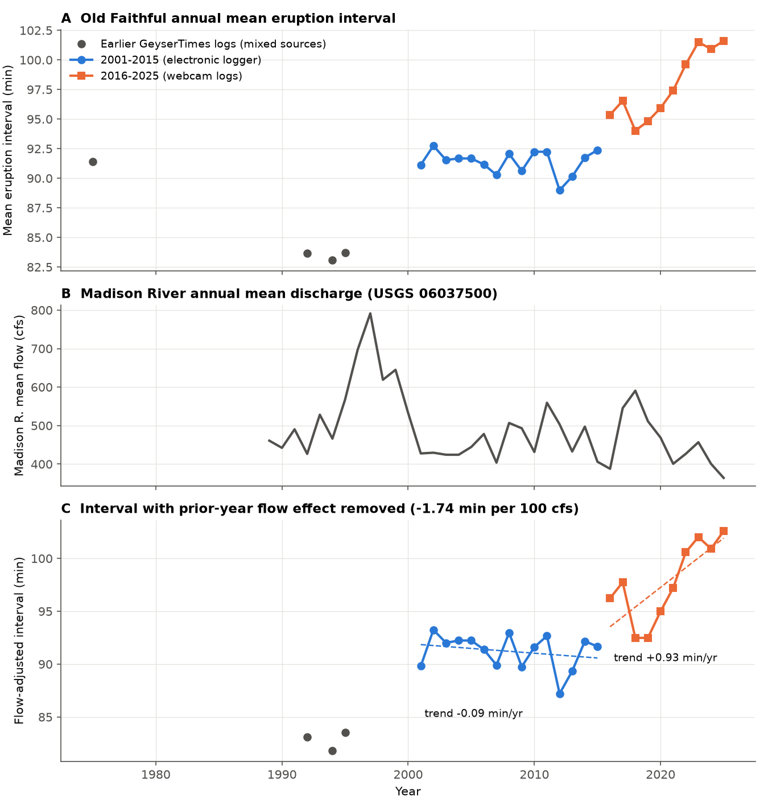
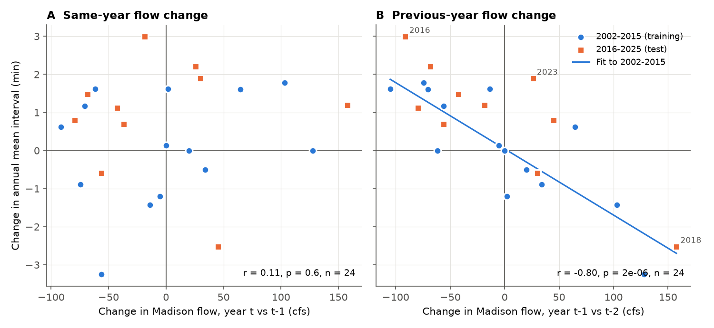
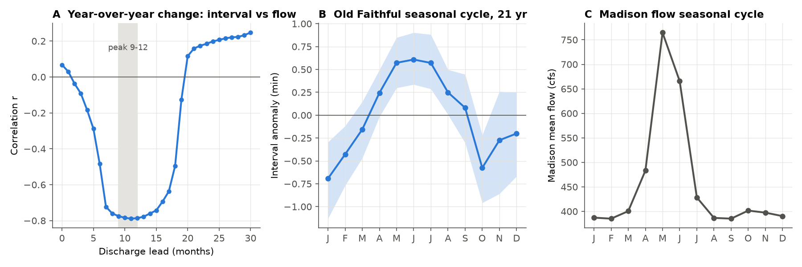

# Old Faithful eruption intervals followed the previous year's river flow in 2001-2025, but same-year flow did not predict them and flow does not explain a 10-minute increase after 2015

## Summary

Hurwitz et al. (2008, Geology 36:451) reported that the annual mean eruption interval of Old Faithful Geyser (Yellowstone) had a correlation of r = -0.98 with the annual mean discharge of the Madison River in 1967-2006. They also reported similar negative correlations for Daisy, Castle, Aurum and Depression geysers, and a seasonal lengthening of intervals after snowmelt. We tested these claims with data that they did not use: 2001-2025 eruption times from GeyserTimes (105,015 cleaned Old Faithful intervals in 2001-2025) and USGS daily discharge.

Main results:

1. **Same-year flow did not predict the interval out of sample.** For 2007-2025, the correlation between the annual mean Old Faithful interval and the same-year Madison River mean discharge was r = -0.35 (n = 19; autocorrelation-adjusted 95% CI -0.76 to 0.26; p = 0.25). The 2008 value of -0.98 is outside this interval.
2. **Year-to-year changes followed the flow of the previous year.** The change in the annual mean interval had a correlation of r = -0.80 with the change in the previous year's discharge (2002-2025, n = 24, p = 2e-6; phase-randomized surrogate p = 0.0005). The slope was -1.74 minutes per 100 cfs. Same-year (r = 0.11), 2-year (r = 0.21) and 3-year (r = 0.15) lags gave no relation. A monthly scan put the peak lead of discharge at 9-12 months (r = -0.79).
3. **The lagged relation forecast later changes.** A slope fitted to 2002-2015 predicted the 2016-2025 year-to-year changes with r = 0.83 (p = 0.003) and 58% lower mean squared error than a no-change forecast. Electronic-logger data alone (2002-2015, r = -0.82) and webcam logs alone (2012-2025, r = -0.86) gave the same result.
4. **Flow does not explain the long-term increase after 2015.** The annual mean interval increased from 92.4 min (2015) to 101.6 min (2025). The flow model predicted only +1.7 of the observed +9.2 min. After we removed the flow effect, the trend was -0.09 min/yr in 2001-2015 and +0.93 min/yr in 2016-2025 (change +1.02 min/yr, HAC SE 0.29, p = 0.0005). A change in data source (webcam logs replaced the electronic logger in 2016) explains about 1.0 min (overlap months: webcam minus logger = +0.98 +/- 0.11 min).
5. **The other geysers did not show a basin-wide flow relation.** For Daisy, Castle, Grand, Riverside, Aurum, Depression and Beehive (July-September medians, 2001-2025), no geyser had a significant lag-1 relation (r from -0.37 to +0.46). One same-year test of 14 had p < 0.05 (Riverside, p = 0.04), which is near the expected false-positive count. Their post-2015 changes were not the same as at Old Faithful: Daisy intervals decreased, Castle intervals increased after 2020, and Riverside stayed level.
6. **The seasonal cycle was smaller than reported and in phase with snowmelt.** Old Faithful intervals were longest in May-July (+0.6 min) and shortest in October-January (-0.6 to -0.7 min). The peak-to-peak amplitude was 1.3 min (95% CI 1.1-1.9) in 21 complete years, not the 2.7 min reported in 2008.

Interpretation (not tested here): the two responses agree with the two-process model in Hurwitz et al. (2008). Cold snowmelt recharge lengthens intervals in the same season. Higher recharge then shortens intervals about one year later, possibly because the pressure in the hydrothermal reservoir increases. The 2016-2025 increase is specific to Old Faithful in this sample. A local change in the conduit, heat supply or recharge path is therefore a candidate cause. We found no local earthquake swarm (M2+, 30 km) at the start of the increase.



## Question

Do Yellowstone geyser eruption intervals follow interannual river discharge as reported in 2008, when we test with data recorded after that study? If they do, at which lag? Does discharge explain the recent change in the Old Faithful interval?

We wrote the analysis plan (files/code/PLAN.md) before we looked at the post-2006 intervals. The primary test was the same-year level correlation for 2007-2025. Lagged discharge, first differences, and multi-year means were planned secondary tests. The post-2015 drift test (result 4) and the reduced-source checks were added after we saw the data. Treat them as exploratory.

## Data

| Data | Source | Use |
| --- | --- | --- |
| Eruption entries, Old Faithful (geyser ID 2), 1970-2026 | GeyserTimes public API v5, `https://www.geysertimes.org/api/v5/entries/{start}/{end}/{ids}`, one request per UTC month, retrieved 2026-11-08 | 205,518 entries |
| Eruption entries for Daisy, Castle, Aurum, Depression, Riverside, Grand, Beehive, Plume, Lion, Grotto, 1990-2026 | same API, IDs `4;5;10;12;7;13;1;3;14;21` | 533,326 entries |
| Madison River near West Yellowstone, daily discharge | USGS NWIS site 06037500, `waterservices.usgs.gov/nwis/dv` | 1913-2026 |
| Firehole River near West Yellowstone, daily discharge | USGS NWIS site 06036905 | 1983-2026 (gaps 1996-2002) |
| Thumb Divide SNOTEL (816:WY) daily SWE and precipitation | NRCS AWDB report generator | 1987-2026 |
| Earthquakes M2+ within 30 km of Old Faithful, 2000-2025 | USGS ComCat FDSN event service | context only |

GeyserTimes is a volunteer database. Its sources changed over time: an electronic temperature logger (RTED) gave nearly all Old Faithful entries in 2000-2015; webcam-based logs gave most entries from 2016. GeyserTimes does not state a data license. Raw entries contain observer names and comments. Thus we do not redistribute the raw JSON. We ship `files/data/gt_entries_reduced.csv.gz`, which contains every entry with time, flags and source file, and replaces the observer name with a class (`infrasound`, `Calculation`, `other`). The code reproduces all results from this table (we checked that the outputs are identical). The SHA-256 of the raw JSON archive that we used is in `files/data/PROVENANCE.md`.

## Methods

**Intervals.** For each geyser, we removed entries flagged not-seen (`ns`), in-eruption start unknown (`ie`), approximate (`A`), questionable (`q`) and minor (`min`). For Old Faithful we also removed infrasound detections (they first appear in 2022 and include false short intervals) and entries from a calculation source. We merged entries closer than a geyser-specific window (Old Faithful: 25 min) into one eruption. Intervals are differences between consecutive eruptions. We applied the outlier rule of Hurwitz et al. (2008): we dropped an interval that is more than twice or less than half both of its neighbours. For Old Faithful we kept intervals of 130 min or less (a longer value nearly always means a missed eruption). An annual value was used if the year had 1,000 or more intervals and 10 or more months with 50 or more intervals.

**Interannual tests.** Pearson correlations of annual means (and month-balanced means, medians, long-mode means) with annual mean discharge, lagged discharge and multi-year means. For level correlations we adjusted the effective sample size for lag-1 autocorrelation (Bretherton et al. 1999). For first differences we used only consecutive years. We tested the lag-1 difference correlation against 2,000 phase-randomized surrogates of the gap-free 1989-2025 discharge series. The forecast test fitted the difference slope on 2002-2015 and applied it without change to 2016-2025.

**Monthly lag scan.** Year-over-year change of the 12-month mean interval against year-over-year change of the 12-month mean discharge, shifted by 0-30 months. P-values use only December values (one per year).

**Drift.** Flow-adjusted interval = annual mean + 1.74 min per 100 cfs times (previous-year discharge minus its 2001-2025 mean). We fitted a broken-trend regression with a slope change and a step at 2016 and HAC (Newey-West, 2 lags) errors.

**Other geysers.** July-September median interval per year (at least 30 intervals), same level and difference tests. Medians reduce the effect of missed eruptions in visual logs.

**Seasonal cycle.** Monthly mean minus the same-year mean, in the 21 years with 12 usable months; 5,000 year-bootstrap samples. A second version used anomalies from a centred 2x12-month moving average (peak-to-peak 1.25 min).

## Results



Old Faithful, primary out-of-sample test (2007-2025, `files/results/p1_interannual.csv`):

| Discharge measure | r (levels) | p (AR-adjusted) | r (first differences) |
| --- | --- | --- | --- |
| Madison, same year | -0.35 | 0.25 | 0.10 |
| Madison, previous year | -0.46 | 0.09 | -0.83 |
| Madison, 3-year mean | -0.51 | 0.28 | -0.44 |
| Firehole, same year | -0.44 | 0.14 | 0.04 |
| Thumb Divide water-year precipitation | 0.06 | 0.82 | 0.41 |

The level correlations are weak because the interval has a slow trend that flow does not have. Year-to-year changes remove this trend and show the one-year lag.

Lag-1 difference relation, robustness (`files/results/p1d_robustness.csv`):

| Variant | Years | n | r | Slope (min per 100 cfs) |
| --- | --- | --- | --- | --- |
| Annual mean | 2002-2025 | 24 | -0.80 | -1.74 |
| Month-balanced mean | 2002-2025 | 24 | -0.79 | -1.62 |
| Median | 2002-2025 | 24 | -0.78 | -1.88 |
| Long intervals only (75 min or more) | 2002-2025 | 24 | -0.82 | -2.07 |
| Electronic logger only | 2002-2015 | 14 | -0.82 | -2.15 |
| Webcam logs only | 2012-2025 | 14 | -0.86 | -1.89 |
| July-September only | 2002-2025 | 24 | -0.78 | -2.09 |
| Without 2012 / 2016 / 2018 | 2002-2025 | 22 | -0.76 to -0.79 | -1.54 to -1.80 |

Forecast of 2016-2025 changes from the 2002-2015 fit (`files/results/p1c_forecast_2016_2025.csv`): mean squared error 1.25 min^2 (flow model), 3.00 (no change), 2.85 (no change plus the training mean drift). The refitted test slope (-1.68) equals the training slope (-1.74).



The figure `files/figures/fig4_other_geysers.png` shows the other geysers. The table is in `files/results/p2_other_geysers.csv`.

Context from GeyserTimes before 2001 (mixed sources, few complete years): 83-84 min in 1992-1995 and 91 min in 1975. We did not use these years in the tests.

## Limitations

- GeyserTimes is a volunteer database with changes in sources. The 2016 change from logger to webcam logs coincides with the start of the increase. In the 40 overlap months, webcam intervals were 1.0 min longer. The offset can change over time, and we cannot check it after 2015 because the logger record stops. Daytime (06-21 h) and night-time mean intervals differed by 0.5 min or less in each year 2000-2020, when both were well sampled (1.3 min or less in 2021-2025, with few night intervals). Thus mainly daytime webcam coverage does not explain the increase.
- From 2019, fewer eruptions are logged (1,100-2,800 intervals per year, not 5,000-5,900). Annual means are still precise (standard error near 0.3 min), but missed eruptions near the 130-min cut-off can bias values slightly.
- We did not use the ranger records (1937-1956, 1967-2002) of the 2008 study. We therefore cannot say whether the -0.98 correlation was correct for its own years. A shared slow trend in both series, or post-earthquake recovery, can give a high level correlation. Our in-sample check with GeyserTimes years 1992-2006 (9 years) gave r = -0.52 (not significant).
- The lag-1 result uses 24 annual differences from one geyser. The relation is strong and replicates in two independent periods and two independent sources, but the mechanism (reservoir pressure) is an interpretation.
- Logs for the other geysers are mostly visual, with long gaps and missed eruptions. A weak relation at these geysers can be hidden by noise. These results do not prove that no relation exists.
- We did not test eruption duration, barometric pressure, earth tides, or distant earthquakes.

## Reproduction

From the `files/` folder (Python 3.12, pandas, numpy, scipy, statsmodels, matplotlib):

```
bash code/run_all.sh
```

This reads `data/gt_entries_reduced.csv.gz` and `raw/` (USGS, SNOTEL, ComCat files) and writes `derived/`, `results/` and `figures/`. To download the raw GeyserTimes JSON again: `python3 code/fetch_gt.py 2 1960 2026 raw/geysertimes` and `python3 code/fetch_gt.py "4;5;10;12;7;13;1;3;14;21" 1990 2026 raw/geysertimes_multi`. When `raw/geysertimes` exists, the code reads the JSON instead of the reduced table. Later downloads can differ because volunteers add and edit entries.

## Provenance

- Job: sci-1107-dell-earth-and-ocean-sciences-3c9a3fed3aae; campaign 11_07_2026; topic earth-and-ocean-sciences; machine dell; account claude-andrii.
- Analysis and text: Claude Opus 5.5 (model ID claude-opus-5-5), running as an autonomous research agent. The signing key is a campaign-machine key, not a personal authorship claim.
- Data retrieval: 2026-11-08. File hashes are in `files/data/PROVENANCE.md`.
