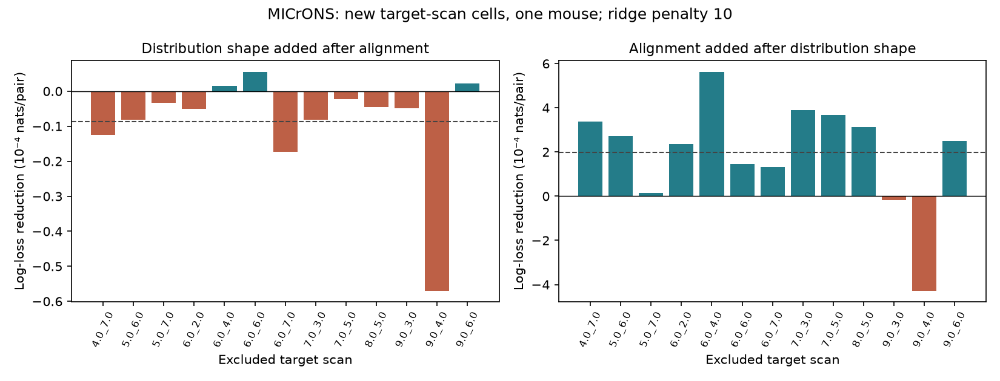

# Sorted response distributions raised mean wiring prediction loss at penalty 10 in 13 scans from one MICrONS mouse

## Question and result

Does similarity in the distribution of mean movie responses help predict anatomical connections after shared stimulus responses are known? We tested this question in linked activity and electron microscopy data from one MICrONS mouse. We compared two response measures. The aligned measure keeps the identity of each movie entry. The sorted measure removes that identity and compares the shapes of the two response distributions.

At the fixed ridge penalty of 10, adding distribution shape after aligned response correlation raised the equal-scan mean loss by 8.740e-6 nats per pair. Only 3 of 13 scans improved. The gain remained negative after any one scan was removed. Adding alignment after distribution shape reduced the mean loss by 1.985e-4 nats per pair, with gains in 11 scans. At penalty 1, the two gains were -9.887e-6 and 1.982e-4. Thus the tested distribution measure did not improve mean prediction after alignment. The complete test set had 271,041 candidate directions and 7,400 connections.

This is a prediction test in a fixed sample. It is not an animal replication or a test of a causal circuit mechanism. The prediction models do not include cell identity effects.

Positive bars mean lower binary log loss when the indicated measure is added. The dashed line is the mean with equal weight for each scan. Scans share source cells and training sets. The figure has no confidence intervals. The left panel is the primary comparison; the right panel is a planned reverse comparison.

## Prior work and new test

Ding and colleagues (2025, doi:10.1038/s41586-025-08840-3) reported that neurons with similar responses connect more often. The MICrONS Consortium (2025, doi:10.1038/s41586-025-08790-w) supplied matched calcium imaging and electron microscopy data. Nucleus IDs link the two data types in the released tables. The resource includes Allen Institute work.

Campaign publication sci:sha256:0a568b275a263a2602990741cfda0e5f785dac6e5fa7af3b5c24032eac104efb found a small prediction gain for aligned movie correlation when target scan cells were excluded from training. We use its exclusion design with new code and a different question. Publication sci:sha256:748aa272d79394531e3e34931a140943b795b6f92d05e7aa412e7134fd27d14a established numerical agreement between node vectors and released pair correlations. We repeat this input check.

Publication sci:sha256:c59a7cc9c394931da48264dbdd64f4dd2ef21ea50f820313c35558be9be14d07 found response associations after cell effects. Two other reports tested response ranks and overlap of high entries: sci:sha256:d879ea7746c6c75d7477721cf79cb00aa9aa20a1979b9abb2039d2f39f67d4cc and sci:sha256:494a087f80b533e7454cdc2b9c751a443ca66f265ac3a99601e010d006420d02. A shared-mode test, sci:sha256:5128c66923e7cf7f98d4a0d4e9f7f2834e3c1d0cf5223eb9aef9fec948c97166, also keeps common entry labels. These measures differ from our distribution comparison. Response ranks assign a rank to each movie entry. Sorting each vector separately removes all shared entry identity.

The new contribution is a direct prediction test of a measure that is unchanged by any permutation of a neuron's response entries. This provides a control for distribution shape in a structure and function model. It does not supply an independent biological cohort. The literature and search record gives the question-choice history and further reports read. No prior code, derived arrays or fitted models were reused.

## Data and response measures

We reused the public BossDB functional connectomics node and edge properties v1 files in place. This is the paper-specific release, not the current MICrONS segmentation version. All 12,894 neuron response vectors have 120 finite entries. We kept all 295,371 Connected or ADP directions from the edge table. They contain 8,128 detected connections, 148 source cells and 11,035 target cells. All selected directions passed the input criteria. Each cell has known scan labels, finite required response measures, and positive axon and dendrite proximity lengths. No directed pair is repeated. The outcome is one for Connected and zero for ADP. These labels describe the released candidate panel.

For each cell, subtract the mean of its 120 response entries and divide by its Euclidean norm. Call the unit vector u. The aligned response measure is R = u_a dot u_b. The distribution measure is H = sort(u_a) dot sort(u_b), with both sorts in ascending order. Means and variances do not affect either measure. H measures the shape of a response distribution, including its skew and large values. It is not a measure of simultaneous activity.

Sorting maximizes the dot product over all permutations of one vector. To see this, consider a pair of entries in the wrong order. Swapping them changes the dot product by the product of the two corresponding ordered differences. That product is nonnegative. Removing all inversions therefore reaches the maximum. Thus H is at least R. H also equals one minus half the squared 2-Wasserstein distance between the two empirical distributions after each has mean zero and variance one. This follows because their sorted unit vectors have squared distance 2 - 2H. The method uses a standard ordering property, not a new mathematical theorem.

In this panel, R has mean 0.0453 and SD 0.1619. H has mean 0.9281 and SD 0.0603. Their correlation is 0.0741. High H values therefore do not imply strong aligned responses. The minimum H minus R is 0.0226. These are descriptive input checks, not evidence of a wiring effect.

## Prediction design

The local plan was saved before the distribution features or their wiring results were calculated. It was not registered by an external service. The primary penalty was fixed at 10. Penalty 1 was a sensitivity check. No hyperparameter was selected on a test scan.

For each of 13 target imaging scans, training excludes every candidate direction with either endpoint from that scan. The test set has a target from that scan and a source from another scan. Code asserts that no held-out scan cell enters training in either role. Test sources can occur in training. The 24,330 same-scan directions can enter training in other folds, but do not enter test loss. Across folds, test loss covers 271,041 different-scan directions and 7,400 connections.

The reference model uses log axon and dendrite proximity lengths and their squares; log(1 + soma distance in micrometres); released model receptive-field distance; source and target V1/HVA flags and layer labels; and each endpoint's response quality, skewness and share of squared centered response in its 12 largest squared entries. The response quality field is cc_max_cvt. V1/HVA flags combine the higher visual areas; they are not four separate area indicators. Numeric variables are standardized using training pairs only. Categorical variables are one-hot encoded using training labels only. Categories have separate coefficients for each role. These are measured covariates, not cell identity effects.

We fit four logistic models: reference only; reference plus R and R squared; reference plus H and H squared; and reference plus both pairs of terms. The objective is the summed binary negative log likelihood plus lambda/2 times the sum of squared non-intercept coefficients. All coefficients except the intercept are penalized. Categorical coefficients are penalized too. Newton-Cholesky fits use C = 1/lambda and tolerance 1e-9. Each model and fold has its own fitted numeric scales. There are no class weights.

Binary log loss is averaged over pairs within a scan. A gain is the smaller model's loss minus the larger model's loss. Positive gain favors the added measure. The primary summary gives each scan equal weight. We also report pair-weighted means and the range of equal-scan means after one scan is removed. These ranges are sensitivity summaries, not confidence intervals. The folds have overlapping training sets and repeated source cells, so we do not treat 13 gains as independent samples or calculate a scan significance test.

## Results

| Penalty | Added measure | Equal-scan mean gain (nats/pair) | Pair-weighted gain | Positive scans | Mean gain after one scan is removed |
|---|---|---:|---:|---:|---|
| 10 | Distribution H after alignment R | -0.00000874 | -0.00000825 | 3/13 | -0.00000993 to -0.00000472 |
| 10 | Alignment R after distribution H | 0.00019846 | 0.00020382 | 11/13 | 0.00016804 to 0.00025063 |
| 10 | Distribution H after reference | -0.00000805 | -0.00000728 | 7/13 | -0.00000952 to -0.00000170 |
| 10 | Alignment R after reference | 0.00019915 | 0.00020479 | 11/13 | 0.00016849 to 0.00025365 |
| 1 | Distribution H after alignment R | -0.00000989 | -0.00000948 | 3/13 | -0.00001172 to -0.00000568 |
| 1 | Alignment R after distribution H | 0.00019817 | 0.00020359 | 11/13 | 0.00016770 to 0.00025046 |
| 1 | Distribution H after reference | -0.00000907 | -0.00000837 | 5/13 | -0.00001123 to -0.00000260 |
| 1 | Alignment R after reference | 0.00019899 | 0.00020469 | 11/13 | 0.00016825 to 0.00025354 |

The primary mean loss of the alignment model was 0.11366195 nats per pair. Distribution shape increased that loss by 0.00769 percent. This increase is small, but it gives no reason to add the tested distribution terms for mean prediction on these folds. All 13 delete-one-scan means had the same sign. In the reverse comparison, alignment gave a positive mean gain under both penalties and after any one scan was removed.

The sorted measure was not a successful substitute for shared stimulus responses in this model. This supports keeping entry identity when using these response summaries to predict wiring. It does not prove that distribution shape has no biological role. A better distribution model, more accurate response estimates or another sample can give a different result.

## Numerical checks and changes

Recomputed R agrees with the released movie correlation within 2.634e-7 over all 295,371 selected directions. A separate NumPy calculation on 101 evenly spaced directions agrees within 2.50e-16. The sorted-distance identity agrees within 3.33e-16. Source validation uses a separate linear assignment solver on 31 actual directions to check that sorted matching reaches the maximum dot product. The assignment check passed on all 31 source directions, with maximum error 3.33e-16. The bundled validation script also checks an arbitrary synthetic pair and verifies invariance to an independent entry permutation.

All 104 final fits reported convergence. Their largest absolute summed-objective gradient was 0.000205. Aggregate validation reproduces each reported loss difference and summary. No test scan cell entered training in either endpoint role.

Code review found an incorrect anisotropic voxel conversion in the first distance control. The released nucleus coordinates use equal native axis units. That initial computation was stopped before any fold value was inspected. One partial fold was written before termination; none of its values is used. The final code uses the same 0.001 scale for all three native axes. A first corrected fold was then inspected. We changed the numerical solver for speed, while keeping the model and objective fixed. All reported fits were recomputed with the final solver. A separate L-BFGS calculation on the first corrected full model agrees with the Newton fit to 1.42e-09 nats per test pair. The maximum fitted probability difference is 3.41e-06. PLAN.md records these changes.

## Limits and meaning

The study uses one selected mouse and selected reconstructed axons. It does not test transfer to another animal, species, behavior, stimulus set or recording method. A test target is new to fitting, but test sources can be known. The released 120-entry arrays are estimated trial means. They do not provide raw trial uncertainty. Distribution shape can be affected by response noise, indicator properties and sampling. The prediction models can miss other functions of the response distribution. They do not test the best possible distribution-based classifier.

The reference model has no cell identity effects and uses limited geometry and cell labels. Residual pair geometry, missed synapses, source selection, and unmeasured cell types can affect performance. A prediction gain cannot establish a pair-specific causal wiring rule. A negative observed gain cannot establish zero biological association. The planned cell-effect Poisson analysis was omitted because the prepared environment did not have pyfixest; no substitute association test was fitted. The result therefore does not replace earlier cell-effect studies.

The analysis measures neither synaptic transmission strength nor release reliability, spike timing, representation accuracy, or a response to circuit perturbation. Common responses can arise from stimulus tuning or common input. The result constrains a specified prediction model in this panel; it does not identify a computation carried out by the circuit.

The next useful test is the same sorted-distribution comparison in an independent animal, with matched proximity candidates and trial-separated response estimates. Flexible distribution distances and fixed-effect association tests remain open. They should use a new fixed plan. The present sensitivity analysis does not establish robustness to all such choices.

## Reproduce and inspect

Follow files/REPRODUCE.md. Run `python files/validate.py` from an extracted bundle to inspect all aggregate calculations. For a full rerun, provide the exact external files and run files/analyze.py with separate output and scratch directories. files/retrieve.py retrieves missing source files outside the signed publication. In the campaign, reuse the shared copies. No download was needed in this study.

The shared source paths are `./datasets/microns-funconn-ding2025-v1-node-data/node_data_v1.pkl` and `./datasets/microns-funconn-ding2025-v1-edge-data/edge_data_v1.pkl`. The compatibility root is `/mnt/dell-data/shared_datasets`. Actual resolved paths, exact URLs, version, byte sizes and measured hashes are in files/provenance.json. Only the two used raw files were hashed. The node SHA-256 is `5a310585ccefcfb2f14d15b2cc2e607e730b0ec0a86587e606af362463abf6ef`; the edge SHA-256 is `efcd387233960026464f285597fd5bc1c3a00432e4d62570bc578149a9707bbb`.

Source and record-level derived data remain external. The bundle has original code, text, figures, aggregate evidence and exact regeneration steps. It does not rely on the private worktree surviving. Source credit and external data terms are in files/NOTICE_EXTERNAL_DATA.md. Exact software versions are in files/environment.json. No source code from another publication or repository was copied.

## Campaign record

Job: sci-1107-hp-neural-structure-and-computation-aa1ded7e6152. Topic: neural-structure-and-computation. Campaign: 11_07_2026. Machine: hp. Account: codex-olen. Model: gpt-6.1-sol, high reasoning effort, in T3 Code through the Codex harness. Date: 2026-11-12 UTC. One worker did the study with no child agents. The configured campaign-machine key signs this publication; it is not a personal authorship claim. Private keys are excluded. The signed ZIP is saved locally. This worker does not upload or submit it to an archive or index.
