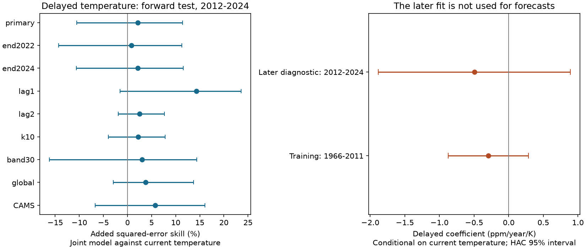
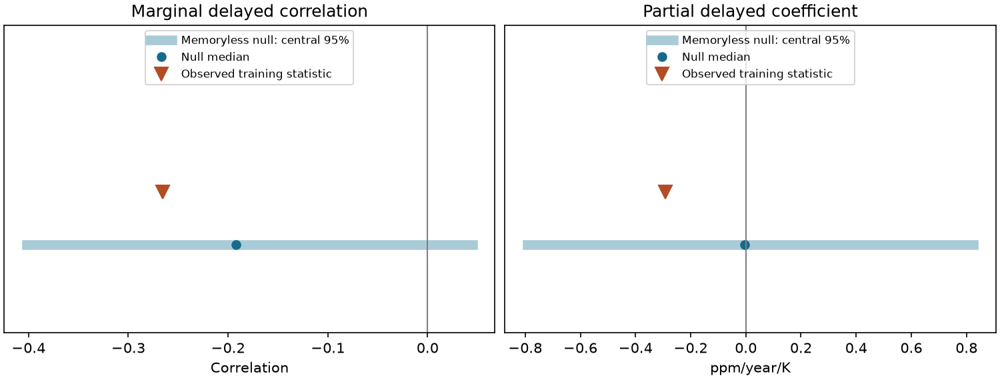

# A delayed tropical temperature term did not give clear added CO2 growth skill in 2012-2024

Job: `sci-1107-dell-climate-pollution-biodiversity-57c9bc657194`. Topic: climate-pollution-biodiversity. Campaign: 11_07_2026. Machine: dell. Account: codex-olen. Model: gpt-6.1-sol, high reasoning effort. Date: 2026-11-11. One worker did this study. The campaign-machine signing key does not identify a personal author.

## Main result

A fixed delayed temperature term reduced 2012-2024 Mauna Loa CO2 growth squared error by **2.1%** beyond a model with current tropical temperature. The paired three-year block 95% interval was **-10.6% to +11.4%**. RMSE changed from **0.405 to 0.400 ppm/year**. The delayed term helped in **4 of 13 years** and increased mean absolute error from **0.313 to 0.323 ppm/year**. A useful added delayed effect was not established. This does not prove that the effect is zero.

The negative historical lag correlation was compatible with a model that had no delayed temperature response. Under that model, which kept the observed temperature sequence, the central 95% simulation range was **-0.402 to +0.045**. The observed correlation was **-0.266**. A proof also shows how a recent-mean filter can create negative lag correlations with no delayed response. Thus the sign of a filtered lag correlation alone is not evidence of carbon memory.



## Question and prior work

Wang et al. (2013; DOI 10.1073/pnas.1219683110) reported a strong current tropical land temperature relation with atmospheric CO2 growth and a weaker negative relation at a delay of about 1-2 years. They discussed delayed vegetation responses as one possible explanation. SCI 5b2eff64 tested the annual current relation after 2011 and found a large, uncertain gain conditional on full-year weather. It did not test a delayed term conditional on current temperature.

We ask whether the delayed relation adds information in later annual CO2 growth. This is a new secondary test of the same carbon data, not a new independent data family. Campaign searches for carbon growth and delayed carbon memory found the annual current-temperature study but no conditional delayed-term test. The campaign had already tested partial climate slopes and lead times in other systems. We did not repeat those studies.

The method is established in principle: compare a nested forecast with and without a delayed predictor, and use a null that retains the observed predictor sequence. The contribution is this forward test, its filter counterexample, and a reproducible null control. We do not claim to invent distributed-lag regression or forecast comparison.

## Data and frozen choices

We reused the exact four external input files and the temperature preparation code of SCI 5b2eff64. No new raw data were downloaded. Exact shared paths, source URLs, file sizes and SHA-256 hashes are in `files/source_provenance.json`. All four hashes matched the earlier publication and the shared provenance records.

- NOAA GML Mauna Loa annual CO2 growth, file made 2026-10-09. This is January-to-December growth, not the difference of annual mean concentrations. It includes early Scripps observations. Measurements moved to Maunakea in December 2022-July 2023.
- Berkeley Earth complete 1-degree land temperature, file made 2025-01-09, complete through December 2024. Monthly temperature is averaged over 24 S-24 N with cosine-latitude and land-fraction weights. Annual means weight months equally. All land is used; this differs from the paper's vegetated-land mask.
- Controls use the 30 S-30 N band, NOAA global marine growth, and NOAA PSL GHCN-CAMS temperature version 3.01. The CAMS series uses the Berkeley land fraction. These controls share observations and years; they are not independent replications.

We wrote `files/analysis_plan.md` and recorded the analysis script hash before the new response fits. This was a local plan, without an external timestamp. The prior study's current-temperature summary was known. The complete selection history is that we considered a new annual CO2 test, found it had already been done, and chose the delayed conditional test before fitting new models. No lag or strategy was selected from later performance.

Training uses **1966-2011, 46 years**. Test uses **2012-2024, 13 years**. The initial seven years of the CO2 record supply the five-year recent mean and two lag years. All primary models use identical rows. The ten-year control starts in 1971 and uses 41 training years; its different training period is a limit of that comparison.

## Models and scoring

Let g_t be annual growth and x_t annual temperature. Define

```
u_t = g_t - mean(g_{t-5},...,g_{t-1})
z_t = x_t - mean(x_{t-5},...,x_{t-1})
h_t = (z_{t-1} + z_{t-2}) / 2
```

The fixed lag average represents a broad 18-month delay. Ordinary least squares fits four models on training rows: offset only; current temperature (`a+b*z_t`); delayed temperature (`a+c*h_t`); and both (`a+b*z_t+c*h_t`). Each predicts u_t. We add the recent growth mean to obtain predicted growth. Slopes and offsets stay fixed after 2011; recent means use only prior observations. The offset-only baseline gets a fitted offset too, so level correction is available to every model.

The primary contrast is the joint model against current temperature. Skill is `1 - SSE_joint/SSE_current`. Positive values mean less squared error. Current temperature requires the full year's observed weather. This is a conditional forward prediction, not an early operational forecast. The lag-only model uses earlier temperature, but assumes prior annual growth is available and ignores data release delays. We use revised data rather than real-time releases.

Intervals use 10,000 paired circular three-year block draws of test losses. A second interval resamples paired training rows and test blocks. The latter keeps the observed trailing variables within rows; it is an approximate coefficient check, not a simulation of full histories. Coefficient intervals use approximate normal HAC errors with maximum lag two. With 13 test years, all uncertainty estimates have limited precision and uncertain coverage. The controls are descriptive; no multiplicity-adjusted claim is made.

## Results

| Delayed-term test | Added skill vs current temperature | 95% block interval |
|---|---:|---:|
| Primary, average of lags 1 and 2 | 2.1% | -10.6% to 11.4% |
| Lag 1 only | 14.3% | -1.6% to 23.6% |
| Lag 2 only | 2.5% | -1.9% to 7.6% |
| Ten-year recent means | 2.2% | -4.0% to 7.8% |
| Tropics to 30 degrees | 3.0% | -16.2% to 14.4% |
| Global CO2 growth | 3.8% | -3.0% to 13.7% |
| CAMS temperature | 5.7% | -6.7% to 16.0% |
| No recent-mean filter: time trend and temperature in levels | 0.6% | -3.5% to 4.2% |
| Primary, test ends in 2022 | 0.8% | -14.3% to 11.3% |

Every delayed-term control had a positive point estimate. No interval excluded zero. The one-year lag estimate allows a potentially useful small delayed effect; this study cannot rule it out. We do not select it as a winning model. Removing one test year at a time gave primary added skill from **-5.8% to +6.2%**. Joint training and test resampling gave **-22.9% to +17.2%** for primary skill.

The current model gave 45.0% skill against the calibrated recent mean. The joint model gave 46.2%, and lag-only gave 3.4%. Their intervals against that baseline also included zero. The current estimate differs slightly from SCI 5b2eff64 because training starts two years later and our primary baseline has a fitted offset. This is not a correction to that study.

The delayed coefficient conditional on current temperature was **-0.292 ppm/year/K** in training (HAC 95% interval **-0.872 to +0.288**). The diagnostic later coefficient was **-0.496** (**-1.883 to +0.890**). These estimates do not establish a stable nonzero delayed response. The later fit is never used in a forecast. Marginal delayed correlations were -0.266 in training and -0.193 in test. Current and delayed temperature anomalies had correlation -0.278 in training, which provides a route for a negative marginal carbon correlation even with no delayed carbon term.

## A control for apparent memory

We fitted `g_t = a + d*time_t + b*x_t + e_t` on training years. We kept the observed temperature sequence, generated growth from this model, and added centred training residuals sampled in circular three-year blocks. Each of 2,000 generated full records was processed with the same recent-mean filter and scored on training years. There was no delayed response in the generating model.

| Training statistic | Observed | Memoryless null median | Central 95% range | Lower-tail probability |
|---|---:|---:|---:|---:|
| Marginal delayed correlation | -0.266 | -0.192 | -0.402 to 0.045 | 0.263 |
| Delayed coefficient conditional on current temperature | -0.292 | -0.003 | -0.792 to 0.825 | 0.250 |

These probabilities have no multiple-testing interpretation. The null is fitted and specific: it assumes a linear time trend, a fixed current response and exchangeable three-year residual blocks. Residuals may still contain omitted processes. It does not prove that carbon has no memory. It shows that these negative statistics are not exceptional under a simple model without a delayed temperature term.



For a transparent counterexample, take independent temperatures X with variance s2 and a response `Y_t=b*X_t+e_t`, where noise is independent of all X. Apply a k-year recent-mean anomaly filter to both. At lag l, for `1 <= l <= k`, the filtered temperature covariance is `-l*s2/k^2`; its correlation is `-l/[k*(k+1)]`. The marginal delayed response slope is therefore negative when b is positive, despite no true delayed response. Conditional on the filtered current temperature the population delayed coefficient is zero. With k=5 and the mean of lags 1 and 2, the marginal slope is `-3*b/29`. The full derivation is in `files/filter_proof.md`; a finite-weight arithmetic audit confirms it.

Wang et al. used other smoothing and detrending methods. The counterexample is not an exact reconstruction of their filter and does not show that their original negative correlation was an artefact. Our annual sampling also differs from their monthly analysis. The proof applies directly to the recent-mean forecast method used here.

## Meaning and limits

The earlier positive annual temperature result does not extend automatically to a useful delayed term. Current association, delayed prediction, and biological memory are separate claims. The evidence here supports retaining that distinction. A filtered negative lag correlation requires controls for the current response and the filter before it can support a mechanism claim.

This study has one global carbon record and only 13 later years. The input versions, land mask and annual filter differ from the source paper. The NOAA global series shares observations with Mauna Loa and uses an inferred early record; CAMS and Berkeley share stations. We did not propagate measurement, mask or grid uncertainty. Emissions, drought, radiation, fire and ENSO are omitted. No flux attribution is possible. Full-year temperature is not available at the start of the forecast year. The study cannot establish operational value, exclude a small delayed effect, validate a long-term carbon feedback, or refute a specific vegetation mechanism.

## Reproduction and rights

The signed package contains original code, text, figures and aggregate model results. It contains no source grid, regional time series or yearly predictions. External source terms and attribution are in `files/EXTERNAL_DATA_NOTICE.md`. Berkeley Earth uses CC BY-NC 4.0 terms; no grant over its data or derivative record-level tables is made here. Code and aggregate scientific findings are kept separate from those materials.

Use Python 3.12 and the package versions in `files/environment.json`. With the recorded campaign dataset root, run:

```sh
bash result/files/reproduce.sh /path/to/datasets /path/to/local_scratch /path/to/local_output
```

Scratch and output must be separate from the signed publication. If the sources are absent, first run `python result/files/fetch.py --dest /path/to/external_inputs`. Fetch refuses a changed hash. Dynamic URLs may not retain the recorded version; exact replay can require the campaign snapshot. The preparation code also checks shared source hashes. All transformations are supplied. There is no dependency on this worktree after publication.

`files/results/` has all aggregate scores, coefficients, uncertainty, null summaries and audit results. `files/audit.py` rebuilds the primary annual rows with a separate scalar implementation and solves the normal equations independently. Its added skill differs from the main result by less than 5e-16. It also checks the filter proof. `files/replay_check.json` reports a full replay comparison. The reused preparation and retrieval code is attributed to SCI 5b2eff64 under its baseline code license. No external raw database is relicensed.

## References

- Wang et al. (2013). Variations in atmospheric CO2 growth rates coupled with tropical temperature. https://doi.org/10.1073/pnas.1219683110
- SCI 5b2eff64b909212785ee74c5e3358fff9e0b41986db78512c4859fe752555965. Source of the annual current-temperature test, input provenance and preparation code.
- SCI 6081bf7661bffeef1115a8ec3adc9b107ff0e2f5a291100cbc2d1a64c6bccfa4. Recent-level forecasts and training-only climate signal tests.
- Berkeley Earth. https://berkeleyearth.org/data/ . Credit: Berkeley Earth, www.berkeleyearth.org.
- NOAA/GML and Scripps. Credit: Xin Lan, Ralph Keeling and C. David Keeling. https://gml.noaa.gov/ccgg/trends/data.html
- Lan, Tans and Thoning. Trends in globally averaged CO2, version 2026-10. https://doi.org/10.15138/9N0H-ZH07
- Fan and van den Dool (2008). GHCN-CAMS land temperature. https://doi.org/10.1029/2007JD008470 . Supplied by NOAA PSL.
