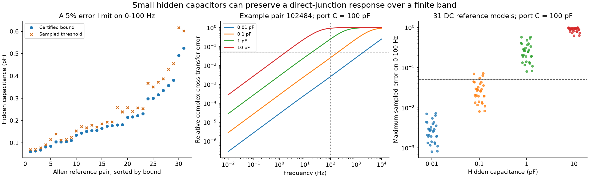

# Hidden relays with positive capacitance match direct transfer within 5% on 0-100 Hz in 31 passive models from Allen data

A passive circuit with no direct electrical edge can closely match the frequency response of a circuit with a direct edge. The hidden node must charge fast enough. We give a sufficient capacitance bound that controls the complex cross-cell transfer error over a continuous frequency band. We apply it to 31 reciprocal reference models from Allen mouse visual cortex slice data. For a 5% error limit on 0-100 Hz, the sufficient hidden capacitance ranges from 0.061 to 0.525 pF, with a median of 0.175 pF. The bound applies for any fixed positive capacitances at the two recorded nodes.

These are constructed model responses. They are not measured frequency responses. The result does not show that any recorded pair has a hidden relay. It states a limit on robust structure inference when hidden capacitances have no positive lower bound and membrane leaks are unknown.

The left panel compares a sufficient bound for the entire band with a numerical threshold on sampled frequencies. The middle panel shows one reference pair. The right panel shows all 31 primary references at four fixed hidden capacitances. In the middle and right panels, each recorded node has a model capacitance of 100 pF. The dashed line is 5% complex transfer error. The curves include phase error as well as amplitude error. They do not show measurement uncertainty.

## Question and prior work

Can transient electrical measurements distinguish a direct junction from an indirect electrical route? This matters when circuit models use effective electrical transfer as a direct anatomical edge. The resulting topology can affect models of input integration and coordinated activity.

Campagnola, Seeman and colleagues provide the linked connection and physiology data used here [1]. Alcami and Marty used capacitive currents and paired recordings to constrain direct electrical neighbors [2]. Their work shows that transient measurements can add structural information under a specified model. Graph reduction by a Schur complement is established circuit theory [3]. We do not claim to discover circuit reduction or indirect electrical coupling.

We searched signed campaign publications for `connectome`, `neural`, `synaptic physiology`, `intrinsic connectivity`, `electrical coupling resistance`, `hidden capacitance`, and `finite bandwidth electrical`. We read the signed electrical-loop report [4] and the signed direct-edge DC report [5]. The latter gives the 31-pair cohort, reciprocal reference rule, and positive-leak static relay construction. We use those methods and cite that work. We wrote new extraction and analysis code. We did not reuse its code or numerical evidence tables, and we did not inspect private worker folders.

The added result is a continuous-band error bound for a strictly positive hidden capacitor, with an exact transfer formula, a high-frequency limit, and reproducible numerical examples at public-data conductance scales. The study is exploratory. The plan was saved after prior cohort counts and basic field coverage were known, but before the dynamic calculations.

## Model and proof

Use conductance in nS, capacitance in pF, time in ms, and impedance in GOhm. A capacitor of C pF has admittance s*C nS when s has units per ms. In a frequency response, s = i*w and w = 2*pi*f/1000 for f in Hz.

The two recorded nodes have the direct reference conductance matrix

    Y0 = [[l1+b, -b], [-b, l2+b]],
    l1 > 0, l2 > 0, b > 0.

Here b is the direct branch conductance and l1, l2 are shunts to ground. Let Cp = diag(Ca,Cb), with Ca,Cb > 0. The reference impedance is Z0(s) = inverse(Y0+s*Cp). The element Z0_ab is the voltage at b per unit current injected at a, with zero external current at b. This is cross-cell transfer. It is nonzero at every finite real frequency in this model.

Replace the direct branch with a hidden node h. There is no a-b edge. Set

    eta = min(l1,l2,b)/4,
    t = 2*b + eta,
    D = t*t/b,
    h = D - 2*t.

Connect a to h and b to h with conductance t. The recorded-node shunts are l1-eta and l2-eta. The hidden shunt is h. All three shunts are strictly positive because h = 2*eta+eta*eta/b. Give the hidden node capacitance Ch > 0. Keep Ca and Cb unchanged. The full conductance matrix is

    G = [[l1-eta+t, 0, -t],
         [0, l2-eta+t, -t],
         [-t, -t, D]].

This is a stable passive network. Its only electrical route between a and b passes through h. Elimination of h gives the recorded-node admittance

    Yh(s) = Y0 + s*Cp + r(s)*v*v',
    v = [1,1]',
    r(s) = b*s*tauh/(1+s*tauh),
    tauh = Ch/D.

Thus the two circuits have exactly the same DC port matrix for every Ch. At nonzero frequency the added term is generally nonzero. We do not claim exact equality of transient responses.

For the cross-cell impedance, direct inversion gives

    Zh_ab(s)/Z0_ab(s) = 1 / [1+s*tauh*F(s)],
    F(s) = 1 + b*v'*Z0(s)*v.

Define relative complex transfer error E(w) = abs(Zh_ab/Z0_ab - 1). Let lambda be the smallest eigenvalue of Y0. The real part of Y0+i*w*Cp is Y0, so norm(Z0) <= 1/lambda. The norm here is the matrix spectral norm. Therefore abs(F) <= 1+2*b/lambda.

Also, Im(v'*Z0(i*w)*v) <= 0 for w >= 0. One way to see this is to diagonalize Cp^(-1/2)*Y0*Cp^(-1/2). The scalar expression is a sum of terms ak/(muk+i*w), with ak >= 0 and muk > 0. Each term has a nonpositive imaginary part. It follows that Re(i*w*F) >= 0, and abs(1+i*w*tauh*F) >= 1. Hence

    E(w) <= w*tauh*(1+2*b/lambda).

For any finite band 0 <= w <= W and any tolerance delta > 0, the sufficient condition is

    0 < Ch <= delta*D / [W*(1+2*b/lambda)].             (1)

Equation (1) proves existence of a strictly positive capacitor that controls error over the whole band. It does not depend on the values of Ca and Cb. It is a sufficient condition, not the largest permitted capacitor.

The full two-port impedance also converges. On the imaginary axis, Re(r) >= 0, so norm(Zh) <= 1/lambda. The resolvent identity gives

    norm(Zh-Z0)/norm(Z0) <= 2*b*W*tauh/lambda.

Under (1), this is at most delta*2*b/(lambda+2*b), which is less than delta. Thus the construction does not hide error only in a weak cross-transfer element. Both recorded-node responses are close in this matrix norm. For a band-limited current at one recorded cell, the scalar cross-transfer bound also controls the relative L2 error in the other cell's voltage, by Parseval's identity. We make no relative output bound for arbitrary two-input combinations with cancellation.

For fixed Ca and Cb, these two topologies have zero infimum separation over any finite band as Ch tends to zero. Thus a fixed nonzero error tolerance cannot uniformly separate these model classes. This is a statement about robustness. Exact noiseless transfer functions can differ on a finite band. It is not a claim that all exact inverse problems are nonidentifiable.

## Why unlimited frequency differs

For any finite passive network with a positive diagonal capacitance matrix C,

    inverse(s*C+G) = C^(-1)/s - C^(-1)*G*C^(-1)/s^2 + O(s^-3).

If d is the direct a-b conductance, then

    limit s^2*Z_ab(s) = d/(Ca*Cb), as abs(s) tends to infinity.

The direct reference has d=b. The relay has d=0 and a leading cross-transfer term t*t/(Ca*Cb*Ch*s^3). The models therefore have different ideal high-frequency limits. As Ch decreases, the distinction moves to higher frequency. Exact unlimited-band data with known positive port capacitances can reveal this direct lumped edge. This statement does not identify a junction at an unknown dendritic site. Recording bandwidth, noise, access resistance, and other compartments would need their own observation model.

## Data and reference construction

We reused this shared source in place and read it without writes:

    /mnt/dell-data/shared_datasets/allen_synphys/r2.1_small_2023-01-26/synphys_r2.1_small.sqlite

Source URL: https://allen-synphys.s3-us-west-2.amazonaws.com/synphys_r2.1_small.sqlite . Version: r2.1 small, schema 22, S3 Last-Modified 2023-01-26. Size: 176771072 bytes. SHA-256:

    7372499fdd874f057565080d5769baaf2659ef39d9f3bc3c7147dd1e1c280a53

The analysis verifies this exact hash. No other shared data file enters the calculations. The source database stays outside the bundle. Its original terms remain in force.

We count each unordered cell pair once and join both directed pair records by experiment and cell IDs. We require mouse VisP, nonsynaptic class `in` at both cells, and two positive electrical calls. This gives 124 pairs. Positive pulse coupling coefficients and pulse correlation p < .05 in both directions leave 34 pairs. Positive input resistances at both nodes leave 31 pairs in 27 recordings, for both the steady-state and peak resistance definitions. The p filter selects a cohort; it is not a test of reciprocity or of this model.

For current injected at a, Kab is the voltage at b divided by the voltage at a. Let Ra and Rb be the reported input resistances. The two transfer-resistance estimates are Kab*Ra and Kba*Rb. They disagree by a median factor of 1.158 in the primary sample. Following [5], we form a reciprocal reference with

    z = sqrt((Kab*Ra)*(Kba*Rb)),
    Zdc = [[Ra,z],[z,Rb]],
    det = Ra*Rb-z*z,
    b = z/det, l1 = (Rb-z)/det, l2 = (Ra-z)/det.

All primary and sensitivity references have 0 < z < min(Ra,Rb). This adjustment is explicit. It is not a fit under a known noise model. The proof is conditional on these reference matrices, not on the unknown true circuit. The median effective b is 0.479 nS, with a range of 0.171-1.552 nS, in the primary references.

Primary capacitances at the recorded nodes are 100 pF each, by model choice. Sensitivity checks use 10 and 300 pF each. A further check uses tau/R as an effective capacitance proxy when both tau values are positive and present. That check has 29 pairs. Separate intrinsic measurements do not establish the intrinsic capacitance of a hidden neuron or even a single passive compartment at a recorded node.

The inspected Allen pipeline source calculates pulse slopes from mean voltage shifts 30-180 ms after pulse onset [6]. It does not supply the frequency responses used here. The source revision that generated every database value was not established. We did not use the known pulse-array order problem in this small database: no pulse-train arrays enter this study.

## Results

| Resistance reference | Pairs | Recordings | Sufficient Ch at 100 Hz: minimum / median / maximum, pF | Maximum sampled error at its bound across all capacitance checks and bands |
|---|---:|---:|---:|---:|
| Steady-state, primary | 31 | 27 | 0.0612 / 0.1749 / 0.5252 | 4.9796% |
| Peak, sensitivity | 31 | 27 | 0.0617 / 0.1697 / 0.4488 | 4.9800% |

The continuous-band guarantee comes from the proof, not from frequency sampling. For the same delta, the sufficient Ch is ten times larger at 10 Hz and ten times smaller at 1000 Hz. The numerical checks used 4,097 frequencies per band, including DC. These frequencies are a verification grid, not measured samples.

With 100 pF at both recorded nodes and the primary resistance reference:

| Fixed hidden capacitance, pF | Pairs within 5% on the sampled 0-100 Hz band | Median maximum sampled error | Range of maximum sampled error |
|---:|---:|---:|---:|
| 0.01 | 31/31 | 0.260% | 0.0813-0.724% |
| 0.1 | 27/31 | 2.60% | 0.813-7.22% |
| 1 | 0/31 | 25.1% | 8.08-58.5% |
| 10 | 0/31 | 92.9% | 62.0-99.0% |

These failures concern this fixed relay construction. They do not exclude every possible hidden network at those capacitances.

A numerical root search for the largest Ch that passed the sampled 5% test gave median thresholds of 0.181, 0.193, and 0.193 pF for fixed port capacitances of 10, 100, and 300 pF. The tau/R check gave a median threshold of 0.193 pF in 29 pairs. These are sampled thresholds. They are not certified maxima over the continuous band, and they are not bounds over all hidden network designs.

For example, pair 102484 in experiment 3263 has b=0.478911 nS, D=2.424489 nS, and lambda=9.280290 nS. Equation (1) gives Ch=0.174885 pF at 100 Hz and delta=.05. Its hidden-node charging time Ch/D is 0.072132 ms. The two recorded capacitances remain fixed; only the extra node is made fast. These are model parameters, not measured hidden-cell properties.

## Validation

The independent checker does not import the analysis program. It solves full three-node complex circuit equations by pivoted elimination and compares them with the transfer formula. It checks DC equality, positive shunts, cross-transfer and matrix error bounds, and 1,000 random circuits away from the Allen parameter values. All 6,588 reference circuit checks passed. The largest relative difference between the full circuit cross-transfer and the formula was 9.52e-16. A separate determinant calculation checks all 244 numerical capacitance thresholds on a grid with 65,537 frequencies. Their largest error from the target value .05 was 2.30e-14. The checker also confirms the distinct high-frequency coefficients. Exact check counts and numerical errors are in `files/independent_checks.json`.

A clean rerun produced byte-identical numerical evidence, source provenance, and independent check results in nine files. The hashes are in `files/reproduction_check.json`. All checks must pass for the reproduction command to complete. The proof establishes the continuous parameter and frequency statements. Finite numerical checks alone would not establish them.

## Interpretation and limits

Transient data can add structural information, as in [2]. This study makes one condition explicit: inference needs constraints on hidden charge-storage and conductance parameters, as well as an observation error model. Without a lower limit on hidden capacitance, the direct and indirect model classes are not uniformly separated on a finite band. A positive capacitance limit can remove the small-capacitor examples given here. It does not by itself prove uniqueness among all hidden graphs.

The required capacitances are small. The construction does not establish that they are plausible for a whole neuron. A tiny compartment connected to a larger dendritic tree would need a model of that tree. It cannot be treated as an isolated capacitor without evidence. The 1 and 10 pF checks show how strongly capacitance can matter within this particular construction.

The references combine separate measurements and adjust directional disagreement. Finite pulse windows, active membrane currents, dendrites, changing states, and electrode effects can break the passive mapping. The circuits need not jointly fit all cells in a recording. Unknown leaks and hidden topology are essential freedoms. Fixed independently measured intrinsic leaks would change the admissible class.

No neural activity dataset was joined across animals. No measured transient, in vivo synchrony, behavior, or representation accuracy was predicted. The 31 pairs are a selected slice cohort in one species and region, with repeated recordings and no population test. The theorem applies across numerical circuit scales under its assumptions. Biological transfer across animals, regions, or conditions remains untested.

## Reproduction and attribution

Run the two commands in `files/REPRODUCE.txt`. The package includes the source query, all 124 candidate records, the 34 pulse-selected records, all reference parameters, numerical error and threshold tables, example curves, figures, source provenance, an analysis plan, and an independent checker. Raw data can be retrieved by the recorded URL and verified by its exact hash. No raw database download was needed for this run.

Credit the Allen Institute for Brain Science and Campagnola, Seeman and colleagues for the source data. Original data remain under the Allen Institute terms at https://alleninstitute.org/legal/terms-use/ . The SCI baseline license covers our new text, figures, analytical tables, and code. It does not change the original database terms. No upstream software is redistributed.

Job: sci-1107-hp-neural-structure-and-computation-39abb839ba30. Topic: neural-structure-and-computation. Campaign: 11_07_2026. Machine: hp. Account: codex-myxtap. Model: gpt-6.1-sol, high reasoning effort, Codex harness in T3 Code. No agents were launched. Computations ran directly in this workspace. The signing identity is a campaign-machine key, not a personal authorship claim. The signed bundle is stored locally; no remote archive or index receives it.

## References

1. Campagnola, Seeman and colleagues (2022). Local connectivity and synaptic dynamics in mouse and human neocortex. [doi:10.1126/science.abj5861](https://doi.org/10.1126/science.abj5861).
2. Alcami and Marty (2013). Estimating functional connectivity in an electrically coupled interneuron network. [doi:10.1073/pnas.1310983110](https://doi.org/10.1073/pnas.1310983110).
3. Dorfler and Bullo (2013). Kron reduction of graphs with applications to electrical networks. [doi:10.1109/TCSI.2012.2215780](https://doi.org/10.1109/TCSI.2012.2215780).
4. Selected Allen mouse V1 electrical coupling graphs provide only one independent reciprocity loop. SCI `sha256:597f4cea5c2b6dc05718bee3c2bf9a54b1f90b750d4482f07c514ddae9c1fd8b`.
5. Passive reference models for 31 Allen mouse slice pairs admit zero direct electrical conductance. SCI `sha256:106b1100aee1ce53a1097c62e2189285f8ef3a185aecf5e8e938fd8097c3c703`.
6. Allen Institute, fixed source revision `b187927abf1e8df46d11b47eeb88c8e2c76aee3c`, [gap-junction pipeline](https://raw.githubusercontent.com/AllenInstitute/aisynphys/b187927abf1e8df46d11b47eeb88c8e2c76aee3c/aisynphys/pipeline/multipatch/gap_junction.py). Field definitions were also checked in [intrinsic schema](https://raw.githubusercontent.com/AllenInstitute/aisynphys/b264d8b61abf11d015222865ca081f80655d33d4/aisynphys/database/schema/intrinsic.py).
