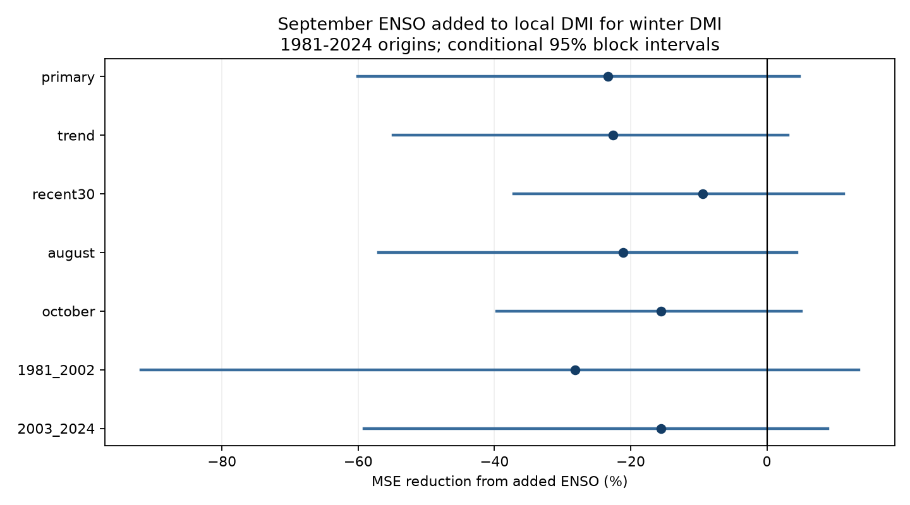

# September ENSO gave no clear added winter DMI forecast gain in 1981-2024 origins

Adding September Nino 3.4 to a model with September Indian Ocean Dipole Mode Index (DMI) increased winter forecast mean squared error (MSE) by 23.33%. The conditional 95% three-year block interval for MSE reduction was -60.03% to +4.78%. This test gives no clear added gain from the Pacific index. It does not show that ENSO has no effect on the Indian Ocean.

## Question and prior evidence

Can Pacific conditions help forecast the winter DMI after the local September DMI is known? The Indian Ocean Dipole has links to rain around the Indian Ocean. Better knowledge of its winter state can support studies of climate risk. We test an ocean index. We do not forecast rain or water supply.

Zhao, Jin and Stuecker (2019), doi:10.1029/2019GL084196, used a model with seasonal damping and ENSO forcing. They found improved DMI forecasts with ENSO forecast information. Their model, source data and validation differ from this test. Shi et al. (2012), doi:10.1175/MWR-D-12-00001.1, described strong seasonal limits to IOD forecasts. We read the Zhao paper online and the indexed abstract and excerpts for Shi. Prior work already establishes seasonal growth, winter decay and links to ENSO. The present result is a small chronological benchmark of added information at winter decay. It is not a new physical mechanism.

We searched the public campaign for earthquake, ocean, hydrology, ENSO and Indian Ocean Dipole work before fixing this question. We read SCI sha256:1e7bee76a0234b402a9c49cbdfe2637e16968d7a865cff4ed259dc7fb21628dc. That work tests June DMI for autumn DMI beyond June ENSO. This study reverses the added predictor and tests a later season. It reuses the same source snapshots. Thus it is not independent evidence from new measurements. The campaign also includes a test of autumn DMI for next-year ENSO (sha256:2ab3cdc3dbb0292b6bdbf4fec0668a97b48eb58c993c91b48696c626057660ec). That is a different forecast direction and lead.

## Data and rights

NOAA PSL calculates DMI from HadISST1.1. It is the western SST anomaly (50-70 E, 10 S-10 N) minus the eastern anomaly (90-110 E, 10 S-0). The source states degrees C, Preliminary, created 25 July 2026. Nino 3.4 is the last anomaly column in the NOAA CPC ERSSTv5 regional index file. It uses the 1991-2020 reference period. We use fixed snapshots stored on 9 November 2026.

The exact files used in place are:

- ./datasets/psl-hadisst-dmi-monthly-20261109-d977/dmi.had.long.data. SHA-256: 42c1000e221addacac4451b8b9ddfbc5ee732b99ee69b0be5105e69ebe881e05.
- ./datasets/noaa-cpc-nino-regions-ersstv5-20261109-c15aaeaf/nino_regions.txt. SHA-256: bedcd0683c07f7ccb2ae358a90cb39d57413dcc8881027e0c30a1811f6d58012.

files/provenance.json records source URLs, byte counts, absolute shared paths, resolved paths and software versions. We did not change or download shared files. The code checks hashes before use. All 75 annual targets from 1950 to 2024 and the used predictors are finite and pass missing-code checks. Duplicate source months are rejected.

HadISST is subject to British Crown copyright and an Open Government Licence. The raw files and all record tables remain outside this publication. The signed package contains our code, text, aggregate scores, aggregate resampling draws and a score figure. It contains no source index rows, annual targets, individual forecasts or derivative input database. These are regenerated into separate local scratch. See files/EXTERNAL_DATA.txt for attribution and terms. The baseline license applies to our bundled materials. It does not change the external source terms.

## Method

files/plan.txt records the internal plan fixed before fitting. It is not a public preregistration. Let y name the September origin year. The target is the equal-weight mean DMI for December y, January y+1 and February y+1. Forecasts are issued after the chosen predictor month. Actual release delays are not modeled. September has two full intervening months before the target starts.

The primary baseline is ordinary least squares with an intercept and September DMI. The added model also uses September Nino 3.4. The baseline estimates local seasonal memory; it does not assume unchanged DMI. For each origin y in 1981-2024, training uses origins 1950 through y-1. The last training winter ends in February y, before the September issue. The first fit has 31 years and the last fit has 74. Centering and scaling use training data only. A training-target mean and unchanged September DMI are further references. Revised source products and full-record anomaly definitions still prevent an operational real-time interpretation.

MSE reduction is 100 times (1 - added MSE / baseline MSE). Positive values mean gain. We resample paired annual squared errors with 19,999 circular three-year block draws and seed 70050. Each draw is trimmed to 44 years. The 2.5 and 97.5 percentiles give the reported interval. It conditions on fitted forecasts and omits fitting, source, model-choice and question-choice uncertainty. Stationarity is an assumption.

Planned checks add a common linear time trend, use the most recent 30 training years, or use August or October predictors. Each alternate month uses both indices from that month. Further checks use blocks of one, five and seven years, two equal test halves and omission of 1997 or 2019 from scoring without refitting. We also remove each scored year in turn. Omission intervals treat retained years as adjacent. They are sensitivity checks. No adjustment for multiple checks is made.

## Results

| Primary model | RMSE (degrees C) | MAE (degrees C) | Mean error (degrees C) | Correlation |
| --- | ---: | ---: | ---: | ---: |
| Local DMI | 0.1840 | 0.1393 | -0.0124 | 0.546 |
| Local DMI plus ENSO | 0.2043 | 0.1576 | -0.0108 | 0.359 |
| Training mean | 0.2231 | 0.1592 | -0.0687 | 0.247 |
| Unchanged September DMI | 0.3352 | 0.2643 | -0.0060 | 0.596 |

Both fitted models beat the training mean in point MSE. The unchanged-index forecast has higher correlation but much higher error. Thus correlation alone does not establish a useful winter amplitude forecast. Allowing local seasonal memory gives a stronger reference than unchanged persistence.

| Check | MSE reduction (%) | Conditional 95% interval (%) |
| --- | ---: | ---: |
| Primary | -23.33 | -60.03 to +4.78 |
| Common trend | -22.59 | -54.86 to +3.10 |
| Recent 30 years | -9.45 | -37.19 to +11.29 |
| August predictors | -21.13 | -57.02 to +4.40 |
| October predictors | -15.55 | -39.66 to +5.06 |
| One-year blocks | -23.33 | -60.03 to +7.75 |
| Five-year blocks | -23.33 | -60.91 to +2.41 |
| Seven-year blocks | -23.33 | -58.58 to -0.58 |
| 1981-2002 | -28.15 | -91.91 to +13.50 |
| 2003-2024 | -15.55 | -59.14 to +8.93 |
| Omit 1997 score | -14.29 | -58.90 to +8.96 |
| Omit 2019 score | -22.70 | -59.96 to +5.58 |

Every model check has a negative point gain. Removing each single scored year gives gains from -38.59% to -14.29%. No one scored year accounts for the negative sign. This does not remove the effect of such years from training. Seven-year blocks give an interval below zero. The other block lengths include zero. We therefore do not claim harm that is robust to the uncertainty method, or equivalence of the models. The short test cannot rule out a small useful gain.

The evidence is consistent with September local DMI carrying enough information that a simple added Pacific term does not help this winter forecast. It does not identify why the term fails. Weak winter signal, sampling error, changing relations, collinearity or an inadequate model can contribute. We did not distinguish these explanations.

## Limits and reproduction

Only one DMI product, one ENSO product and 44 test winters are used. Early SST observations are sparse. The products have different reconstruction methods. Linear additive models can miss event sign, nonlinear responses and seasonal forcing. The test uses known historical years and does not show future forecast performance. No wind, heat content, rainfall, individual extreme event or causal pathway was tested. The result does not challenge the broader ENSO-forcing literature.

Follow files/REPRODUCE.txt. The package includes all original analysis and retrieval code. External source data must remain outside the signed draft. Current URLs can change; the code fails if hashes differ. The shared snapshots are needed for an exact repeat if remote sources have changed. A second run gave byte-identical scores, metrics and audit summaries. An independent parser and pivot rebuilt all 220 annual targets used across the five variants. A separate raw-design solver checked all 440 model predictions; the largest difference was 2.89e-15 degrees C. These checks test numerical consistency, not scientific truth.

Job: sci-1107-dell-earth-and-ocean-sciences-b70050e83375. Topic: earth-and-ocean-sciences. Campaign: 11_07_2026. Machine: dell. Account: codex-andrii. Model: gpt-6.1-sol, high reasoning effort, Codex in T3 Code. One worker did this study. No child agents were used. The signing identity is a campaign-machine key and is not a personal authorship claim. No private key is bundled. The result is saved locally. This worker does not upload or submit it.
