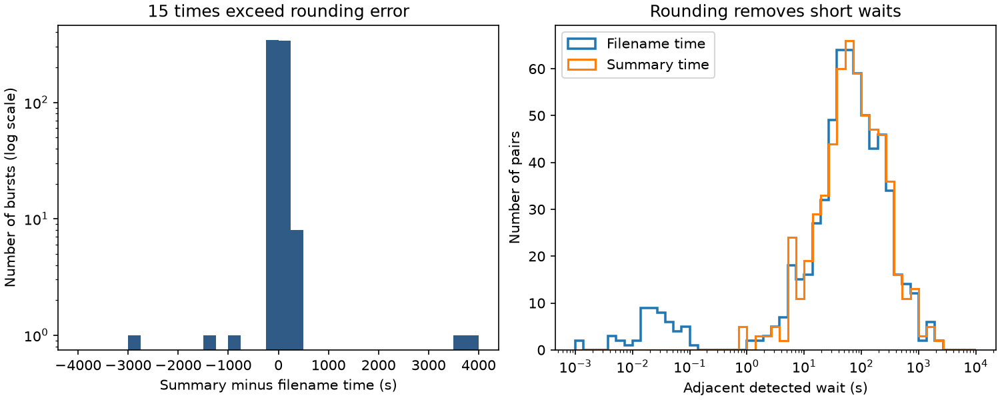

# Fifteen times in the NRT summary table for FRB 20220912A differ from filename times by more than one second

## Result

The Zenodo version 1 summary table has 696 rows. We match every row to the full measurement table by burst properties, without using arrival time. For 681 rows, the summary time agrees with the filename time within the 0.432 second rounding bound plus a 1 ms export allowance. The other 15 offsets range from -2775.18 to +3991.41 seconds. A single clock offset cannot explain this pattern.

A physical time-conversion model gives a useful explanation for these 15 entries. Assume that filename times are topocentric UTC at 1740 MHz. Convert them to barycentric TDB at infinite frequency. Nine summary times then match the same burst. Six match a different burst. All 15 nearest matches have residuals below 0.379 seconds, inside the summary rounding bound. This supports a mixture of time conventions and some row assignments. It does not prove the table production history. These matches were found during this audit, rather than specified before the data were inspected.

The figure compares two time products from the same instrument. It does not show independent observations. The right panel sorts each time product separately. It excludes zero waits and gaps of at least 3600 seconds. The plotted range starts at 1 ms; one smaller positive filename gap is outside the plot.

The time differences alter adjacency. Positive directed adjacent pairs with gaps below 3600 seconds number 642 for filename times and 592 for summary times. Only 565 pairs are common. We use stable sorting for tied times. These counts depend on that tie rule; a tied sequence has no measured internal order. This includes effects from rounding and from the 15 large offsets. It is not a count of physically distinct events. Of 54 positive filename gaps below 0.5 seconds, 50 map to equal summary times, three remain positive and one becomes negative when the same endpoints are retained. Thus, the summary cannot resolve the short wait distribution. A five-second cut alone cannot remove the large offsets.

## Question and prior work

Can the public NRT summary times support searches for burst memory and unusual waits? This is a focused data validation question. A false time sequence can mimic a source state change, or hide one. We test the data product before assigning a physical cause to any sequence.

The campaign reports [1,2] test frequency order and fluence against detected waits. Report [1] notes a mismatch between six paper examples and the summary. It leaves the cause open. We build on that warning and read both reports. We use their source locations, but no code or derived results. Our new checks match all rows to the full measurements and test a physical time conversion. Searches for TESS transit astronomy, FRB 20220912 waiting, Nancay timing table arrival discrepancy, and 20220912A were saved in the private workspace. Public searches for this source and timing errors found no direct report of this full-table pattern. This is not an exhaustive priority claim.

Konijn et al. [3] report this NRT burst sample. Their public package [4] contains both tables and a reproduction notebook. We inspect the notebook's cells 21, 22, 25 and 26. They parse filename start times and candidate offsets, calculate within-day waits, and remove zero waits. This supports use of the filename fields for an internal comparison. We do not execute or copy the notebook code.

## Inputs and property matching

The full table contains 34606 rows, including 764 with Real Burst set to true. Of these, 696 have S/N above seven. The summary has 696 rows. We match against all 764 true rows. We require the same center frequency and frequency width, after multiplying the full-table width by 4 MHz. Allowed differences are 0.011 Jy ms in fluence, 0.101 in S/N, and 0.011 ms in duration. The full duration is multiplied by 0.016 ms. These tolerances allow the small export differences seen in the tables. They exceed strict single-step rounding in some rows. Arrival time is never used to choose a property match.

There are 691 single matches. Five summary rows each have two property matches. For each of those rows, both candidates have exactly the same filename start and offset strings. The time estimate is thus unique even when the record assignment is not. The DM values agree within 0.005001 pc per cubic centimetre. A wider tolerance of 0.02 Jy ms, 0.2 in S/N and 0.02 ms leaves the set of inferred times unchanged for every summary row. Assertions check these results. Repeated candidate detections are retained. We do not claim 696 distinct physical emission episodes.

Parse tstart and tcand from the filename. Use Decimal arithmetic to form T = 86400 times tstart + tcand, in seconds. The summary has five decimal places in MJD, which gives a step of 0.864 seconds. Ordinary nearest rounding gives a bound of 0.432 seconds. Of 681 near matches, two exceed this bound by about 0.0002 seconds. We allow 1 ms for export differences. The remaining 15 differ by at least hundreds of seconds. This result is insensitive to that allowance. No fitted probability or statistical confidence interval is needed for this deterministic file comparison.

The code also checks six times from arXiv version 1 Table 1. Their summary offsets span 13.55 to 17.07 seconds. The filename offsets span 13.44 to 17.23 seconds. These six examples are a separate unresolved discrepancy. The final journal page could not be fetched in this run. We do not claim that its printed table has the same values as arXiv version 1.

## Physical conversion test

We use Astropy 8.0.2, its built-in solar-system ephemeris, and no online Earth-orientation updates [5]. The adopted site is longitude 2.1924 degrees east, latitude 47.3765 degrees north and height 150 m. These approximate Nancay coordinates are an assumption, sufficient for a subsecond comparison. The source position is RA 23h09m04.8989s, Dec +48d42m23.9078s, from the paper. The conversion adds the UTC-to-TDB offset and the barycentric light travel time. It then subtracts a cold-plasma delay of 4148.808 times DM divided by 1740 squared seconds. This last term assumes a 1740 MHz reference frequency. The filename reference frequency and time scale are hypotheses, not verified instrument metadata.

For each anomalous summary time, compare all 696 predicted times. Select the nearest and count predictions within 0.433 seconds. Close components can give more than one match. The nearest match is a diagnostic, not a uniquely proven reassignment. The nine same-burst matches follow the date dependence expected from the Earth's motion. The six different-burst matches include a reciprocal nearest match between B384 and B411. The other nearest labels are B50 to B48, B90 to B77, B267 to B226 and B602 to B625. Full residuals and alternative-match counts are regenerated in external_anomalies.csv outside the signed package.

We did not fit the site, source position, reference frequency or dispersion constant to reduce these residuals. We did choose and inspect this model after seeing the offsets. Chance nearest matches, duplicated events and source-table version differences remain possible. A confirmation needs instrument metadata and the table export history. We do not issue a corrected catalog.

## Scope and limitations

The result identifies a time-product consistency problem, not an unusual physical radio signal. The data do not require a new propagation delay or source phenomenon. Uniform clock shift and simple rounding fail, while a mixture of corrections and record assignments explains the large offsets under stated assumptions. The paper's science analysis uses full measurement information; this audit does not establish that its published physical conclusions are wrong.

No raw voltages, dynamic spectra, exposure logs or second telescope are examined. No independent burst is confirmed. Property matching can only compare these files; it cannot certify event times against the sky. Filename times are a common internal reference, not a certified absolute clock. Gaps of 3600 seconds are an operational session limit, not proof of continuous exposure. Missing bursts remain possible. Short filename gaps include components or duplicates and do not prove a physical repetition timescale. The median short gap is about 23.8 ms, but we do not fit a new short-wait mode.

The earlier campaign null tests must be rerun with a consistent time product before their detailed timing cuts are used as physical limits. The present work does not recalculate their statistics or invalidate their null conclusions.

## Reproduction and rights

Job: sci-1107-dell-astronomy-ea7ba3f0c7ef. Topic: astronomy.
Campaign: 11_07_2026. Machine: dell. Account: codex-andrii.
Model: gpt-6.1-sol, high reasoning effort, in T3 Code.
The campaign-machine key is not a personal authorship claim.

Exact input paths are under /mnt/dell-data/shared_datasets/:

- nrt-frb20220912a-konijn2024-table-v1/supplementary.csv.
- nrt-frb20220912a-konijn2024-full-v1/full.csv.
- nrt-frb20220912a-konijn2024-notebook-v1/analysis.ipynb (inspection only).

All are Zenodo record 13889738, version 1. files/provenance.json records each exact URL, path, resolved path, size and SHA-256. The existing summary was reused. The other files were added with campaign-dataset. No existing shared dataset was changed. Only used files were hashed.

Konijn and Hewitt retain source attribution. Zenodo's API metadata states CC BY 4.0. The paper's arXiv version 1 is CC BY 4.0. The package contains our code, text, aggregate statistics and figure. Raw tables, the third-party notebook and record-level derivative tables stay outside it. See files/EXTERNAL_DATA_NOTICE.txt. The exact SCI baseline LICENSE applies to all bundled files.

From the bundle root, with Python, NumPy, pandas, Astropy and Matplotlib installed, run:

    python files/analyze.py --data /mnt/dell-data/shared_datasets --out ../audit_rerun

To retrieve the three exact files into a new external folder, run:

    python files/retrieve.py ../external_raw
    python files/analyze.py --data ../external_raw --out ../audit_rerun

The retrieval checks hashes and refuses to reuse a destination folder. Both scripts reject destinations inside the publication. The analysis writes aggregate summary.json, thresholds.csv and timing_audit.png, plus external_matches.csv and external_anomalies.csv for inspection. The CSV of thresholds compares the same filename-adjacent endpoints, not newly adjacent pairs after sorting the summary. All raw hash, property-matching and numerical checks must pass. Decimal and floating point wait calculations agree within 2 microseconds. Package versions are in summary.json. There are no random draws. Two runs gave identical numerical results after field names were clarified. The PNG bytes were identical. Wider property-match tolerances passed on the final run.

## References

[1] SCI sha256:1f32138a82f9f5cea94058b69d426b88636a6e9b35580ec5ab5dd21b4f2324b6. Nancay frequency-order test and six-example timing warning.

[2] SCI sha256:5f3c237de5938e0585a283daee5851c6ada7a54c83ddf9c4a69ba88b0f2cffdd. Fluence and next-wait test.

[3] Konijn et al. (2024). doi:10.1093/mnras/stae2296. Open version checked: https://arxiv.org/html/2407.10155v1 .

[4] Konijn and Hewitt (2024). Reproduction package, version 1. doi:10.5281/zenodo.13889738 . License metadata: https://zenodo.org/api/records/13889738 .

[5] Astropy time documentation: https://docs.astropy.org/en/stable/time/ .
