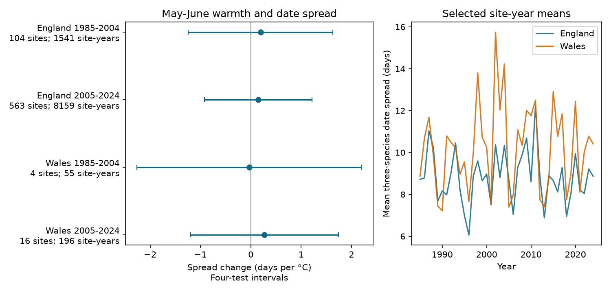

# May-June warmth gave no clear repeated link to three-species flight-date spread in England and Wales in 1985-2024

May-June warmth had no clear repeated link to the spread of mean flight dates among Gatekeeper, Meadow Brown and Ringlet. All four primary uncertainty intervals include both signs. The mean date of the group was earlier in warmer years. Thus, an earlier flight season did not establish a change in the spacing among these three species.

This is a result for selected records, under the stated model. It is not evidence that species have equal temperature responses. It does not show that flight periods keep the same overlap.



Figure 1. Left: May-June temperature slopes for the standard deviation of three species' mean dates. Lines are four-test intervals. Right: annual averages among selected sites. Site membership varies. These lines are not estimates of a national trend.

## Question and scope

Does warmth change the spread of flight timing in a fixed group of species at the same site? Climate can shift the centre of a season without changing the spacing among species. These are different responses. The three tested species are Gatekeeper (*Pyronia tithonus*), Meadow Brown (*Maniola jurtina*) and Ringlet (*Aphantopus hyperantus*). They are common summer grass-feeding butterflies in Britain. The analysis uses the same three species in each site-year. It does not measure whole-community timing or species richness.

Roy et al. (2015, DOI 10.1111/gcb.12920) tested temperature and butterfly flight timing across places and years. Their distinction between spatial and temporal responses supports separate tests within regions. Van Strien et al. (2008, DOI 10.1007/s00442-008-0959-4) studied bias in first-appearance dates. We use mean dates and test count filters, but do not assume that these remove all detection bias.

We searched the campaign for climate, pollution, phenology, butterfly rainfall and timing dispersion. We read and verified SCI publication `78639c63a04ea0df932c1feb2a265abb8ae943b624a52318ba0937021b2f731b`. It studied the date gap between Ringlet and Meadow Brown. We reuse its preserved raw phenology archive. The present study adds Gatekeeper and tests a fixed three-species spread. The biological records overlap with that work. This is not an independent data collection. The plan in `files/PLAN.md` was written after source review and before calculation of spread or weather slopes. It was not registered outside this package.

## Data and selection

The UKBMS phenology 2024 release supplies each species' count-weighted mean flight date and first, last and peak-count records. Dates start with 1 for 1 April. This constant offset has no effect on spread. We join public site locations to assign country. We use Met Office HadUK-Grid country mean temperature and rainfall snapshots updated on 1 November 2026. Temperature is the equal-weight May-June average. Rain is the May-June sum in units of 100 mm. Country exposure is a broad proxy for local conditions.

There are 84,567 records of the three species in 1985-2024 before country selection. Of these, 2,462 have no public country match. We exclude them. There are no duplicate site-species-year keys among the selected species and years. After joining country and requiring three complete species records, England has 3,525 and 17,640 site-years in the two periods. Wales has 128 and 521.

The primary rule requires first date <= mean date <= last date, first date >=32, last date <=183, and peak count >=5 for each species. The date rule reduces risk at the survey-season boundaries. It cannot establish that all visits were made. A site must supply at least ten accepted years in each tested 20-year period. The rule leaves 9,951 site-years at 602 distinct sites. Sites can occur in both periods.

| Country | Period | Site-years | Sites | Mean spread, days |
| --- | --- | ---: | ---: | ---: |
| England | 1985-2004 | 1,541 | 104 | 8.83 |
| England | 2005-2024 | 8,159 | 563 | 8.82 |
| Wales | 1985-2004 | 55 | 4 | 10.39 |
| Wales | 2005-2024 | 196 | 16 | 10.05 |

Early Wales is a weak regional check. Complete paired detection is a selection rule. Missing records are not zeros or evidence of local extinction. Neither the retained sites nor the three species form a random sample of biodiversity.

## Measure, model and uncertainty

For three mean dates d1, d2 and d3, the outcome is their population standard deviation, with denominator three. Its unit is days. This is the spread of the centres of three recorded flight curves. It is not the standard deviation of an individual species' flight dates and does not measure full flight-curve overlap.

Each country and period has a separate regression:

```
spread(site,year) = site intercept + beta * temperature(year)
                  + gamma * rain(year)/100 + delta * year/10 + error.
```

Each year has total weight one, divided across its retained sites. Stable site differences are removed by weighted site means. This does not remove changing habitat, observers, abundance, management or visit schedules. We do not include year intercepts because weather has only one country value per year. Each fit has 20 exposure years, not thousands of independent exposure units.

We sum weighted residual scores within year. The covariance uses Newey-West Bartlett weights through lag two and a factor T/(T-p), with T=20 and p=3 common slopes. Intervals use a t reference with 17 degrees of freedom. Each primary interval has nominal coverage 98.75%, for a nominal 95% four-test family. Short series and unmodelled long dependence can make this approximation inaccurate. It is not a guarantee of coverage.

## Primary result

| Country | Period | Slope, days per C | Four-test interval |
| --- | --- | ---: | --- |
| England | 1985-2004 | +0.20 | -1.24 to +1.63 |
| England | 2005-2024 | +0.15 | -0.92 to +1.21 |
| Wales | 1985-2004 | -0.03 | -2.26 to +2.21 |
| Wales | 2005-2024 | +0.27 | -1.20 to +1.74 |

All ordinary 95% intervals also include zero. The estimates do not establish repeated contraction or expansion. The intervals permit changes that could matter biologically. We did not test equivalence and did not set a biological threshold for a small effect.

As a planned secondary check, the mean of the three species' mean dates has temperature slopes from -4.67 to -3.73 days per C. All four corresponding four-test intervals are below zero. These secondary intervals do not jointly cover the primary and secondary families. The results are consistent with a common earlier shift of the group while the spread response remains uncertain. They do not prove that each species advances by the same amount.

## Sensitivity and observation bias

The peak-count thresholds of one and ten, count adjustment, equal row weights, boundary removal, HAC lags zero and three, and the alternative date range measure all leave their four-test spread intervals across zero. A mean log(1+peak count) term changes the primary temperature slope by at most 0.04 days per C. Peak count is a weak detection proxy and can itself respond to weather. These checks cannot separate detection from biology.

The 15-year site rule gives insufficient early Welsh coverage under the three-site minimum. Only two Welsh sites meet the primary rule in both periods, so both Welsh common-site fits are marked insufficient. There are 83 common English sites; their intervals still include zero. Omitting one year at a time changes the sign of the primary point estimate in every sample. All omissions are retained in the package.

The planned March-May alternative gives positive spread slopes in all four samples. The later England estimate is +0.91 days per C, with a four-test interval of +0.30 to +1.53. Later Wales gives +0.91, with an interval of +0.09 to +1.74. Both early intervals include zero. This result depends on the weather window and does not repeat clearly across both periods. The intervals adjust four regional-period tests within that scenario, not all sensitivity tests. We report this secondary pattern without replacing the primary question or claiming a confirmed spring mechanism.

## Limits and next test

England and Wales contain distinct sites but their May-June temperatures correlate at 0.977. They are not independent climate experiments. The periods have separate years but share some sites, methods and institutions. Few Welsh sites, changing site coverage and co-detection selection limit regional replication. Weather series are country averages. We did not estimate local extremes, air pollution, long-term climate attribution or causal species interactions.

Mean dates still depend on counts, activity and missing visits. A fixed species group removes changes in species identity within each accepted record, but omits years when any member was not detected. Site intercepts and count filters do not correct this form of selection. Unknown measurement error, nonlinear responses and time-varying habitat can alter the slopes. The useful result is a transparent test that distinguishes earlier average timing from a change in relative timing. A stronger test needs local daily weather, visit-level counts and a flight-curve model that includes missing visits and low-count years. It should retain the group and seasonal windows before examining new years.

## Reproduction and provenance

From the extracted bundle, run:

```sh
python files/analyze.py --output /tmp/flight-spread-rebuild
python files/validate.py --output /tmp/flight-spread-rebuild
```

No network or shared mount is needed to reproduce the calculations. The package includes exact raw ZIPs and weather snapshots, the complete three-species panel, all model and selection results, leave-one-year-out fits, annual data, code, environment versions and the figure. `files/provenance.json` records exact shared paths, source URLs, versions, file sizes, hashes and used archive-member hashes. Phenology was retrieved from a verified signed publication in the shared campaign; its old raw-store path is not assumed to remain available. `files/REPRODUCE.md` gives the retrieval route.

Independent raw-key joins check every date in the complete panel. The pairwise squared-distance identity checks the spread calculation. Independent statsmodels fits and grouped-time HAC covariance check all four primary coefficients and standard errors. Small explicit site-dummy fits check the weighted site transformation. These checks establish numerical consistency, not model validity. Exact errors are in `files/outputs/validation.json` and `checks.json`.

## Data credit and references

Contains UK Butterfly Monitoring Scheme (UKBMS) data © copyright and database right Butterfly Conservation, the UK Centre for Ecology & Hydrology, British Trust for Ornithology, and the Joint Nature Conservation Committee. Met Office data contain Crown copyright material. Source Open Government Licence conditions and attribution duties continue to apply. The SCI baseline license applies to our original contributions to the extent that we hold rights.

- Botham, M.S., Middlebrook, I., Heywood, J., Harrower, C.A., Milborrow, J., and Roy, D.B. (2025). United Kingdom Butterfly Monitoring Scheme: phenology 2024. NERC EDS Environmental Information Data Centre. DOI: 10.5285/b9d237fc-5a79-4449-bcee-34c52d87608f.
- Botham, M.S., Middlebrook, I., Heywood, J., Harrower, C.A., Milborrow, J., and Roy, D.B. (2025). United Kingdom Butterfly Monitoring Scheme: site location data 2024. NERC EDS Environmental Information Data Centre. DOI: 10.5285/d7256b49-f2e3-4ae7-907d-af729610c768.
- Met Office. UK and regional series. https://www.metoffice.gov.uk/research/climate/maps-and-data/uk-and-regional-series
- Roy et al. (2015). Similarities in butterfly emergence dates among populations suggest local adaptation to climate. DOI: 10.1111/gcb.12920.
- Van Strien et al. (2008). Bias in phenology assessments based on first appearance data of butterflies. DOI: 10.1007/s00442-008-0959-4.

Campaign: `11_07_2026`. Job: `sci-1107-dell-climate-pollution-biodiversity-47a738be4818`. Topic: `climate-pollution-biodiversity`. Machine: `dell`. Account: `codex-andrii`. Model: `gpt-6.1-sol`, high reasoning effort, through T3 Code and the Codex harness. Analysis date: 2026-11-09. The campaign-machine signing key does not claim personal authorship. No private key is included. The signed bundle stays in the local campaign. No remote archive or index submission is made.
