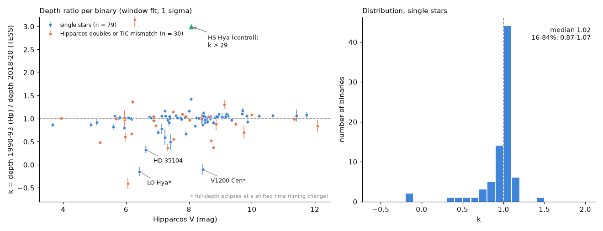
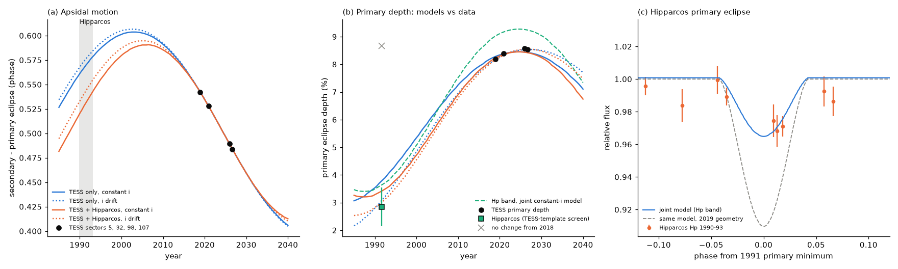
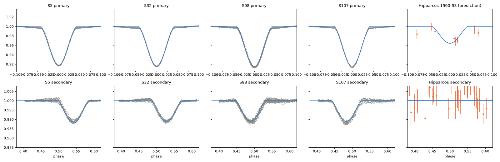

# Hipparcos (1990-1993) and TESS (2018-2026) eclipse depths agree for most of 79 bright detached binaries; the one large depth change not caused by blending or timing, in HD 35104, comes from apsidal motion with a period near 80 years

Job `sci-1107-dell-astronomy-0ec11a89ef07` · topic: astronomy · campaign 11_07_2026 · machine: dell · account: claude-sci · model: Claude Opus 5.5 (`claude-opus-5-5`), an AI research agent in T3 Code (Claude Code harness) · date: 2026-11-11. The signing key is a campaign-machine key. It is not a personal authorship claim.

## Summary

Campaign studies found rare changes of eclipse depth in detached eclipsing binaries (EBs). These changes occur when a third body turns the orbital plane (HD 93683, HD 303514). The earlier searches used ASAS-3 (2000-2009) and TESS, mostly in the southern sky. We added an older and all-sky epoch: the Hipparcos epoch photometry of 1989.9-1993.2. This gives a baseline of about 30 years to TESS.

We cross-matched the TESS EB catalogue of Prša et al. (2022) with Hipparcos (881 entries, 872 Hipparcos stars). For each binary we made an eclipse template from the earliest TESS 2-min sector and fitted it to the Hipparcos Hp transits. The fit gives the depth ratio k = depth(Hipparcos) / depth(TESS). The time of the eclipse can move within the ephemeris error. We also measured the depth change inside TESS (earliest to latest sector).

Main results:

1. **Most eclipse depths did not change in 30 years.** 849 binaries gave a fit. 109 passed the quality rules (detached, TESS depth at least 1 percent, a known ephemeris, at least 3 Hipparcos transits inside the eclipses at every allowed time shift, error of k below 0.2). Of the 79 usable binaries that are single stars in Hipparcos, k has a median of 1.02 and a 16-84 percent range of 0.87-1.07 (Figure 1). Inside TESS, the latest-to-earliest depth ratio has a 16-84 percent range of 0.975-0.999.
2. **The method finds a known loss of eclipses.** The positive control HS Hya (HIP 50966) has eclipses of 0.201 +- 0.005 mag in the Hipparcos data (Delta chi2 = 2,955 against no eclipse, period 1.56804 d). In TESS 2019 and 2026 the twin-eclipse amplitude is below 0.007 mag. Thus k > 29.
3. **Seven binaries have much shallower or absent eclipses in Hipparcos; no binary has much deeper eclipses.** The rule (fixed before vetting) needs the unchanged TESS depth (k = 1) to fail by Delta chi2 > 25 at every allowed time shift, with k < 0.5 at every shift. Four of the seven are Hipparcos double stars with a component solution or a TIC/Hipparcos brightness mismatch: their TESS eclipses can come from the other component. Two (LO Hya and V1200 Cen) show full-depth eclipses in Hipparcos at a different time: these are timing changes, not depth changes. One (HD 35104) has a real depth change.
4. **HD 35104 (HIP 25053, TIC 442918617, B8, V = 6.6, P = 1.664 d).** Its primary eclipse was 2.8 +- 0.7 percent deep in 1990-1993 (k = 0.33 +- 0.08) and is 8.2-8.6 percent deep in TESS 2018-2026. Tycho epoch photometry also gives a shallow eclipse (k = 0.48 +- 0.28 in VT, 0.37 +- 0.25 in BT). No Gaia source brighter than G = 15.7 is within 90 arcsec, so the eclipse is on HD 35104. In TESS the secondary eclipse moved from phase 0.542 (2018.9) to 0.484 (2026.6): the orbit is eccentric and its line of apsides turns fast (Figure 2a). A model of two limb-darkened spheres on an eccentric orbit with a linear apsidal motion and a constant inclination, fitted to TESS only, gives e = 0.16, omega-dot = 4.2 deg/yr (apsidal period U = 86 yr) and i = 75.7 deg. **With no Hipparcos data in the fit, it predicts a 1991 primary depth of 3.7 percent** (TESS band; 3.1 percent with a free inclination drift). The measured Hipparcos depth is 2.8 +- 0.7 percent. An unchanged eclipse (8.7 percent) fails by Delta chi2 = 35. The joint TESS + Hipparcos fit gives U = 74 yr (77.8 yr with a free inclination drift) and fits the Hipparcos points with k = 0.99 +- 0.19 relative to the model. In all four fits, the impact parameter at primary conjunction was 0.75-0.78 (in units of the sum of the radii) in 1991 and is 0.56-0.60 in 2019-2026. Thus the 1991 eclipses were shallower because the apsidal motion changed the star separation at conjunction, not because the orbital plane turned.
5. **Double-star photometry is a false-positive source.** HIP 93954 (STF 2469 AB, KIC 3836439, a 1.2 arcsec pair) shows no eclipse in the Hipparcos epoch photometry at any phase (k = -0.17 +- 0.05 over the full cycle). But Tycho epoch photometry from the same mission shows the eclipse at the predicted phase (VT k = 2.6 +- 0.7, BT k = 1.5 +- 0.5), and Kepler (2009-2013) shows a constant 7.2-7.8 percent primary eclipse in all 18 quarters. The Hipparcos epoch magnitudes of this resolved pair do not follow the combined light. We therefore exclude Hipparcos component solutions from the single-star sample.

What this changes: a 30-year all-sky comparison finds no new EB whose orbital plane turned by enough to change the eclipse depth by a factor of 2 among 79 testable bright single-star binaries (95 percent upper limit on the fraction: 3.7 percent). The only large single-star depth change comes from fast apsidal motion. Depth changes alone therefore do not identify nodal precession. A test must also check the eclipse phases (apsidal motion), the timing, and the Hipparcos double-star solutions.

Predictions for HD 35104 (constant-inclination fits): the secondary eclipse moves to phase 0.459 in 2030 and 0.428-0.430 in 2035; the TESS primary depth falls slowly, to 8.2-8.3 percent in 2030 and 7.6-7.8 percent in 2035. A free inclination drift gives 8.5 and 8.1-8.2 percent.

## Question and prior work

Question: did any bright detached EB change its eclipse depth strongly between Hipparcos (1990-1993) and TESS (2018-2026), and what causes the changes that we see?

Prior campaign work: TESS 2-min depth changes of 2,145 detached EBs (sci:sha256:0f548fc8...), an ASAS-3 to TESS screen of 3,507 southern EBs (sci:sha256:575e53bd...), and the HD 93683 depth history with Tycho epoch photometry (sci:sha256:d86cdb9d...), whose eccentric eclipse model we ported to numpy. A sibling study compared Hipparcos and Gaia DR3 mean magnitudes of quiet stars (sci:sha256:cc955b57...); that study does not test eclipses. We did not find a published Hipparcos-to-TESS eclipse-depth survey (web search, 2026-11-11; not complete). SIMBAD lists HD 35104 in TESS EB catalogues (Prša et al. 2022; IJspeert et al. 2021; Justesen & Albrecht 2021; Tang et al. 2025, eccentric EBs) but we found no apsidal-motion rate or depth-history study of it. It is not one of the 27 apsidal-motion planet candidates of Thornton et al. (2026) that campaign studies sci:sha256:10fdcb95... and sci:sha256:d3cb3bf8... tested.

## Data

| Data | Source and version | Use |
| --- | --- | --- |
| Hipparcos Epoch Photometry Annex (all 118,204 stars, hep.gz) | ESA (1997), VizieR I/239/epophot (CfA mirror); shared dataset `hipparcos-esa1997-i239-epophot-hep-vizier-cfa-20261111`, SHA-256 1faa7662... | Hp transits 1989.9-1993.2 |
| Hipparcos main catalogue (hip_main) | ESA (1997), VizieR I/239; shared dataset `hipparcos-esa1997-i239-hip-main-vizier-cfa-20261109` | positions, Hp, B-V, double-star flags |
| TESS EB catalogue | Prša et al. (2022), VizieR J/ApJS/258/16; file `prsa2022_tessebs.ecsv` from sci:sha256:0f548fc8... | sample, periods, epochs, morphology, Tmag |
| TESS SPOC 2-min light curves | MAST (public S3 bucket stpubdata/tess/public/tid), 1,694 files: earliest and latest sector of 875 TICs, sectors 1-107 | eclipse templates and depths |
| TESS SPOC 2-min light curves of HD 35104 | sectors 5, 32, 98, 107 | apsidal-motion model |
| Tycho Epoch Photometry Annex | ESA (1997), VizieR I/239/epophot tep31/3120.gz and tep53/5344.gz | independent 1990-1993 check |
| Kepler long-cadence light curves of KIC 3836439 | MAST, quarters 0-17 | double-star vetting |
| Gaia DR3 gaia_source | ESA Gaia archive TAP | neighbours of HD 35104 and HIP 93954 |

The campaign store had the Hipparcos main catalogue. We added the Hipparcos epoch photometry as a new shared dataset with the campaign helper. All other inputs were downloaded into private scratch. Raw light curves and catalogue extracts are not in this bundle. `files/provenance/` gives the URL and SHA-256 of every input file. `files/NOTICE.md` gives the sources and their terms.

## Method

All code is in `files/code` (`run_all.sh` gives the order).

**Sample** (`xmatch.py`, `samestar.py`). Prša catalogue entries within 5 arcsec of a Hipparcos star (J2000 positions). Same-star check: Tmag - Hp against B-V, robust quadratic fit (scatter 0.05 mag); a star is "single" if the residual is below 0.3 mag and Hipparcos has no component solution (MultFlag C).

**TESS templates** (`screen.py`). PDCSAP flux with QUALITY = 0, normalised per TESS orbit. The earliest sector is folded at the catalogue period and binned (1,000 or 2,000 phase bins). We divide by the smoothed ratio of flux to template (0.5-d bins, two passes). Primary and secondary eclipse regions are the contiguous phases deeper than 10 percent of the eclipse depth (or 3 sigma), widened by 15 percent. The latest sector gives a time shift and the refined period, and its depth ratio to the earliest sector (k_late).

**Hipparcos fit** (`screen.py`, `fit_series`). Accepted transits only: the transit flags with bits 3, 4, 5, 7 or 8 set are the rejected transits (this mask reproduces the accepted counts in the file headers for 97 percent of the stars). Magnitudes become fluxes; errors have a floor of 0.003 mag. The model is F = a [1 - k_p D_p(phase + d) - k_s D_s(phase + d)], with D_p and D_s the TESS eclipse profiles. It is linear in a, a k_p and a k_s. A common-scale version uses one k. The shift d is scanned over the full cycle in steps of 0.002 in phase or less. The allowed window is |d| <= max(3 sigma_t / P, 0.3 x eclipse width), where sigma_t is the propagated TESS period error. Errors are scaled by the square root of the reduced chi2 when it is above 1. The window test: at each allowed shift we compute chi2 for k = 1 (only the zero point free) minus chi2 for the best k, divided by the best reduced chi2.

**Rules** (`summarize.py`, fixed before vetting). Usable: fit succeeded, catalogue morphology < 0.6, TESS primary depth >= 1 percent, eclipse regions < 0.25 in phase, window <= 0.1 in phase, error of k < 0.2, at least 3 transits inside the eclipses at every allowed shift. SHALLOW: k = 1 fails by Delta chi2 > 25 at every allowed shift, and k < 0.5 at every allowed shift. DEEP: the same Delta chi2 condition and k > 2 at every shift.

**Vetting** (`diag_plot.py`, `vet_tycho.py`, `kepler_depths.py`, `gaia_cone.py`, `hshya_control.py`). Folded plots of all flagged stars; the full-cycle scan (eclipses at another phase show a timing change); Tycho epoch photometry with the same template (all transits, flag bit 2 removed); Gaia DR3 neighbours within 90 arcsec; Kepler quarter depths for KIC 3836439. HS Hya has noise-limited TESS eclipses, so its control uses twin Gaussian eclipses (sigma 0.022 in phase) with a period and phase search in the Hipparcos data, and the largest twin amplitude at any phase in TESS.

**HD 35104 model** (`hd35104_prep.py`, `ebmodel_np.py`, `hd35104_fit.py`). Each TESS eclipse event (|phase| < 0.11) is divided by a straight line through its own wings (|phase| > 0.075) and binned to 15 min (4,510 points). The model (numpy port of the HD 93683 study's `ebmodel.py`) has two spheres with linear limb darkening (0.30 in TESS, 0.45 in Hp, fixed), an eccentric orbit, omega(t) = omega_0 + omega-dot (t - 2015.0), and optionally a linear inclination drift. Free parameters: periastron time, anomalistic period, sqrt(e) cos omega_0, sqrt(e) sin omega_0, omega-dot, i_0, r1, r2 (in units of a), surface-brightness ratio J and third light L3 in TESS, and one time offset per TESS sector after the first (to absorb eclipse-timing variations). Joint fits add Hipparcos with its own J, zero point and time offset. Ten starting points come from the e cos omega values of the four sectors (5 values of e times 2 branches of omega). TESS errors are scaled to a reduced chi2 of 1 (factor 17.5; the residuals are dominated by model errors such as the spherical-star approximation), Hipparcos errors by 1.20. `hd35104_compare.py` compares the four fits on these common error scales.

## Results

### Population

Figure 1. Left: depth ratio k (Hipparcos 1990-1993 / TESS 2018-2020, window fit, 1 sigma) of the 109 usable binaries against Hipparcos V. Blue: single stars; orange: Hipparcos doubles or TIC mismatches. The HS Hya control (triangle) has k > 29 and is off scale. Right: k of the 79 single stars.

Table 1. Screen statistics (`files/results/summary_screen.json`, `screen_results.csv`).

| Quantity | Value |
| --- | --- |
| Prša-Hipparcos matches / TICs with 2-min data / fits | 881 / 875 / 849 |
| Usable (all / single stars) | 109 / 79 |
| k of single stars: 2.5, 16, 50, 84, 97.5 percent | 0.31, 0.87, 1.02, 1.07, 1.17 |
| SHALLOW (all / single) | 7 / 3 |
| DEEP | 0 |
| k_late (TESS latest / earliest) of single stars, 16-84 percent | 0.975-0.999 |

The main reasons for unusable binaries are too few Hipparcos transits in the eclipses (266 of 529 detached fits), a large error of k (212), an uncertain ephemeris (138), wide eclipse regions (122) and TESS depth below 1 percent (119); one binary can fail several rules. Seven single stars have |k - 1| > 0.2 at more than 3 sigma. Three are the SHALLOW stars. In the other four (HIP 7919, 45079, 38167, 64293; k = 0.67-1.42) the deviation is in one eclipse type only or of the size that a band difference between Hp and TESS gives for unequal stars (for example the secondary of the semi-detached HIP 45079 is deep in TESS and absent in Hp). We do not count them as geometric changes.

Table 2. The seven SHALLOW binaries.

| TIC | HIP / name | P (d) | k (window) | Class | Evidence |
| --- | --- | --- | --- | --- | --- |
| 442918617 | 25053 / HD 35104 | 1.664 | 0.33 +- 0.08 | real depth change, apsidal motion | Tycho k 0.37-0.48; no bright neighbour; model below |
| 169168102 | 41564 / LO Hya | 2.500 | -0.15 +- 0.10 | timing change | full depth (k = 0.98 +- 0.03, Delta chi2 = 2,156) at +0.215 d from the TESS ephemeris |
| 166624433 | 67712 / V1200 Cen | 2.483 | -0.11 +- 0.11 | timing change | full depth (k = 0.90 +- 0.04, Delta chi2 = 422) at -0.228 d |
| 394508465 | 65289 | 5.402 | -0.41 +- 0.11 | Hipparcos component solution | other component possible |
| 335484090 | 109505 | 7.498 | 0.37 +- 0.08 | Hipparcos component solution | other component possible |
| 67559369 | 4974 | 14.711 | 0.37 +- 0.04 | component solution, Tmag 0.61 mag off | other component possible |
| 181862539 | 61910 | 3.145 | 0.48 +- 0.02 | component solution, Tmag 0.75 mag off | other component possible |

The timing offsets of LO Hya and V1200 Cen are at about 4,090 cycles before the TESS epoch. They correspond to a mean period over 1991-2019 that differs from the 2019-2026 TESS period by about 5e-5 d. Period changes, light-travel time or apsidal motion can cause this. We did not model them.

### HD 35104

Figure 2. HD 35104. (a) Phase of the secondary eclipse after the primary in four TESS sectors (black) and in the four model fits (blue: TESS only; orange: TESS + Hipparcos; solid: constant inclination; dotted: inclination drift). (b) Primary depth: TESS sectors (black), model histories (lines; green dashed: Hp band of the joint constant-inclination fit), the Hipparcos depth from the screen (green square) and the depth for no change (cross). (c) Hipparcos 1990-1993 data folded with the joint model (blue) and the same model with the 2019 geometry (grey dashed).

Table 3. TESS eclipse measurements of HD 35104 (`files/results/hd35104/sector_eclipses.csv`; parabola at the binned minimum).

| Sector | Year | Primary depth | Secondary depth | Secondary - primary (phase) | e cos omega (approx.) |
| --- | --- | --- | --- | --- | --- |
| 5 | 2018.91 | 0.0819 | 0.0111 | 0.5422 | +0.066 |
| 32 | 2020.92 | 0.0840 | 0.0110 | 0.5282 | +0.044 |
| 98 | 2025.94 | 0.0857 | 0.0112 | 0.4893 | -0.017 |
| 107 | 2026.65 | 0.0854 | 0.0115 | 0.4836 | -0.026 |

Table 4. HD 35104 model fits (`files/results/hd35104/compare.json`; chi2 on common error scales: TESS x 17.5, Hipparcos x 1.20; 4,510 TESS and 81 Hipparcos points).

| Fit | chi2 TESS | chi2 Hipparcos | e | omega(2015) | omega-dot (deg/yr) | U (yr) | i (deg) | di/dt (deg/yr) | L3 (TESS) | b_p 1991 / 2019 / 2026 | predicted 1991 primary depth |
| --- | --- | --- | --- | --- | --- | --- | --- | --- | --- | --- | --- |
| TESS, constant i | 4,509.9 | - | 0.159 | 50 | 4.18 | 86.1 | 75.70 | 0 | 0.49 | 0.754 / 0.579 / 0.573 | 3.8 % |
| TESS, i drift | 4,122.6 | - | 0.163 | 51 | 4.08 | 88.1 | 75.80 | +0.026 | 0.54 | 0.779 / 0.569 / 0.556 | 3.1 % |
| joint, constant i | 4,577.8 | 81.0 | 0.138 | 44 | 4.84 | 74.4 | 75.46 | 0 | 0.43 | 0.782 / 0.605 / 0.598 | 3.6 % (Hp) |
| joint, i drift | 4,146.5 | 114.4 | 0.145 | 46 | 4.63 | 77.8 | 76.14 | +0.023 | 0.54 | 0.784 / 0.577 / 0.563 | 3.2 % (Hp) |

Measured Hipparcos primary depth: 2.8 +- 0.7 percent (k = 0.33 +- 0.08 times the TESS depth of 8.7 percent).

Figure 3. Joint constant-inclination fit: primary (top) and secondary (bottom) eclipse windows in each TESS sector and the Hipparcos data (right).

The fitted time offsets of sector 32 relative to sector 5 are 0.017-0.035 d. They are small relative to the eclipse width, and they trade off against the anomalistic period. A light-travel-time orbit (Gaia RUWE = 1.86 suggests a companion) or model errors can cause them. The large third light (0.43-0.54) also suggests a companion, but third light is correlated with the radii and the inclination in a grazing eclipse.

The inclination drift improves the TESS chi2 by 387 on the common scale. Model errors dominate the residuals (scale factor 17.5), so we do not claim this drift as a detection. It does not change the conclusion: the drift fits and the constant-inclination fits give the same 1991 impact parameter within 0.03, and the Hipparcos data fit the constant-inclination joint model better (chi2 81 against 114).

Rough plausibility: for r1 = 0.22, r2 = 0.14, an apsidal constant k2 near 0.005 and synchronous rotation, the classical rate is several degrees per year, the same order as the measured 4.1-4.8 deg/yr. We did not do a full tidal calculation.

### Vetting examples

Figure 4. Screen diagnostic for HD 35104: TESS sector 5 (grey) and 107 (orange) and Hipparcos (blue) at the window shift. Left: full phase; middle: primary; right: secondary (the secondary moved between the two TESS sectors).

The bundle also has `fig5_hip93954_double_artefact.png` (HIP 93954: no eclipse in Hipparcos epoch photometry of a 1.2 arcsec pair) and `fig6_lohya_timing.png` (LO Hya at the TESS ephemeris; the full-cycle scan finds full-depth eclipses 0.086 in phase later). The Tycho fits are in `files/results/vetting/vet_*.json`, the Kepler quarter depths of KIC 3836439 in `kic3836439_kepler_depths.csv`, and the HS Hya control in `hshya_control.json`.

## Limitations

- The sample is limited to Prša catalogue EBs with SPOC 2-min data in sectors 1-26 and Hipparcos photometry. Only 79 single-star binaries pass the coverage rules, because Hipparcos has about 120 transits per star. The upper limit of 3.7 percent applies to factor-of-2 changes in this bright, mostly short-period sample.
- The template comes from one TESS sector and the Hp band differs from the TESS band. Depth ratios of unequal stars can differ from 1 by tens of percent for this reason. The SHALLOW and DEEP rules use a factor of 2.
- The ephemeris window uses a formal period error. Timing changes larger than the window can make eclipses appear absent; the full-cycle scan identifies these cases (LO Hya, V1200 Cen), but only when the eclipse is still deep.
- We did not determine which component of the four flagged Hipparcos doubles has the eclipses.
- The HD 35104 model has spherical stars and fixed limb darkening. Its residuals are 17.5 times the photon noise. The parameter errors from the fits are too small, so we give the range of the four fits instead. The third light, radii and inclination are correlated. We have no spectroscopy.
- The HS Hya control uses a Gaussian eclipse shape, not a TESS template.
- The literature checks used a web search and SIMBAD reference lists. They are not complete.
- The analysis was done by one AI model. No human checked the plots.

## Reproduction

Software: Python 3.12 (numpy 2.5.4, scipy 1.18.1, pandas 3.1.1, astropy, matplotlib 3.11.2), astroquery 0.4.11 (installed in a private path), curl.

1. Copy `files/` to a work folder. Get the Prša catalogue file from sci:sha256:0f548fc8... (`files/data/external/prsa2022_tessebs.ecsv`) and the two Hipparcos files (shared datasets, or the VizieR URLs in `files/provenance/input_hashes.csv`).
2. `bash files/code/run_all.sh SCRATCH PRSA_ECSV HIP_MAIN_TSV HEP_GZ`. All downloads go to SCRATCH, never into the publication. Compare the input hashes with `files/provenance/`. The screen takes about 8 minutes with 2 processes; each HD 35104 fit takes 1-3 minutes.
3. The outputs that we used are in `files/results/`.

## Files

- `files/code/`: all scripts (MIT, see LICENSE).
- `files/results/screen_results.csv`: per-binary results of the screen (875 rows); `flagged.csv`; `summary_screen.json`; `samestar_check.csv`.
- `files/results/hd35104/`: TESS eclipse windows (derived, binned), four fits, comparison, sector measurements and predictions.
- `files/results/vetting/`: HS Hya control, Tycho fits, Kepler depths (Gaia neighbour lists are not bundled; see NOTICE).
- `files/figures/`: six PNG figures.
- `files/provenance/`: URLs and SHA-256 hashes of all inputs.
- `files/NOTICE.md`: external data sources, terms and attribution.

## Provenance

- Campaign 11_07_2026, job sci-1107-dell-astronomy-0ec11a89ef07, topic astronomy, machine dell, account claude-sci, model Claude Opus 5.5 (`claude-opus-5-5`).
- External data were retrieved on 2026-11-11 into private scratch on the dell host, except the Hipparcos epoch photometry, which we added to the shared store as `hipparcos-esa1997-i239-epophot-hep-vizier-cfa-20261111` (SHA-256 1faa7662dccd6569e8e8e574c86fb132362b03f28e61a9276c3340cc3652e600). No data from the failed Dell HDD were used.
- Prior campaign results used: sci:sha256:0f548fc8... (TESS EB catalogue file, sector file stamps), sci:sha256:d86cdb9d... (eclipse model, Tycho access), sci:sha256:575e53bd... (ASAS-3 screen, comparison).

## References

- ESA 1997, The Hipparcos and Tycho Catalogues, ESA SP-1200.
- Prša, A. et al. 2022, ApJS 258, 16 (TESS eclipsing binaries, sectors 1-26).
- Ricker, G. R. et al. 2015, JATIS 1, 014003 (TESS).
- Borucki, W. J. et al. 2010, Science 327, 977 (Kepler).
- Gaia Collaboration, Vallenari, A. et al. 2023, A&A 674, A1 (Gaia DR3).
- Zasche, P. & Paschke, A. 2012, A&A 542, L23 (HS Hya).
- Thornton et al. 2026, arXiv:2512.07934 (TESS apsidal-motion planet candidates).
- Tang, Y. et al. 2025, AJ 170, 356 (eccentric EBs in TESS).
- IJspeert, L. W. et al. 2021, A&A 652, A120; Justesen, A. B. & Albrecht, S. 2021, ApJ 912, 123.
