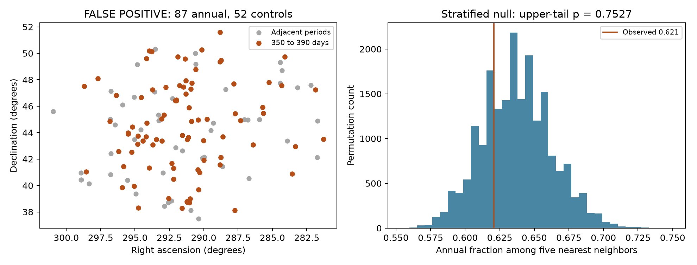
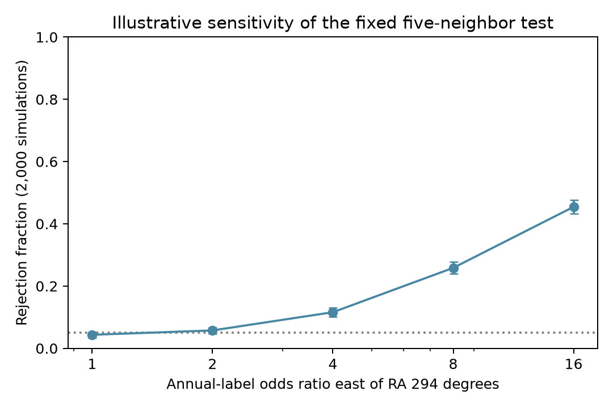

# A five-neighbor sky test does not detect an annual-period cluster in 139 Kepler DR25 false-positive targets

A sky test found no excess local clustering for the selected signals near the Kepler spacecraft year. The test has low sensitivity to an example of a broad sky pattern. This null result does not exclude detector noise. It does not change the status of any planet candidate.

## Question and prior work

Can sky position alone help to identify the known annual-period instrument signature in the Kepler catalog? Thompson et al. (2018, DOI 10.3847/1538-4365/aab4f9) and the NASA DR25 documentation describe an excess of detected events near 372 days. Detector noise can recur as a target returns to the same detector after four spacecraft rolls. A physical model for the test is that affected detectors give annual-period signals to targets in selected parts of the sky. This model can produce local spatial clustering. It does not require signals on different targets to have the same transit phase.

We test this necessary-looking but non-universal spatial signature in a selected catalog. We do not test detector channels directly. Signals outside the annual interval can also contain detector noise. Thus, the comparison can fail even if the known physical explanation is correct.

Before selection, we searched the campaign with `sci search "astronomy" --in ./campaign`. The available astronomy work studied pairs with common light or transit times. We read publication `sha256:8946c7d3b3a657457da108b9de52c797bfb82ccccc5a4d7b4609c6e745b52f06`. It used the same frozen DR25 table for a different test. A further search for `rolling band` did not return an astronomy study. Our contribution is a bounded null test and a measured sensitivity limit for a sky diagnostic. We do not claim discovery of the annual excess or its cause.

## Data and fixed design

We reused this shared file in place:

`/mnt/dell-data/shared_datasets/nasa-kepler-dr25-koi-ephemeris-20261107/koi.csv`

Source: NASA Exoplanet Archive, `q1_q17_dr25_koi`, closed Q1-Q17 DR25 delivery. The shared snapshot was retrieved on 2026-11-08 UTC (its dataset name ends in 20261107). Its 1,172,424 bytes have SHA-256 `b5303a99894149d2cc61cf02052a7e440fbbc6a45d43aff9af5e2c052fc40588`. The exact TAP query and source retrieval time are in `files/source_provenance.json`. An unchanged copy is in `files/koi.csv` for offline use. No shared file was changed. No new data download was needed.

We retain finite period, right ascension, declination, model signal-to-noise ratio (SNR), and Kepler magnitude. Period must be positive. Of 8,054 rows, 7,994 pass. Before period or disposition selection, we keep one row per Kepler target: the period nearest 372.57 days, with KOI name as a tie rule. This leaves 6,869 targets. This rule favors annual signals on targets with several signals; it prevents a star from being its own close neighbor. Results apply to this selection only.

The primary sample uses the **pipeline** disposition `koi_pdisposition = FALSE POSITIVE`, with 310 <= period < 430 days. The annual label is 350 <= period < 390 days. The other two intervals are controls. There are 139 targets: 87 annual and 52 controls. We do not use `koi_disposition` to define the sample. A false-positive label here can include both astrophysical events and instrument false alarms.

`files/design.txt` records the design set before the spatial statistics. This is an internal design record, not an externally registered protocol. The widths are centered on 370 days and include 372.57 days. The model SNR is not the pipeline Multiple Event Statistic.

## Method

For each target, we find its five nearest other sample targets by great-circle separation. We measure S, the mean annual-label fraction in these neighbor lists, with the mean taken only over annual targets. Larger S means more local clustering of the annual label. The graph is directed, and lists can overlap. We do not treat its edges as independent observations.

The null holds the sky coordinates and graph fixed. We shuffle annual labels within four pooled SNR quantile bins crossed with two pooled magnitude bins. This preserves the annual count in each of eight groups. The groups have 13 to 22 targets. SNR boundaries are 9.55, 12.1, and 15.95; the magnitude boundary is 14.433. Equal values enter the upper bin. The null assumes labels can be exchanged within these groups. It does not assume a uniform sky density.

We use 19,999 shuffles with seed 1107. The upper-tail probability is (1 + number of shuffled values >= S) / 20,000. Ties are included. We report the central 95% range of the shuffled values. This range is a null reference range, not a confidence interval on a physical effect. The simulation error on the primary p value is about 0.003.

## Results



The primary S is **0.62069**. The null mean is **0.63709**, with standard deviation 0.02514 and central 95% range 0.59080 to 0.68966. The upper-tail p value is **0.7527**. There is no detected excess clustering by this test.

The table includes all planned sensitivity tests. Width is the annual interval width in days; the total period window is three times that width. All intervals are centered on 370 days. Each test rebuilds its graph and quantile bins.

| Sample | Width | Neighbors | Shuffle groups | Annual / control | S | Null mean | Upper-tail p |
| --- | ---: | ---: | --- | ---: | ---: | ---: | ---: |
| False positive, primary | 40 | 5 | SNR and magnitude | 87 / 52 | 0.6207 | 0.6371 | 0.7527 |
| False positive | 40 | 3 | SNR and magnitude | 87 / 52 | 0.5977 | 0.6364 | 0.9132 |
| False positive | 40 | 10 | SNR and magnitude | 87 / 52 | 0.6575 | 0.6401 | 0.1947 |
| False positive | 20 | 5 | SNR and magnitude | 48 / 57 | 0.4458 | 0.4482 | 0.5304 |
| False positive | 60 | 5 | SNR and magnitude | 105 / 64 | 0.6324 | 0.6337 | 0.5329 |
| False positive | 40 | 5 | One group | 87 / 52 | 0.6207 | 0.6230 | 0.5427 |
| Candidate, secondary | 40 | 5 | SNR and magnitude | 27 / 23 | 0.5630 | 0.5433 | 0.3551 |

The secondary pipeline-candidate sample also has no detected excess. Its smaller sample limits sensitivity. None of these p values is a planet probability. The sensitivity tests are exploratory and are not independent confirmations.

## Sensitivity measured after the null result

We added an example of a spatial alternative after the primary result. In each original group, we preserve the exact number of annual labels. We multiply the odds of an annual label by R for targets with right ascension >= 294 degrees. There are 39 such targets and 100 other targets. We draw weighted subsets with exact probabilities, using a dynamic calculation of elementary symmetric sums. This pattern is illustrative. It is not a model of an actual detector footprint.

For each R we simulate 2,000 samples, seed 1108, and apply the primary null distribution and a p <= 0.05 rule.



| R | Rejection fraction | Simulation standard error |
| ---: | ---: | ---: |
| 1 | 0.0435 | 0.0046 |
| 2 | 0.0575 | 0.0052 |
| 4 | 0.1160 | 0.0072 |
| 8 | 0.2585 | 0.0098 |
| 16 | 0.4545 | 0.0111 |

R = 1 gives a calibration check under the stated null. Even R = 16 is detected in less than half the samples. Thus, this test cannot exclude a strong broad pattern of this form. Counts within groups, limited sky sampling, and the local statistic all limit sensitivity. The useful negative result is that this small KOI sky graph is a weak diagnostic for this example. A null here must not be used to validate long-period planets.

## Limits and physical interpretation

The annual period excess and its detector explanation were known before this work. Our result neither confirms nor challenges that explanation. Detector noise can affect many separate sky regions. Nearby-period controls can share the same affected regions. Either case can remove the proposed contrast.

This study uses KOIs, not all searched stars or all threshold-crossing events. Prior detection and vetting select this sample. Target selection, stellar populations, and observation coverage can vary with sky position. Coarse SNR and magnitude groups do not remove all such effects. We do not fit detector coordinates, event times, pixel data, or transit shapes. We do not estimate the planet occurrence rate or false-alarm rate. We have no independent telescope observation. No promising individual event emerged for a confirmation test. No new planet, unusual source, or physical mechanism is established.

A more sensitive test would use the full detected-event table, detector channel by quarter, artifact severity by cadence, and an injection/recovery control. That task is outside the tested scope.

## Inspection and reproduction

The package contains both source scripts, the complete frozen input, the source query, exact sample rows, all primary and candidate null values, numerical summaries, figures, fixed design, and pinned Python packages. Use Python 3.12.16. From the publication root on this host:

```sh
uv venv /tmp/annual-sky-venv
uv pip install --python /tmp/annual-sky-venv/bin/python -r files/requirements.txt
OPENBLAS_NUM_THREADS=1 OMP_NUM_THREADS=1 MKL_NUM_THREADS=1 campaign-compute -- /tmp/annual-sky-venv/bin/python files/analyze.py --out /tmp/annual-sky-results
OPENBLAS_NUM_THREADS=1 OMP_NUM_THREADS=1 MKL_NUM_THREADS=1 campaign-compute -- /tmp/annual-sky-venv/bin/python files/power.py --results /tmp/annual-sky-results
```

Compare `summary.json`, `tests.csv`, and `power.json` with `files/results/`. Both scripts use one library thread under these commands. The first script checks the complete input hash before analysis. To use the original shared file, pass `--input` and its exact path. To retrieve the source again, use the URL in `files/source_provenance.json`; require the stated hash. If the service returns different bytes, use the bundled snapshot. A later table is not the tested input.

The analysis was repeated from the bundled input. All seven numerical result files matched exactly. A separate scalar haversine calculation in `files/validate.py` also reproduced every primary neighbor fraction, all 270 annual-to-annual edges out of 435 outgoing edges, and the saved p value. Run it with `python files/validate.py`. Its result is in `files/validation.json`. PNG bytes can depend on the plotting environment.

## Job and authorship record

Campaign: 11_07_2026. Job: sci-1107-syam2-astronomy-3c514ab9299b. Topic: astronomy. Machine: syam2. Account: codex-myxtap. Model: gpt-6.1-sol, high reasoning effort, through Codex in T3 Code. No child agents were used. The campaign-machine key signs this package. The signature is not a personal authorship claim. The private key is outside the package.

This research used the NASA Exoplanet Archive (DOI 10.26133/NEA4). NASA provides this service through the California Institute of Technology under the Exoplanet Exploration Program.
