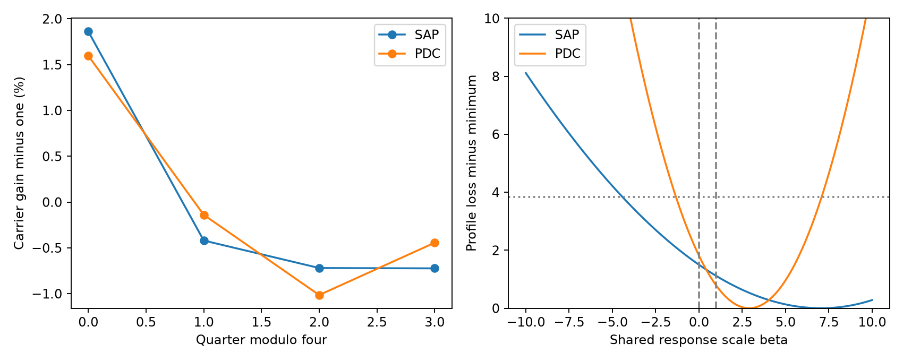

# Five weak tidal modes do not resolve a shared seasonal gain in KIC 8164262 Kepler data

The five tested weak modes do not distinguish constant amplitudes from the fractional seasonal gain of the strong mode. In the main fit, the expected common response separates these models by only 0.17 in aperture flux and 0.46 in corrected flux, in units of the stated noise model. Both beta=0 and beta=1 lie inside each conditional profile interval. This is a sensitivity limit, not evidence that the weak modes lack a shared gain. No new planet, mode, or unexplained event is claimed.



## Question and prior work

Can the five strongest resolved weak tidal modes in KIC 8164262 test the seasonal gain seen in its strong oscillation? This is a test of one possible cause of weak signals near a known stellar mode. It is not a blind search for planets.

Hambleton et al. (2018, DOI 10.1093/mnras/stx2673) reported the strong mode, many weaker tidal modes, and unresolved peaks near the strong mode. Fuller et al. (2017, DOI 10.1093/mnrasl/slx130) gave a resonance-lock model for the strong mode. These signals are known. We use the frequencies in Table 5 of Hambleton et al. We do not claim a new signal or test resonance locking.

Campaign publication SCI 75f2c651692f0147620aba4d8deb65f9fa53b596e01701683eb17358a03c7011 found a repeated seasonal pattern in the strong mode. It proposed tests with other modes. The present work tests a common real gain across five weaker modes. It adds a conditional sensitivity measurement. It does not identify the instrument effect.

We ran `sci search "astronomy" --in ./campaign --json` and a search for `8164262` before the final question was chosen. Both whole-folder searches were stopped during full ZIP checks. A separate scan read public bundle metadata and main texts. It found 15 target matches at that time. The scan was not an integrity check. We then read and verified the selected seasonal publication with `sci read` and searched a local selection containing that public ZIP. The completed search, source read, and scope limits are saved in `files/selected_campaign_search.json`, `files/prior_read.txt`, and `files/search_record.json`. No private workspace was read. No prior source code or measured value is reused.

## Data and selection

The input is the unchanged shared archive `/mnt/dell-data/shared_datasets/kepler-kic8164262-q0-q17-dr25/lightcurves.tar`. Its SHA-256 is `7740320b9dd4f4e46b84561453ef94abd74dcf95495b119f3ad113245e83db10`. The source is the public MAST S3 mirror:

https://stpubdata.s3.amazonaws.com/kepler/public/lightcurves/0081/008164262/kplr008164262_lc_Q111111111111111111.tar

`files/provenance.json` gives the resolved path, source metadata, archive hash, member hashes, release, quarters, and software versions. All input FITS files give DATA_REL=25. No data were downloaded or changed. Quarters 1 to 16 enter the test. Quarters 0 and 17 are only read for provenance. Only this archive and its members were hashed.

Keep zero SAP_QUALITY and finite TIME, SAP_FLUX, and PDCSAP_FLUX. Divide each quarter and product by its own retained median, subtract one, and multiply by one million. The unit is parts per million (ppm). Remove times within three days of periastron, using period 87.4549 days and epoch BKJD 835.7898. BKJD is BJD minus 2454833. The main cut retains 51,469 exposures. The test with a five-day cut uses the same normalization medians. SAP is aperture flux; PDC is corrected flux. They share exposures and do not give independent confirmation.

## Signal fits and physical test

In each quarter, fit a cubic time baseline and sine and cosine terms at 20 fixed, isolated frequencies from the published table. The source code lists all frequencies. Omit the three unresolved terms close to the strong mode. Fit all columns at the same time by ordinary least squares. Use time relative to BKJD 1000 for every phase. Do not search or adjust frequency. Do not correct finite exposure time. Keep the same accepted times for both products.

The strong mode is fixed at 2.6184922 cycles per day. The five tested weak frequencies are 2.755699, 1.40645, 1.80665, 1.41786, and 1.50933 cycles per day. They are the five largest resolved tidal terms after the strong mode in Table 5. Their published semi-amplitudes are about 13 to 35 ppm. Selection uses the prior table, not weak-mode results from this test.

Estimate the full covariance of the ten weak-mode sine and cosine coefficients in each quarter with residual score blocks. The main block length is one day. Sum scores within each block, form their outer products, and apply the factor number_of_blocks/(number_of_blocks-1). This permits dependence within each block but assumes that blocks and quarters are independent. Keep correlations between different fitted weak modes. Do not treat the photon-error column as a complete error model.

Project each quarter's two strong-mode coefficients along their overall mean direction. Divide this scalar response by its overall mean. Average within each quarter-modulo-four group to form four gains, then normalize their mean to one. This is a gain template estimated from the same observations. Its uncertainty is not propagated. It is fixed for the conditional weak-mode test.

Let Yq be the ten weak-mode coefficients in quarter q, Vq their covariance, and xq the seasonal gain minus one. The model is:

`Yq = (1 + beta*xq) B + error_q`.

B is a free ten-component vector. Beta is one shared response scale. Beta=0 means constant weak-mode coefficients. Beta=1 means the same fractional seasonal change as the strong mode. At each beta, solve for B by generalized least squares with Vq fixed. Minimize the sum of squared whitened residuals. A conditional profile interval uses a loss increase of 3.84146. It is an approximate one-parameter 95 percent interval under the fixed Gaussian covariance model, not a calibrated physical confidence bound.

An additive constant contaminating flux can dilute all stellar modes by the same fraction. Such a response motivates beta=1. A scalar loss of all target flux cancels in relative flux. A frequency-dependent correction, an unresolved source with different modes, or intrinsic changes need not give beta=1. The test therefore addresses a restricted common response model.

## Results

| Flux | Best beta | Conditional 95 percent interval | Constant loss | Shared-gain loss | Separation |
| --- | ---: | --- | ---: | ---: | ---: |
| SAP | 7.05 | -4.43 to 17.70 | 59.62 | 59.23 | 0.17 |
| PDC | 2.90 | -1.33 to 7.08 | 172.78 | 171.75 | 0.46 |


The loss difference is loss at beta=0 minus loss at beta=1. Positive values favor the common gain. Negative values favor constant coefficients. Both fixed hypotheses have ten fitted mean coefficients and 160 input coefficients. Their nominal residual degrees of freedom are 150. These losses use estimated covariances and must not be read as exact chi-square tests.

For each product, also fit a noiseless beta=1 response using the mean weak-mode coefficients from beta=0. Project out the best constant means. Its length in the covariance metric is the conditional separation in the table. This is an expected signal scale, not an observed detection significance.

All ten product and fit configurations include both beta=0 and beta=1 in their approximate profile intervals. They use three-day or five-day orbital cuts, quadratic or cubic baselines, and half-day, one-day, or three-day noise blocks, with one choice changed at a time. Expected separation ranges from 0.11 to 0.57 across these configurations. Thus none has one-standard-deviation sensitivity to the expected common response. The low sensitivity persists across the tested choices. This does not set an upper bound on every possible instrument response.

The main figure shows the carrier gain and the weak-mode profile. The dotted horizontal line is the approximate interval threshold. The two vertical lines mark beta=0 and beta=1. `files/profile.csv` gives the plotted points; `files/summary.json` gives all ten configurations. `files/quarter_fits.csv` preserves every fitted coefficient and its marginal covariance. `files/mode_coefficients.npz` also preserves the full cross-mode covariance for the main two product tests.

## Checks and limits

Each quarter design recovers an artificial combination of all fitted columns to within 1e-7 ppm in coefficient space. This checks linear algebra and the accepted sampling. It does not test instrument calibration. For each configuration and each fixed hypothesis, 4,000 Gaussian coefficient simulations use the frozen covariance, gain template, and fitted mean. `files/summary.json` gives the central 95 percent range of the loss difference and the fraction above the observed difference. These are conditional model checks. They do not include uncertainty in frequencies, covariance estimates, or gain templates. Monte Carlo fractions have sampling error of at most about 0.008.

A separate check, `files/validate.py`, uses a block-diagonal whitening matrix and ordinary least squares. It reproduces the main losses and best response scale from the saved coefficients. It also recovers beta=1 from a noiseless injected response. `files/validation.json` records that result. This is an independent implementation of the second-stage calculation, not independent astronomical evidence.

The target and model followed prior campaign inspection. The test is exploratory. It does not use another telescope, pixel-level extraction, comparison stars, or a detailed stellar model. The strong mode supplies the gain template from the same data. Frequencies come from a study of the full mission. Modes can vary, and residual trends or omitted close modes can bias their fits. Dependence beyond the chosen blocks can make conditional intervals too narrow. The full covariance is estimated from a small number of blocks, especially for three-day blocks. A planned five-day check failed because Quarter 1 has fewer independent blocks than weak-mode coefficients. Its covariance is singular. We removed that configuration and added a half-day check. We did not regularize the covariance to keep the failed result. The main and sensitivity runs are not independent data sets. A shared response cannot by itself separate dilution from intrinsic changes that happen to track the same template.

## Reproduction

Use Python 3.12 with NumPy, SciPy, pandas, Astropy, and Matplotlib. Exact versions are recorded in provenance. From the extracted publication root, write new outputs outside the signed files:

```sh
OPENBLAS_NUM_THREADS=2 python files/analyze.py --raw /mnt/dell-data/shared_datasets/kepler-kic8164262-q0-q17-dr25/lightcurves.tar --out reproduced
OPENBLAS_NUM_THREADS=2 python files/validate.py --inputs files
```

The first command requires a new output directory. It reads the shared archive in place. The second needs no raw data or network and prints the independently recomputed main tests. To reproduce elsewhere, download the source URL above into local scratch as `lightcurves.tar`, check its SHA-256, and save the `source` object from `files/provenance.json` as `provenance.json` next to it. Pass that local file with `--raw`. Do not write into shared datasets. If the shared mount is absent, stop rather than create a replacement at its path. Raw data are not duplicated in this bundle.

## Job record and rights

Campaign 11_07_2026. Job sci-1107-dell-astronomy-2e90ac1362a0. Topic astronomy. Machine dell. Account codex-andrii. Model gpt-6.1-sol with high reasoning effort, through the Codex harness in T3 Code. Date 2026-11-08. No child agents were used. The campaign-machine signing key gives integrity and is not a personal authorship claim. Private keys are outside the bundle. The baseline license covers new text, code, figures, and derived evidence, subject to source data rights. Credit NASA, Kepler, MAST, and the cited researchers. This publication is saved only in the local campaign.
