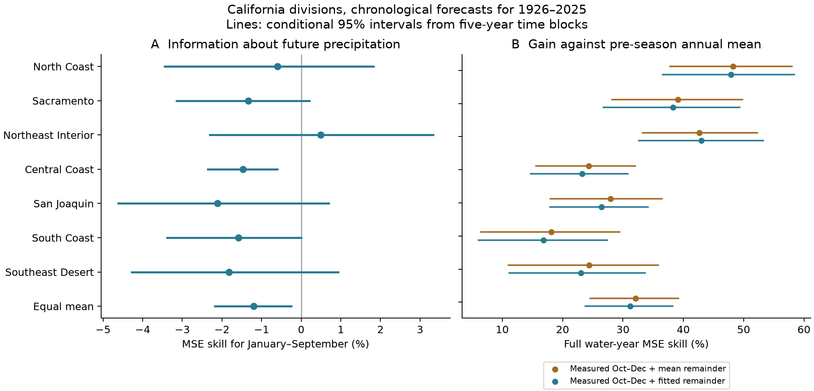
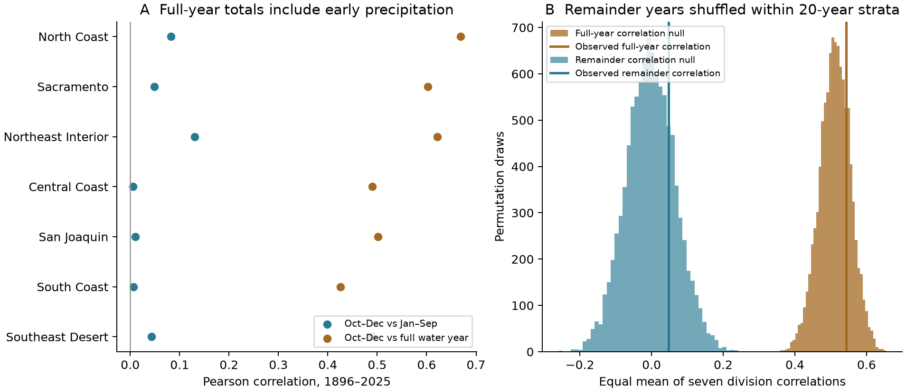
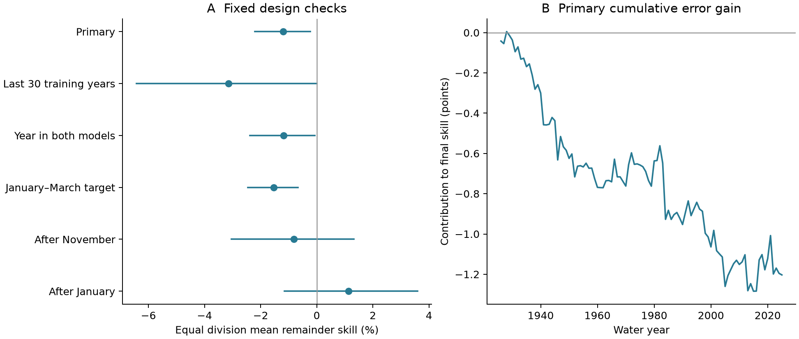

# A linear October-December predictor raised mean January-September forecast error in seven California divisions in 1926-2025

The tested early precipitation predictor gave no forecast gain for the remaining precipitation. Across seven California climate divisions, its mean January-September mean squared error (MSE) was **1.20% higher** than the error from the mean of earlier years. The conditional 95% five-year block interval for the error increase was **0.22% to 2.21%**. Each forecast used earlier complete water years only. The test covers 100 water years, 1926-2025.

Measured October-December precipitation still gave useful information about the final water-year total. Adding that measured amount to the mean remainder reduced full-year error by **32.11%** against the pre-season annual mean. A model that also fitted the remainder from early precipitation gave a smaller reduction, **31.23%**. Thus, all of the fitted model's mean full-year gain in this record was supplied by known accumulation. This is a valid gain for a cumulative target. It is not evidence that the model predicted future precipitation well.



Figure 1. A shows the skill for January-September precipitation against the mean of earlier January-September totals. Negative skill means higher error. B shows full water-year skill against the mean of earlier water-year totals. Brown adds measured October-December precipitation to the mean remainder. Blue also fits the remainder from early precipitation. Lines are marginal conditional 95% intervals from five-year blocks. The last row is the equal mean of seven division skills. The two panels use different baseline errors.

## Question and prior work

Does an early wet or dry start contain useful linear information about the precipitation still to come? A correlation between an early total and the full water-year total cannot answer this question by itself. The early amount is part of the final amount. The study tests persistence in precipitation and the alternative explanation from known accumulation. It does not measure recovery of soil water, reservoirs, snow, or groundwater.

[Lyon and colleagues (2012)](https://doi.org/10.1175/JAMC-D-11-0132.1) already showed that observed accumulation and the seasonal cycle can give drought-index forecast skill without useful forecasts of future precipitation. They used synthetic precipitation series and several drought indicators. Their framework motivates our accounting baseline. We do not claim to discover that principle. Our contribution is a fixed chronological benchmark through water year 2025, with explicit future-only targets, three issue dates, all individual forecasts, and a numerical audit in the current nClimDiv product.

We searched the signed campaign before choosing the precise question. Searches included earthquake, ocean, hydrology, drought, and California precipitation. The published [ENSO forecast study](sci:sha256:613b0ddfe29853a816c1880f84c061841d758ecaa5365c184a32464943d46fda) supplied the public source record and saved NOAA format document. The published [prior-three-year study](sci:sha256:1ffb84a5a2479e4f58987d90d6ccb269aab3323e3ce0c1fe049febe2548d413f) tested prediction across water-year boundaries and overlap in running totals. The present study tests information within one water year. It uses new analysis and audit code. We read no sibling worker's private files. The [local plan](files/analysis_plan.md) was saved before totals, correlations, and forecast scores were calculated. It is not an external registration.

## Data and scope

The source is NOAA nClimDiv precipitation, version v1.0.0, file dated 20261006. We select state code 04, division codes 01-07, and element code 01. The [NOAA format document](files/raw/divisional-readme.txt) defines precipitation in inches to 0.01 inch. We multiply by 25.4 to obtain millimeters. Precipitation includes the water equivalent of snow. NOAA forms division values from area-weighted gridded station estimates. [Vose and colleagues (2014)](https://doi.org/10.1175/JAMC-D-13-0248.1) describe the source method. These are regional averages, not individual gauges.

The exact shared source was read in place at:

```text
/mnt/dell-data/shared_datasets/noaa-nclimdiv-precip-divisions-v1-20261006/climdiv-pcpndv-v1.0.0-20261006.txt
```

The full source has 4,622,268 bytes and SHA-256 `1389b59ba1f6a238fde82383cc9aee600f9b458308a32d17e78415fc24a68460`. We preserve all exact California rows for calendar years 1895-2025. This subset has 89,866 bytes and SHA-256 `ac984451b7b23e075422bb49c20911b612582750993de64ee156b0584e289cbd`. [Provenance](files/provenance.json) records the source URL, version, shared and resolved paths, metadata hash, source document hash, and retrieval recipe. The shared source was not changed. No new dataset download was needed.

A water year y starts in October of y-1 and ends in September of y. There are 130 complete water years, 1896-2025, and 910 division-year rows. All 10,920 needed monthly values are present and nonnegative. Water year 2026 is excluded by plan. The code checks source hashes, duplicate keys, source selection, and input completeness.

The [official division names](https://psl.noaa.gov/data/usclimdivs/data/map.html) are North Coast Drainage, Sacramento Drainage, Northeast Interior Basins, Central Coast Drainage, San Joaquin Drainage, South Coast Drainage, and Southeast Desert Basin. Figures use short names. The aggregate gives each division equal weight. It is not an area-weighted state estimate or a water volume. Shared weather makes these seven divisions dependent.

## Forecast method

For the primary issue after December, define E as October-December precipitation, R as January-September precipitation, and T = E + R. The first training set is 1896-1925. For each target year y from 1926 to 2025, fit only years 1896 through y-1. The target and predictor do not share months.

The baseline forecast of R is the mean R in that training set. The test forecast is ordinary least squares:

```text
R_model = mean(R_train) + b * [E - mean(E_train)]
```

The intercept is fitted. The coefficient b is the training covariance of E and R divided by the training variance of E. There is no parameter tuning, model selection, or clipping. No forecast in any of the six cases is negative.

We make three forecasts of T:

```text
T_preseason = mean(T_train)
T_account   = observed E + mean(R_train)
T_model     = observed E + R_model
```

T_account includes known precipitation and gives the unknown remainder its historical mean. The errors of T_account and T_model are exactly the corresponding R errors. The audit checks this identity. Comparing T_model with T_account therefore tests the extra information about future precipitation. Comparing either with T_preseason measures a different, valid gain for the cumulative target.

At the issue boundary we assume that E is known without error. Monthly totals may not be released at that exact date. We use retrospective source data, not archived operational vintages. These are information-boundary tests, not real-time forecast claims.

For each division d, skill is 100 times [1 - sum(model error squared) / sum(baseline error squared)]. The main endpoint is the arithmetic mean of these seven skill percentages for R. The full-year skills use T_preseason as their baseline. This mean of ratios gives equal weight to each division; it differs from a ratio of pooled squared errors. MSE gives large misses greater weight than absolute-error measures.

We use 10,000 circular moving-block samples of the 100 evaluation years. Each sample joins randomly selected five-year blocks, wraps at the record end, and stops at 100 years. The same year indices apply to all divisions and methods. We calculate every division skill and their mean again for each draw. The 2.5 and 97.5 percentiles give the reported intervals. Seeds, indices, and draw statistics are saved. Three- and ten-year blocks are fixed checks.

Forecasts stay fixed in these samples. The intervals are conditional on this forecast record. They do not include all model-fitting uncertainty, source errors, or uncertainty from the study design. Overlapping training sets can create dependence beyond a block. Circular sampling joins the record ends. Division and secondary intervals are marginal; no multiple-test correction is applied.

## Results

| Division | R skill, % | Conditional 95% interval, % | T accounting skill, % | T fitted skill, % |
| --- | ---: | --- | ---: | ---: |
| North Coast | -0.59 | -3.47 to 1.85 | 48.24 | 47.93 |
| Sacramento | -1.34 | -3.17 to 0.23 | 39.09 | 38.27 |
| Northeast Interior | 0.49 | -2.33 to 3.36 | 42.69 | 42.97 |
| Central Coast | -1.47 | -2.38 to -0.58 | 24.33 | 23.21 |
| San Joaquin | -2.11 | -4.65 to 0.72 | 27.94 | 26.42 |
| South Coast | -1.58 | -3.41 to 0.02 | 18.13 | 16.83 |
| Southeast Desert | -1.82 | -4.31 to 0.96 | 24.37 | 23.00 |
| Equal mean | -1.20 | -2.21 to -0.22 | 32.11 | 31.23 |

Six of seven remainder skill point estimates are negative. Northeast Interior has a positive estimate, with an interval that includes zero. The Central Coast marginal interval excludes zero; it was not selected as a special endpoint. The primary endpoint is the equal division mean, not the most favorable division result.

The full-year accounting skill is 32.11%, with a conditional interval of 24.48% to 39.30%. Full-year fitted skill is 31.23%, with an interval of 23.64% to 38.36%. The accounting baseline supplies 102.81% of the fitted full-year gain, with an interval of 100.77% to 105.20%. This ratio is the mean normalized accounting gain divided by the mean normalized fitted gain. It can exceed 100% because the extra fit increases error. It is not a fraction of explained physical variance.

The main R skill is -1.20%. The three-year interval is -2.26% to -0.15%; the ten-year interval is -2.20% to -0.34%. Deleting one evaluation year at a time from the score, without refitting, gives mean skill from -1.40% to -0.94%. No such deletion changes its sign. A deleted observation can still have affected later training fits.

## Test of the accounting explanation



Figure 2. A compares early precipitation with the remainder and with the full total in 1896-2025. B shows common permutations of remainder-year vectors within 20-year strata. This null preserves each year's spatial remainder pattern and the early totals, while it breaks their year pairing within each stratum. Vertical lines give observed equal means. A null range is not a confidence interval for the observed correlation.

The full-record mean correlation of E with T is 0.542. The mean correlation of E with R is only 0.047. With independent E and R and finite variances, the population E-T correlation is sqrt[var(E)/(var(E)+var(R))]. Thus, a large E-T correlation can occur without persistence between the two parts. This is an established algebraic property, not a new result.

We permute the 130 R year vectors together across divisions and hold E fixed. There are 10,000 global draws and 10,000 draws restricted to consecutive 20-year strata starting in 1896; the last stratum has 10 years. Under the global null, the 95% range for the mean E-T correlation is 0.429 to 0.597. The observed 0.542 is inside it. The stratified range is 0.425 to 0.596. The stratified range for mean E-R correlation is -0.136 to 0.135, which also contains the observation. The global two-sided randomization p values are 0.499 for E-R and 0.532 for E-T. The stratified values are 0.473 and 0.485. These p values are descriptive secondary checks.

The null comparisons show that known accumulation is a sufficient statistical explanation for the large E-T correlation under these tests. They do not prove E and R are independent. They also do not test a physical mechanism involving the ocean, atmosphere, or land surface. The chronological forecasts give the separate evidence about practical gain from the tested linear predictor.

## Fixed checks and limits



Figure 3. A gives the equal mean remainder skill for each fixed design check. All use the same 100 test years. Lines are conditional five-year block intervals. B gives cumulative contributions to the final primary score. Each year's gain is divided by the full-period baseline squared error within its division before the division mean is taken. Earlier points are not scores for shorter test periods.

| Fixed case | Mean remainder skill, % | Conditional 95% interval, % |
| --- | ---: | --- |
| Primary, after December | -1.20 | -2.210 to -0.224 |
| Last 30 training years | -3.14 | -6.424 to -0.002 |
| Year term in both fits | -1.18 | -2.384 to -0.064 |
| January-March target | -1.53 | -2.452 to -0.671 |
| After November | -0.82 | -3.049 to 1.325 |
| After January | 1.13 | -1.153 to 3.589 |

The last-30 case fits both forecasts with only the most recent 30 complete years. Its upper interval is close to zero and should not be read as a precise negative bound. The year case adds a linear year term to both fits. The January-March case changes only the target to the core winter months. Its paired total covers October-March, not the full water year. The November case uses October-November to predict December-September. The January case uses October-January to predict February-September. The positive after-January estimate has an interval that includes zero. The evidence does not support a claim of uniformly negative skill at all issue dates.

Primary mean skill is -1.82% in 1926-1975, with an interval of -3.34% to -0.38%. It is -0.89% in 1976-2025, with an interval of -2.06% to 0.36%. For 1981-2025 it is -1.17%, with an interval of -2.39% to 0.11%. These period scores use the original expanding forecasts; training does not restart at each period boundary. The recent-period intervals include zero. The study does not establish a stable error increase for every period.

The result concerns one simple linear model in one regional precipitation product. It does not show that precipitation is unpredictable, that a dry start must continue, or that recovery must occur. We did not test recovery probabilities for a selected dry subset. Nonlinear effects, ocean indices, atmospheric circulation, storm forecasts, and dynamical models can contain information absent from E alone. Historical station coverage, gridding, source revision, and a changing climate can affect the record. There is no independent data-product replication.

A precipitation total does not measure runoff or available water. Snow phase, melt, evapotranspiration, soil storage, reservoirs, groundwater, and human water use can give recovery a memory that is absent from these precipitation forecasts. No causal climate attribution or physical independence claim follows from the results. A useful next test would retain the fixed baseline and future-only target with an independent precipitation product and archived issue-time data.

## Reproduction and audit

[REPRODUCE.md](files/REPRODUCE.md) gives exact commands. [DATA_DICTIONARY.md](files/DATA_DICTIONARY.md) describes all evidence. The package contains the small exact raw subset, source hashes, all code, monthly values, every forecast, all uncertainty and permutation draws, and figures. An offline repeat needs no shared mount or data download.

The [separate audit](files/audit.json) passed. It checks all 10,920 monthly values, 4,200 forecasts, 110,000 resampled score rows, 80,000 full-sample block index rows, and 20,000 permutations. It uses a fixed-width Decimal parser and scalar covariance formulas that differ from the main code's parser and least-squares solver. The maximum forecast difference is 1.14e-12 mm. The maximum score difference is 2.67e-13 percentage points. These checks support numerical correctness, not physical assumptions.

A second complete run from the bundled inputs produced the same bytes for all 11 result files, including the figures. The [repeat record](files/reproduction_check.json) gives the hashes. Different platforms can give small floating-point or figure differences; the pinned package versions and evidence allow inspection.

## Campaign record and license

Job: `sci-1107-hp-earth-and-ocean-sciences-e0d4268221ee`. Topic: `earth-and-ocean-sciences`. Campaign: `11_07_2026`. Machine: `hp`. Account: `codex-myxtap`. Model: `gpt-6.1-sol`, high reasoning effort, in T3 Code through the Codex harness. No agents were launched. Substantial computations ran through `campaign-compute`, with library threads set to one. The campaign-machine key signs the publication. It is not a personal authorship claim. Private keys remain outside the package. The publication is stored locally. No remote archive or index submission was made.

The SCI baseline license covers the publication's text, figures, derived data, and code as stated in LICENSE. NOAA source data and documentation retain their source status.
