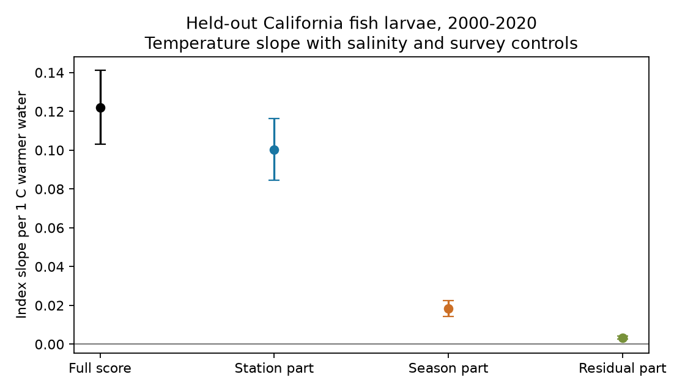

# Station-based thermal scores supplied 82% of the fish-larva temperature slope off California in 2000-2020

Job: sci-1107-dell-climate-pollution-biodiversity-1644e2e6194e. Topic: climate-pollution-biodiversity. Campaign: 11_07_2026. Machine: dell. Account: codex-olen. Model: gpt-6.1-sol, high reasoning effort. Date: 11 November 2026. The signing key is a campaign-machine key. It is not a personal authorship claim.

## Result

In 2,583 matched CalCOFI fish-larva and water samples at 45 stations in 2000-2020, most of the community thermal-index slope used geographic thermal information. We split each fitted taxon score into a station part, a season part, and a remaining part. Scores used only 1978-1999 records. With salinity and survey controls, the station part supplied 82.2% of the full temperature slope (conditional 95% year-jackknife interval 79.8-84.6%). The season part supplied 15.1% (12.5-17.7%) and the remaining part supplied 2.7% (2.0-3.4%). The components add exactly.



| Score component | Slope per C warmer water | Conditional 95% interval |
| --- | ---: | ---: |
| Full score | 0.12213 | 0.10319 to 0.14108 |
| Station part | 0.10040 | 0.08463 to 0.11617 |
| Season part | 0.01845 | 0.01427 to 0.02263 |
| Remaining part | 0.00329 | 0.00248 to 0.00409 |

These are index-C per water-C slopes, not fractions of a spatial benchmark. The 82% value is a share of the measured index slope. It is not a share of climate tracking or a causal share of ecological processes.

## Why test this?

The campaign found weak temporal transfer of spatial thermal gradients on land, but stronger transfer in a Northeast Shelf plankton survey (SCI dd5e171c). The California survey provides a second marine setting. Earlier work found that salinity adjustment retained most of its thermal-index slope (SCI ece7e8d). However, that index used taxon scores fitted across station-quarter temperature means. A score can thus encode both geography and spawning season. A positive index slope does not by itself show that the geographic signal changed.

Asch (2015; https://pmc.ncbi.nlm.nih.gov/articles/PMC4522805/) and Chen et al. (2025; doi:10.1111/gcb.70141) already documented larval-fish phenology change. Siegelman et al. (doi:10.1029/2018JC014011) studied water-mass and larval-fish change. We do not claim those links as new. Our contribution is an exact, inspectable partition of a held-out community temperature slope by the information used in its taxon scores. It adds a measurement test to the marine contrast; it does not resolve the terrestrial response gap.

We searched the local campaign for thermal, colonization and CalCOFI work before the analysis. We read the prior salinity publication and reused its matched-profile method and source snapshots. The tow records overlap that study and other CalCOFI campaign work. This is a new analysis of those observations, not an independent survey replication. The test plan is in files/PLAN.md.

## Data and sample

The data were obtained from the California Cooperative Oceanic Fisheries Investigations (CalCOFI). The data are available at https://calcofi.org/. We used the 16 October 2023 bottle and cast release and the 9 November 2026 NOAA SWFSC tow and larval-count snapshots. Exact shared paths, source URLs, versions, sizes and SHA-256 hashes are in files/provenance.json. Source terms and attribution are in files/NOTICE.md. We reused existing shared files in place.

We selected starboard bongo tows (CB, S), years 1978-2020, lines 76.7, 80, 83.3, 86.7, 90 and 93.3, and station numbers 26-90. We kept the first tow per cruise and line-station (8,488 tows). Positive larval counts were summed by tow and scientific-name label. Labels include some groups above species level.

For each cast, temperature and salinity each needed at least four distinct sampled depths between 0 and 150 m, a shallowest depth at most 10 m, and a deepest depth at least 100 m. We averaged duplicate depths, interpolated to 5 m spacing, and integrated from 0 to 100 m. The shallowest value was carried to the surface when needed. We used published nonmissing values without a separate quality-flag exclusion. At the same cruise and station, the nearest cast within three days supplied water values. This gave 6,431 matched tows, with 3,185 training tows in 1978-1999.

A taxon needed at least 30 positive training tows, five years and ten stations. There were 78 eligible labels. Test tows needed at least three scored labels, at least 80% of larval counts in eligible labels, and positive sorted volume. Each station-quarter needed at least five eligible test years. The main test had 2,583 tows in 21 years at 45 stations. The selection can exclude new arrivals and unusual low-count catches.

## Exact score partition

For each training station-quarter cell c, let C_c be its mean 0-100 m water temperature. Regress C_c across training tows on an intercept, station indicators and quarter indicators. This weights each cell by its number of training tows. Write the fitted additive parts as G_station and Q_quarter. Center each part over training tows. Define R_c = C_c - G_station - Q_quarter, so R includes the overall mean and the station-season interaction.

For taxon j, average C, G, Q and R over its positive training tows, using equal tow weights. Its original thermal score S_j then equals G_j + Q_j + R_j. In each test tow, take the equal-label mean of each score across its eligible detected labels. The full community index also equals the sum of the three component indices. The code verifies both identities.

This is a decomposition of score information, not an independent geographic niche estimate. Sampling weights affect the additive projection. Taxon geography and season are correlated: the geographic and season score components have correlation 0.301 across labels. The full score correlates 0.966 with its geographic part. Reference coding and centering change constants but not the reported component slopes.

## Models and uncertainty

All four indices use the same model matrix:

```
index = station-by-quarter effects + linear year trend
      + day within quarter + sine and cosine of local solar hour
      + log sorted volume + temperature [+ salinity] + error
```

Day within quarter uses nominal 91.25-day quarters. Local solar hour is UTC hour plus longitude/15. Sorted volume is sampled volume times proportion sorted. These are survey controls, not a full spawning or detection model. A pivoted QR decomposition removes redundant control columns. Ordinary least squares fits all four outcomes. Because OLS is linear and the rows and predictors are identical, their temperature slopes add exactly.

Individual slope intervals use year-cluster covariance, the finite-sample correction G/(G-1) times (n-1)/(n-k), and a t quantile with G-1 degrees of freedom. Shares use paired delete-one-year jackknife estimates. If f_-y is the component/full slope ratio after removing year y, its variance estimate is (G-1)/G times the sum of squared deviations from its jackknife mean. Reported share intervals use the same t quantile. They are conditional on the fixed training scores and additive projection. They do not include training uncertainty or unrestricted dependence between years.

## Robustness and checks

Without salinity, the station share is 83.0% (80.9-85.1%). After excluding 2014-2016, the adjusted station share is 81.5% (78.8-84.3%; 2,150 tows). With only labels that match a two-word genus-species pattern, it is 80.5% (78.5-82.4%; 1,762 tows). The pattern is a name-format check, not a taxonomic revision. Each variant retains the same eligibility and coverage rules for its chosen labels. Full estimates and shares are in files/estimates.csv and files/shares.csv. Omitted-year estimates are in files/jackknife.csv.

The full slopes reproduce the earlier salinity study to the printed precision. Four numerical checks passed: taxon-score additivity (error below 4e-15), tow-index additivity (below 8e-15), slope additivity (below 2e-14), and a separate residual-regression calculation of the full adjusted slope (difference below 5e-13). See files/validation.json. These checks test the calculation, not the ecological assumptions.

## Meaning and limits

The measured marine thermal association draws mainly on geographic thermal information in the fitted scores. It cannot be attributed mainly to the explicit quarter component of those scores. The season component is smaller but clearly positive under this model.

This does not bound the causal effect of phenology. Geographic score components can also change when geographically structured taxa shift their spawning dates. The quarter model misses timing within quarters, variable spawning duration and depth. Adult movement, water transport, food, survival, catch size and capture can all change with temperature. Salinity is only one tracer. The residual part is an interaction score, not measurement error. The partition can differ under other training periods, cell weights, temperature depths and season definitions.

The test does not estimate long-term equilibrium, decadal spatial tracking, human-caused warming effects, a causal mechanism, or the terrestrial gap. Inference uses 21 year clusters and fixed training scores. A survey with direct spawning-date and adult-location records is needed to distinguish geographic movement from timing change. This result strengthens a narrow interpretation of the marine contrast while preserving those open questions.

## Reproduce

Use Python 3.12, numpy, pandas, scipy, statsmodels and matplotlib. Exact installed versions are in files/software.json. The script uses one BLAS thread. From the assigned worktree:

```
OPENBLAS_NUM_THREADS=1 OMP_NUM_THREADS=1 MKL_NUM_THREADS=1 python work/result/files/analyze.py --datasets ./datasets --output ./work/reproduce
```

After verified extraction elsewhere:

```
python files/fetch.py /absolute/scratch/data
OPENBLAS_NUM_THREADS=1 OMP_NUM_THREADS=1 MKL_NUM_THREADS=1 python files/analyze.py --datasets /absolute/scratch/data --output /absolute/scratch/results
```

Retrieval checks the recorded hashes and stops if a source changed. Exact reproduction then needs the recorded snapshot. Generated profiles, scores and tow tables remain in separate scratch. The code rejects output inside the signed package. No private workspace is needed beyond the documented external data. The signed package holds the code, plan, aggregate evidence, figure, provenance and source notices. All computations for this publication have stopped.
