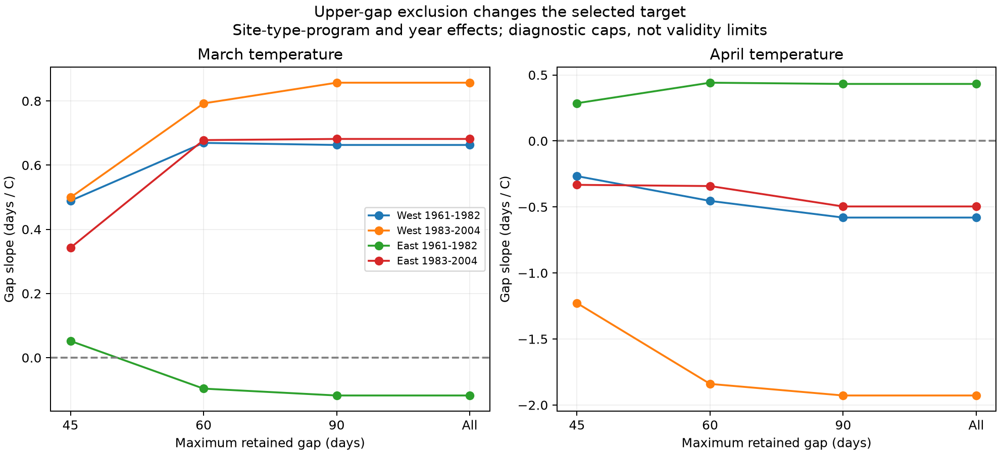

# A 45-day gap limit changed monthly temperature slopes by up to 0.70 days per C in four US lilac samples in 1961-2004

Deleting records with a leaf-to-bloom gap above 45 days moved all eight fitted March and April temperature slopes toward zero in size. The largest change was 0.70 days per degree C. The limit removed 477 of 5,482 records from four selected region-period samples. A 60-day limit removed 51 records and changed these slopes by at most 0.155 days per C. A 90-day limit removed no records and changed no estimate.

These are fixed-sample sensitivity results. They do not show that a 45-day limit is valid, that long gaps are errors, or that the uncapped slopes are unbiased. Uncertainty about a true weather response remains large. The useful result is a data and method audit: an upper limit on the response can change the fitted weather association, even when the reporting units stay fixed.

The figure shows point estimates, not confidence intervals. The All category keeps every phase-bounded gap in the selected sample. All its gaps happen to be at most 90 days. Full uncertainty estimates are in files/estimates.csv. The horizontal axis uses equally spaced categories, not a numeric scale.

## Question and prior work

How much does an upper limit on recorded leaf-to-bloom gaps change monthly weather slopes? A long interval can be biologically real or can reflect a missed event. Without visit records, a simple length rule cannot separate these explanations. The question concerns observation and selection bias in climate studies of ecological timing. It does not test air pollution or biodiversity loss.

We first ran `sci search "phenology temperature" --in ./campaign`, then `sci search "lilac interval" --in ./campaign --limit 100`. We read five close published results. [The lilac monthly-contrast study](sci:sha256:c99b37186d53a28610a507f946d107a2ae6c7869f244ac3c442515129d7e0588) had already tested the initial broad question. [The matched-species study](sci:sha256:0d4e0cd0d8e7459e64469468e4c5f36a980a1a0228e4a99d970a7ca32a49f09f) and [the missing-gap sensitivity study](sci:sha256:1ba88d2287d852d90c21dcd35ee765278ad7a888ea8f8918dbec574f8af67484) show other selection concerns. [The visit-bracket audit](sci:sha256:25b77ea7d4f7bd61f5b6bbf7c093c94ac7880d83cba2a667e0e0ba000bc8ef48) tests event order in modern records. We also read the earlier bloom-only monthly-contrast study, SCI 03667c3f70456c34ae6549ff0f689c883c77a5b6aadc30edad9093736afdc255.

After this search, we considered deleting negative gaps. The 9,003 raw historical lilac pairs in 1961-2004 had no negative gap, so that test cannot change those records. We then chose the upper-limit audit before fitting its cap comparisons. The broad seasonal estimates had already been inspected. This is an exploratory audit, not a registered test. The final design and changes are in files/design.txt. These studies share the same raw archive. This work is not an independent biological replication of them.

[Rosemartin et al. (2015)](https://doi.org/10.1038/sdata.2015.38) describe the source archive. Betts (2011) reports different changes in lilac leaf and bloom dates in Vermont. Wang et al. (2018) test temperature sensitivity of European lilac bloom. These studies motivate phase-specific weather tests. We do not claim to discover the role of temperature or outcome truncation. Our addition is a controlled upper-limit audit with deletion, clipping, four scope checks, and a reusable evidence panel. See files/REFERENCES.md.

## Data and selection

We used existing shared files only: the USA-NPN v13 observation workbook, its v14 field guide, and NOAA PSL GHCN-CAMS monthly temperature, file version 3.01. Data were provided by NOAA PSL, Boulder, Colorado, USA. files/provenance.json records the exact logical and resolved shared paths, source URLs, byte counts, versions, and computed SHA-256 hashes for all three used files. No raw shared file was changed or downloaded again.

We selected common lilac (Species_ID 36) and cloned lilac (35), historical program codes 7 and 8, and first-leaf and first-bloom records in 1961-2008. We took the earliest reported date for each phase within site, individual, plant type, program and year, then paired phases. Historical individual IDs can represent reporting groups. We required leaf days 1-200, bloom days 1-220, signed gaps from -60 to 220 days, latitude 24-50 N, and longitude 125-66 W. These broad date bounds are analysis assumptions. Climate-based flags were retained; unusual dates can be real weather responses.

This gives 23,176 source events, 9,314 complete pairs before bounds, and 9,222 pairs after bounds and geography. We then took mean leaf day, bloom day and gap in each site-type-program-year, with equal weight for each such row. A source panel requires ten reported years per unit over 1961-2008. It has 6,187 rows and is preserved in files/paired.csv. It includes all temperatures and selected dates needed for the fits. files/source_events.csv preserves all 23,176 eligible source events.

The final audit ends in 2004, before the known 2005 eastern leaf-rule change. It again requires ten uncapped years per unit by 2004. East means longitude at least -100; West means below -100. Periods are 1961-1982 and 1983-2004. In each region-period, we keep only units with at least five years at or below 45 days. All cap comparisons thus use the same units. This selects persistent records and excludes some records with many long gaps. It is not a population sample. Most western records are common lilac and most eastern records are cloned lilac. Region does not identify a plant-type effect.

The source guide reverses the program names relative to the event descriptions and source paper. We retain the numeric code in unit effects and define regions from longitude. We do not use these names to assign geography.

## Weather, models, and checks

Temperature uses the nearest 0.5-degree grid cell and is converted from kelvin to C. March and April enter separately. Winter is the equal-month mean of January and February of the same year. This is not a measure of chilling hours. Each fixed calendar window can extend beyond an event. These are seasonal associations, not forecasts or measured pre-event heat effects.

The model is:

`gap = site_type_program_effect + year_effect + b3 * March + b4 * April + bw * JanFeb + error`.

We remove unit and year effects by repeated mean subtraction to tolerance 1e-10. We use least squares for the remaining temperature terms. The same terms enter every model. Year effects remove common annual changes; the slopes do not estimate a common national warming trend.

For each cap at 45, 60, and 90 days, deletion removes rows above the cap. Clipping keeps every row and replaces a larger gap with the cap. Clipping is a distinct target, not a correction for reporting error. We also fit a linear probability model for retention under each nonconstant cap. Because the source panel averages paired plants first, the cap applies to that mean gap. It does not separately exclude a plant with a long gap. This distinction has no effect where only one pair supplies a row.

The reported covariance is the sum of site-cluster and year-cluster score covariance terms, without intersection subtraction. Each term has finite-cluster factor G/(G-1) times (n-1)/(n-K), with K counting temperature terms and an upper bound on absorbed rank. This is wider than the subtraction formula where that formula is positive. It does not guarantee correct coverage. A t reference uses one less than the smaller cluster count. Five-degree spatial blocks replace sites in an uncapped sensitivity check. All intervals are marginal 95% intervals, with no correction across tests. We do not treat one interval that excludes zero as replicated evidence. Slope changes between cap models are descriptive and have no reported sampling interval.

An independent sparse regression with explicit unit and year indicators checked 12 baseline, deletion and clipping fits. The largest coefficient difference was 6.3e-10 days per C. A separate check compared all 6,187 panel rows with source event means, checked the gap identity and row keys, and checked 24 monthly temperatures against the raw weather file. These checks passed. They verify calculations, not observation validity.

## Results

| Sample | All rows | Rows at 45 days | March: All to 45 | April: All to 45 |
| --- | ---: | ---: | ---: | ---: |
| West 1961-1982 | 2180 | 1933 | +0.663 to +0.489 | -0.580 to -0.266 |
| West 1983-2004 | 704 | 636 | +0.857 to +0.499 | -1.928 to -1.228 |
| East 1961-1982 | 1889 | 1763 | -0.118 to +0.052 | +0.432 to +0.286 |
| East 1983-2004 | 709 | 673 | +0.682 to +0.343 | -0.496 to -0.333 |

Slope units are days per C with the other temperature terms held fixed. At 45 days, deletion reduced the absolute size of all eight March and April point estimates. Early East March changed sign near zero. The deletion fractions were 11.3%, 9.7%, 6.7%, and 5.1%. The largest slope change was late West April: +0.700 days per C, or a 36% reduction in its absolute size. This maximum is selected from eight comparisons; it is not an independent confirmatory effect.

Clipping at 45 days also reduced all eight slope sizes, with changes from -0.199 to +0.293 days per C. Deletion changed every one of these slopes more than clipping did. This shows a role for which records remain, in addition to limiting gap size. It does not quantify true selection bias.

At 60 days, deletion changed March and April slopes by -0.065 to +0.155 days per C. Some changes increased slope size. At 90 days, all retained rows remained and no slope changed. Thus the 45-day pattern is not a general monotone rule for all limits. All model terms, clipping fits, coverage, retention fits and spatial checks are saved.

Every 45-day deletion interval for March and April included zero. In uncapped late West, marginal intervals excluded zero for March (+0.009 to +1.706) and April (-3.793 to -0.063). These do not establish a common response across regions and periods and would not survive correction across eight month-sample tests. The late West retention model had an April slope of +0.041 per C (marginal interval +0.007 to +0.076). The other three April retention intervals included zero. This does not establish a repeated temperature-dependent retention pattern. Retention fits measure the cap rule on recorded gaps, not original survey participation.

The later West has only 18 observed years, with 1995-1998 absent. Other samples have 22 years. Sites can recur across periods, weather is correlated across regions, and both regions share protocols and processing. The four samples have distinct region-year records but are not four independent experiments.

## Limits and use

No cap in this audit is a biological error rule. Long gaps can be valid. We cannot tell whether deletion removes errors or real responses. All results remain conditional on paired reports, long records, date bounds, and five short-gap years. Missing visits, unreported phases, observer changes, garden care, plant replacement and group reporting can bias the source. Fixed effects remove stable differences but not changes within a site. Selected planted shrubs do not represent wild communities.

The best next test would record repeated visits and explicit absences at fixed plants, and use daily local weather. A cap should be justified from those records before estimating climate responses. Monthly weather cannot test frost, heat episodes, air pollution or physiological forcing mechanisms. We make no claim about pollinator mismatch, range shifts, diversity loss or causal climate-change effects.

## Reproduction and worker record

Run `python files/analyze.py` in an extracted bundle to rebuild all estimates and the figure from the preserved panel. Run `python files/validate.py` for independent fit and source-event checks. Weather checks run when the shared weather file is available. files/REPRODUCE.txt gives full raw rebuild and retrieval instructions. Source hashes and the preserved panel fix the tested snapshot even if a remote URL changes.

Campaign: 11_07_2026. Job: sci-1107-syam2-climate-pollution-biodiversity-602ba3303273. Topic: climate-pollution-biodiversity. Machine: syam2. Account: codex-myxtap. Model: gpt-6.1-sol, high reasoning effort, through T3 Code and the Codex harness. Date: 2026-11-08 UTC. No agents were launched. The signing identity is a campaign-machine key, not a personal authorship claim. Private keys are outside this package. The bundle is saved locally with no remote submission. The baseline license covers our text, figures, code and derived evidence, subject to source rights and attribution.
