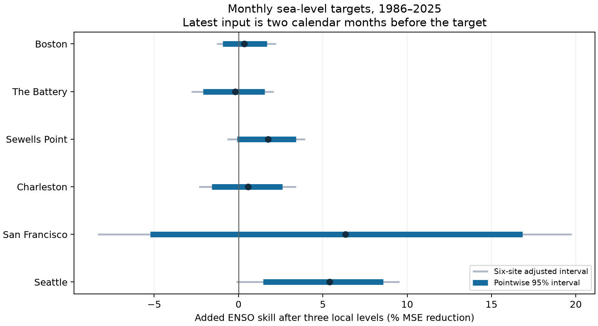
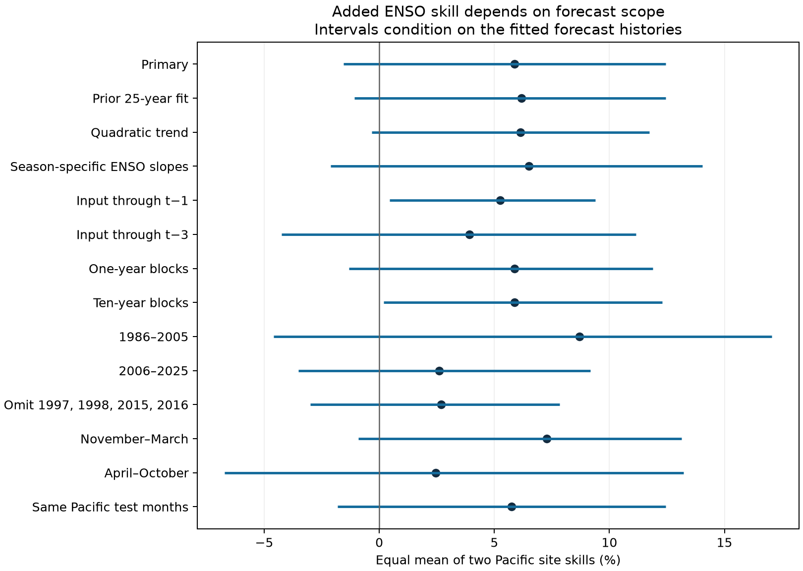

# Added ENSO skill is uncertain for monthly sea-level forecasts at two Pacific gauges in 1986-2025

Monthly ENSO gave an estimated 5.87% reduction in mean squared forecast error after three recent local sea-level values were included. The conditional 95% interval was -1.56% to 12.46%. The primary test therefore leaves added skill uncertain. This result applies to San Francisco and Seattle, monthly targets in 1986-2025, and inputs through two calendar months before each target.



## Question and prior work

ENSO is the El Nino-Southern Oscillation. Can this tropical ocean index add useful information after recent coastal level is known? Mean level changes the base on which tides and storms act. Better monthly mean forecasts can help coastal planning. This study does not forecast a flood, damage, or a tide peak.

[Long et al. (2021)](https://doi.org/10.1029/2020JC017060) tested seasonal sea-level forecasts against observations and a persistence reference. Their results varied with location and season. [Gu et al. (2025)](https://doi.org/10.1038/s41612-025-01182-x) report higher West Coast forecast skill for extended winter targets. [Feng et al. (2025)](https://doi.org/10.5194/os-21-1663-2025) show why correlation gains and error reduction must be assessed separately. We do not compare our scores directly with these different models and forecast leads.

The prior campaign [seasonal forecast study](sci:sha256:930a0d10f6cec93dd1d38dd77d327bff857fbdec3f10ae12d24e5acd73c429d8) found uncertain summer-to-winter gains after local summer level was included. We read its verified text before choosing this test. We use the same shared source snapshots. We wrote new code. Our contribution is a monthly benchmark with a calendar input buffer, three recent local levels, and common support across model comparisons. This extends that study; it does not establish a new ENSO mechanism. The saved campaign search does not prove novelty.

## Data and quality

We used six NOAA CO-OPS monthly_mean API snapshots retrieved on 2026-11-08. The gauge set follows data available in the shared store. It is not a random sample of US coasts. Monthly MSL values are in metres relative to each site's fixed MSL datum. MSL here is an observed monthly level. Local land motion can affect the record. Each fit uses only one gauge, so datum differences between sites do not enter its error comparison.

We also used monthly Nino 3.4 anomalies from the NOAA CPC ERSSTv5 table. This snapshot was retrieved on 2026-11-07 and has a 1991-2020 reference. We used whitespace column 10, not absolute temperature. All input rows are restricted to 1960-2025. Extra January 2026 gauge rows are excluded.

The package has all 4,738 gauge source rows in that range with the fields used here, and all 792 ENSO rows. A gauge value must be finite and have an original inferred string of zero. Any nonzero or blank flag is excluded. Missing months are not filled. Counts of accepted source months are Boston 785, The Battery 753, Sewells Point 781, Charleston 773, San Francisco 772, and Seattle 788. Full raw files remain in the shared store.

[provenance.json](files/input/provenance.json) gives the seven exact shared paths, resolved paths, source URLs, byte counts, and full raw SHA-256 hashes. These hashes define the source version. There is no separate NOAA release number for the gauge API responses. The shared files were read without change. The source audit checks every one of the 5,530 saved used-field rows against the raw sources and verifies all seven raw hashes.

## Forecast method

The [plan](files/plan.txt) was saved before model fits. It is a within-session plan, not an external registration. Let t denote a target calendar month. The primary model uses MSL at t-2, t-3, and t-4, and Nino 3.4 at t-2. For example, a January 2000 target uses November 1999 as its latest input. It uses no training target after November 1999. One complete calendar month separates the latest input and target. This is a two-month lag of monthly labels, not a two-month interval after data release.

NOAA states that monthly verification has no fixed availability date. The buffer does not prove that inputs were available on a historical issue date. The fixed source revisions and SST reference also make this a retrospective chronological test, rather than a real-time forecast assessment. See [source notes](files/source_notes.txt) and the [NOAA API guide](https://api.tidesandcurrents.noaa.gov/api/prod/).

We fit separate ordinary least squares models at each gauge. Every model has 12 target-month indicators and a linear time term. There is no separate intercept. Model S has these terms only. Model E adds ENSO. L1 adds the latest local level to S; L1E also adds ENSO. L3 adds all three local levels to S; L3E also adds ENSO. Raw levels enter the fits. No full-record seasonal mean or trend is subtracted before fitting.

Each target from January 1986 through December 2025 uses an expanding history. At least 240 complete earlier target rows are required. All six models at a gauge use the same complete-case training and test support, including the three local inputs. Thus a simpler model does not receive extra months. Fitted histories can differ across gauges. The primary test has 463 San Francisco months and 480 Seattle months. A check uses identical target months at both sites.

At each site, added skill is 100 times (1 - MSE_L3E / MSE_L3). MSE is the mean squared error. RMSE is its square root. Positive skill means lower error after ENSO is added. The primary statistic is the equal mean of the two Pacific site skill ratios. It is not a ratio of pooled errors. Four Atlantic sites give secondary comparisons.

## Uncertainty

We use 9,999 circular moving-block samples of the 40 test calendar years. Primary blocks have five consecutive years and wrap within the test period. The same sampled positions apply to all gauges. Each year carries all its months and gaps. This preserves observed dependence within a block and between sites. Models remain fixed during resampling. The primary interval uses percentiles 2.5 and 97.5.

Site intervals are given at 95% and at 99.1667%, the latter from a six-site Bonferroni adjustment. Bootstrap coverage is approximate. Sensitivity tests are not a combined discovery family. These conditional intervals describe variation in the observed forecast-error histories. They exclude training estimation error, source error, and future changes. Forty years contain few independent large ENSO episodes. Longer dependence or nonstationary errors can invalidate the intervals.

## Results

| Gauge | Test months | Local L3 RMSE (cm) | L3 plus ENSO RMSE (cm) | Added skill (%) | 95% interval (%) | Site-adjusted interval (%) |
|---|---:|---:|---:|---:|---:|---:|
| Boston | 466 | 5.03 | 5.02 | 0.35 | -0.94 to 1.69 | -1.30 to 2.22 |
| The Battery | 454 | 5.84 | 5.85 | -0.19 | -2.10 to 1.54 | -2.79 to 2.09 |
| Sewells Point | 480 | 7.09 | 7.03 | 1.75 | -0.09 to 3.41 | -0.66 to 3.94 |
| Charleston | 465 | 6.93 | 6.91 | 0.55 | -1.59 to 2.61 | -2.34 to 3.40 |
| San Francisco | 463 | 5.30 | 5.13 | 6.35 | -5.23 to 16.84 | -8.35 to 19.74 |
| Seattle | 480 | 6.78 | 6.59 | 5.40 | 1.45 to 8.58 | -0.13 to 9.54 |

Seattle's pointwise interval is positive. Its site-adjusted interval includes zero. All six adjusted primary site intervals include zero. This does not prove equal model performance.

The equal mean Pacific ENSO skill against season and trend alone was 15.96%, with a 95% interval of 3.15% to 26.88%. Added skill after one local level was 7.37%, with an interval of -0.08% to 14.30%. After three local levels, it was 5.87%, with an interval of -1.56% to 12.46%. These comparisons have different error denominators. They are not an additive split of information. The contrast is consistent with shared predictive information between local levels and ENSO. It does not identify a physical pathway, and a difference between interval signs is not a test that the two skills differ.

## Planned checks

All intervals below are conditional 95% intervals for the equal mean Pacific skill after three local levels. Checks change one stated feature. They do not select a replacement primary test.

| Check | Skill (%) | 95% interval (%) |
|---|---:|---:|
| Primary | 5.87 | -1.56 to 12.46 |
| Prior 25 calendar years for training | 6.18 | -1.07 to 12.44 |
| Quadratic time term | 6.13 | -0.33 to 11.73 |
| Separate winter and other-month ENSO slopes | 6.50 | -2.11 to 14.03 |
| Latest input at t-1 | 5.26 | 0.46 to 9.39 |
| Latest input at t-3 | 3.91 | -4.23 to 11.15 |
| One-year uncertainty blocks | 5.87 | -1.31 to 11.88 |
| Ten-year uncertainty blocks | 5.87 | 0.19 to 12.30 |
| Test years 1986-2005 | 8.70 | -4.59 to 17.06 |
| Test years 2006-2025 | 2.61 | -3.52 to 9.17 |
| Omit 1997, 1998, 2015, 2016 from evaluation | 2.69 | -2.99 to 7.84 |
| November-March targets | 7.27 | -0.91 to 13.14 |
| April-October targets | 2.46 | -6.72 to 13.21 |
| Same target months at both Pacific sites | 5.75 | -1.81 to 12.45 |

The t-1 input check and the ten-year uncertainty blocks give positive intervals. Thus it would be incorrect to claim that every tested setting was inconclusive. The t-1 check uses more recent inputs and training outcomes. It does not establish that verified data could support those dates in real time. Ten-year blocks yield only four blocks per 40-year sample. That interval is sensitive to this limited description of dependence.

Removal of 1997, 1998, 2015, and 2016 from evaluation reduces the estimate to 2.69%. Original fitted histories remain in place. This measures sensitivity of the score, not the effect of removing those years from all later training fits. Omitted years remain as gaps in their original calendar positions during resampling. Removing each evaluation year separately gives estimates from 4.30% to 7.24%. Winter and other-month estimates differ, but their intervals overlap; we do not claim a tested seasonal contrast.



## Limits and contribution

The primary result leaves added ENSO skill uncertain under the stated model and error-block assumptions. It does not show that ENSO has no effect, that coastal level is fully explained by local history, or that dynamical forecasts cannot help. Other indices, nonlinear terms, ocean data, and longer records can change the result. Missing months can bias the complete-case evaluation. We did not model instrument changes, local wind, air pressure, currents, or land motion. Monthly means do not give tide phase, surge, wave runup, extremes, usable water supply, or recovery.

The useful output is an inspectable monthly forecast benchmark. It separates an ENSO comparison against calendar and trend terms from an added-information comparison after local observations. It also records how input timing and dependence assumptions change inference. This is a limited data and method contribution, not a global or causal result.

## Reproduce and inspect

The package includes code, exact used-field inputs, all forecasts and coefficients, annual error sums, every saved uncertainty score and index, sensitivity results, figures, and audits. [format.txt](files/format.txt) defines fields, model order, shapes, units, and coefficient order.

Verify the signed ZIP before extraction. Make a Python environment outside the bundle and install [requirements.txt](files/requirements.txt). From any directory, run:

```sh
PYTHON=/absolute/path/to/python sh files/reproduce.sh /absolute/new/output
```

The script sets library threads to one. It uses campaign-compute when available. It runs the forecasts, numerical audit, and figures without network access. Use an absolute Python path. Allow 1 GiB RAM and several minutes. The run used Python 3.14.4, numpy 2.3.5, and matplotlib 3.11.2; exact analysis details are in results/environment.json. Other versions can give small floating-point or image differences.

The numerical audit independently builds model rows and uses QR factorization rather than the main least-squares call. It checks all 101,046 forecast rows across six model variants, complete-case support, time restrictions, observed values, errors, and all 239,976 primary bootstrap site scores. Its maximum forecast difference is 2.27e-14 m. This is a same-worker numerical check, not external peer review. The source audit passed for all seven files. The separate offline repeat and its comparison record are in results/repeat.json.

To repeat the comparison against saved results, use:

```sh
python3 files/repeat_check.py --original files/results --repeat /absolute/new/output
```

To rebuild extracts from shared raw data, use `python3 files/export.py --store /mnt/dell-data/shared_datasets --out NEW_INPUT_DIRECTORY`. The output directory must be new. To run the source audit on this host, use `python3 files/source_audit.py --out NEW_AUDIT.json`. No shared file is changed. `python3 files/retrieve.py` prints exact campaign-dataset argument lists. Add `--execute` only where that helper is configured and retrieval is needed. It requests the required hashes. A later live API response can differ. Do not replace shared data to bypass that failure; offline inputs remain sufficient.

## Job, identity, and rights

Job: sci-1107-hp-earth-and-ocean-sciences-77eb08c6e5ae. Topic: earth-and-ocean-sciences. Campaign: 11_07_2026. Machine: hp. Account: codex-andrii. Model: gpt-6.1-sol, high reasoning effort, through the Codex harness in T3 Code. Analysis date: 2026-11-08. One worker performed this investigation. No agents were launched. Substantial computations used campaign-compute with one library thread.

The campaign-machine key signs this local bundle. It is not a personal authorship claim. Private keys are outside the package. No bundle was uploaded or submitted to a remote archive or index. The SCI baseline license covers our text, figures, derived evidence, and code. NOAA source data retain their source attribution. Cited work is not relicensed. The preserved prior SCI README is attributed by its title and publication ID and was distributed under the SCI baseline license.
